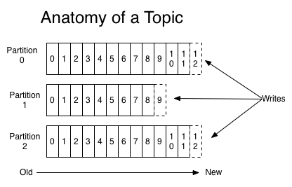
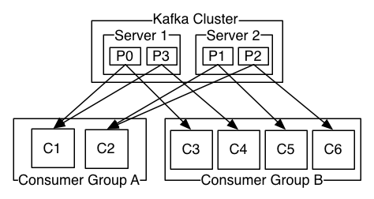
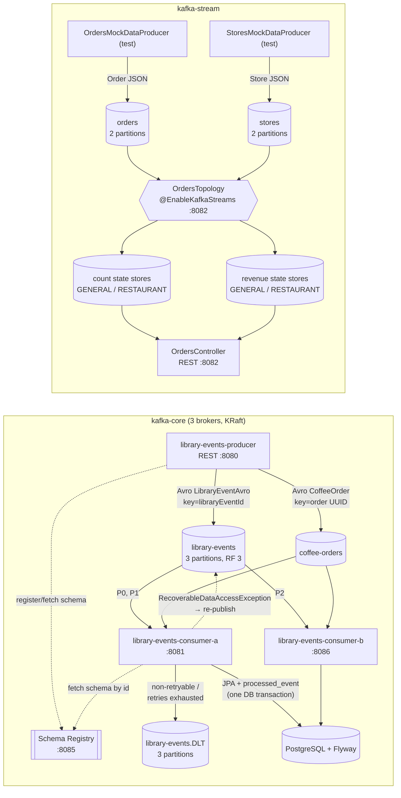
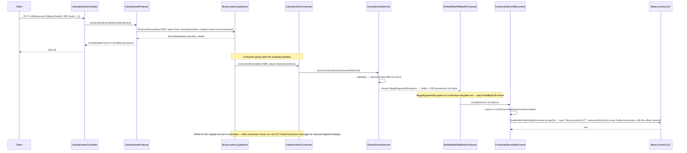

# <span style="color:hsl(339,80%,58%)">Learning Kafka</span>


## <span style="color:hsl(117,80%,58%)">Table of contents</span>

1. 🏗️ [Project Structure](#project-structure)
2. 📨 [Part 1 — Core Kafka Concepts](#part-1--core-kafka-concepts-grounded-in-this-codebase)
3. 📨 [Part 2 — Component & Message-Flow Diagrams](#part-2--component--message-flow-diagrams)
4. 🧰 [Tech Stack](#tech-stack)
5. 🏗️ [Gang of Four Design Patterns Applied](#gang-of-four-design-patterns-applied)
6. 🚀 [Quick Start](#quick-start)
7. 🌐 [API Reference — Library Events Producer](#api-reference--library-events-producer-port-8080)
8. 📈 [Observability](#observability)
9. 🧪 [Running Tests](#running-tests)
10. 🏗️ [Module Details](#module-details)

A multi-module Maven project demonstrating Apache Kafka with Spring Boot 4.1, Java 27, Confluent Schema Registry, and Kafka Streams. Unlike a toy "hello world," each module wires up the pieces you actually need in production: retryable consumers with dead-letter routing, Avro schema evolution against a real Schema Registry, and a stateful Kafka Streams topology with interactive queries.

This document is a **conceptual deep-dive** — it explains *why* Kafka is shaped the way it is, and then shows exactly where in this codebase each concept is implemented. For step-by-step run instructions specific to one module, see the per-module READMEs linked throughout.

---

<a id="project-structure"></a>
## <span style="color:hsl(254,80%,58%)">1. 🏗️ Project Structure</span>

```
learning-kafka/                       ← root POM (spring-boot-starter-parent)
├── kafka-core/                       ← Avro + Schema Registry on a 3-broker KRaft cluster (README: kafka-core/README.md)
│   ├── schemas/                      ← Avro .avsc definitions + code generation (LibraryEvent, CoffeeOrder, ...)
│   ├── library-events-producer/      ← REST API → Kafka: library events + coffee orders, VIP partitioner, zstd (port 8080)
│   ├── library-events-consumer-a/    ← Kafka → PostgreSQL, transactional + idempotent, retry topics, share group, replay (port 8081)
│   ├── library-events-consumer-b/    ← same code as a, same groups, KIP-848 group protocol (port 8086)
│   └── connect/                      ← Kafka Connect JDBC sink → PostgreSQL "events" + reconciliation SQL
└── kafka-stream/                     ← Kafka Streams (README: kafka-stream/README.md)
    ├── orders-domain/                ← shared domain records (library JAR)
    └── orders-streams-app/           ← order count & revenue topology (port 8082)
```

---

<a id="part-1--core-kafka-concepts-grounded-in-this-codebase"></a>
## <span style="color:hsl(32,80%,58%)">2. 📨 Part 1 — Core Kafka Concepts, Grounded in This Codebase</span>

Kafka is a distributed, append-only, partitioned commit log. Everything else — topics, consumer groups, delivery guarantees, Streams, Schema Registry — is built on top of that one idea. The sections below explain the core vocabulary and immediately point at the line of code in this repository that exercises it.

### <span style="color:hsl(169,80%,58%)">Topics and partitions</span>

A **topic** is a named, ordered, immutable log of records. Kafka splits a topic into **partitions** so it can be written to and read from in parallel across brokers. Every record appended to a partition gets a monotonically increasing **offset** — its position in that partition's log. Ordering is only guaranteed *within* a partition, never across partitions of the same topic.

<p align="center">
  
</p>

<p align="center"><sub>Each partition is an append-only log; offsets grow left to right. Diagram: <a href="https://kafka.apache.org/documentation/#intro_concepts_and_terms">Apache Kafka documentation</a>, Apache-2.0.</sub></p>

This repo creates its topics programmatically with Spring Kafka's [`TopicBuilder`][TopicBuilder], rather than relying on broker auto-create, so partition counts are explicit and version-controlled:

| Topic                | Partitions     | Declared in                                                                      |
|----------------------|----------------|----------------------------------------------------------------------------------|
| `library-events`     | 3              | `kafka-core/library-events-producer/.../config/AutoCreateConfig.java`            |
| `library-events.DLT` | 3              | `kafka-core/library-events-consumer-a/.../config/LibraryEventsConsumerConfig.java` |
| `orders`             | 2              | `kafka-stream/orders-streams-app/.../config/OrdersStreamsConfiguration.java`     |
| `stores`             | 2              | `kafka-stream/orders-streams-app/.../config/OrdersStreamsConfiguration.java`     |
| `coffee-orders`      | broker default | created implicitly on first produce by `CoffeeOrdersProducer` (in `library-events-producer`) |

The **key** a producer assigns to a record determines which partition it lands on (`hash(key) % numPartitions`, by default). `LibraryEventProducer` keys every record by `libraryEventId` (an [`Integer`][Integer]); `OrdersTopology` re-keys the incoming order stream by `locationId` via `.selectKey((key, order) -> order.locationId())` specifically so that all orders for the same store land on the same partition — which is what makes per-store aggregation with a local state store possible (see Part 4).

With the kafka-core docker compose (3 brokers), the one-shot `kafka-init` container creates `library-events` and `library-events.DLT` first, with ***replication factor 3*** and `min.insync.replicas=2`, so each partition has a leader and two followers spread across the brokers.

### <span style="color:hsl(307,80%,58%)">Offsets and consumer position</span>

Kafka does not track "read" vs "unread" the way a queue does. Instead, each **consumer group** tracks a *committed offset* per partition — the position it will resume from after a restart or rebalance. The broker's `__consumer_offsets` internal topic stores this.

<ul>

- `library-events-consumer-a` / `-b` commit offsets ***inside a Kafka transaction***: Kafka's own `enable.auto.commit` is off, and the listener container sends each consumed offset with `sendOffsetsToTransaction` after the listener returns, atomically with anything the record caused to be published (DLT, re-publish). A record that throws rolls the transaction back and is retried or recovered by the `AfterRollbackProcessor`.
- `LibraryEventsConsumerManualOffset` (active only under the `manual-offset` profile, which switches the default listener off) demonstrates the alternative: [`AcknowledgingMessageListener`][AcknowledgingMessageListener] with `MANUAL_IMMEDIATE` ack mode, where the application explicitly calls `acknowledgment.acknowledge()` after it has finished processing. This is the safer pattern when "processed" and "committed" must not drift apart (e.g., commit only after a DB write succeeds).

</ul>

`auto-offset-reset: earliest` is set on the kafka-core consumers and the streams app, meaning a *brand new* consumer group with no committed offset starts from the beginning of the topic rather than only seeing new records.

### <span style="color:hsl(84,80%,58%)">Consumer groups and parallelism</span>

A **consumer group** is a set of consumer instances that cooperatively read a topic — Kafka guarantees each partition is assigned to at most one consumer *within* the group at a time, so work is load-balanced without any two group members processing the same partition simultaneously. Add more consumers than partitions and the extras sit idle; that's why partition count is the real upper bound on consumer parallelism.

<p align="center">
  
</p>

<p align="center"><sub>Every group gets all partitions; inside a group each partition goes to exactly one consumer. Diagram: <a href="https://kafka.apache.org/documentation/#intro_concepts_and_terms">Apache Kafka documentation</a>, Apache-2.0.</sub></p>

kafka-core shows group membership across ***two separate apps***: `library-events-consumer-a` and `library-events-consumer-b` share `library-events-listener-group` (and `coffee-orders-listener-group`), each with one listener thread (`spring.kafka.listener.concurrency: 1`). The group coordinator splits the 3 partitions between them — e.g. a gets P0+P1, b gets P2 — and gives all three to the survivor if one app stops. Raising `concurrency` adds listener threads inside one JVM instead; either way, partition count caps the useful parallelism.

### <span style="color:hsl(222,80%,58%)">Delivery semantics: at-least-once, at-most-once, exactly-once</span>

| Semantic           | Guarantee                               | Cost                                                                                            |
|--------------------|-----------------------------------------|-------------------------------------------------------------------------------------------------|
| At-most-once       | Each record delivered zero or one times | Commit offset *before* processing — a crash mid-processing loses the record                     |
| At-least-once      | Each record delivered one or more times | Commit offset *after* processing — a crash before commit causes redelivery (must be idempotent) |
| Exactly-once (EOS) | Each record has effect exactly once     | Requires idempotent producer + transactions across the read-process-write cycle                 |

What this codebase guarantees:

<ul>

- `library-events-producer` sets `acks: all` (wait for all in-sync replicas) with `enable.idempotence: true` and `retries: 10` — *producer-side* sends are idempotent (no duplicate writes from producer retries) and durable.
- `library-events-consumer-a` / `-b` use ***Kafka transactions*** (offset + DLT/re-publish commit atomically) plus an ***idempotent consumer***: the `processed_event` table in PostgreSQL records `(group, topic, partition, offset)` in the same database transaction as the business write. Delivery is still at-least-once (a crash between the DB commit and the Kafka commit redelivers the record), but the redelivery is skipped, so each record changes the database ***effectively exactly once***. Details: [`kafka-core/README.md`](kafka-core/README.md) §11–§15.
- Kafka Streams uses `processing.guarantee=at_least_once` by default (not overridden anywhere in `OrdersStreamsConfiguration`), so the count/revenue aggregations can, in rare failure-and-reprocessing scenarios, double-count a record. Enabling exactly-once semantics for the streams app would mean setting `processing.guarantee=exactly_once_v2`, which turns on transactional writes to the state-store changelog topics and the output topics together.

</ul>

### <span style="color:hsl(359,80%,58%)">Retention, compaction, and the internal topics you don't see</span>

Kafka retains records for a configured time/size window (topic retention), independent of whether they've been consumed — this is what lets Kafka Streams *replay* a topic from the beginning to rebuild a KTable on startup (see Part 4). Internal topics like `__consumer_offsets` and the Kafka Streams changelog topics (e.g. `<application-id>-<store-name>-changelog`) use **log compaction** instead of time-based retention: only the latest value per key is kept forever, because they represent current state, not an event history.

---

<a id="part-2--component--message-flow-diagrams"></a>
## <span style="color:hsl(137,80%,58%)">3. 📨 Part 2 — Component & Message-Flow Diagrams</span>

### <span style="color:hsl(274,80%,58%)">2.1 System component diagram</span>



### <span style="color:hsl(52,80%,50%)">2.2 Sequence diagram — library event publish, consume, and the retry/DLT path</span>

This traces one representative failure scenario end-to-end: a `PUT /v1/libraryevent` update whose `libraryEventId` doesn't exist in the consumer's database, which the consumer code deliberately treats as **non-retryable** and routes straight to the dead-letter topic (`LibraryEventsService.validate()` throws [`IllegalArgumentException`][IllegalArgumentException], which `LibraryEventsConsumerConfig.afterRollbackProcessor()` has registered via `addNotRetryableExceptions(IllegalArgumentException.class)`). The listener runs inside a Kafka transaction, so the failure first rolls that transaction back.



A second path exists for **recoverable** failures ([`RecoverableDataAccessException`][RecoverableDataAccessException], e.g. a transient DB outage): instead of routing to the DLT, `LibraryEventsConsumerConfig.recoverer()` calls `LibraryEventsService.handleRecovery()`, which re-publishes the same key/value back onto `library-events` for another pass through the whole pipeline. See `kafka-core/README.md` for the full retry/backoff timeline.

---

<a id="tech-stack"></a>
## <span style="color:hsl(189,80%,58%)">4. 🧰 Tech Stack</span>

| Concern       | Technology                                                                      |
|---------------|---------------------------------------------------------------------------------|
| Language      | Java 27 with virtual threads (Project Loom)                                     |
| Framework     | Spring Boot 4.1.1 / Spring Kafka 4.1.1 (via super-pom 1.2.0, as of 2026)          |
| Messaging     | Apache Kafka 4.2 clients, Confluent Platform 8.3.2 broker — KRaft only (ZooKeeper removed in Kafka 4) |
| Schema        | Confluent Schema Registry 8.3.2 + Apache Avro 1.12.2                            |
| Streams       | Kafka Streams (via Spring Kafka)                                                |
| Persistence   | Spring Data JPA + PostgreSQL, schema by Flyway                                  |
| Logging       | Logback (`logback-spring.xml`: console + rolling file)                          |
| Observability | Spring Actuator + Micrometer + Prometheus + Grafana                             |
| API Docs      | springdoc-openapi (Swagger UI at `/swagger-ui.html`)                            |
| Testing       | JUnit 6, Mockito, Awaitility, Spring Kafka Test (EmbeddedKafka), Testcontainers 2 |
| Build         | Maven 3.9 (multi-module)                                                        |
| UI            | Kafdrop (topic browser)                                                         |

---

<a id="gang-of-four-design-patterns-applied"></a>
## <span style="color:hsl(327,80%,58%)">5. 🏗️ Gang of Four Design Patterns Applied</span>

### <span style="color:hsl(104,80%,58%)">Creational</span>
| Pattern            | Where                                                                                                                                                            |
|--------------------|------------------------------------------------------------------------------------------------------------------------------------------------------------------|
| **Factory Method** | [`@Bean`][Bean] methods in `LibraryEventsConsumerConfig`, `AutoCreateConfig`, `OrdersStreamsConfiguration` — Spring's IoC container is the concrete factory      |
| **Builder**        | `Book`, `LibraryEvent` records use Lombok [`@Builder`][Builder]; [`ProducerRecord`][ProducerRecord] construction in `LibraryEventProducer.buildProducerRecord()` |

### <span style="color:hsl(242,80%,58%)">Structural</span>
| Pattern       | Where                                                                                                                                                                                              |
|---------------|----------------------------------------------------------------------------------------------------------------------------------------------------------------------------------------------------|
| **Decorator** | [`StreamsBuilderFactoryBeanConfigurer`][StreamsBuilderFactoryBeanConfigurer] wraps the default [`StreamsBuilderFactoryBean`][StreamsBuilderFactoryBean] to add a custom uncaught exception handler |

### <span style="color:hsl(19,80%,58%)">Behavioural</span>
| Pattern             | Where                                                                                                                                                                                                                                                                                                                                                                                                                                                                               |
|---------------------|-------------------------------------------------------------------------------------------------------------------------------------------------------------------------------------------------------------------------------------------------------------------------------------------------------------------------------------------------------------------------------------------------------------------------------------------------------------------------------------|
| **Strategy**        | [`ConsumerRecordRecoverer`][ConsumerRecordRecoverer] in `LibraryEventsConsumerConfig.recoverer()` — swappable recovery (re-publish vs log-and-discard). `OrdersStreamsConfiguration` uses a log-and-skip deserialization recoverer whose exception-response strategy (`REPLACE_THREAD` vs `SHUTDOWN_APPLICATION`) is chosen per exception type in `StreamsProcessorCustomErrorHandler`. `OrderStoreService.countStoreName/revenueStoreName` selects the state store per order type. |
| **Template Method** | `LibraryEventsService.processLibraryEvent()` defines the algorithm skeleton; `save()` and `validate()` are the concrete steps dispatched by event type via a switch expression. `OrdersTopology.aggregateOrdersCountAndRevenue()` is the reusable skeleton for both GENERAL and RESTAURANT branches.                                                                                                                                                                                |
| **Observer**        | `LibraryEventsConsumer` annotated with [`@KafkaListener`][KafkaListener] — Spring Kafka registers it as an observer that reacts to each Kafka record                                                                                                                                                                                                                                                                                                                                |

---

<a id="quick-start"></a>
## <span style="color:hsl(157,80%,58%)">6. 🚀 Quick Start</span>

### <span style="color:hsl(294,80%,58%)">1. Start the infrastructure</span>

```bash
docker compose up -d
```

For kafka-core's 3-broker cluster with Schema Registry, PostgreSQL and topic setup, use its own compose instead: `cd kafka-core && docker compose up -d` (Kafka on 9092–9094, Kafka Connect on 8083, Kafdrop on 9001, PostgreSQL on 5435 — see [`kafka-core/README.md`](kafka-core/README.md)). The kafka-core consumers need that PostgreSQL. Don't run both stacks at once; both bind 9092 and 8085.

| Service               | URL                                   |
|-----------------------|---------------------------------------|
| Kafka (KRaft)         | localhost:9092                        |
| Schema Registry       | http://localhost:8085                 |
| Kafdrop (Kafka UI)    | http://localhost:9000                 |
| Prometheus            | http://localhost:9091                 |
| Grafana               | http://localhost:3001 (admin/admin)   |
| Swagger UI (producer) | http://localhost:8080/swagger-ui.html |

### <span style="color:hsl(72,80%,58%)">2. Build all modules</span>

```bash
mvn clean install -DskipTests
```

### <span style="color:hsl(209,80%,58%)">3. Run the applications</span>

```bash
# Terminal 1 — Producer
mvn spring-boot:run -pl kafka-core/library-events-producer

# Terminals 2 and 3 — two consumers in the same group (they split the partitions)
mvn spring-boot:run -pl kafka-core/library-events-consumer-a
mvn spring-boot:run -pl kafka-core/library-events-consumer-b

# Terminal 3 — Streams
mvn spring-boot:run -pl kafka-stream/orders-streams-app
```

---

<a id="api-reference--library-events-producer-port-8080"></a>
## <span style="color:hsl(347,80%,58%)">7. 🌐 API Reference — Library Events Producer (port 8080)</span>

### <span style="color:hsl(124,80%,58%)">POST /v1/libraryevent — Publish a new library event</span>

```json
POST http://localhost:8080/v1/libraryevent
Content-Type: application/json

{
  "libraryEventId": null,
  "book": {
    "bookId": 456,
    "bookName": "Kafka Using Spring Boot",
    "bookAuthor": "Dilip"
  }
}
```

Response `201 Created`:
```json
{
  "libraryEventId": null,
  "libraryEventType": "NEW",
  "book": { "bookId": 456, "bookName": "Kafka Using Spring Boot", "bookAuthor": "Dilip" }
}
```

### <span style="color:hsl(262,80%,58%)">PUT /v1/libraryevent — Update an existing library event</span>

```json
PUT http://localhost:8080/v1/libraryevent
Content-Type: application/json

{
  "libraryEventId": 1,
  "book": {
    "bookId": 456,
    "bookName": "Kafka Using Spring Boot 3.x",
    "bookAuthor": "Dilip"
  }
}
```

Response `200 OK`.

---

<a id="observability"></a>
## <span style="color:hsl(39,80%,58%)">8. 📈 Observability</span>

All modules expose Actuator endpoints:

| Endpoint               | Description                      |
|------------------------|----------------------------------|
| `/actuator/health`     | Liveness and readiness           |
| `/actuator/prometheus` | Prometheus metrics scrape target |
| `/actuator/info`       | Application metadata             |

Import `insomnia-collection.json` into Insomnia to test all endpoints including actuator.

---

<a id="running-tests"></a>
## <span style="color:hsl(177,80%,58%)">9. 🧪 Running Tests</span>

```bash
# Unit + integration tests (all modules)
mvn test

# Only kafka-core tests (schemas, producer, consumer-a, consumer-b)
cd kafka-core && mvn test
```

Most Kafka integration tests use [`@EmbeddedKafka`][EmbeddedKafka] and Confluent's in-memory `mock://` Schema Registry. The kafka-core consumer tests need Docker: they run against a real PostgreSQL via Testcontainers, and `LibraryEventsConsumerContainerTest` also uses a real `cp-kafka:8.3.2` broker ([`ConfluentKafkaContainer`][ConfluentKafkaContainer]).

---

<a id="module-details"></a>
## <span style="color:hsl(314,80%,58%)">10. 🏗️ Module Details</span>

### <span style="color:hsl(92,80%,58%)">kafka-core/library-events-producer</span>

<ul>

- REST endpoints: `POST /v1/libraryevent`, `PUT /v1/libraryevent`, `POST /v1/coffee-orders`
- Custom `CoffeeVipPartitioner` (VIP customers → partition 0) on the coffee template only; `zstd` compression
- Publishes Avro via Confluent [`KafkaAvroSerializer`][KafkaAvroSerializer]; schemas registered automatically to `http://localhost:8085`
- Kafka producer with async [`CompletableFuture`][CompletableFuture]-based send; idempotent (`acks=all`)
- Custom headers per record (`event-source: scanner`)
- [`@ControllerAdvice`][ControllerAdvice] for validation error mapping
- Deep dive: [`kafka-core/README.md`](kafka-core/README.md)

</ul>

### <span style="color:hsl(229,80%,58%)">kafka-core/library-events-consumer-a and -b</span>

<ul>

- Same code, two apps (ports 8081 / 8086) in the same consumer groups — Kafka splits the partitions between them
- [`@KafkaListener`][KafkaListener]s on `library-events` and `coffee-orders`; Confluent [`KafkaAvroDeserializer`][KafkaAvroDeserializer] (wrapped in `ErrorHandlingDeserializer`) with `specific.avro.reader=true`
- Persists `LibraryEvent` + `Book` entities to PostgreSQL via Spring Data JPA; schema owned by Flyway migrations
- Kafka transactions + idempotent consumer (`processed_event` table) — effectively exactly-once into the database
- Publishes the latest state per id to the compacted topic `library-book-state` inside the Kafka transaction
- Coffee orders: non-blocking retry topics (`@RetryableTopic` → `coffee-orders-retry-0/1/2` → `coffee-orders-dlt`) and a share group (`coffee-baristas`, KIP-932) on the same topic
- consumer-b uses the KIP-848 group protocol in the same groups as classic consumer-a; replay API (`/v1/library-events/replay`) seeks owned partitions back
- `DefaultAfterRollbackProcessor` with [`FixedBackOff`][FixedBackOff] (1 s delay, 2 retries — 3 attempts total); [`IllegalArgumentException`][IllegalArgumentException] and undeserializable records go straight to `library-events.DLT`; [`RecoverableDataAccessException`][RecoverableDataAccessException] triggers recovery by re-publishing the event
- Deep dive: [`kafka-core/README.md`](kafka-core/README.md)

</ul>

### <span style="color:hsl(7,80%,58%)">kafka-stream/orders-streams-app</span>

<ul>

- [`@EnableKafkaStreams`][EnableKafkaStreams] Spring Boot integration
- `OrdersTopology` builds the Kafka Streams topology: re-key by `locationId`, branch orders by type (`GENERAL` / `RESTAURANT`), aggregate per-store count and running revenue into materialized state stores
- Custom deserialization ([`RecoveringDeserializationExceptionHandler`][RecoveringDeserializationExceptionHandler] + log-and-skip) and serialization (`StreamsSerializationExceptionHandler`) exception handlers, plus a custom [`StreamsUncaughtExceptionHandler`][StreamsUncaughtExceptionHandler] that decides between replacing the stream thread and shutting the app down
- `OrdersController` / `OrderStoreService` expose the state stores as a queryable REST API (interactive queries)
- Deep dive: [`kafka-stream/README.md`](kafka-stream/README.md)

</ul>

### <span style="color:hsl(144,80%,58%)">kafka-core/schemas</span>

<ul>

- Avro `.avsc` schema definitions for `LibraryEvent` (generated as `LibraryEventAvro`), `CoffeeOrder`, `OrderLineItem`, `Store`, `Address`, `OrderId`, `CoffeeUpdateEvent`
- `avro-maven-plugin` generates Java classes into `target/generated-sources/avro` at build time
- Deep dive (schema evolution, compatibility modes, logical types): [`kafka-core/README.md`](kafka-core/README.md)

</ul>

<!-- Library classes mentioned above, linked to their source at the versions this project builds with. -->

[AcknowledgingMessageListener]: https://github.com/spring-projects/spring-kafka/blob/v4.1.1/spring-kafka/src/main/java/org/springframework/kafka/listener/AcknowledgingMessageListener.java
[Bean]: https://github.com/spring-projects/spring-framework/blob/v7.0.9/spring-context/src/main/java/org/springframework/context/annotation/Bean.java
[Builder]: https://github.com/projectlombok/lombok/blob/v1.18.48/src/core/lombok/Builder.java
[CompletableFuture]: https://github.com/openjdk/jdk/blob/jdk-27-ga/src/java.base/share/classes/java/util/concurrent/CompletableFuture.java
[ConfluentKafkaContainer]: https://github.com/testcontainers/testcontainers-java/blob/2.0.5/modules/kafka/src/main/java/org/testcontainers/kafka/ConfluentKafkaContainer.java
[ConsumerRecordRecoverer]: https://github.com/spring-projects/spring-kafka/blob/v4.1.1/spring-kafka/src/main/java/org/springframework/kafka/listener/ConsumerRecordRecoverer.java
[ControllerAdvice]: https://github.com/spring-projects/spring-framework/blob/v7.0.9/spring-web/src/main/java/org/springframework/web/bind/annotation/ControllerAdvice.java
[EmbeddedKafka]: https://github.com/spring-projects/spring-kafka/blob/v4.1.1/spring-kafka-test/src/main/java/org/springframework/kafka/test/context/EmbeddedKafka.java
[EnableKafkaStreams]: https://github.com/spring-projects/spring-kafka/blob/v4.1.1/spring-kafka/src/main/java/org/springframework/kafka/annotation/EnableKafkaStreams.java
[FixedBackOff]: https://github.com/spring-projects/spring-framework/blob/v7.0.9/spring-core/src/main/java/org/springframework/util/backoff/FixedBackOff.java
[IllegalArgumentException]: https://github.com/openjdk/jdk/blob/jdk-27-ga/src/java.base/share/classes/java/lang/IllegalArgumentException.java
[Integer]: https://github.com/openjdk/jdk/blob/jdk-27-ga/src/java.base/share/classes/java/lang/Integer.java
[KafkaAvroDeserializer]: https://github.com/confluentinc/schema-registry/blob/v8.3.2/avro-serializer/src/main/java/io/confluent/kafka/serializers/KafkaAvroDeserializer.java
[KafkaAvroSerializer]: https://github.com/confluentinc/schema-registry/blob/v8.3.2/avro-serializer/src/main/java/io/confluent/kafka/serializers/KafkaAvroSerializer.java
[KafkaListener]: https://github.com/spring-projects/spring-kafka/blob/v4.1.1/spring-kafka/src/main/java/org/springframework/kafka/annotation/KafkaListener.java
[ProducerRecord]: https://github.com/apache/kafka/blob/4.2.1/clients/src/main/java/org/apache/kafka/clients/producer/ProducerRecord.java
[RecoverableDataAccessException]: https://github.com/spring-projects/spring-framework/blob/v7.0.9/spring-tx/src/main/java/org/springframework/dao/RecoverableDataAccessException.java
[RecoveringDeserializationExceptionHandler]: https://github.com/spring-projects/spring-kafka/blob/v4.1.1/spring-kafka/src/main/java/org/springframework/kafka/streams/RecoveringDeserializationExceptionHandler.java
[StreamsBuilderFactoryBean]: https://github.com/spring-projects/spring-kafka/blob/v4.1.1/spring-kafka/src/main/java/org/springframework/kafka/config/StreamsBuilderFactoryBean.java
[StreamsBuilderFactoryBeanConfigurer]: https://github.com/spring-projects/spring-kafka/blob/v4.1.1/spring-kafka/src/main/java/org/springframework/kafka/config/StreamsBuilderFactoryBeanConfigurer.java
[StreamsUncaughtExceptionHandler]: https://github.com/apache/kafka/blob/4.2.1/streams/src/main/java/org/apache/kafka/streams/errors/StreamsUncaughtExceptionHandler.java
[TopicBuilder]: https://github.com/spring-projects/spring-kafka/blob/v4.1.1/spring-kafka/src/main/java/org/springframework/kafka/config/TopicBuilder.java
