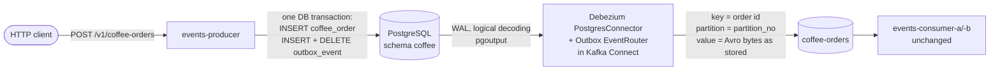

# Coffee orders: transactional outbox with Debezium

Status: design approved 2026-10-15 — spec for review.
Scope: `kafka-core/events-producer`, `kafka-core/docker-compose.yml`, `kafka-core/connect/`, READMEs. Consumers are unchanged.

## 1. What the user asked for

- Use the ***outbox pattern*** on the producer side of `kafka-core`.
- Chosen scope: ***coffee orders, full pattern*** — the producer stores the order and the event in one database transaction, and something else publishes the event.
- Chosen relay: ***Debezium*** (change data capture from the PostgreSQL write-ahead log), not an in-app polling job.

## 2. Today

`POST /v1/coffee-orders` builds a `CoffeeOrder` (Avro) and sends it straight to `coffee-orders` through its own `KafkaTemplate` with `CoffeeVipPartitioner` (VIP customers → partition 0, everyone else hashed over partitions 1..n-1). The producer has no database. If Kafka is down the order is lost after the HTTP 201; if the app crashes between "decide" and "send" nothing records that the order existed.

## 3. Design

### 3.1 Flow



### 3.2 Database (producer-owned schema `coffee`, Flyway)

Same PostgreSQL instance and database (`library`) as the consumers, separate schema and Flyway history, so the producer owns its tables.

```sql
CREATE TABLE coffee_order (
    id           UUID         PRIMARY KEY,
    name         VARCHAR(255) NOT NULL,
    nick_name    VARCHAR(255) NOT NULL,
    store_id     INTEGER      NOT NULL,
    status       VARCHAR(32)  NOT NULL,
    pick_up      VARCHAR(32)  NOT NULL,
    ordered_time TIMESTAMPTZ  NOT NULL
);

CREATE TABLE outbox_event (
    id             UUID         PRIMARY KEY,   -- metadata.eventId; Debezium adds it as header "id"
    aggregatetype  VARCHAR(255) NOT NULL,      -- routes the event: "coffee-orders" = topic name
    aggregateid    VARCHAR(255) NOT NULL,      -- Kafka record key: the order id
    type           VARCHAR(255) NOT NULL,      -- "CoffeeOrder.PLACED" → header event-type
    payload        BYTEA        NOT NULL,      -- Confluent Avro wire format (magic byte + schema id + Avro binary)
    partition_no   INTEGER      NOT NULL,      -- Kafka partition chosen by the VIP rule
    correlation_id VARCHAR(255),               -- header correlation-id (from X-Correlation-Id), nullable
    created_at     TIMESTAMPTZ  NOT NULL DEFAULT now()
);
```

Column names `id`, `aggregatetype`, `aggregateid`, `payload` are the Event Router's defaults.

### 3.3 Producer code (`com.learnkafka.coffee`)

| Class | Role |
|---|---|
| `CoffeeOrdersController` | `POST /v1/coffee-orders` (same request, response and `X-Correlation-Id` handling as today); replaces `CoffeeOrdersProducer` |
| `CoffeeOrderService` | `@Transactional`: builds the `CoffeeOrder` (as today), inserts the order, writes the outbox event |
| `CoffeeOrderRepository` | `INSERT` into `coffee_order` (`JdbcClient`) |
| `OutboxRepository` | `INSERT` then `DELETE` of one `outbox_event` row, in the caller's transaction |
| `CoffeeOrderPayloadSerializer` | `KafkaAvroSerializer` for topic `coffee-orders`: the same bytes the app sends today (schema registered or looked up in Schema Registry) |
| `VipPartitionRule` | the VIP rule as a plain function `(name, key, partitions) → partition`; replaces `CoffeeVipPartitioner` (the Kafka `Partitioner`), which nothing would call any more |

- The coffee `KafkaTemplate` is removed: the app no longer talks to Kafka for coffee orders. Library events and key routing are untouched.
- ***Delete in the same transaction*** — the row is inserted and deleted before commit. Debezium reads both changes from the WAL; the Event Router turns the INSERT into the Kafka record and drops the DELETE. The outbox table stays empty, so it needs no cleanup and a connector snapshot never re-sends old events.
- ***Partition count*** — `app.coffee.partitions: 3` (the VIP rule needs it: non-VIP orders hash over 1..n-1). At startup the app compares it with the topic (Admin client, short timeout): fewer partitions on the topic than configured → fail fast (Debezium would be told to write to a partition that doesn't exist); more → warning; Kafka unreachable → warning, start anyway (the point of the outbox is not to depend on Kafka at write time).
- ***Schema Registry is still needed at write time*** (first use of the schema; cached after). Documented as the remaining dependency; storing schema-less Avro instead would force changes on every consumer.

### 3.4 Kafka Connect

- ***Plugin*** — Debezium PostgreSQL connector ***3.7.0.Final*** (current, Maven Central). Confluent Hub only has 3.2.6 and the Connect image has no `curl`, so a one-shot init service (curl image) downloads `debezium-connector-postgres-3.7.0.Final-plugin.tar.gz` once into a named volume that the Connect worker mounts on its plugin path. One Connect worker keeps running both connectors (the existing JDBC sink and the new source).
- ***PostgreSQL*** — `wal_level=logical`. The `library` user is a superuser in the official image, so it may replicate and create the publication.
- ***Connector*** `coffee-outbox` (`connect/coffee-outbox-debezium.json`, registered by `kafka-connect-init` next to the JDBC sink):

```json
{
  "connector.class": "io.debezium.connector.postgresql.PostgresConnector",
  "tasks.max": "1",
  "database.hostname": "postgres",
  "database.port": "5432",
  "database.user": "library",
  "database.password": "library",
  "database.dbname": "library",
  "topic.prefix": "coffee-outbox",
  "plugin.name": "pgoutput",
  "slot.name": "coffee_outbox_slot",
  "publication.name": "coffee_outbox_publication",
  "publication.autocreate.mode": "filtered",
  "table.include.list": "coffee.outbox_event",
  "snapshot.mode": "no_data",
  "tombstones.on.delete": "false",
  "heartbeat.interval.ms": "10000",
  "key.converter": "org.apache.kafka.connect.storage.StringConverter",
  "value.converter": "io.debezium.converters.BinaryDataConverter",
  "value.converter.delegate.converter.type": "org.apache.kafka.connect.json.JsonConverter",
  "value.converter.delegate.converter.type.schemas.enable": "false",
  "transforms": "outbox",
  "transforms.outbox.type": "io.debezium.transforms.outbox.EventRouter",
  "transforms.outbox.route.by.field": "aggregatetype",
  "transforms.outbox.route.topic.replacement": "${routedByValue}",
  "transforms.outbox.table.field.event.key": "aggregateid",
  "transforms.outbox.table.fields.additional.placement": "type:header:event-type,correlation_id:header:correlation-id,partition_no:partition"
}
```

  - `BinaryDataConverter` writes the `payload` bytes unchanged → consumers' `KafkaAvroDeserializer` reads them exactly as today. Its JSON delegate only serves heartbeat records.
  - `heartbeat.interval.ms` keeps the replication slot's confirmed position moving while only other tables change, so PostgreSQL can recycle WAL.
  - Option names (`snapshot.mode=no_data`, the `partition` placement) are re-checked against the 3.7 docs and a live run during implementation.
- ***Topic*** — `kafka-init` creates `coffee-orders` (3 partitions, RF 3) so it exists with enough partitions before Debezium writes `partition_no`.

### 3.5 Delivery semantics

- ***Atomic*** — order and event commit together or not at all.
- ***At-least-once to Kafka*** — after a Connect crash the connector resumes from its stored WAL position and can resend events. The coffee consumers only log, so duplicates are harmless; the README states this.
- ***Order*** — WAL order per partition; one connector task.

### 3.6 Consumers

Unchanged: same topic, same key type (String order id), same Avro bytes. New record headers `id`, `event-type`, `correlation-id` are available but not required.

## 4. Testing

- ***Unit*** — `VipPartitionRule` (the old partitioner cases: VIP → 0, non-VIP never 0, same key → same partition, 1 partition → 0); `CoffeeOrdersController` (201 with the order and metadata, 400 on a blank name).
- ***Integration*** — `CoffeeOutboxIntegrationTest`: Spring Boot + Testcontainers PostgreSQL started with `wal_level=logical` + mock Schema Registry. Before the request it creates a logical replication slot with the `test_decoding` plugin; after `POST` it reads the slot — exactly what Debezium will see — and asserts:
  1. INSERT into `coffee.coffee_order`;
  2. INSERT into `coffee.outbox_event` with `aggregatetype='coffee-orders'`, `aggregateid` = order id, `type='CoffeeOrder.PLACED'`, `partition_no` 0 for a VIP (`Ada`) and not 0 otherwise, and a `payload` that `KafkaAvroDeserializer` turns back into the same `CoffeeOrder`;
  3. DELETE of that outbox row, all in one transaction; the table is empty afterwards.
  - A failing outbox write rolls the order back (no `coffee_order` row).
- ***Producer test set-up*** — the app now has a datasource, so the producer's Spring Boot tests get a shared Testcontainers PostgreSQL configuration (Docker becomes required for them, as it already is for the consumer tests).
- ***End to end*** (docker compose, run once during implementation and recorded in the README): POST an order for `Ada` and one for `Linus` → both on `coffee-orders` (Ada on partition 0) with headers `id`, `event-type`, `correlation-id` → consumer logs them. Then: stop Kafka Connect, POST another order (201), start Connect → the order arrives.

## 5. Documentation

- `kafka-core/README.md`: new last section "Transactional outbox for coffee orders (Debezium)" (flow, tables, connector config, delete-in-the-same-transaction, slot and WAL notes, how to inspect the slot, at-least-once); §9 producers (coffee section); §22 Kafka Connect (second connector); §25 (VIP rule now applied through `partition_no`); §18 configuration; §19 running (plugin init, `wal_level`, slot clean-up when tearing down); §31 tests.
- Root `README.md`: coffee-orders API note, module details, test counts.
- Insomnia: unchanged requests; descriptions mention the outbox.

## 6. Out of scope

- Outbox for library events or key routing.
- Exactly-once source delivery (Kafka Connect KIP-618).
- Debezium-side Avro conversion (the payload is already Avro).
