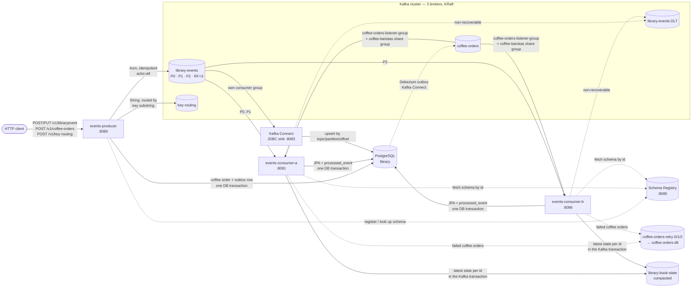

# <span style="color:hsl(92,80%,58%)">kafka-core — Kafka cluster, Schema Registry & platform</span>

## <span style="color:hsl(139,80%,58%)">Table of contents</span>

1. 🧰 [Tech stack](#1-tech-stack)
2. 🏗️ [Architecture](#2-architecture)
3. 🖥️ [The Kafka cluster: 3 brokers, KRaft](#3-the-kafka-cluster-3-brokers-kraft)
4. 🧬 [Why Avro + Schema Registry instead of JSON](#4-why-avro--schema-registry-instead-of-json)
5. 🔄 [Schema evolution and compatibility modes](#5-schema-evolution-and-compatibility-modes)
6. 🗜️ [Compacted topics (log compaction)](#6-compacted-topics-log-compaction)
7. ⚙️ [Ports and docker compose](#7-ports-and-docker-compose)
8. 🚀 [Running](#8-running)
9. 🔍 [Inspecting the cluster and the registry](#9-inspecting-the-cluster-and-the-registry)
10. 🛠️ [Kafka CLI cheat sheet](#10-kafka-cli-cheat-sheet)
11. 🔐 [Security: SASL/SCRAM over TLS on the host listener](#11-security-sasl-scram-over-tls)
12. ❓ [Q&A](#12-q-and-a)
    - ❓ [12.1 Zombie fencing: which brokers do the fencing, and what must the cluster provide?](#12-1-zombie-fencing-broker-side)
    - ❓ [12.2 🔥 You stop one broker, then a second. What still works?](#12-2-you-stop-one-broker-then-a-second-what-still-works)
    - ❓ [12.3 Why do apps on the host use `localhost:9092`, while containers use `kafka-1:29092`?](#12-3-why-do-apps-on-the-host-use-localhost-9092-while)
    - ❓ [12.4 🔥 A new required field was added to `LibraryEvent.avsc`, and the producer's first send fails with `409`. Why — and what's the deploy order for a legal change?](#12-4-a-new-required-field-was-added-to-libraryevent-avsc-and)
    - ❓ [12.5 The compacted `library-book-state` topic still shows two values for one key. Is compaction broken?](#12-5-the-compacted-library-book-state-topic-still-shows-two)
    - ❓ [12.6 Every broker here is also a controller. Why not in production?](#12-6-every-broker-here-is-also-a-controller-why-not-in)
    - ❓ [12.7 🔥 Clients must authenticate with SCRAM. Can `events-producer` read the consumers' DLT?](#12-7-clients-must-authenticate-with-scram-can-events)

---

This module runs the ***Kafka platform*** of the repo: a ***3-broker KRaft cluster***, ***Confluent Schema Registry***, ***PostgreSQL***, ***Kafka Connect*** (JDBC sink + Debezium) and ***Kafdrop***, all from one `docker-compose.yml`, with ***SASL/SCRAM over TLS*** on the host listener. This README covers the broker side: cluster, topics, schemas in the registry, compaction, running and inspecting the stack, and security.

On top of it run ***four modules*** — one shared `schemas` module (Avro), ***one producer*** and ***two consumers*** — with two domains:

- ***Library events*** — published by the producer, consumed by ***both consumer apps in one consumer group***, and written to ***PostgreSQL*** (schema managed by ***Flyway***). They use ***Kafka transactions***, an ***idempotent producer***, an ***idempotent consumer***, retries and a ***dead-letter topic***; a ***Kafka Connect*** JDBC sink replicates every record into an `events` table for reconciliation.
- ***Coffee orders*** — the same producer and consumers (own topic, own consumer group), showing richer Avro: nested records, logical types (`uuid`, `timestamp-millis`, `decimal`) and schema evolution. Stored through a ***transactional outbox*** and published by ***Debezium***, with a ***VIP partition rule***, ***non-blocking retry topics*** and a ***share group*** (Kafka's queue semantics).
- ***Also covered*** — a ***key-substring partitioner***, ***zstd compression*** of every batch, a ***compacted*** "latest state" topic written in the consumers' Kafka transaction, the ***KIP-848*** consumer rebalance protocol (consumer-b), and ***replay*** by seeking a partition back.

The applications have their own READMEs:

- [***events-producer***](events-producer/README.md) — REST → `library-events` (Avro), `key-routing`, coffee orders through a transactional outbox; the Avro schemas and base-event metadata; partitioners and compression; producer concepts and Q&A.
- [***events-consumer-a / -b***](events-consumer-a/README.md) — one consumer group over two apps, Kafka transactions, idempotent consumer, retries and DLT, share groups, KIP-848, replay, the Kafka Connect replica; consumer concepts and Q&A.

Start here for the fundamentals: partitions with leaders and followers, replication and in-sync replicas, schema compatibility, compaction, listeners and security. Producer records, consumer groups, offsets and what "exactly-once" can and cannot mean once a database is involved are in the two application READMEs.

For the broader repo architecture and core Kafka vocabulary, see the [root README](../README.md). The Kafka Streams examples live in [`kafka-stream`](../kafka-stream/README.md).

---

<a id="1-tech-stack"></a>
## <span style="color:hsl(230,80%,58%)">1. 🧰 Tech stack</span>

| Piece | Version (as of 2026) | Used for |
|---|---|---|
| Spring Boot | 4.1.2 | all three apps (single default config, no profiles) |
| Spring Kafka | 4.1.2 | `KafkaTemplate`, `@KafkaListener`, transactions |
| Apache Kafka clients | 4.2.2 | producers / consumers |
| Kafka broker | `confluentinc/cp-kafka:8.3.2` (KRaft, no ZooKeeper) | 3-node cluster |
| Schema Registry | `confluentinc/cp-schema-registry:8.3.2` | Avro schemas, compatibility checks |
| Avro + Confluent serializers | Avro 1.12.x, `kafka-avro-serializer` 8.4.1 | `KafkaAvroSerializer` / `KafkaAvroDeserializer` |
| PostgreSQL | `postgres:19beta3` in compose, `postgres:18` in tests | library events + idempotency table |
| Flyway | via `spring-boot-flyway` | schema migrations |
| Hibernate | 7.4.13 | JPA, `ddl-auto: validate` only |
| Testcontainers | Kafka + PostgreSQL | integration tests |
| Kafka Connect | `confluentinc/cp-kafka-connect:8.3.2` + JDBC connector 10.9.9 | `library-events` → PostgreSQL `events` (no code) |
| Logback | via Spring Boot | console + rolling file logs (`logback-spring.xml`) |
| Kafdrop | 4.3.0 | web UI on `localhost:9001`, Avro-aware |
| Prometheus + Grafana | v3.15.0 / 13.2.3 (root compose) | metrics + the provisioned "Learning Kafka" dashboard |

---

<a id="2-architecture"></a>
## <span style="color:hsl(7,80%,58%)">2. 🏗️ Architecture</span>

```
kafka-core/
├── docker-compose.yml           3 Kafka brokers + topic init + Schema Registry + PostgreSQL + Kafka Connect + Kafdrop
├── connect/                     connector configs (JDBC sink, Debezium outbox) + reconciliation SQL
├── schemas/                     Avro .avsc files → generated Java (library JAR, no Spring Boot)
├── events-producer/             REST API (port 8080) → "library-events" (Avro) and "key-routing" (String, key-substring
│                                partitioner), zstd-compressed batches; coffee orders → PostgreSQL outbox, published by Debezium
├── events-consumer-a/           port 8081: library-events → PostgreSQL + compacted "library-book-state",
│                                coffee-orders → consumer group with retry topics + "coffee-baristas" share group, replay API
└── events-consumer-b/           port 8086: same code as a, same groups — but on the KIP-848 group protocol
```



- ***One shared `schemas` module*** — every app depends on it, so producers and consumers use the same generated classes.
- ***One topic per domain, three partitions, three replicas*** — each partition has a leader on one broker and followers on the other two.
- ***Two consumer apps, same consumer groups*** — `library-events-listener-group` for library events and `coffee-orders-listener-group` for coffee orders. The group coordinator splits each topic's partitions between the two apps. If one stops, the other takes them all.
- ***Both library consumers share one database***, including the `processed_event` table, so a record redelivered to the *other* app after a rebalance is still skipped.
- ***Kafka Connect replicates the topic*** into an `events` table in the same database, independently of the apps ([events-consumer §11](events-consumer-a/README.md#11-data-replication-with-kafka-connect-and-reconciliation)).

---

<a id="3-the-kafka-cluster-3-brokers-kraft"></a>
## <span style="color:hsl(145,80%,58%)">3. 🖥️ The Kafka cluster: 3 brokers, KRaft</span>

Kafka has only two node roles, set by `process.roles`: ***`broker`*** and ***`controller`***. Leader and follower are ***not broker types***. They are roles a broker plays *per partition*, so one broker can lead partition 0 and follow partition 1 at the same time.

| Container | Host port | Node id | Roles |
|---|---|---|---|
| `kafka-core-kafka-1` | `9092` | 1 | `broker,controller` |
| `kafka-core-kafka-2` | `9093` | 2 | `broker,controller` |
| `kafka-core-kafka-3` | `9094` | 3 | `broker,controller` |

- ***Controller quorum*** — all 3 nodes are voters (`KAFKA_CONTROLLER_QUORUM_VOTERS`). Raft elects ***one active controller***; the other two are hot standbys. A 3-voter quorum survives ***1*** node down.
- ***Combined mode*** (`broker,controller` on every node) suits a laptop. Production usually runs 3 or 5 *dedicated* controllers separate from the brokers.
- ***Replication defaults*** — `default.replication.factor=3`, `min.insync.replicas=2`, and RF 3 for `__consumer_offsets`, `__transaction_state` and Schema Registry's `_schemas`. With `acks=all`, a write succeeds while at least 2 of the 3 replicas are in sync.

The one-shot `kafka-init` container creates the library topics (`--partitions 3 --replication-factor 3 --config min.insync.replicas=2`) and prints the layout. Output from a real run:

```
Topic: library-events  Partition: 0  Leader: 2  Replicas: 2,3,1  Isr: 2,3,1
Topic: library-events  Partition: 1  Leader: 3  Replicas: 3,1,2  Isr: 3,1,2
Topic: library-events  Partition: 2  Leader: 1  Replicas: 1,2,3  Isr: 1,2,3

LeaderId: 3      ← active controller
CurrentVoters: [1, 2, 3]
```

| Partition | Leader (reads + writes) | Followers (copy from the leader) |
|---|---|---|
| P0 | broker 2 | brokers 3, 1 |
| P1 | broker 3 | brokers 1, 2 |
| P2 | broker 1 | brokers 2, 3 |

- ***Leaders are spread across brokers*** so the load is shared. Which broker leads which partition can differ from run to run.
- ***Clients bootstrap from any broker*** (`localhost:9092` is enough; over `SASL_SSL` — [§11](#11-security-sasl-scram-over-tls)). The metadata response tells them every broker's address (`localhost:9092/9093/9094`), and they talk to each partition's leader directly.
- ***If a broker dies***, the controller elects a new leader for its partitions from the in-sync followers. Try it with `docker stop kafka-core-kafka-2` and describe the topic again ([§9](#9-inspecting-the-cluster-and-the-registry)).
- `coffee-orders` is created by `kafka-init` (3 partitions, RF 3). Debezium writes each coffee event to the partition the producer chose ([events-producer §8](events-producer/README.md#8-transactional-outbox-for-coffee-orders-debezium)), so the topic must exist with enough partitions.

---

<a id="4-why-avro--schema-registry-instead-of-json"></a>
## <span style="color:hsl(60,80%,50%)">4. 🧬 Why Avro + Schema Registry instead of JSON</span>

With plain JSON, the "schema" is only ever the Java class the producer happened to serialize with [`ObjectMapper`][ObjectMapper], and consumers just hope their own copy of that shape still matches. Nothing prevents a producer from renaming a field and shipping — the failure shows up as a deserialization exception (or worse, silently-wrong data) on the consumer side, in production. kafka-core used to work that way for library events; it now uses Avro end to end.

Avro + Schema Registry changes the contract:

1. The **schema** (`.avsc`) is a first-class artifact, checked into version control (`schemas/src/main/avro/*.avsc`) and compiled into generated Java classes by the `avro-maven-plugin`.
2. When a producer serializes a record with [`KafkaAvroSerializer`][KafkaAvroSerializer], the client registers (or looks up) that exact schema in the Schema Registry and prefixes the Avro bytes with a small header — a magic byte and a 4-byte **schema id** — instead of embedding the schema in every message. That keeps messages small.
3. Before the registry accepts a *new* version of a schema for a subject (by default `<topic>-value`), it checks it against the previous version(s) under the subject's **compatibility mode**. An incompatible change is rejected at registration time — at deploy time for the producer — rather than discovered later as a consumer failure.
4. On the consumer side, [`KafkaAvroDeserializer`][KafkaAvroDeserializer] reads the schema id from the message, fetches (and caches) the writer schema from the registry, and reconciles it with the consumer's own reader schema using Avro's schema-resolution rules.

The schemas themselves (`LibraryEvent.avsc`, `EventMetadata.avsc`, the coffee records): [events-producer §2–§4](events-producer/README.md#2-the-library-event-libraryeventavsc).

---

<a id="5-schema-evolution-and-compatibility-modes"></a>
## <span style="color:hsl(335,80%,58%)">5. 🔄 Schema evolution and compatibility modes</span>

Confluent Schema Registry's default compatibility mode for a new subject is **`BACKWARD`**: a new schema version is accepted only if consumers using the *new* schema can still read data written with the *previous* one. Concretely, new fields must have a `default`, and only fields with defaults may be dropped.

The optional fields in these schemas already follow that rule:

| Field            | Schema         | Default | Why it matters |
|------------------|----------------|---------|----------------|
| `libraryEventId` | `LibraryEvent` | `null`  | Optional by design; a reader that doesn't find it gets `null` instead of an error |
| `nickName`       | `CoffeeOrder`  | `""`    | A later version can drop it, and readers still resolve a value |
| `status`         | `CoffeeOrder`  | `"NEW"` | Same — can be added after the fact without breaking readers that don't know it yet |
| `country`        | `Address`      | `"USA"` | Same pattern one level down, inside `Store.address` |

The other modes, for contrast. None is configured here; `BACKWARD` applies because the compose file doesn't set `SCHEMA_REGISTRY_SCHEMA_COMPATIBILITY_LEVEL`:

| Mode                    | Guarantee                                                                                      | Typical use |
|-------------------------|------------------------------------------------------------------------------------------------|-------------|
| `BACKWARD` (default)    | New schema can read data written with the previous schema                                      | Upgrade consumers before producers |
| `FORWARD`               | Previous schema can read data written with the new schema                                      | Upgrade producers before consumers |
| `FULL`                  | Both of the above                                                                              | Producers and consumers upgrade in any order |
| `*_TRANSITIVE` variants | Same guarantee checked against *all* previous versions, not just the last one                  | Long-lived topics with many schema revisions |
| `NONE`                  | No compatibility checking                                                                      | Registry is just a schema store |

***Try it:*** add a new required field (no `default`) to `LibraryEvent.avsc`, rebuild `schemas`, and send with the producer against a registry that already has the current version. The registry rejects the registration with `409 Conflict` (incompatible schema), because a consumer reading old data with the new schema could not fill in that field. This module's [`insomnia-collection.json`](insomnia-collection.json) has a *Schema Registry* folder with requests to view and change a subject's compatibility.

---

<a id="6-compacted-topics-log-compaction"></a>
## <span style="color:hsl(72,80%,58%)">6. 🗜️ Compacted topics (log compaction)</span>

The consumers publish the ***current state*** of each book to `library-book-state`, keyed by the database id, inside their Kafka transaction ([events-consumer §14](events-consumer-a/README.md#14-compacted-latest-state-topic)). The broker keeps that topic compacted:

- ***`cleanup.policy=compact`*** — the log cleaner keeps only the ***newest record per key***, so the topic reads like a table ("latest book for each id") and a new consumer can rebuild that state from the start of the topic. A `null` value (tombstone) would delete the key.
- ***Created by `kafka-init`*** with `segment.ms=60000` and `min.cleanable.dirty.ratio=0.01` so compaction is visible within minutes (production defaults: 7-day segments, ratio 0.5). Only ***closed*** segments are compacted — the active one never is.
- ***Real run*** — NEW, then UPDATE `State v2`, then (after the segment rolled) UPDATE `State v3` for id 17. After the cleaner ran:

```
Offset:2  17  {"libraryEventType":"UPDATE", "book":{"bookId":5001,"bookName":"State v2", ...}}
Offset:4  17  {"libraryEventType":"UPDATE", "book":{"bookId":5001,"bookName":"State v3", ...}}
```

  The NEW record (offset 0) is gone. `State v2` is still there because the newer `State v3` sits in the ***active*** segment, which the cleaner never reads — so the latest value is always present, but an older one lingers until the newer one's segment closes. Offsets keep their gaps; they are never renumbered.

---

<a id="7-ports-and-docker-compose"></a>
## <span style="color:hsl(250,80%,58%)">7. ⚙️ Ports and docker compose</span>

***Ports***

| App / service | Port |
|---|---|
| `events-producer` | `8080` |
| `events-consumer-a` | `8081` |
| Kafka Connect REST API | `8083` |
| Schema Registry | `8085` |
| `events-consumer-b` | `8086` |
| Kafka brokers | `9092`, `9093`, `9094` |
| Kafdrop | `9001` |
| PostgreSQL | `5435` |

(`8082` belongs to `orders-kafka-streams` in the [`kafka-stream`](../kafka-stream/README.md) module.)

***Compose*** — `kafka-core/docker-compose.yml` is the single source of truth. The repo-root `docker-compose.yml` `include:`s it and adds Prometheus + Grafana; both use the Compose project name `kafka-core`, so running either manages the ***same*** containers and volumes:

| Service | Port | Notes |
|---|---|---|
| `kafka-certs` | — | writes the dev CA, broker keystores and the truststore into `certs/` if missing, then exits ([§11](#11-security-sasl-scram-over-tls)) |
| `kafka-1`, `kafka-2`, `kafka-3` | `9092`, `9093`, `9094` | `broker,controller`; RF 3, `min.insync.replicas=2`, 3 partitions by default, auto-create on; `__consumer_offsets` and `__transaction_state` RF 3 (`__transaction_state` min ISR 2) |
| `kafka-init` | — | creates `library-events`, `library-events.retry`, `library-events.DLT`, `key-routing`, `coffee-orders` and the compacted `library-book-state` (3 partitions × RF 3, `min.insync.replicas=2`), creates the SCRAM users, prints layout and quorum, then exits |
| `schema-registry` | `8085` | `cp-schema-registry:8.3.2`, schemas stored in `_schemas` |
| `postgres` | `5435` | `postgres:19beta3`, db/user/password `library`, `wal_level=logical` for Debezium |
| `debezium-plugin` | — | downloads the Debezium PostgreSQL connector 3.7.0.Final once into the `kafka-core-connect-plugins` volume, then exits |
| `outbox-slot-init` | — | creates the publication and the `coffee_outbox_slot` replication slot as soon as PostgreSQL is healthy, then exits |
| `kafka-connect` | `8083` | Connect worker; installs the JDBC connector 10.9.9 on start and loads the Debezium plugin from the shared volume |
| `kafka-connect-init` | — | registers `library-events-jdbc-sink` and `coffee-outbox` from `connect/*.json` (`PUT …/config`, safe to re-run), then exits |
| `kafdrop` | `9001` | `kafdrop:4.3.0`, connected to Schema Registry (container port 9000; host 9000 is often taken by local dev servers) |
| `prometheus` (root compose) | `9091` | `prometheus:v3.15.0`; scrapes the apps on the host via `host.docker.internal` (`extra_hosts: host-gateway` for plain Linux Docker) |
| `grafana` (root compose) | `3001` | `grafana:13.2.3`, admin/admin; provisioned Prometheus datasource + the ***Learning Kafka*** dashboard (producer send rate and compression ratio, listener throughput/latency by result incl. retry/DLT containers, consumer lag, Streams threads/commit latency, HTTP, heap, Hikari, CPU) |

---

<a id="8-running"></a>
## <span style="color:hsl(116,80%,58%)">8. 🚀 Running</span>

```bash
# 1. From kafka-core/ (or from the repo root to add Prometheus + Grafana — same containers):
#    3 brokers + topics + Schema Registry + PostgreSQL + Kafka Connect + Kafdrop
docker compose up -d
docker logs kafka-core-kafka-init        # partition leaders/followers + active controller

# 2. One producer + two consumers (Flyway migrates on startup). No profile needed.
mvn spring-boot:run -pl kafka-core/events-producer
mvn spring-boot:run -pl kafka-core/events-consumer-a
mvn spring-boot:run -pl kafka-core/events-consumer-b

# Optional, instead of a consumer: the manual-offset demo listener
mvn spring-boot:run -pl kafka-core/events-consumer-a -Dspring-boot.run.profiles=manual-offset
```

```bash
cd kafka-core && mvn -T 4 clean install         # all four modules (162 tests)
```

- The repo-root `docker-compose.yml` is this stack plus Prometheus (`9091`) and Grafana (`3001`) — not a second Kafka, so there is nothing to keep apart.
- ***Start order*** — PostgreSQL's replication slot must exist before the producer starts (compose creates it); the apps' own notes, requests to try and options: [events-producer §1](events-producer/README.md#1-overview), [events-consumer §1](events-consumer-a/README.md#1-overview).
- Ready-made requests (library events, coffee orders, key routing, Schema Registry, Kafka Connect, actuator) are in this module's [`insomnia-collection.json`](insomnia-collection.json).

---

<a id="9-inspecting-the-cluster-and-the-registry"></a>
## <span style="color:hsl(347,80%,58%)">9. 🔍 Inspecting the cluster and the registry</span>

Kafdrop: http://localhost:9001 (pick the Avro message format to decode values via Schema Registry).

```bash
# Partition leaders, replicas, in-sync replicas
docker exec kafka-core-kafka-1 kafka-topics --bootstrap-server kafka-1:29092 \
  --describe --topic library-events

# Active controller and quorum voters
docker exec kafka-core-kafka-1 kafka-metadata-quorum --bootstrap-server kafka-1:29092 \
  describe --status

# Which app owns which partition, and the lag
docker exec kafka-core-kafka-1 kafka-consumer-groups --bootstrap-server kafka-1:29092 \
  --describe --group library-events-listener-group

# Registered schemas
curl localhost:8085/subjects
curl localhost:8085/subjects/library-events-value/versions/latest
curl localhost:8085/subjects/coffee-orders-value/versions/latest
curl localhost:8085/config                          # global compatibility level

# Library events decoded from Avro (avro console consumer ships with the Schema Registry image)
docker exec -it kafka-core-schema-registry kafka-avro-console-consumer \
  --bootstrap-server kafka-1:29092 --topic library-events --from-beginning \
  --property schema.registry.url=http://localhost:8081

# Dead-letter topic (Avro and raw-bytes values — see events-consumer §7)
docker exec -it kafka-core-kafka-1 kafka-console-consumer --bootstrap-server kafka-1:29092 \
  --topic library-events.DLT --from-beginning --property print.key=true --property print.headers=true
```

Try a failover: `docker stop kafka-core-kafka-2`, describe the topic again (new leaders, smaller ISR), then `docker start kafka-core-kafka-2`.

The *Schema Registry* folder of [`insomnia-collection.json`](insomnia-collection.json) has requests for subjects, versions, schemas by id and every compatibility level.

---

<a id="10-kafka-cli-cheat-sheet"></a>
## <span style="color:hsl(40,80%,58%)">10. 🛠️ Kafka CLI cheat sheet</span>

Every command runs inside a broker container, so nothing needs installing and it works the same on Linux, macOS and Windows. Commands are for Kafka 4.x / KRaft (as of 2026): ***`--bootstrap-server` everywhere***. The old `--zookeeper` flag and the producer's `--broker-list` were removed along with ZooKeeper.

```bash
K="docker exec -i kafka-core-kafka-1"          # any broker works
B="--bootstrap-server kafka-1:29092"
```

| Task | Command |
|---|---|
| Create a topic | `$K kafka-topics $B --create --topic test-topic --partitions 3 --replication-factor 3` |
| List topics | `$K kafka-topics $B --list` |
| Describe topics (leaders, replicas, ISR) | `$K kafka-topics $B --describe` or `... --describe --topic library-events` |
| Change `min.insync.replicas` | `$K kafka-configs $B --entity-type topics --entity-name test-topic --alter --add-config min.insync.replicas=2` |
| Delete a topic | `$K kafka-topics $B --delete --topic test-topic` |
| Produce (no key) | `$K kafka-console-producer $B --topic test-topic` |
| Produce with key (`key:value` per line) | `$K kafka-console-producer $B --topic test-topic --reader-property parse.key=true --reader-property key.separator=:` |
| Consume from the start | `$K kafka-console-consumer $B --topic test-topic --from-beginning` |
| Consume and print keys | `... --formatter-property print.key=true --formatter-property "key.separator= - "` |
| Consume and print partitions | `... --formatter-property print.partition=true` |
| Consume as part of a group | `... --group my-group` |
| List consumer groups | `$K kafka-consumer-groups $B --list` |
| Group offsets, lag and owners | `$K kafka-consumer-groups $B --describe --group library-events-listener-group` |
| Delete a consumer group | `$K kafka-consumer-groups $B --delete --group my-group` |
| Quorum / active controller | `$K kafka-metadata-quorum $B describe --status` |
| Read a segment file (the commit log) | `docker exec kafka-core-kafka-1 kafka-dump-log --files /var/lib/kafka/data/test-topic-0/00000000000000000000.log --print-data-log` |
| Avro messages, decoded | `docker exec -it kafka-core-schema-registry kafka-avro-console-consumer $B --topic library-events --from-beginning --formatter-property schema.registry.url=http://localhost:8081` |

- ***Keys and partitions*** — the console producer hashes the key exactly like the Java client, so lines with the same key land on the same partition.
- ***Console flags were renamed in Kafka 4*** — `--property` still works with a deprecation warning; the new names are `--reader-property` (producer) and `--formatter-property` (consumer).
- ***Segment files*** exist on every replica, not only the leader — `kafka-dump-log` works on any broker that hosts the partition. It shows batch headers (base offset, record `count`, `compresscodec`, producer id, sequence, `isTransactional`) and each record's key and payload.
- ***Extra brokers*** — there is nothing to set up by hand any more: the compose file already runs 3 brokers. Each needs its own `KAFKA_NODE_ID`, listener ports and data volume ([§3](#3-the-kafka-cluster-3-brokers-kraft)).

---

<a id="11-security-sasl-scram-over-tls"></a>
## <span style="color:hsl(0,80%,58%)">11. 🔐 Security: SASL/SCRAM over TLS on the host listener</span>

Apps on your machine connect with ***`SASL_SSL`***: the connection is encrypted with ***TLS*** (the client checks the broker's certificate against a dev CA), then the client proves who it is with a ***SCRAM-SHA-512*** user name and password. Inside docker nothing changes: brokers, Schema Registry, Kafka Connect (with Debezium), Kafdrop and `kafka-init` keep talking plaintext on the private network (as of 2026, cp 8.3.2).

| Listener | Address | Protocol | Used by |
|---|---|---|---|
| `CONTROLLER` | `kafka-N:29093` | `PLAINTEXT` | KRaft quorum |
| `PLAINTEXT` | `kafka-N:29092` | `PLAINTEXT` | inter-broker, Schema Registry, Kafka Connect, Kafdrop, `kafka-init` |
| `EXTERNAL` | `localhost:9092` / `9093` / `9094` | ***`SASL_SSL`***, `SCRAM-SHA-512` | the four apps |

### <span style="color:hsl(137,80%,45%)">Certificates — `kafka-certs`</span>

A one-shot compose service (keytool from the `cp-kafka` image) writes these into `kafka-core/certs/` (git-ignored), ***only if they are missing***:

| File | Content |
|---|---|
| `ca.crt`, `ca.p12` | the dev certificate authority (10 years); `ca.p12` holds its private key — dev only |
| `kafka-N.keystore.p12` | broker N's key and certificate, signed by the CA: SAN `DNS:localhost, DNS:kafka-N`, `serverAuth` |
| `kafka.truststore.p12` | the CA certificate — the only file the apps need |

- Store password `kafka-dev-secret` (`KAFKA_SSL_PASSWORD` overrides it). The truststore is written last, so its presence means a complete set; an interrupted run starts over.
- ***Hostname verification stays on*** (`ssl.endpoint.identification.algorithm=https`, the client default): the brokers advertise `localhost`, which every broker certificate names.
- ***Regenerating*** — delete `certs/*` except `.gitignore`, run `docker compose up -d`, restart the apps.

### <span style="color:hsl(274,80%,58%)">Brokers</span>

```yaml
KAFKA_LISTENER_SECURITY_PROTOCOL_MAP: CONTROLLER:PLAINTEXT,PLAINTEXT:PLAINTEXT,EXTERNAL:SASL_SSL
KAFKA_LISTENERS: PLAINTEXT://kafka-1:29092,CONTROLLER://kafka-1:29093,EXTERNAL://0.0.0.0:9092
KAFKA_ADVERTISED_LISTENERS: PLAINTEXT://kafka-1:29092,EXTERNAL://localhost:9092
KAFKA_LISTENER_NAME_EXTERNAL_SASL_ENABLED_MECHANISMS: SCRAM-SHA-512
KAFKA_LISTENER_NAME_EXTERNAL_SCRAM___SHA___512_SASL_JAAS_CONFIG: "org.apache.kafka.common.security.scram.ScramLoginModule required;"
KAFKA_LISTENER_NAME_EXTERNAL_SSL_KEYSTORE_LOCATION: /etc/kafka/secrets/kafka-1.keystore.p12   # + type, store and key password
```

- ***`listener.name.external.*`*** — every setting is scoped to the `EXTERNAL` listener, so the other listeners stay plaintext. The cp image maps env vars to properties as `_` → `.`, `__` → `_`, `___` → `-`, hence `SCRAM___SHA___512`.
- ***Why the listener isn't called `SASL_SSL`*** — a listener ***name*** containing `SSL` or `SASL_` makes the cp image's start script demand its own secrets files (`KAFKA_SSL_KEYSTORE_FILENAME`, a JAAS file in `KAFKA_OPTS`).
- ***No users in the broker's JAAS line*** — SCRAM credentials live in the cluster metadata (KRaft), not in a file.

### <span style="color:hsl(51,80%,45%)">Users — `kafka-init`</span>

| User | Dev password | App |
|---|---|---|
| `events-producer` | `events-producer-secret` | events-producer |
| `events-consumer` | `events-consumer-secret` | events-consumer-a and -b |
| `orders-streams` | `orders-streams-secret` | orders-streams-app |

```bash
kafka-configs --bootstrap-server kafka-1:29092 --alter --entity-type users --entity-name events-producer \
  --add-config 'SCRAM-SHA-512=[iterations=8192,password=events-producer-secret]'
```

- Created through the internal listener; re-running replaces the credentials. `EVENTS_PRODUCER_KAFKA_PASSWORD`, `EVENTS_CONSUMER_KAFKA_PASSWORD` and `ORDERS_STREAMS_KAFKA_PASSWORD` override the passwords.
- ***Authentication only*** — there is no authorizer and no ACLs, so an authenticated user may still read and write every topic. ACLs would add `KAFKA_AUTHORIZER_CLASS_NAME: org.apache.kafka.metadata.authorizer.StandardAuthorizer`, super users for the brokers, and grants such as `kafka-acls --add --allow-principal User:events-producer --operation Write --topic library-events`.

### <span style="color:hsl(188,80%,45%)">Clients</span>

Every app connects with `security.protocol: SASL_SSL`, the truststore `certs/kafka.truststore.p12` and its own SCRAM user. The settings: [events-producer §11](events-producer/README.md#11-configuration), [events-consumer §18](events-consumer-a/README.md#18-configuration), and the Streams app in [kafka-stream](../kafka-stream/README.md).

### <span style="color:hsl(325,80%,58%)">Verification</span>

Real run against the compose stack (2026-11-12), from the host through `localhost:9092`:

```bash
# TLS: the broker certificate chains to the dev CA and names localhost
echo | openssl s_client -connect localhost:9092 -CAfile certs/ca.crt -verify_hostname localhost
#   subject=CN=kafka-1   issuer=CN=kafka-core dev CA   Verification: OK

# SASL_SSL + SCRAM with the right password: works (client.properties = the five client settings above)
kafka-topics --bootstrap-server localhost:9092 --command-config client.properties --list
#   __consumer_offsets, __share_group_state, __transaction_state, coffee-orders, library-events, ...

# wrong password
#   SaslAuthenticationException: Authentication failed during authentication due to invalid credentials with SASL mechanism SCRAM-SHA-512

# security.protocol=PLAINTEXT against the TLS port
#   Error while executing topic command : The AdminClient thread has exited. Call: listTopics
```

The CLI ran in a throwaway `confluentinc/cp-kafka:8.3.2` container with `--network host` and `certs/` mounted read-only.

### <span style="color:hsl(22,80%,58%)">Mutual TLS instead of passwords</span>

- ***Broker*** — protocol `SSL` on the listener, `KAFKA_LISTENER_NAME_EXTERNAL_SSL_CLIENT_AUTH: required`, and a truststore holding the CA.
- ***Client*** — its own keystore signed by the same CA (`spring.kafka.ssl.key-store-*`); the certificate's subject (`CN=…`) becomes the principal ACLs refer to.

***Things to know***

- ***Keep hostname verification on.*** `ssl.endpoint.identification.algorithm` defaults to `https`; setting it to empty turns verification off and allows man-in-the-middle attacks. Put the right names in the certificate's SAN instead.
- ***Never commit keystores or passwords*** — mount them as secrets and pass passwords through environment variables.
- ***TLS turns off zero-copy:*** the broker has to encrypt in the JVM, so it can no longer `sendfile` straight from the page cache to the socket. Expect higher broker CPU.

---

<a id="12-q-and-a"></a>
## <span style="color:hsl(298,80%,58%)">12. ❓ Q&A</span>

<a id="12-1-zombie-fencing-broker-side"></a>
### <span style="color:hsl(175,80%,45%)">12.1 Zombie fencing: which brokers do the fencing, and what must the cluster provide?</span>

***Two broker roles fence zombies: the transaction coordinator (by producer epoch) and the group coordinator (by group generation).*** Neither is a separate broker type; each is the leader of a partition of an internal topic.

| Role | Chosen by | Fences with | Stored in |
|---|---|---|---|
| ***Transaction coordinator*** | leader of `__transaction_state` partition `hash(transactional.id) % 50` | the ***producer epoch***: `initTransactions()` with a known id bumps it and aborts the old instance's open transaction; requests with an older epoch fail with `ProducerFencedException` | `__transaction_state` (RF 3, `min.insync.replicas=2` here) |
| ***Group coordinator*** | leader of `__consumer_offsets` partition `hash(group.id) % 50` | the ***generation***: offsets sent with `sendOffsetsToTransaction` by a member of an older generation are rejected (KIP-447) | `__consumer_offsets` (RF 3) |

- ***Cluster requirements*** — both internal topics replicated, so a coordinator failover keeps the epochs and generations. compose sets RF 3 for both ([§3](#3-the-kafka-cluster-3-brokers-kraft)); single-node test brokers need `transaction.state.log.replication.factor=1` and `min.isr=1`.
- ***What it looks like*** — `ProducerFencedException` / `InvalidProducerEpochException` in the zombie app. Walk-throughs: [events-consumer §21.1](events-consumer-a/README.md#21-1-zombie-fencing-in-the-consumers) (consumers, which use transactions) and [events-producer §14.1](events-producer/README.md#14-1-zombie-fencing) (why the producer doesn't).

<a id="12-2-you-stop-one-broker-then-a-second-what-still-works"></a>
### <span style="color:hsl(10,80%,58%)">12.2 🔥 You stop one broker, then a second. What still works?</span>

| Brokers up | Partition leaders | `acks=all` writes (`min.insync.replicas=2`) | Reads | Controller quorum (3 voters) |
|---|---|---|---|---|
| 3 | spread | ✅ | ✅ | ✅ |
| 2 | moved to the survivors; ISR shrinks to 2 | ✅ — 2 replicas in sync | ✅ | ✅ — 2 of 3 is a majority |
| 1 | still a leader where it is the last in-sync replica | ❌ `NotEnoughReplicasException`, retried until `delivery.timeout.ms` | ✅ from the remaining leader | ❌ no majority: no elections, no metadata changes |

- ***Try it*** — `docker stop kafka-core-kafka-2`, describe the topic ([§9](#9-inspecting-the-cluster-and-the-registry)), `docker start kafka-core-kafka-2`; the restarted broker catches up and rejoins the ISR.
- ***Why `min.insync.replicas=2` and not 3*** — with 3, a single broker restart would stop every `acks=all` write.
- ***Unclean leader election*** stays off (the default): a stale replica never becomes leader, so acknowledged writes aren't truncated — at the price of unavailability when the last in-sync replica is gone.

<a id="12-3-why-do-apps-on-the-host-use-localhost-9092-while"></a>
### <span style="color:hsl(50,80%,45%)">12.3 Why do apps on the host use `localhost:9092`, while containers use `kafka-1:29092`?</span>

***Each listener advertises the address its clients can reach.*** A client bootstraps from any address, then connects to the ***advertised*** address of each partition leader from the metadata.

- `EXTERNAL://localhost:9092/9093/9094` (`SASL_SSL`) — reachable from the host; inside a container `localhost` is the container itself, so a containerised client would connect to nothing.
- `PLAINTEXT://kafka-N:29092` — Docker DNS names, reachable only on the compose network (Schema Registry, Connect, Kafdrop, `kafka-init`, CLI via `docker exec`).
- ***Classic symptom of a wrong `advertised.listeners`*** — bootstrap succeeds, then `TimeoutException: Topic X not present in metadata after 60000 ms` or endless "could not be established" warnings ([§11](#11-security-sasl-scram-over-tls)).

<a id="12-4-a-new-required-field-was-added-to-libraryevent-avsc-and"></a>
### <span style="color:hsl(230,80%,58%)">12.4 🔥 A new required field was added to `LibraryEvent.avsc`, and the producer's first send fails with `409`. Why — and what's the deploy order for a legal change?</span>

***The subject is `BACKWARD`: a new schema must read data written with the previous one, and a required field without a default can't be filled from old records.***

- ***Legal under `BACKWARD`*** — add a field ***with*** a default, delete a field. ***Deploy consumers first***: they read old and new data; then producers start writing the new schema.
- ***`FORWARD`*** — old readers must read new data: ***producers first***. ***`FULL`*** — either order. `*_TRANSITIVE` checks every older version, not just the last ([§5](#5-schema-evolution-and-compatibility-modes)).
- ***Renames*** need `aliases`, or the registry sees a different record and rejects it.

<a id="12-5-the-compacted-library-book-state-topic-still-shows-two"></a>
### <span style="color:hsl(290,80%,58%)">12.5 The compacted `library-book-state` topic still shows two values for one key. Is compaction broken?</span>

***No — the log cleaner never touches the active segment.*** The newest value sits in the open segment, so the previous one in a closed segment is kept until the newer one's segment closes and the cleaner runs again ([§6](#6-compacted-topics-log-compaction)).

- Compaction guarantees "at least the latest value per key", not "only the latest".
- A ***tombstone*** (null value) deletes a key, but stays readable for `delete.retention.ms` (24 h) so slow readers see the delete. A reader that rebuilds state slower than that can miss the delete and keep a deleted key.

<a id="12-6-every-broker-here-is-also-a-controller-why-not-in"></a>
### <span style="color:hsl(140,80%,45%)">12.6 Every broker here is also a controller. Why not in production?</span>

***Combined mode shares one JVM and one failure domain between data and metadata.***

- A broker under heavy load (GC, disk) can stall its controller duties, and a broker restart is also a controller restart.
- Production usually runs 3 or 5 ***dedicated*** controllers: a 3-voter quorum survives 1 failure, a 5-voter quorum 2.
- For a laptop, combined mode saves three containers ([§3](#3-the-kafka-cluster-3-brokers-kraft)).

<a id="12-7-clients-must-authenticate-with-scram-can-events"></a>
### <span style="color:hsl(0,80%,58%)">12.7 🔥 Clients must authenticate with SCRAM. Can `events-producer` read the consumers' DLT?</span>

***Yes — authentication isn't authorization.*** There is no authorizer and no ACL, so any authenticated user may read and write every topic and join any group ([§11](#11-security-sasl-scram-over-tls)).

- ***To restrict*** — `KAFKA_AUTHORIZER_CLASS_NAME: org.apache.kafka.metadata.authorizer.StandardAuthorizer`, `super.users` for the brokers (and the inter-broker / internal clients), then grants: WRITE on `library-events` for `User:events-producer`; READ on the topics and on `library-events-listener-group` for `User:events-consumer`; transactional-id WRITE for the consumers' `events-consumer-*-tx-` prefixes.
- Without the grants, clients fail with `TopicAuthorizationException` / `GroupAuthorizationException` / `TransactionalIdAuthorizationException`.
- The internal `PLAINTEXT` listener stays unauthenticated — anyone on the compose network is trusted.

<!-- Library classes mentioned above, linked to their source at the versions this project builds with. -->

[KafkaAvroDeserializer]: https://github.com/confluentinc/schema-registry/blob/v8.4.1/avro-serializer/src/main/java/io/confluent/kafka/serializers/KafkaAvroDeserializer.java
[KafkaAvroSerializer]: https://github.com/confluentinc/schema-registry/blob/v8.4.1/avro-serializer/src/main/java/io/confluent/kafka/serializers/KafkaAvroSerializer.java
[ObjectMapper]: https://github.com/FasterXML/jackson-databind/blob/jackson-databind-3.1.7/src/main/java/tools/jackson/databind/ObjectMapper.java
