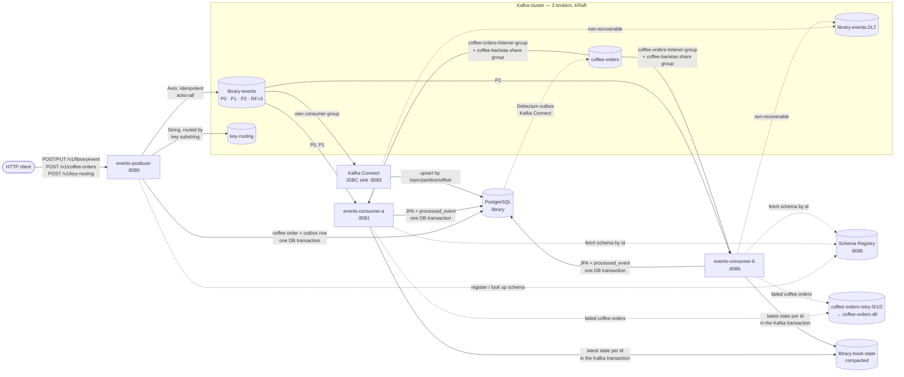
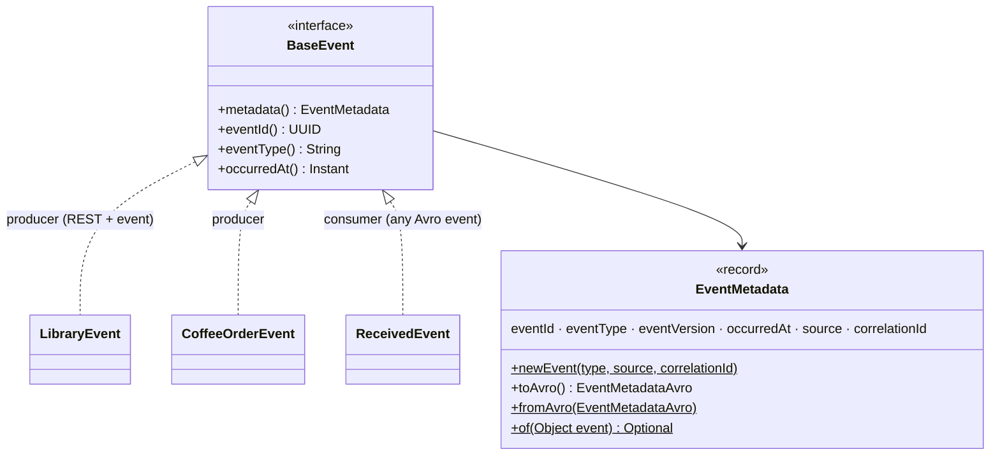
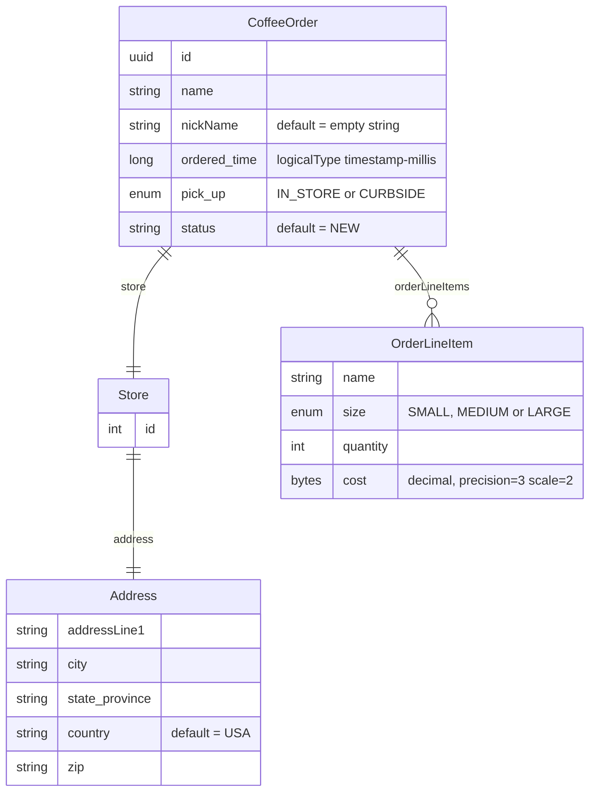
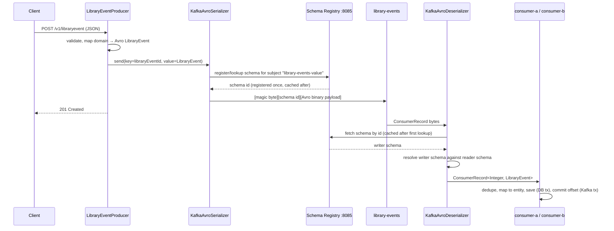
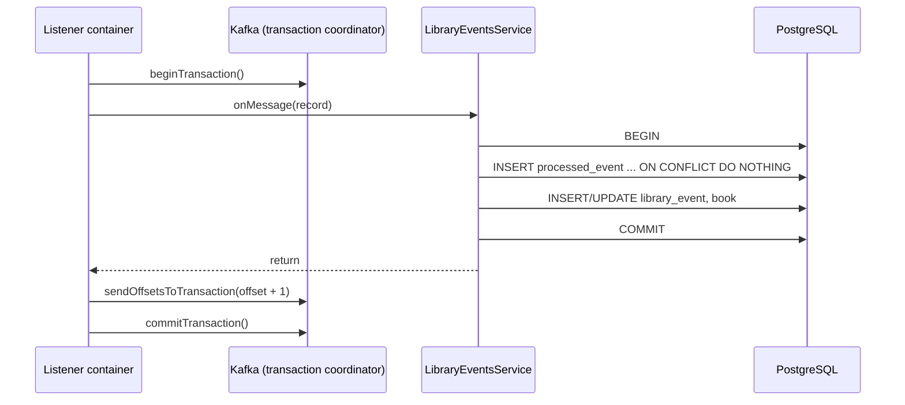
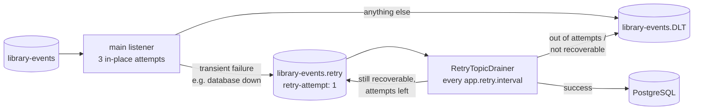
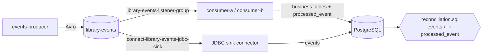
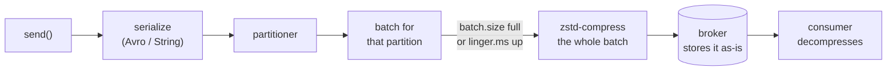
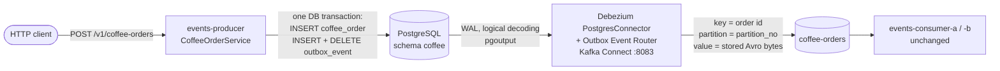

# <span style="color:hsl(92,80%,58%)">kafka-core — Kafka, Avro & Schema Registry</span>

## <span style="color:hsl(139,80%,58%)">Table of contents</span>

1. 🧰 [Tech stack](#1-tech-stack)
2. 🏗️ [Architecture](#2-architecture)
3. 🖥️ [The Kafka cluster: 3 brokers, KRaft](#3-the-kafka-cluster-3-brokers-kraft)
4. 🧬 [Why Avro + Schema Registry instead of JSON](#4-why-avro--schema-registry-instead-of-json)
5. 📨 [The library event: `LibraryEvent.avsc`](#5-the-library-event-libraryeventavsc)
6. 🧱 [Base event: common metadata for every event](#6-base-event-common-metadata-for-every-event)
7. ☕ [The coffee orders domain](#7-the-coffee-orders-domain)
8. 🔄 [Schema evolution and compatibility modes](#8-schema-evolution-and-compatibility-modes)
9. 📤 [Producers](#9-producers)
10. 📥 [Consumers](#10-consumers)
11. 👥 [Two consumers, one group: consumer-a and consumer-b](#11-two-consumers-one-group-consumer-a-and-consumer-b)
12. 🔁 [Kafka transactions](#12-kafka-transactions)
13. 🪪 [Idempotency: producer and consumer](#13-idempotency-producer-and-consumer)
14. ⚠️ [Error handling: retries, recovery, dead-letter topic](#14-error-handling-retries-recovery-dead-letter-topic)
15. ✋ [Manual offset commits](#15-manual-offset-commits)
16. 🎯 [Delivery semantics, concretely](#16-delivery-semantics-concretely)
17. 🗄️ [Database and Flyway migrations](#17-database-and-flyway-migrations)
18. ⚙️ [Configuration reference](#18-configuration-reference)
19. 🚀 [Running](#19-running)
20. 🔍 [Inspecting the cluster and the registry](#20-inspecting-the-cluster-and-the-registry)
21. 🪤 [Gotchas (Avro 1.12 / Spring Boot 4)](#21-gotchas-avro-112--spring-boot-4)
22. 🔄 [Data replication with Kafka Connect, and reconciliation](#22-data-replication-with-kafka-connect-and-reconciliation)
23. 🔁 [Non-blocking retry topics (`@RetryableTopic`)](#23-non-blocking-retry-topics-retryabletopic)
24. 🧺 [Share groups: Kafka as a queue](#24-share-groups-kafka-as-a-queue)
25. 🎯 [Custom partitioners and compression](#25-custom-partitioner-and-compression)
26. 🗜️ [Compacted "latest state" topic](#26-compacted-latest-state-topic)
27. 🆕 [KIP-848 consumer rebalance protocol](#27-kip-848-consumer-rebalance-protocol)
28. ⏪ [Replaying records with seek](#28-replaying-records-with-seek)
29. 🛠️ [Kafka CLI cheat sheet](#29-kafka-cli-cheat-sheet)
30. 🔐 [Enabling TLS (SSL) and mutual TLS](#30-enabling-tls-ssl-and-mutual-tls)
31. 🧪 [Tests](#31-tests)
32. 📮 [Transactional outbox for coffee orders (Debezium)](#32-transactional-outbox-for-coffee-orders-debezium)

---

This module is the core of the repo. Every event is ***Avro, registered in Confluent Schema Registry***. It is just ***four modules*** — one shared `schemas` module, ***one producer*** and ***two consumers*** — running two domains on one ***3-broker KRaft cluster***, plus a ***Kafka Connect*** JDBC sink that replicates every library event into a PostgreSQL `events` table for reconciliation:

- ***Library events*** — published by the producer, consumed by ***both consumer apps in one consumer group***, and written to ***PostgreSQL*** (schema managed by ***Flyway***). They use ***Kafka transactions***, an ***idempotent producer***, an ***idempotent consumer***, retries and a ***dead-letter topic***.
- ***Coffee orders*** — the same producer and consumers (own topic, own consumer group), showing richer Avro: nested records, logical types (`uuid`, `timestamp-millis`, `decimal`) and schema evolution. They also carry the more advanced features: a ***custom (VIP) partitioner***, ***non-blocking retry topics*** and a ***share group*** (Kafka's queue semantics).
- ***Also covered*** — a ***key-substring partitioner*** (every key containing a configured substring lands on one partition), ***zstd compression*** of every batch before it is sent, a ***compacted*** "latest state" topic written in the consumers' Kafka transaction, the ***KIP-848*** consumer rebalance protocol (consumer-b), and ***replay*** by seeking a partition back.

Start here for the fundamentals: producer records, partitions with leaders and followers, consumer groups, offsets, schema compatibility, and what "exactly-once" can and cannot mean once a database is involved.

For the broader repo architecture and core Kafka vocabulary, see the [root README](../README.md). The Kafka Streams examples live in [`kafka-stream`](../kafka-stream/README.md).

---

<a id="1-tech-stack"></a>
## <span style="color:hsl(230,80%,58%)">1. 🧰 Tech stack</span>

| Piece | Version (as of 2026) | Used for |
|---|---|---|
| Spring Boot | 4.1.1 | all three apps (single default config, no profiles) |
| Spring Kafka | 4.1.1 | `KafkaTemplate`, `@KafkaListener`, transactions |
| Apache Kafka clients | 4.2.1 | producers / consumers |
| Kafka broker | `confluentinc/cp-kafka:8.3.2` (KRaft, no ZooKeeper) | 3-node cluster |
| Schema Registry | `confluentinc/cp-schema-registry:8.3.2` | Avro schemas, compatibility checks |
| Avro + Confluent serializers | Avro 1.12.x, `kafka-avro-serializer` 8.3.2 | `KafkaAvroSerializer` / `KafkaAvroDeserializer` |
| PostgreSQL | `postgres:19beta3` in compose, `postgres:18` in tests | library events + idempotency table |
| Flyway | via `spring-boot-flyway` | schema migrations |
| Hibernate | 7.4.5 | JPA, `ddl-auto: validate` only |
| Testcontainers | Kafka + PostgreSQL | integration tests |
| Kafka Connect | `confluentinc/cp-kafka-connect:8.3.2` + JDBC connector 10.9.9 | `library-events` → PostgreSQL `events` (no code) |
| Logback | via Spring Boot | console + rolling file logs (`logback-spring.xml`) |
| Kafdrop | 4.3.0 | web UI on `localhost:9001`, Avro-aware |
| Prometheus + Grafana | v3.15.0 / 13.2.3 (root compose) | metrics + the provisioned "Learning Kafka" dashboard |

---

<a id="2-architecture"></a>
## <span style="color:hsl(7,80%,58%)">2. 🏗️ Architecture</span>

```
kafka-core/
├── docker-compose.yml           3 Kafka brokers + topic init + Schema Registry + PostgreSQL + Kafka Connect + Kafdrop
├── connect/                     connector configs (JDBC sink, Debezium outbox) + reconciliation SQL
├── schemas/                     Avro .avsc files → generated Java (library JAR, no Spring Boot)
├── events-producer/             REST API (port 8080) → "library-events" (Avro) and "key-routing" (String, key-substring
│                                partitioner), zstd-compressed batches; coffee orders → PostgreSQL outbox, published by Debezium
├── events-consumer-a/           port 8081: library-events → PostgreSQL + compacted "library-book-state",
│                                coffee-orders → consumer group with retry topics + "coffee-baristas" share group, replay API
└── events-consumer-b/           port 8086: same code as a, same groups — but on the KIP-848 group protocol
```



- ***One shared `schemas` module*** — every app depends on it, so producers and consumers use the same generated classes.
- ***One topic per domain, three partitions, three replicas*** — each partition has a leader on one broker and followers on the other two.
- ***Two consumer apps, same consumer groups*** — `library-events-listener-group` for library events and `coffee-orders-listener-group` for coffee orders. The group coordinator splits each topic's partitions between the two apps. If one stops, the other takes them all.
- ***Both library consumers share one database***, including the `processed_event` table, so a record redelivered to the *other* app after a rebalance is still skipped.
- ***Kafka Connect replicates the topic*** into an `events` table in the same database, independently of the apps ([§22](#22-data-replication-with-kafka-connect-and-reconciliation)).

---

<a id="3-the-kafka-cluster-3-brokers-kraft"></a>
## <span style="color:hsl(145,80%,58%)">3. 🖥️ The Kafka cluster: 3 brokers, KRaft</span>

Kafka has only two node roles, set by `process.roles`: ***`broker`*** and ***`controller`***. Leader and follower are ***not broker types***. They are roles a broker plays *per partition*, so one broker can lead partition 0 and follow partition 1 at the same time.

| Container | Host port | Node id | Roles |
|---|---|---|---|
| `kafka-core-kafka-1` | `9092` | 1 | `broker,controller` |
| `kafka-core-kafka-2` | `9093` | 2 | `broker,controller` |
| `kafka-core-kafka-3` | `9094` | 3 | `broker,controller` |

- ***Controller quorum*** — all 3 nodes are voters (`KAFKA_CONTROLLER_QUORUM_VOTERS`). Raft elects ***one active controller***; the other two are hot standbys. A 3-voter quorum survives ***1*** node down.
- ***Combined mode*** (`broker,controller` on every node) suits a laptop. Production usually runs 3 or 5 *dedicated* controllers separate from the brokers.
- ***Replication defaults*** — `default.replication.factor=3`, `min.insync.replicas=2`, and RF 3 for `__consumer_offsets`, `__transaction_state` and Schema Registry's `_schemas`. With `acks=all`, a write succeeds while at least 2 of the 3 replicas are in sync.

The one-shot `kafka-init` container creates the library topics (`--partitions 3 --replication-factor 3 --config min.insync.replicas=2`) and prints the layout. Output from a real run:

```
Topic: library-events  Partition: 0  Leader: 2  Replicas: 2,3,1  Isr: 2,3,1
Topic: library-events  Partition: 1  Leader: 3  Replicas: 3,1,2  Isr: 3,1,2
Topic: library-events  Partition: 2  Leader: 1  Replicas: 1,2,3  Isr: 1,2,3

LeaderId: 3      ← active controller
CurrentVoters: [1, 2, 3]
```

| Partition | Leader (reads + writes) | Followers (copy from the leader) |
|---|---|---|
| P0 | broker 2 | brokers 3, 1 |
| P1 | broker 3 | brokers 1, 2 |
| P2 | broker 1 | brokers 2, 3 |

- ***Leaders are spread across brokers*** so the load is shared. Which broker leads which partition can differ from run to run.
- ***Clients bootstrap from any broker*** (`localhost:9092` is enough). The metadata response tells them every broker's address (`localhost:9092/9093/9094`), and they talk to each partition's leader directly.
- ***If a broker dies***, the controller elects a new leader for its partitions from the in-sync followers. Try it with `docker stop kafka-core-kafka-2` and describe the topic again ([§20](#20-inspecting-the-cluster-and-the-registry)).
- `coffee-orders` is created by `kafka-init` (3 partitions, RF 3). Debezium writes each coffee event to the partition the producer chose ([§32](#32-transactional-outbox-for-coffee-orders-debezium)), so the topic must exist with enough partitions.

---

<a id="4-why-avro--schema-registry-instead-of-json"></a>
## <span style="color:hsl(60,80%,50%)">4. 🧬 Why Avro + Schema Registry instead of JSON</span>

With plain JSON, the "schema" is only ever the Java class the producer happened to serialize with [`ObjectMapper`][ObjectMapper], and consumers just hope their own copy of that shape still matches. Nothing prevents a producer from renaming a field and shipping — the failure shows up as a deserialization exception (or worse, silently-wrong data) on the consumer side, in production. kafka-core used to work that way for library events; it now uses Avro end to end.

Avro + Schema Registry changes the contract:

1. The **schema** (`.avsc`) is a first-class artifact, checked into version control (`schemas/src/main/avro/*.avsc`) and compiled into generated Java classes by the `avro-maven-plugin`.
2. When a producer serializes a record with [`KafkaAvroSerializer`][KafkaAvroSerializer], the client registers (or looks up) that exact schema in the Schema Registry and prefixes the Avro bytes with a small header — a magic byte and a 4-byte **schema id** — instead of embedding the schema in every message. That keeps messages small.
3. Before the registry accepts a *new* version of a schema for a subject (by default `<topic>-value`), it checks it against the previous version(s) under the subject's **compatibility mode**. An incompatible change is rejected at registration time — at deploy time for the producer — rather than discovered later as a consumer failure.
4. On the consumer side, [`KafkaAvroDeserializer`][KafkaAvroDeserializer] reads the schema id from the message, fetches (and caches) the writer schema from the registry, and reconciles it with the consumer's own reader schema using Avro's schema-resolution rules.

---

<a id="5-the-library-event-libraryeventavsc"></a>
## <span style="color:hsl(282,80%,58%)">5. 📨 The library event: `LibraryEvent.avsc`</span>

`schemas/src/main/avro/LibraryEvent.avsc` → generated `LibraryEventAvro`, `BookAvro`, `LibraryEventTypeAvro` (package `com.learnkafka.avro`):

```json
{
  "name": "LibraryEventAvro", "aliases": ["LibraryEvent"], "namespace": "com.learnkafka.avro", "type": "record",
  "fields": [
    { "name": "metadata", "type": ["null", "com.learnkafka.avro.EventMetadataAvro"], "default": null },   // base event, §6
    { "name": "libraryEventId",   "type": ["null", "int"], "default": null },
    { "name": "libraryEventType", "type": { "type": "enum", "name": "LibraryEventTypeAvro", "aliases": ["LibraryEventType"], "symbols": ["NEW", "UPDATE"] } },
    { "name": "book", "type": { "type": "record", "name": "BookAvro", "aliases": ["Book"], "fields": [
        { "name": "bookId",     "type": "int" },
        { "name": "bookName",   "type": "string" },
        { "name": "bookAuthor", "type": "string" } ] } }
  ]
}
```

- ***`libraryEventId` is optional*** (`["null","int"]`, default `null`): a NEW event has no id yet, because the consumer's database assigns it.
- ***Why the `Avro` suffix?*** The producer's REST records and the consumers' JPA entities are also called `LibraryEvent` / `Book` / `LibraryEventType`. Distinct generated names let every file import plain class names — no package-qualified names anywhere.
- ***Why the `aliases`?*** Version 1 of the schema used the names without the suffix. Avro treats a renamed record as a different type unless the new schema lists the old name as an alias. With the aliases, Schema Registry accepted the rename as a `BACKWARD`-compatible ***version 2***, and consumers still read records written with version 1 (verified with a v1 record sent through `kafka-avro-console-producer`).
- ***Registered as subject `library-events-value`*** the first time the producer sends.
- ***Three shapes, two mappings*** — each side still keeps its own Java model, and only the Avro record crosses the wire:

| Where | Type | Role |
|---|---|---|
| producer REST layer | `com.learnkafka.domain.LibraryEvent` (record + Bean Validation) | validated HTTP input |
| on the wire | `com.learnkafka.avro.LibraryEventAvro` (generated) | `LibraryEventAvroMapper.toAvro()` in the producer |
| consumer database | `com.learnkafka.entity.LibraryEvent` (JPA [`@Entity`][Entity]) | `LibraryEventEntityMapper.toEntity()` in the consumers |

- ***Key*** = `libraryEventId` (an [`Integer`][Integer], [`IntegerSerializer`][IntegerSerializer]/[`IntegerDeserializer`][IntegerDeserializer]). Events for the *same* id always land on the same partition, which preserves per-entity ordering — an `UPDATE` must never be processed before the `NEW` that created it, and per-partition ordering is Kafka's only ordering guarantee.
- ***NEW events have a `null` key***, so the producer's sticky partitioner batches them onto one partition at a time. Keyed UPDATE events spread by key hash.

---

<a id="6-base-event-common-metadata-for-every-event"></a>
## <span style="color:hsl(26,80%,58%)">6. 🧱 Base event: common metadata for every event</span>

Every event — library events and coffee orders, on the producer and on the consumer side — carries the same ***base-event metadata***:

| Field | Type | Meaning |
|---|---|---|
| `eventId` | UUID | unique per event; consumers dedupe on it |
| `eventType` | string | `<Aggregate>.<Action>`: `LibraryEvent.NEW`, `LibraryEvent.UPDATE`, `CoffeeOrder.PLACED` |
| `eventVersion` | int (default 1) | version of the event's payload contract |
| `occurredAt` | timestamp-millis | when the event happened |
| `source` | string | producing application (`spring.application.name`) |
| `correlationId` | string or null | ties the event to the request that caused it (`X-Correlation-Id` header) |

***In Avro: composition, not inheritance.*** Avro records can't extend each other, so the base event is its own named record, `EventMetadataAvro` (`schemas/src/main/avro/EventMetadata.avsc`), and every event schema embeds it as its first field:

```json
{ "name": "metadata", "type": ["null", "com.learnkafka.avro.EventMetadataAvro"], "default": null }
```

- ***Optional on purpose*** — with `null` as default, the new schemas stay ***BACKWARD-compatible*** with every event already on the topics. Schema Registry accepted them as `library-events-value` ***v3*** and `coffee-orders-value` ***v2***; old events simply read `metadata = null`.
- ***Defined once*** — `EventMetadata.avsc` is compiled first (`<imports>` in `schemas/pom.xml`) and referenced by full name from `LibraryEvent.avsc` and `CoffeeOrder.avsc`, even though `CoffeeOrder` lives in another namespace.
- ***But every generated class `extends SpecificRecordBase`?*** — that is Avro's own runtime base class, the same for every generated record (`Address`, `LibraryEventAvro`, `EventMetadataAvro` …). It has ***no fields***, only plumbing: get/put by field name, schema-based `equals`/`hashCode`/`compareTo`, JSON `toString`, Java serialization and fast custom encode/decode. It is not schema inheritance: the code generator always picks this parent, and a schema has no `extends` to name another record as its parent — so shared fields still have to be embedded. It is also why `EventMetadata.of(Object)` can read `metadata` from any event: `SpecificRecordBase` implements `GenericRecord`.

***In Java: a base interface and child events.*** The shared contract module (`schemas`) holds the Java side, so producer and consumers use the same types:



- ***Records can't extend a class*** either, so `BaseEvent` is an interface whose default methods (`eventId()`, `eventType()`, `occurredAt()`) read the composed `metadata()` — the same shape as the Avro schemas.
- ***`EventMetadata.of(event)`*** reads the `metadata` field of ***any*** generated event class (they are all `GenericRecord`s), so common handling doesn't need to know the event type.

***Producer — stamping.*** `EventMetadataFactory` creates the metadata for every event: random id, current time, the app as source, and the `X-Correlation-Id` request header if present. The child events carry it into Avro (`LibraryEventAvroMapper`, `CoffeeOrderService`), and the REST responses return it, so callers learn the eventId. Real response:

```json
"metadata": {"eventId": "44b660dc-ca14-4d49-a939-438d4ca0b7cc", "eventType": "LibraryEvent.NEW", "eventVersion": 1,
             "occurredAt": "2026-10-14T05:47:01.773Z", "source": "events-producer", "correlationId": "e2e-req-1"}
```

***Consumers — handled once, for every event type.***

| Where | What the base event gives |
|---|---|
| `EventMetadataMdcInterceptor` (a `RecordInterceptor` on every classic container, incl. retry/DLT ones) | puts `eventId`, `eventType`, `correlationId` into the logging MDC for the duration of the record; the barista share listener does the same itself (share containers have no interceptor) |
| `logback-spring.xml` | every log line written while processing shows `[LibraryEvent.NEW:44b660dc-…]` — console and file |
| `ProcessedEventRepository` + Flyway `V3` | idempotency also by `eventId`: the same event re-sent at a ***new offset*** is skipped ([§13](#13-idempotency-producer-and-consumer)) |
| `ReceivedEvent.of(value)` | the base-event view of any received Avro event, used for logging in the library service and coffee listener |
| Kafka Connect replica | `events` gains `event_id`, `event_type`, `event_version`, `occurred_at`, `event_source`, `correlation_id` ([§22](#22-data-replication-with-kafka-connect-and-reconciliation)) |

Real consumer log, one record, three lines — all tagged with the same event:

```
[LibraryEvent.NEW:44b660dc-ca14-4d49-a939-438d4ca0b7cc] c.l.consumer.LibraryEventsConsumer : Received ConsumerRecord : ...
[LibraryEvent.NEW:44b660dc-ca14-4d49-a939-438d4ca0b7cc] c.l.service.LibraryEventsService   : Processing LibraryEvent.NEW eventId=44b660dc-...
[LibraryEvent.NEW:44b660dc-ca14-4d49-a939-438d4ca0b7cc] c.l.service.LibraryEventsService   : Persisted libraryEvent LibraryEvent(libraryEventId=21, ...)
```

---

<a id="7-the-coffee-orders-domain"></a>
## <span style="color:hsl(197,80%,58%)">7. ☕ The coffee orders domain</span>

All coffee schemas live in `schemas/src/main/avro/` next to `LibraryEvent.avsc`. `avro-maven-plugin` (configured in `schemas/pom.xml`) compiles them to `target/generated-sources/avro` at build time — nothing generated is checked in under `src/main/java`, so `mvn clean` truly cleans them.



- ***Producer and consumer*** — `POST /v1/coffee-orders` lives in `events-producer` (stored through a transactional outbox, published by Debezium — [§32](#32-transactional-outbox-for-coffee-orders-debezium)), and the `CoffeeOrdersConsumer` listener lives in both consumer apps ([§9](#9-producers), [§10](#10-consumers)).
- ***Logical types*** — `CoffeeOrder.id` is `{"type": "string", "logicalType": "uuid"}` and `ordered_time` is `{"type": "long", "logicalType": "timestamp-millis"}`. The generated classes expose idiomatic `UUID` and [`Instant`][Instant] getters/setters (`CoffeeOrderService.buildCoffeeOrder()` calls `.setId(...)` with a random UUID and `.setOrderedTime(...)` with the current time) while the wire format stays a plain string/long. `OrderLineItem.cost` uses a `bytes` logical `decimal` (precision 3, scale 2) so [`BigDecimal`][BigDecimal] round-trips exactly; the plugin turns this on with `<enableDecimalLogicalType>true</enableDecimalLogicalType>`.
- ***A schema not yet wired to any app*** — `CoffeeUpdateEvent.avsc` (`{id, status}`, `status` enum `PROCESSING | READY_FOR_PICK_UP`) compiles alongside the others but nothing produces or consumes it. It would be its own subject (`CoffeeUpdateEvent-value` if published), showing that the registry manages compatibility ***per subject***, not globally.

---

<a id="8-schema-evolution-and-compatibility-modes"></a>
## <span style="color:hsl(335,80%,58%)">8. 🔄 Schema evolution and compatibility modes</span>

Confluent Schema Registry's default compatibility mode for a new subject is **`BACKWARD`**: a new schema version is accepted only if consumers using the *new* schema can still read data written with the *previous* one. Concretely, new fields must have a `default`, and only fields with defaults may be dropped.

The optional fields in these schemas already follow that rule:

| Field            | Schema         | Default | Why it matters |
|------------------|----------------|---------|----------------|
| `libraryEventId` | `LibraryEvent` | `null`  | Optional by design; a reader that doesn't find it gets `null` instead of an error |
| `nickName`       | `CoffeeOrder`  | `""`    | A later version can drop it, and readers still resolve a value |
| `status`         | `CoffeeOrder`  | `"NEW"` | Same — can be added after the fact without breaking readers that don't know it yet |
| `country`        | `Address`      | `"USA"` | Same pattern one level down, inside `Store.address` |

The other modes, for contrast. None is configured here; `BACKWARD` applies because the compose file doesn't set `SCHEMA_REGISTRY_SCHEMA_COMPATIBILITY_LEVEL`:

| Mode                    | Guarantee                                                                                      | Typical use |
|-------------------------|------------------------------------------------------------------------------------------------|-------------|
| `BACKWARD` (default)    | New schema can read data written with the previous schema                                      | Upgrade consumers before producers |
| `FORWARD`               | Previous schema can read data written with the new schema                                      | Upgrade producers before consumers |
| `FULL`                  | Both of the above                                                                              | Producers and consumers upgrade in any order |
| `*_TRANSITIVE` variants | Same guarantee checked against *all* previous versions, not just the last one                  | Long-lived topics with many schema revisions |
| `NONE`                  | No compatibility checking                                                                      | Registry is just a schema store |

***Try it:*** add a new required field (no `default`) to `LibraryEvent.avsc`, rebuild `schemas`, and send with the producer against a registry that already has the current version. The registry rejects the registration with `409 Conflict` (incompatible schema), because a consumer reading old data with the new schema could not fill in that field. This module's [`insomnia-collection.json`](insomnia-collection.json) has a *Schema Registry* folder with requests to view and change a subject's compatibility.

---

<a id="9-producers"></a>
## <span style="color:hsl(112,80%,58%)">9. 📤 Producers</span>

### <span style="color:hsl(27,80%,58%)">`LibraryEventProducer` (events-producer)</span>

Three send methods, each demonstrating a different Spring Kafka [`KafkaTemplate`][KafkaTemplate] usage pattern. The template's value type is the ***generated Avro class***, `KafkaTemplate<Integer, LibraryEventAvro>`:

| Method                          | Used by                                       | Behavior |
|---------------------------------|-----------------------------------------------|----------|
| `sendLibraryEventWithHeaders()` | `POST` / `PUT /v1/libraryevent`               | Async send via an explicit [`ProducerRecord`][ProducerRecord] carrying a custom header `event-source: scanner`; returns a [`CompletableFuture`][CompletableFuture] the controller does not block on |
| `sendLibraryEvent()`            | available, not wired to a controller endpoint | Async send using `kafkaTemplate.sendDefault()` (the configured default topic) — no custom headers |
| `sendLibraryEventSynchronous()` | available, not wired to a controller endpoint | Blocks up to 1 second via `.get(1, TimeUnit.SECONDS)` — for when the caller genuinely needs a confirmed offset before responding |

`LibraryEventsController` calls `sendLibraryEventWithHeaders()` for both `POST` (sets `LibraryEventType.NEW`, and 400s if a `libraryEventId` is sent — the consumers' database assigns it) and `PUT` (sets `LibraryEventType.UPDATE`, and 400s if `libraryEventId` is missing). Both stamp the base-event metadata (eventId, type, time, source, optional `X-Correlation-Id`, [§6](#6-base-event-common-metadata-for-every-event)) and return it in the response, and they return `201`/`200` ***without waiting for the Kafka send to complete***. Success or failure is only seen by the `whenComplete()` callback, which logs. The REST API's availability is decoupled from Kafka's, at the cost of the HTTP response not saying whether the message reached the topic.

```yaml
spring.kafka.producer:
  key-serializer: org.apache.kafka.common.serialization.IntegerSerializer
  value-serializer: io.confluent.kafka.serializers.KafkaAvroSerializer
  compression-type: zstd       # every batch is compressed before it is sent (§25)
  properties:
    acks: all                  # wait for all in-sync replicas to ack
    retries: 10                # retry transient send failures
    retry.backoff.ms: 1000
    enable.idempotence: "true" # producer-side dedup of retried sends
    linger.ms: 20              # wait up to 20 ms to fill a batch: bigger batches compress better
    schema.registry.url: ${SCHEMA_REGISTRY_URL:http://localhost:8085}
```

- **`acks=all`** — the leader acks only once every in-sync replica has the record. With `min.insync.replicas=2` at least one follower also has it, so a leader crash right after acking doesn't lose data.
- **`enable.idempotence=true`** — see [§13](#13-idempotency-producer-and-consumer).
- **Auto-topic-creation** (`AutoCreateConfig`) declares `library-events` and `key-routing` with `3` partitions via [`NewTopic`][NewTopic], so the app also works against a bare broker. With docker compose, `kafka-init` has already created them with RF 3, so this is a no-op there.

### <span style="color:hsl(165,80%,58%)">Coffee orders: `CoffeeOrdersController` → transactional outbox (also in events-producer)</span>

```java
@Transactional                                                    // CoffeeOrderService.place
public CoffeeOrderResponse place(CoffeeOrderRequest request, String correlationId) {
    ...
    orders.insert(order);                                         // coffee.coffee_order
    outbox.append(new OutboxEvent(eventId, "coffee-orders", orderId, "CoffeeOrder.PLACED",
            payloadSerializer.serialize(order),                   // KafkaAvroSerializer bytes
            vipPartitionRule.partition(name, orderId, partitions), correlationId));   // INSERT + DELETE
}
```

- ***No `KafkaTemplate` for coffee orders*** — the order and its event are stored in one PostgreSQL transaction; Debezium publishes the event ([§32](#32-transactional-outbox-for-coffee-orders-debezium)). A `201` means "committed", even if Kafka is down at that moment.
- ***Same bytes, key and partition as before*** — `KafkaAvroSerializer` produces the Confluent wire format the consumers already read, the key is the order id, and `VipPartitionRule` (the old `CoffeeVipPartitioner` arithmetic) picks the partition.
- ***REST records in `domain`*** — `CoffeeOrderRequest` and `CoffeeOrderResponse` sit next to the library-event records in `com.learnkafka.domain`.

`POST /v1/coffee-orders` (`CoffeeOrderRequest{name, nickName}`) builds a full `CoffeeOrder` — hardcoded `Store`/`Address`/one `Latte` `OrderLineItem` for demo purposes, a real `UUID.randomUUID()` id, [`Instant.now()`][Instant] ordered time (millisecond precision, as Avro's `timestamp-millis` stores it), `PickUp.IN_STORE`, `status = "NEW"` — and stores it with its outbox event. It returns a `CoffeeOrderResponse` record rather than the Avro object ([§21](#21-gotchas-avro-112--spring-boot-4)).

### <span style="color:hsl(220,80%,58%)">`KeyRoutingProducer` (also in events-producer)</span>

`POST /v1/key-routing` (`KeyRoutingRequest{key, message}`) sends the message as a plain ***String*** record to `key-routing`, keyed by whatever the caller sends, through a template that uses `KeySubstringPartitioner` ([§25](#25-custom-partitioner-and-compression)). It waits for the broker's ack and returns `KeyRoutingResponse{key, matchedSubstring, partition, offset}`, so you can see where each key landed.

- ***Its own template, not a bean*** — a String/String template built from Boot's producer factory: it inherits `acks`, idempotence, zstd and `linger.ms`, and has its own `client.id` (`events-producer-key-routing-N`). A second `KafkaTemplate` ***bean*** would make Boot's auto-configured one (used by `LibraryEventProducer`) back off.
- ***Rules checked at startup*** — the controller parses `app.key-routing.substring-partitions` itself, so a malformed rule stops the app instead of failing the first send.
- ***Why a separate topic*** — the other keys can't show substring routing: library events are keyed by an Integer id (`null` for NEW) and coffee orders by a random UUID.

`POST /v1/key-routing/partitions/{partition}` sends the same request to the partition ***the caller names***, with [`KafkaTemplate.send(topic, partition, key, value)`][KafkaTemplate]:

- ***The partitioner is skipped*** — a record that carries a partition never reaches `partitioner.class`, so `KeySubstringPartitioner` doesn't run: a VIP key sent to `/partitions/2` lands on 2, not 0. The key still travels with the record, and the response's `matchedSubstring` is `null`.
- ***Checked before sending*** — a partition the topic doesn't have gets `400 Partition 7 does not exist: topic key-routing has partitions 0-2`, checked against `partitionsFor()`. `send()` itself would block for `max.block.ms` (60 s) waiting for that partition, then fail ([§25](#25-custom-partitioner-and-compression)).

---

<a id="10-consumers"></a>
## <span style="color:hsl(304,80%,58%)">10. 📥 Consumers</span>

### <span style="color:hsl(54,80%,50%)">`LibraryEventsConsumer` → `LibraryEventsService` (events-consumer-a / -b)</span>

`events-consumer-a` and `events-consumer-b` contain the same code. Only the app name, port and client id differ ([§11](#11-two-consumers-one-group-consumer-a-and-consumer-b)).

```java
@KafkaListener(topics = {"library-events"}, groupId = "${spring.kafka.consumer.group-id}",
        properties = "specific.avro.value.type=com.learnkafka.avro.LibraryEventAvro")
public void onMessage(ConsumerRecord<Integer, LibraryEventAvro> consumerRecord) {
    libraryEventsService.processLibraryEvent(consumerRecord);
}
```

```yaml
spring.kafka.consumer:
  key-deserializer: org.apache.kafka.common.serialization.IntegerDeserializer
  value-deserializer: org.springframework.kafka.support.serializer.ErrorHandlingDeserializer
  properties:
    spring.deserializer.value.delegate.class: io.confluent.kafka.serializers.KafkaAvroDeserializer
    specific.avro.reader: true
```

- ***`ErrorHandlingDeserializer` wraps `KafkaAvroDeserializer`.*** Bytes that are not valid Avro become a `DeserializationException` that is dead-lettered ([§14](#14-error-handling-retries-recovery-dead-letter-topic)), instead of a poison pill that fails every `poll()`.
- ***`specific.avro.reader: true`*** makes the deserializer return the typed generated class instead of a reflection-only [`GenericRecord`][GenericRecord].
- ***`specific.avro.value.type`*** (set per listener) pins the reader class. Without it the deserializer picks the class from the ***writer's*** schema name, so records written as `LibraryEvent` (schema v1) would fail with `Could not find class com.learnkafka.avro.LibraryEvent`. It's per listener because the same apps also read `CoffeeOrder`.

`processLibraryEvent()` is the Template Method. It runs in ***one database transaction*** ([`@Transactional("transactionManager")`][Transactional], the JPA transaction manager):

1. ***Idempotency check*** — insert `(group, topic, partition, offset)` into `processed_event`. If the row already exists, the record was applied before: log and return ([§13](#13-idempotency-producer-and-consumer)).
2. ***Map*** the Avro record to the JPA entity (`LibraryEventEntityMapper`), seen through the base-event view `ReceivedEvent.of(value)` for logging ([§6](#6-base-event-common-metadata-for-every-event)).
3. ***Dispatch by `libraryEventType`*** (a `NEW` that carries an id is rejected — the database assigns ids):
    - **`NEW`** → `save()` — persists `LibraryEvent` + cascaded `Book` via `LibraryEventsRepository` (Spring Data JPA → PostgreSQL).
    - **`UPDATE`** → `validate()` then `save()`. `validate()` is where the deliberately non-retryable failure lives:

```java
private void validate(LibraryEvent libraryEvent) {
    if (libraryEvent.getLibraryEventId() == null) {
        throw new IllegalArgumentException("Library Event Id is missing");
    }
    libraryEventsRepository.findById(libraryEvent.getLibraryEventId())
            .orElseThrow(() -> new IllegalArgumentException("Not a valid library Event: " + ...));
}
```

An `UPDATE` for an id that was never saved as `NEW` (or has a null id) is not a *transient* problem — retrying fails identically every time. That's why it's an [`IllegalArgumentException`][IllegalArgumentException], excluded from retry ([§14](#14-error-handling-retries-recovery-dead-letter-topic)). If any step throws, the database transaction rolls back — including the `processed_event` row — so the retry starts clean.

### <span style="color:hsl(9,80%,58%)">`CoffeeOrdersConsumer` (in consumer-a and consumer-b)</span>

```java
@KafkaListener(topics = "coffee-orders", groupId = "coffee-orders-listener-group",
        containerFactory = LibraryEventsConsumerConfig.COFFEE_ORDERS_CONTAINER_FACTORY,
        properties = "key.deserializer=org.apache.kafka.common.serialization.StringDeserializer")
public void onMessage(ConsumerRecord<String, CoffeeOrder> record) { ... }
```

- ***Same deserializer setup*** as library events (ErrorHandlingDeserializer → KafkaAvroDeserializer, specific reader), with the key deserializer overridden to `String` for the UUID keys.
- ***Own group, shared by both apps*** — `coffee-orders-listener-group` splits the coffee partitions between consumer-a and consumer-b, independently of the library group.
- ***Own, simpler container*** (`coffeeOrdersContainerFactory`) — the listener only logs, so there is no Kafka transaction and no DLT: `DefaultErrorHandler` retries a failing record twice, then logs and skips it.
- `onMessage()` receives a typed `CoffeeOrder` (`record.value().getId()`, `.getStatus()`, `.getStore().getId()`) and logs `Received CoffeeOrder: id=... name='Ada' status=NEW store=1 partition=...`.

### <span style="color:hsl(270,80%,58%)">Message flow with Schema Registry</span>



The coffee flow differs on the producer side: `CoffeeOrderService` serializes the `CoffeeOrder` (subject `coffee-orders-value`) into the outbox row and Debezium publishes those bytes ([§32](#32-transactional-outbox-for-coffee-orders-debezium)); `CoffeeOrdersConsumer` then reads them like any Avro record (without the database and transaction steps).

---

<a id="11-two-consumers-one-group-consumer-a-and-consumer-b"></a>
## <span style="color:hsl(195,80%,58%)">11. 👥 Two consumers, one group: consumer-a and consumer-b</span>

| | consumer-a | consumer-b |
|---|---|---|
| Module | `events-consumer-a` | `events-consumer-b` |
| HTTP port | `8081` | `8086` (`8082` is the kafka-stream app, `8085` Schema Registry) |
| `spring.application.name` / `client-id` | `events-consumer-a` | `events-consumer-b` |
| Transaction id prefix | `events-consumer-a-tx-` | `events-consumer-b-tx-` |
| `group-id` (library events) | `library-events-listener-group` | ***same*** |
| `group-id` (coffee orders) | `coffee-orders-listener-group` | ***same*** |
| Listener threads (`spring.kafka.listener.concurrency`) | 1 | 1 |
| Group protocol | `classic` (default) | `consumer` — KIP-848 ([§27](#27-kip-848-consumer-rebalance-protocol)) |

- ***Same `group-id` = one logical consumer.*** Kafka gives each partition to exactly one member of the group, so the two apps never process the same partition at the same time.
- ***Different `group-id`s*** would do the opposite: each app would get *every* record (pub/sub instead of load sharing).
- ***Concurrency is 1 per app*** on purpose. With 3 threads each there would be 6 members for 3 partitions, and the assignor could give all 3 to one app and leave the other idle.
- ***Who assigns the partitions?*** With the classic protocol the group leader's client computes the assignment; with KIP-848 the broker does. Either way the ***group coordinator***, a responsibility of one ordinary broker (the leader of the group's `__consumer_offsets` partition). It is not a separate broker type. On the client side, each app's `ConsumerCoordinator` sends heartbeats and join requests to it.
- ***Transaction ids must be unique per running instance***, which is why the prefix uses the app name.

Real run — 6 NEW events (null key, so all on P0), then 6 keyed UPDATE events (spread by key):

```
PARTITION  CURRENT-OFFSET  LAG  CONSUMER-ID
0          10              0    events-consumer-a-0
1          5               0    events-consumer-a-0
2          3               0    events-consumer-b-0
```

consumer-a processed the records on P0 + P1, consumer-b those on P2, and all 6 books in PostgreSQL were created and then updated.

***Failover*** — after stopping consumer-a, the coordinator rebalanced within seconds:

```
PARTITION  CONSUMER-ID
0          events-consumer-b-0
1          events-consumer-b-0
2          events-consumer-b-0
```

Start consumer-a again and the partitions are shared once more. Coffee orders split the same way in their own group — in a real run, 3 orders went 2 to consumer-a (P0, P1) and 1 to consumer-b (P2).

---

<a id="12-kafka-transactions"></a>
## <span style="color:hsl(320,80%,58%)">12. 🔁 Kafka transactions</span>

Turned on by one property in each library consumer app:

```yaml
spring.kafka.producer.transaction-id-prefix: ${spring.application.name}-tx-
```

Spring Boot then makes the `KafkaTemplate` transactional and creates a [`KafkaTransactionManager`][KafkaTransactionManager]. `LibraryEventsConsumerConfig` puts that manager on the listener container:

```java
factory.getContainerProperties().setKafkaAwareTransactionManager(kafkaTransactionManager);
factory.setAfterRollbackProcessor(afterRollbackProcessor());
```

***What happens for each record:***



- ***Kafka side is atomic*** — the consumed offset and anything sent to Kafka while handling the record (state topic, retry-topic forward, DLT publish) commit together or not at all.
- ***Database side is a separate transaction.*** Kafka cannot take part in a database transaction (there is no XA/2PC), so this is "best-effort one-phase commit": the database commits first, then Kafka.
- ***The gap:*** if the app dies after the database commit but before the Kafka commit, the offset is not committed and the record is delivered again. The idempotent consumer ([§13](#13-idempotency-producer-and-consumer)) closes that gap.
- ***Two transaction managers, one `@Primary`.*** `transactionManager` is a [`JpaTransactionManager`][JpaTransactionManager] declared explicitly and marked `@Primary`. Without it, Boot's JPA transaction manager can back off once a `KafkaTransactionManager` exists, and `@Transactional` would silently cover Kafka instead of the database. The service names it explicitly: `@Transactional("transactionManager")`.
- ***`isolation.level=read_committed`*** — the consumers never see records from producer transactions that were aborted.
- ***Sends must happen inside a transaction.*** A transactional `KafkaTemplate` refuses a send with no transaction open. Inside the listener the container has one open; elsewhere (for example in tests) use `kafkaTemplate.executeInTransaction(t -> t.sendDefault(...))`.
- The producer app uses no Kafka transactions: library events and key routing rely on the idempotent producer, coffee orders on a database transaction plus Debezium ([§32](#32-transactional-outbox-for-coffee-orders-debezium)). The coffee listener's container is not transactional either.

---

<a id="13-idempotency-producer-and-consumer"></a>
## <span style="color:hsl(229,80%,58%)">13. 🪪 Idempotency: producer and consumer</span>

Two different problems, two different fixes:

| | Idempotent ***producer*** | Idempotent ***consumer*** |
|---|---|---|
| Duplicate it prevents | a producer ***retry*** writing the same record twice | the same record being ***applied twice*** to the database |
| Where it lives | Kafka broker | this app's database |
| How | producer id (PID) + per-partition sequence number; the broker drops a repeated sequence | `processed_event` row per `(group, topic, partition, offset)`, inserted in the same DB transaction |
| Config | `enable.idempotence=true`, `acks=all`, `max.in.flight.requests.per.connection ≤ 5` | Flyway `V2__create_processed_event.sql` + `V3__add_event_id_to_processed_event.sql` + `ProcessedEventRepository` |
| On in | the producer app and both consumer apps (required by transactions) | both consumer apps, library events only |

***Idempotent producer***

- Each producer gets a ***PID***, and each record gets a ***sequence number per partition***. If a retry re-sends a batch the broker already wrote, the broker sees the repeated sequence and drops it.
- It is ***on by default*** in Kafka clients 3.0+, but only if `acks=all`, `retries > 0` and `max.in.flight.requests.per.connection ≤ 5`. This project sets it explicitly so a config change can't quietly turn it off.
- It does ***not*** stop a consumer from processing a record twice.

***Idempotent consumer***

```java
// ProcessedEventRepository — runs inside the service's DB transaction
INSERT INTO processed_event (consumer_group, topic, partition_no, offset_no)
VALUES (?, ?, ?, ?)
ON CONFLICT DO NOTHING            -- 0 rows inserted = already processed → skip
```

- ***Atomic check-and-mark*** — one `INSERT ... ON CONFLICT DO NOTHING`, no "SELECT then INSERT" race between threads or between consumer-a and consumer-b.
- ***Same transaction as the business write*** — if processing fails, the marker rolls back too, so a retry is not wrongly skipped.
- ***Keyed by delivery position AND by event*** — the primary key `(group, topic, partition, offset)` catches a ***redelivery*** of the same record; the unique index `(group, event_id)` catches the same ***event re-sent*** at a new offset (the base event's `eventId`, [§6](#6-base-event-common-metadata-for-every-event)). One `INSERT ... ON CONFLICT DO NOTHING` checks both. Events written before metadata existed have no `event_id` and are deduped by position only.
- ***Shared by both apps*** — after a rebalance moves a partition from consumer-a to consumer-b, a record that a already applied is skipped by b.
- The test `redeliveredRecord_isAppliedOnce` processes the same record twice: one row, no error. Without the marker the second `NEW` would hit the `book` primary key.

---

<a id="14-error-handling-retries-recovery-dead-letter-topic"></a>
## <span style="color:hsl(31,80%,58%)">14. ⚠️ Error handling: retries, recovery, dead-letter topic</span>

With a transactional container, a failed record ***rolls the Kafka transaction back***, and Spring Kafka's [`DefaultAfterRollbackProcessor`][DefaultAfterRollbackProcessor] (not the `DefaultErrorHandler`) decides what happens next. It wraps a [`BackOff`][BackOff] policy and a [`ConsumerRecordRecoverer`][ConsumerRecordRecoverer]:

```java
var backOff   = new FixedBackOff(1_000L, 2);       // 1s delay, 2 retries = 3 attempts total
var processor = new DefaultAfterRollbackProcessor<>(retryRouter(), backOff, kafkaTemplate, true);
processor.addNotRetryableExceptions(IllegalArgumentException.class, DataIntegrityViolationException.class);
```

- ***Deterministic failures skip the retries*** — they can never succeed: an `UPDATE` for an unknown id or a `NEW` that carries an id (`IllegalArgumentException`), a `NEW` for a `book_id` that already exists (`DataIntegrityViolationException` from the primary key), and bytes that are not Avro (`DeserializationException`). Each lands on the DLT after exactly one attempt.
- ***Why a NEW must not carry an id*** — Spring Data would `merge()` it as an existing row, and Hibernate 6.6+ rejects merging an entity whose generated id isn't in the table (`ObjectOptimisticLockingFailureException`) — on every retry. The producer answers `400` for such a POST, and the consumer rejects it too (other producers may not).
- ***Recovery looks through the whole cause chain*** for a transient failure, since the listener's exception arrives wrapped (`RetryRouter.isRecoverable`). A real PostgreSQL outage never surfaces as `RecoverableDataAccessException`: the JPA transaction fails to start (`CannotCreateTransactionException`) with Hikari's `SQLTransientConnectionException` underneath. The consumers set Hikari's `connection-timeout` to 5 s, so an outage reaches the retry topic within seconds instead of stalling the listener.
- ***`commitRecovered = true`*** — once the recoverer has handled a record, its send (retry topic / DLT) and the record's offset commit in ***one new Kafka transaction***, so the record is never processed again.
- ***`DeserializationException` is never retried*** (Spring Kafka's default) — bad bytes stay bad.

Recovery strategy — `RetryRouter`, the recoverer shared with the drain job, keyed off the **cause chain**:

| Root cause | Behavior |
|---|---|
| a ***transient failure*** anywhere in the cause chain — the database unreachable or briefly overloaded: `CannotCreateTransactionException`, `DataAccessResourceFailureException` (incl. `CannotGetJdbcConnectionException`), `TransientDataAccessException`, [`RecoverableDataAccessException`][RecoverableDataAccessException], `SQLTransientException`, `SQLRecoverableException` | Treated as transient — forwarded to **`library-events.retry`** with header `retry-attempt: 1`, same partition number; the scheduled drain job retries it ([below](#retry-topic-and-the-scheduled-drain)) |
| anything else ([`IllegalArgumentException`][IllegalArgumentException], `DataIntegrityViolationException`, `DeserializationException`, or any exception that survives all retries) | Routed via [`DeadLetterPublishingRecoverer`][DeadLetterPublishingRecoverer] to **`library-events.DLT`**, same partition number as the original record |

***What lands on the DLT*** — the library consumers publish with a [`DelegatingByTypeSerializer`][DelegatingByTypeSerializer] (set by a `DefaultKafkaProducerFactoryCustomizer` bean):

| Failed record | DLT value | Serializer |
|---|---|---|
| valid Avro, failed in business logic (e.g. unknown id) | the same `LibraryEvent`, Avro again (subject `library-events.DLT-value`) | `KafkaAvroSerializer` |
| bytes that are not valid Avro | the ***original bytes, unchanged*** | `ByteArraySerializer` |

Both carry `kafka_dlt-*` headers (original topic/partition/offset, exception class and message). A DLT reader must handle both kinds of value.

The DLT topic is created by `kafka-init` (3 partitions, RF 3) and also declared in code ([`NewTopic`][NewTopic]), so it exists before the first dead letter. It has the same partition count as the source topic, so the "same partition" mapping is meaningful.

**Retry timeline for a genuinely transient failure:**

```
t=0s      record → listener throws (e.g. transient DB hiccup) → Kafka + DB transactions roll back
t=0s+1s   retry #1 (FixedBackOff delay = 1000ms)
t=1s+1s   retry #2 (2 retries configured → 3 total attempts)
t=2s      still failing → RetryRouter invoked inside a new Kafka transaction
             → transient failure (DB down, timeout)? → "library-events.retry" (retry-attempt 1)
             → anything else?                 → DeadLetterPublishingRecoverer → "library-events.DLT"
          → offset committed in that same transaction
```

The partition is *not* blocked forever by a poison message, which is the whole point of a dead-letter topic.

<a id="retry-topic-and-the-scheduled-drain"></a>
### <span style="color:hsl(211,80%,58%)">Retry topic and the scheduled drain</span>

A recoverable failure (the database is down) is worth retrying later, but not by holding the record in the app (a restart would start the wait again) and not by re-publishing it to `library-events` (that loops forever and loses the headers). It moves to ***`library-events.retry`*** at once, and a ***scheduled job*** retries it:



| Header | Meaning |
|---|---|
| `retry-attempt` | times the record was forwarded to the retry topic: `1` on the first hop, ***replaced*** (not appended) on each hop. The DLT copy keeps it, so "dead-lettered after 3 retries" is visible. A record on `library-events` that already carries it (re-driven from the DLT) starts again at 1. |
| producer headers | kept |
| `kafka_dlt-exception-*` | the ***latest*** failure |
| `kafka_dlt-original-*` | the record's position on `library-events` (first hop only: `setAppendOriginalHeaders(false)`) |

***One drain run*** (`RetryTopicDrainer`, `@Scheduled(fixedDelay = app.retry.interval)`, so runs never overlap):

1. A fresh consumer joins `library-events-retry-group` and gets its share of the partitions (both consumer apps run the job).
2. It notes where each partition ends ***now*** and processes only records below that point ***that have waited `app.retry.delay`*** on the retry topic, judged by the record's timestamp (the time it was forwarded). A record re-queued during the run — or forwarded seconds ago by the other consumer app, whose schedule runs independently — waits for a later run, so ***attempts are at least `app.retry.delay` apart***. A run also stops at `app.retry.max-run`, checked before each record (it fetches at most 50 per poll), because with the database down every attempt can take a connection timeout.
3. Each record: Kafka transaction 1 = `processLibraryEvent` + the record's offset. On failure that transaction aborts (dropping a state record it may have sent) and transaction 2 forwards the record through `RetryRouter` — back to the retry topic with `retry-attempt + 1`, or to the DLT once `app.retry.max-attempts` are used up — together with the offset.
4. A crash loses nothing: offsets are committed per record. If Kafka itself fails mid-run, the run stops and the next one reads that record again; a record whose database work had already committed is skipped by `processed_event` ([§13](#13-idempotency-producer-and-consumer)).

```yaml
app:
  retry:
    topic: library-events.retry
    group-id: library-events-retry-group
    interval: 30s       # fixed delay between two drain runs
    delay: 30s          # a record is retried only after waiting this long (default: interval)
    max-attempts: 3     # attempts from the retry topic before the DLT
    max-run: 1m         # a single run never drains longer than this
```

- ***Trade-off: per-key order*** — while a record waits on the retry topic, newer events with the same key are processed from `library-events`, so an older event can be applied after a newer one: an `UPDATE` that waited on the retry topic overwrites a later `UPDATE` of the same book. (An `UPDATE` that overtakes its `NEW` fails validation and goes to the DLT.) Every retry-topic design trades ordering for not blocking the partition; the coffee orders' [`@RetryableTopic`](#23-non-blocking-retry-topics-retryabletopic) makes the same trade.
- ***Why a drain job and not `@RetryableTopic`*** — the library listener already recovers in its transactional `AfterRollbackProcessor`, and one schedule (`app.retry.interval`) makes retry timing explicit. `@RetryableTopic` instead pauses each retry partition until a record's due time, stored in a header (so it survives restarts too).

---

<a id="15-manual-offset-commits"></a>
## <span style="color:hsl(84,80%,58%)">15. ✋ Manual offset commits</span>

A second, intentionally minimal listener, `LibraryEventsConsumerManualOffset` ([`@Profile("manual-offset")`][Profile]; the default `LibraryEventsConsumer` is `@Profile("!manual-offset")`, so the two never run together), demonstrates the other end of the offset-commit spectrum:

```java
@KafkaListener(topics = {"library-events"}, groupId = "${spring.kafka.consumer.group-id}",
        containerFactory = LibraryEventsConsumerConfig.MANUAL_ACK_CONTAINER_FACTORY,
        properties = LibraryEventsConsumer.AVRO_READER_TYPE)
public void onMessage(ConsumerRecord<Integer, LibraryEventAvro> consumerRecord,
                      Acknowledgment acknowledgment) {
    acknowledgment.acknowledge();
}
```

The `manualAckContainerFactory` bean in `LibraryEventsConsumerConfig` is the default factory's setup (including the Kafka transaction manager) plus `AckMode.MANUAL_IMMEDIATE`. Without it the container would run in the default `BATCH` mode, where Spring Kafka has no `Acknowledgment` to pass and every record fails.

With [`AcknowledgingMessageListener`][AcknowledgingMessageListener] + `MANUAL_IMMEDIATE`, the framework will *not* commit an offset unless the listener calls `acknowledgment.acknowledge()` itself. This is the building block for "commit only after I'm certain the side effect succeeded". The default listener gets the same effect implicitly, since its offset is committed in the Kafka transaction only after the listener returns. The manual variant makes the commit point an explicit line of code, which matters once processing spans more than one listener invocation (e.g. batching, or committing after a separate async step).

### <span style="color:hsl(221,80%,58%)">Ack modes: when does the container commit?</span>

[`ContainerProperties.AckMode`][AckMode] decides when the listener container commits the offsets of the records it has processed (Spring Kafka 4.1, as of 2026). It only applies while Kafka's own auto-commit is off: with `enable.auto.commit=true` the consumer commits on its own every `auto.commit.interval.ms`, and the ack mode is ignored. Spring Kafka turns auto-commit off unless you set it.

| Ack mode | The container commits… | Listener gets | Trade-off |
|---|---|---|---|
| `BATCH` (default) | once every record from one `poll()` has been processed | the record | fewest commits; a crash replays the rest of that poll |
| `RECORD` | after each record | the record | one commit per record: slower, smallest replay window |
| `TIME` | the pending offsets, once `ackTime` (default 5 s) has passed | the record | caps the commit rate by time |
| `COUNT` | the pending offsets, once `ackCount` (default 1) records are pending | the record | caps the commit rate by count |
| `COUNT_TIME` | whichever of `ackCount` / `ackTime` comes first | the record | both caps |
| `MANUAL` | only what the listener acknowledged, queued until every record from the poll has been processed | the record + [`Acknowledgment`][Acknowledgment] | the listener decides what counts as done; still one commit per poll |
| `MANUAL_IMMEDIATE` | at once, when the listener calls `acknowledge()` on the consumer thread (from another thread it is queued like `MANUAL`) | the record + `Acknowledgment` | the commit point is a line of code; one commit per ack |

- ***Commits are synchronous*** (`commitSync`) by default; `ContainerProperties.setSyncCommits(false)` switches to `commitAsync`.
- ***An offset is a position, not a per-record flag*** — committing record 8 means "resume at 9", so it also covers an unacknowledged record 7 on the same partition. Not acknowledging a record does not by itself bring it back.
- ***`nack(Duration)`*** (manual modes, record listener) is the opposite of `acknowledge()`: nothing is committed, the rest of the poll is discarded, and the container seeks back so this record is delivered again after the sleep. The whole listener pauses for that sleep (at least `pollTimeout`, 5 s), not just the record's partition.

***Inside a Kafka transaction*** (both consumer apps, [§12](#12-kafka-transactions)) the ack mode hardly matters. After the listener returns, the container sends the record's offset to ***the record's transaction*** (`sendOffsetsToTransaction`), so the offset commits or aborts together with whatever the listener published. Checked in the spring-kafka 4.1.1 source (`ackCurrent()` takes the transaction branch before it looks at the ack mode):

- `BATCH`, `RECORD`, `TIME`, `COUNT`, `COUNT_TIME` and even `MANUAL` — the offset joins the transaction when the listener returns, whether or not it called `acknowledge()`.
- `MANUAL_IMMEDIATE` — the offset joins the transaction only when the listener calls `acknowledge()`. That is why `manualAckContainerFactory` uses it: the commit point stays the explicit line in `LibraryEventsConsumerManualOffset`.

---

<a id="16-delivery-semantics-concretely"></a>
## <span style="color:hsl(158,80%,58%)">16. 🎯 Delivery semantics, concretely</span>

- ***Producer → broker: no duplicates from retries.*** `acks=all` + idempotence means a producer retry cannot create a second broker-side write.
- ***Broker → consumer: at-least-once delivery.*** A record can be delivered again if the app dies between the database commit and the Kafka offset commit.
- ***Consumer → database: effectively exactly-once.*** The idempotent consumer turns that redelivery into a no-op, so each record changes the database once.
- ***Kafka → Kafka: exactly-once.*** Anything the consumers write back to Kafka (state topic, retry topic, DLT) commits atomically with the consumed offset.
- ***Forwarding to the retry topic*** creates a *new* record (new offset) on `library-events.retry`. The original record's offset is committed as handled, because it was handled, by forwarding it. In-place retries re-attempt the *existing* record; forwarding closes the current attempt and leaves the real retry to the drain job ([§14](#14-error-handling-retries-recovery-dead-letter-topic)).
- ***Coffee orders*** use a plain (non-transactional) container: at-least-once, no dedupe — the listener only logs.

---

<a id="17-database-and-flyway-migrations"></a>
## <span style="color:hsl(14,80%,58%)">17. 🗄️ Database and Flyway migrations</span>

***Flyway owns the schema*** (`events-consumer-*/src/main/resources/db/migration`), and Hibernate only checks it (`ddl-auto: validate`) — the app fails fast at startup if the entities and tables disagree.

| Migration | Creates |
|---|---|
| `V1__create_library_event_and_book.sql` | `library_event` (identity primary key, `NEW`/`UPDATE` check) and `book` (one-to-one via `library_event_id`) |
| `V2__create_processed_event.sql` | `processed_event` — the idempotent-consumer table, primary key `(consumer_group, topic, partition_no, offset_no)` |
| `V3__add_event_id_to_processed_event.sql` | `processed_event.event_id` (UUID) + unique index `(consumer_group, event_id)` — dedupe by the base event's `eventId` |

```
library_event                         book
─────────────────────────────         ──────────────────────────────────────
library_event_id   INT  PK identity   book_id           INT  PK
library_event_type VARCHAR(20)        book_name         VARCHAR(255)
                                      book_author       VARCHAR(255)
                                      library_event_id  INT  UNIQUE FK → library_event

processed_event
──────────────────────────────────────────────────────
consumer_group VARCHAR │ topic VARCHAR │ partition_no INT │ offset_no BIGINT   ← composite PK
event_id       UUID    ← unique per consumer_group (NULL for pre-metadata events)
processed_at   TIMESTAMPTZ DEFAULT now()
```

- `LibraryEvent.libraryEventId` uses `GenerationType.IDENTITY` to match the identity column.
- Both consumer apps run the same migrations against the same database. Flyway takes a database lock while migrating, so starting both at once is safe.
- Column names follow Spring Boot's default naming: `libraryEventType` → `library_event_type`.

---

<a id="18-configuration-reference"></a>
## <span style="color:hsl(250,80%,58%)">18. ⚙️ Configuration reference</span>

***Ports***

| App / service | Port |
|---|---|
| `events-producer` | `8080` |
| `events-consumer-a` | `8081` |
| Kafka Connect REST API | `8083` |
| Schema Registry | `8085` |
| `events-consumer-b` | `8086` |
| Kafka brokers | `9092`, `9093`, `9094` |
| Kafdrop | `9001` |
| PostgreSQL | `5435` |

(`8082` belongs to `orders-kafka-streams` in the [`kafka-stream`](../kafka-stream/README.md) module.)

***One default configuration, no profiles.*** Each app has a single `application.yml` (no `local`/`prod` sections, no `spring.profiles.active`). Environment-specific values come from environment variables with local defaults: `SCHEMA_REGISTRY_URL` (default `http://localhost:8085`) and `POSTGRES_HOST/PORT/DB/USER/PASSWORD` (default the compose PostgreSQL). The only profile left is the opt-in `manual-offset` demo ([§15](#15-manual-offset-commits)).

***Consumer apps*** (`application.yml`):

| Property | Value | Why |
|---|---|---|
| `spring.kafka.bootstrap-servers` | `localhost:9092` | any broker; clients discover the rest |
| `spring.kafka.properties.schema.registry.url` | `${SCHEMA_REGISTRY_URL:http://localhost:8085}` | Avro (de)serializers |
| `spring.kafka.consumer.value-deserializer` | `ErrorHandlingDeserializer` | wraps the Avro deserializer |
| `spring.kafka.consumer.properties.spring.deserializer.value.delegate.class` | `KafkaAvroDeserializer` | the real deserializer |
| `spring.kafka.consumer.properties.specific.avro.reader` | `true` | generated classes, not `GenericRecord` |
| `spring.kafka.producer.transaction-id-prefix` | `${spring.application.name}-tx-` | turns on Kafka transactions; unique per app |
| `spring.kafka.producer.acks` | `all` | required by idempotence and transactions |
| `spring.kafka.producer.properties.enable.idempotence` | `true` | idempotent producer |
| `spring.kafka.producer.properties.max.in.flight.requests.per.connection` | `5` | the most that keeps ordering with idempotence |
| producer value serializer | `DelegatingByTypeSerializer` (in code) | Avro for records, raw bytes for undeserializable ones |
| `spring.kafka.consumer.isolation-level` | `read_committed` | skip records from aborted transactions |
| `spring.kafka.consumer.enable-auto-commit` | `false` | offsets are committed inside the Kafka transaction |
| `spring.kafka.consumer.client-id` | `${spring.application.name}` | readable consumer ids in `kafka-consumer-groups` |
| `spring.kafka.consumer.group-id` | `library-events-listener-group` | ***same*** for consumer-a and consumer-b (coffee uses `coffee-orders-listener-group`, set on its listener) |
| `spring.kafka.listener.concurrency` | `1` | one listener thread per app |
| `spring.kafka.producer.compression-type` | `zstd` | DLT, state-topic and retry records compressed ([§25](#25-custom-partitioner-and-compression)) |
| `spring.kafka.consumer.properties.group.protocol` | `consumer` — ***consumer-b only*** | KIP-848 ([§27](#27-kip-848-consumer-rebalance-protocol)) |
| `app.retry.topic` / `app.retry.group-id` | `library-events.retry` / `library-events-retry-group` | retry topic and the drain job's own group ([§14](#retry-topic-and-the-scheduled-drain)) |
| `app.retry.interval` | `30s` | fixed delay between drain runs |
| `app.retry.delay` | `30s` (default: `interval`) | how long a record waits on the retry topic before it is retried, judged by its timestamp |
| `app.retry.max-attempts` | `3` | attempts from the retry topic before the DLT |
| `app.retry.max-run` | `1m` | longest single drain run (checked before each record) |
| `spring.datasource.hikari.connection-timeout` (consumers) | `5000` | fail fast while PostgreSQL is down, so records move on to the retry topic |
| `spring.datasource.*`, `spring.flyway.schemas` (producer) | `library` database, schema `coffee` | the coffee outbox ([§32](#32-transactional-outbox-for-coffee-orders-debezium)) |
| `app.coffee.partitions` (producer) | `3` | the VIP rule hashes non-VIP orders over partitions 1..N-1; checked against `coffee-orders` at startup |
| `app.coffee.outbox-slot` / `app.coffee.require-outbox-slot` (producer) | `coffee_outbox_slot` / `true` | without that slot (or `wal_level=logical`) orders would be accepted but never published, so the producer refuses to start; `false` only warns (tests) |
| `app.coffee.share-group.enabled` | `true` (default) | turns the barista share-group listener on/off ([§24](#24-share-groups-kafka-as-a-queue)) |
| `spring.jpa.hibernate.ddl-auto` | `validate` | Flyway owns the schema |
| `spring.jpa.open-in-view` | `false` | no lazy loading outside transactions |
| `spring.datasource.url` | `jdbc:postgresql://${POSTGRES_HOST:localhost}:${POSTGRES_PORT:5435}/${POSTGRES_DB:library}` | compose PostgreSQL by default |
| `spring.datasource.username/password` | `${POSTGRES_USER:library}` / `${POSTGRES_PASSWORD:library}` | local demo credentials; set the env vars elsewhere |

***Logging*** — Spring Boot logs through ***Logback***; each app has a `logback-spring.xml`:

- ***Console*** — Spring Boot's coloured default pattern.
- ***File*** — `logs/<app-name>.log` (directory from `LOG_DIR`, default `logs/` in the working directory, git-ignored), rolled daily or at 10 MB, gzipped, kept 7 days / 200 MB.
- ***Levels*** — `com.learnkafka` at `DEBUG`; Kafka's `AbstractConfig` and Confluent's serializer config dumps (the long "ConsumerConfig values: ..." blocks printed on every client start) at `WARN`.
- `<springProperty>` reads `spring.application.name`, so each app's file and log lines carry its own name.

***Compose*** — `kafka-core/docker-compose.yml` is the single source of truth. The repo-root `docker-compose.yml` `include:`s it and adds Prometheus + Grafana; both use the Compose project name `kafka-core`, so running either manages the ***same*** containers and volumes:

| Service | Port | Notes |
|---|---|---|
| `kafka-1`, `kafka-2`, `kafka-3` | `9092`, `9093`, `9094` | `broker,controller`; RF 3, `min.insync.replicas=2` |
| `kafka-init` | — | creates `library-events`, `library-events.retry`, `library-events.DLT`, `key-routing` and the compacted `library-book-state` (3 × RF 3), prints layout and quorum, then exits |
| `schema-registry` | `8085` | `cp-schema-registry:8.3.2`, schemas stored in `_schemas` |
| `postgres` | `5435` | `postgres:19beta3`, db/user/password `library` |
| `kafka-connect` | `8083` | Connect worker; installs the JDBC connector on start |
| `kafka-connect-init` | — | registers `library-events-jdbc-sink` from `connect/library-events-jdbc-sink.json`, then exits |
| `kafdrop` | `9001` | `kafdrop:4.3.0`, connected to Schema Registry (container port 9000; host 9000 is often taken by local dev servers) |
| `prometheus` (root compose) | `9091` | `prometheus:v3.15.0`; scrapes the apps on the host via `host.docker.internal` (`extra_hosts: host-gateway` for plain Linux Docker) |
| `grafana` (root compose) | `3001` | `grafana:13.2.3`, admin/admin; provisioned Prometheus datasource + the ***Learning Kafka*** dashboard (producer send rate and compression ratio, listener throughput/latency by result incl. retry/DLT containers, consumer lag, Streams threads/commit latency, HTTP, heap, Hikari, CPU) |

---

<a id="19-running"></a>
## <span style="color:hsl(116,80%,58%)">19. 🚀 Running</span>

```bash
# 1. From kafka-core/ (or from the repo root to add Prometheus + Grafana — same containers):
#    3 brokers + topics + Schema Registry + PostgreSQL + Kafka Connect + Kafdrop
docker compose up -d
docker logs kafka-core-kafka-init        # partition leaders/followers + active controller

# 2. One producer + two consumers (Flyway migrates on startup). No profile needed.
mvn spring-boot:run -pl kafka-core/events-producer
mvn spring-boot:run -pl kafka-core/events-consumer-a
mvn spring-boot:run -pl kafka-core/events-consumer-b

# Optional, instead of a consumer: the manual-offset demo listener
mvn spring-boot:run -pl kafka-core/events-consumer-a -Dspring-boot.run.profiles=manual-offset
```

***Try it***

```bash
# Library event (NEW)
curl -X POST localhost:8080/v1/libraryevent -H 'Content-Type: application/json' \
  -d '{"libraryEventType":"NEW","book":{"bookId":1,"bookName":"Kafka","bookAuthor":"Me"}}'

# Coffee order (same producer)
curl -X POST localhost:8080/v1/coffee-orders -H 'Content-Type: application/json' \
  -d '{"name": "Ada", "nickName": "Countess"}'
```

- ***Coffee orders need the outbox infrastructure*** — PostgreSQL with `wal_level=logical` and Debezium's replication slot, both from `docker compose up -d`. Without them the producer refuses to start (`OutboxCaptureCheck`, [§32](#32-transactional-outbox-for-coffee-orders-debezium)); `--app.coffee.require-outbox-slot=false` starts it anyway, and orders are then stored but not published.
- More ready-made requests (all PUT variants, DLT cases, coffee orders, Schema Registry, actuator) are in this module's [`insomnia-collection.json`](insomnia-collection.json).
- If port `8080` is already taken on your machine, start the producer with `--server.port=8090` (or `-Dspring-boot.run.arguments=--server.port=8090`).
- The repo-root `docker-compose.yml` is this stack plus Prometheus (`9091`) and Grafana (`3001`) — not a second Kafka, so there is nothing to keep apart.

---

<a id="20-inspecting-the-cluster-and-the-registry"></a>
## <span style="color:hsl(347,80%,58%)">20. 🔍 Inspecting the cluster and the registry</span>

Kafdrop: http://localhost:9001 (pick the Avro message format to decode values via Schema Registry).

```bash
# Partition leaders, replicas, in-sync replicas
docker exec kafka-core-kafka-1 kafka-topics --bootstrap-server kafka-1:29092 \
  --describe --topic library-events

# Active controller and quorum voters
docker exec kafka-core-kafka-1 kafka-metadata-quorum --bootstrap-server kafka-1:29092 \
  describe --status

# Which app owns which partition, and the lag
docker exec kafka-core-kafka-1 kafka-consumer-groups --bootstrap-server kafka-1:29092 \
  --describe --group library-events-listener-group

# Registered schemas
curl localhost:8085/subjects
curl localhost:8085/subjects/library-events-value/versions/latest
curl localhost:8085/subjects/coffee-orders-value/versions/latest
curl localhost:8085/config                          # global compatibility level

# Library events decoded from Avro (avro console consumer ships with the Schema Registry image)
docker exec -it kafka-core-schema-registry kafka-avro-console-consumer \
  --bootstrap-server kafka-1:29092 --topic library-events --from-beginning \
  --property schema.registry.url=http://localhost:8081

# Dead-letter topic (Avro and raw-bytes values — see §13)
docker exec -it kafka-core-kafka-1 kafka-console-consumer --bootstrap-server kafka-1:29092 \
  --topic library-events.DLT --from-beginning --property print.key=true --property print.headers=true

# Database: rows and idempotency markers per partition
docker exec kafka-core-postgres psql -U library -d library \
  -c "select partition_no, count(*) from processed_event group by 1 order by 1"
```

Try a failover: `docker stop kafka-core-kafka-2`, describe the topic again (new leaders, smaller ISR), then `docker start kafka-core-kafka-2`.

The *Schema Registry* folder of [`insomnia-collection.json`](insomnia-collection.json) has requests for subjects, versions, schemas by id and every compatibility level.

---

<a id="21-gotchas-avro-112--spring-boot-4"></a>
## <span style="color:hsl(201,80%,58%)">21. 🪤 Gotchas (Avro 1.12 / Spring Boot 4)</span>

- ***Trusted packages:*** Avro ≥ 1.12.1 ([`ClassSecurityValidator`][ClassSecurityValidator], the fix for the 2025 Avro deserialization CVE) only instantiates [`SpecificRecord`][SpecificRecord] classes from trusted packages. Every app sets `org.apache.avro.SERIALIZABLE_PACKAGES=com.learnkafka.avro,com.learnavro.domain.generated` in `main()`; tests get the same value from Surefire's `systemPropertyVariables` in `kafka-core/pom.xml`. Without it every send fails with `SecurityException: Forbidden com.learnkafka.avro.LibraryEventAvro`.
- ***Renaming an Avro record*** needs `aliases` in the new schema (or Schema Registry rejects it as incompatible), ***and*** consumers need `specific.avro.value.type`, because the specific reader looks up the Java class by the writer's name ([§5](#5-the-library-event-libraryeventavsc), [§10](#10-consumers)).
- ***Don't return Avro records from REST:*** Jackson walks `getSchema()` and fails (`Not an array: {...}`). The coffee endpoint returns a `CoffeeOrderResponse` record; the library endpoints return no body.
- ***Avro strings are [`CharSequence`][CharSequence]*** ([`Utf8`][Utf8]) in the generated getters — call `.toString()` when mapping to Java types (`LibraryEventEntityMapper` does).
- ***Named-type references:*** `"items": "OrderLineItem"` — wrapping a reference as `{"type": "OrderLineItem", "name": ...}` is invalid and Avro 1.12.2 rejects it at build time.
- ***Boot 4 modularity:*** depend on `spring-boot-starter-kafka`, not bare `spring-kafka` — the Kafka auto-configuration ([`KafkaTemplate`][KafkaTemplate], listener container factory) lives in `spring-boot-kafka`.
- ***`DefaultKafkaProducerFactoryCustomizer` must be a `static` `@Bean`*** in a config class that also injects the `KafkaTemplate`; otherwise the producer factory and the config class wait on each other (circular reference).
- ***Spring's consumer factory re-configures deserializer instances*** from the consumer properties, so put `schema.registry.url` in those properties rather than calling `configure()` yourself.
- ***Two keys types, one Boot `KafkaTemplate`*** — build extra templates from the producer factory (`copyWithConfigurationOverride`) instead of declaring another `KafkaTemplate` bean, or Boot's auto-configured one backs off ([§9](#9-producers)).
- ***`RetryTopicConfiguration` beans match by topic*** — every `@KafkaListener` on that topic gets retry topics, including a share-group listener (which then silently runs as a classic consumer). Put `@RetryableTopic` on the one method instead ([§23](#23-non-blocking-retry-topics-retryabletopic)).
- ***Extra `KafkaTemplate` beans*** — declare them `@Bean(defaultCandidate = false)`: reachable by name (e.g. from `@RetryableTopic(kafkaTemplate = ...)`), ignored by Boot's `@ConditionalOnMissingBean` and by type-based injection, so Boot's own template stays.
- ***Share consumers reject consumer-group settings*** (`isolation.level`, `auto.offset.reset`, `enable.auto.commit`, `group.protocol`, ...): copy the consumer config and remove them, or the client throws `ConfigException`.
- ***Single-node test brokers*** need `share.coordinator.state.topic.replication.factor=1` (and `min.isr=1`) for share groups, like `transaction.state.log.*` for transactions.
- ***Copying a transactional producer factory*** keeps its `transaction-id-prefix`. Give the copy its own prefix, or its producer fences the original (same `transactional.id`, newer epoch → `InvalidProducerEpochException` on the original's next send).

---

<a id="22-data-replication-with-kafka-connect-and-reconciliation"></a>
## <span style="color:hsl(280,80%,58%)">22. 🔄 Data replication with Kafka Connect, and reconciliation</span>

A ***Kafka Connect JDBC sink connector*** reads `library-events` and writes every record into a PostgreSQL table called `events`. (The same Connect worker also runs a Debezium ***source*** connector, the coffee-orders outbox — [§32](#32-transactional-outbox-for-coffee-orders-debezium).) No Spring Boot service is involved — the connector is just configuration ([`connect/library-events-jdbc-sink.json`](connect/library-events-jdbc-sink.json)). The table is a raw copy of ***what was sent***; the consumers' `processed_event` table records ***what was processed***. Comparing the two is reconciliation. Background: the wiki note *Kafka Connect* (connectors, workers, converters, SMTs, DLQ).



***How it is wired***

| Piece | Setting | Why |
|---|---|---|
| Worker | `kafka-connect` container, JDBC connector 10.9.9 installed with `confluent-hub` on start | the connector bundles the PostgreSQL driver |
| Own consumer group | `connect-library-events-jdbc-sink` | reads the topic independently of the apps; starts from the earliest offset |
| Key | `IntegerConverter` | keys are `IntegerSerializer`-encoded |
| Value | `AvroConverter` + Schema Registry | reads the same Avro the consumers read |
| Isolation | `consumer.override.isolation.level=read_committed` | needs `CONNECT_CONNECTOR_CLIENT_CONFIG_OVERRIDE_POLICY=All` on the worker |
| SMT `Flatten$Value` | `book.bookId` → `book_bookId` | the JDBC sink can't write nested structs |
| SMT `ReplaceField$Value` | renames to `library_event_id`, `book_id`, ... | snake_case columns |
| SMT `InsertField$Value` | `kafka_timestamp` | when the record was produced |
| Primary key | `pk.mode=kafka`, `pk.fields=kafka_topic,kafka_partition,kafka_offset` | same coordinates as `processed_event` |
| Write mode | `insert.mode=upsert` | a replay after a Connect crash overwrites the same row — idempotent |
| Table | `auto.create=true`, `auto.evolve=true` | the connector owns `events`; a new optional Avro field becomes a new column |
| Errors | `errors.tolerance=all` → DLQ `library-events.connect-dlq` (with context headers) | a bad record doesn't stop replication |

`kafka-connect-init` registers the connector with `PUT /connectors/library-events-jdbc-sink/config`, which creates or updates it, so re-running compose is safe.

***The table it created***

```
events
──────────────────────────────────────────────────────────────
kafka_topic TEXT │ kafka_partition INT │ kafka_offset BIGINT     ← primary key
event_id TEXT │ event_type TEXT │ event_version INT │ occurred_at TIMESTAMP │ event_source TEXT │ correlation_id TEXT
                                                                  ← base-event metadata (§6), added by auto.evolve
kafka_timestamp TIMESTAMP
library_event_id INT (null for NEW) │ library_event_type TEXT
book_id INT │ book_name TEXT │ book_author TEXT
```

***Reconciliation*** — [`connect/reconciliation.sql`](connect/reconciliation.sql) joins the two tables on `(topic, partition, offset)`:

```bash
docker exec -i kafka-core-postgres psql -U library -d library < connect/reconciliation.sql
```

1. ***Summary per partition*** — sent, processed, not processed.
2. ***Sent but never processed*** — dead-lettered (look them up on `library-events.DLT`), still in flight, or sent before `processed_event` existed.
3. ***Processed but missing from the replica*** — should be empty; non-empty means the connector is behind or couldn't read those records.
4. ***The same event sent more than once*** — groups the replica by `event_id`; more than one row = a producer re-send (the consumers applied it once).

Real run:

```
 partition | sent | processed | not_processed
-----------+------+-----------+---------------
         0 |   11 |         9 |             2
         1 |    6 |         6 |             0
         2 |    1 |         1 |             0
```

The 2 unprocessed records were exactly the two the consumers had dead-lettered: one written with schema v1 before the reader class was pinned ([§10](#10-consumers)), and one a second `NEW` for an existing `book_id`. The 6 "processed but missing" rows were plain-JSON records from before the Avro switch: the consumers of that time processed them, but the Avro converter can't read them, so the connector sent them to `library-events.connect-dlq`.

***Things to know***

- ***At-least-once, made safe by the key*** — Connect commits its consumer offsets after writing; a crash replays records, and `upsert` on the Kafka coordinates absorbs the duplicates.
- ***`events` is a replica, not the source of truth*** — the topic is. Retention still applies to the topic; the table keeps everything until you delete it.
- ***Licensing*** — the Confluent JDBC connector uses the Confluent Community License (free to self-host, not Apache 2.0). Aiven's JDBC sink is an Apache-licensed alternative.
- ***Managing it*** (REST on `localhost:8083`; also in the *Kafka Connect* folder of [`insomnia-collection.json`](insomnia-collection.json)):

```bash
curl localhost:8083/connectors                                        # list
curl localhost:8083/connectors/library-events-jdbc-sink/status        # connector + task state
curl -X POST localhost:8083/connectors/library-events-jdbc-sink/restart?includeTasks=true
curl -X PUT localhost:8083/connectors/library-events-jdbc-sink/pause  # .../resume
docker exec kafka-core-kafka-1 kafka-consumer-groups --bootstrap-server kafka-1:29092 \
  --describe --group connect-library-events-jdbc-sink                 # connector lag
```

---

<a id="23-non-blocking-retry-topics-retryabletopic"></a>
## <span style="color:hsl(18,80%,58%)">23. 🔁 Non-blocking retry topics (`@RetryableTopic`)</span>

Library events retry ***in place*** (the partition waits — [§14](#14-error-handling-retries-recovery-dead-letter-topic)). Coffee orders show the other approach, ***error-handling pattern 3***: a failed record is moved to a ***retry topic*** and retried later, while the main topic keeps flowing.

```java
@RetryableTopic(
        attempts = "4",                                            // 1 main + 3 retry topics
        backOff = @BackOff(delay = 1_000, multiplier = 2.0, maxDelay = 10_000),
        include = CoffeeMachineBusyException.class,                // anything else → straight to the DLT
        topicSuffixingStrategy = TopicSuffixingStrategy.SUFFIX_WITH_INDEX_VALUE,
        autoCreateTopics = "true", numPartitions = "3", replicationFactor = "-1",
        kafkaTemplate = CoffeeKafkaConfig.COFFEE_RETRY_TEMPLATE,
        listenerContainerFactory = CoffeeKafkaConfig.COFFEE_ORDERS_CONTAINER_FACTORY)
@KafkaListener(topics = "coffee-orders", groupId = "coffee-orders-listener-group", ...)
public void onMessage(ConsumerRecord<String, CoffeeOrder> record) { ... }
```

```
coffee-orders ──fail──▶ coffee-orders-retry-0 (≥1 s) ──fail──▶ -retry-1 (≥2 s) ──fail──▶ -retry-2 (≥4 s) ──fail──▶ coffee-orders-dlt
```

- ***How the delay works*** — each retry topic's listener ***pauses its partition*** until the record's due time (header `retry_topic-backoff-timestamp`), so nothing blocks the main topic.
- ***Topics and groups*** — Spring creates `coffee-orders-retry-0/1/2` and `coffee-orders-dlt` (`SUFFIX_WITH_INDEX_VALUE`; the default suffix is the delay, e.g. `-retry-1000`), each consumed by its own group (`coffee-orders-listener-group-retry-0`, ...). Consumer-a and consumer-b share them, just like the main topic.
- ***Its own template*** — retry and DLT records keep the String key (order UUID) and are not transactional. `coffeeRetryKafkaTemplate` is a `@Bean(defaultCandidate = false)`, so Boot's auto-configured template for library events stays in place.
- ***Trade-off*** — per-key ***ordering is lost***: later orders for the same key overtake one that is waiting in a retry topic. Fine for independent orders, wrong for "UPDATE must follow NEW".
- ***Why on the method, not a `RetryTopicConfiguration` bean*** — a configuration bean matches ***by topic*** and also took over the barista share-group listener on `coffee-orders` ([§21](#21-gotchas-avro-112--spring-boot-4)).
- ***Try it*** — the customer name drives the demo: `flaky ...` fails once on the main topic and succeeds on `-retry-0`; `fail ...` fails every attempt and lands on `coffee-orders-dlt`. Real run: `name='flaky Dennis' ... topic=coffee-orders-retry-0`, and one record on `coffee-orders-dlt` for `fail Edsger`.

---

<a id="24-share-groups-kafka-as-a-queue"></a>
## <span style="color:hsl(36,80%,58%)">24. 🧺 Share groups: Kafka as a queue</span>

A ***share group*** (KIP-932, "Queues for Kafka" — GA in Kafka 4.2, as of 2026) reads the same `coffee-orders` topic as a ***work queue***: the `coffee-baristas` group has 2 barista threads in each consumer app (4 in total), and every order is made by exactly one of them.

| | Consumer group (`coffee-orders-listener-group`) | Share group (`coffee-baristas`) |
|---|---|---|
| Unit of work | a ***partition***, owned by one member | a ***record***, handed to any member |
| Members vs partitions | at most one member per partition | ***more members than partitions*** is fine |
| Ordering | per partition | none |
| Progress | committed offset | per-record ***acknowledgement*** (with a lock and a delivery count) |

```java
@KafkaListener(topics = "coffee-orders", groupId = "coffee-baristas",
        containerFactory = CoffeeKafkaConfig.BARISTA_SHARE_CONTAINER_FACTORY)
public void onMessage(ConsumerRecord<String, CoffeeOrder> record, ShareAcknowledgment ack) {
    if (busy && record.deliveryCount().orElse((short) 1) == 1) { ack.release(); return; }   // back to the queue
    ack.acknowledge();                                                                      // ACCEPT
}
```

- ***Container*** — `ShareKafkaListenerContainerFactory` + `DefaultShareConsumerFactory`, `ShareAckMode.MANUAL` (the listener acknowledges each record). The consumer config is copied from the normal one ***minus*** the settings share consumers reject (`isolation.level`, `auto.offset.reset`, `enable.auto.commit`, `group.protocol`, ...).
- ***Acknowledgements*** — `acknowledge()` = ACCEPT (done), `release()` = RELEASE (redeliver, maybe to another barista; delivery count + 1), `reject()` = REJECT (poison, never again), `renew()` = extend the lock.
- ***Built-in poison handling*** — a record is locked while in flight (`group.share.record.lock.duration.ms`); after `group.share.delivery.count.limit` attempts it is archived.
- ***Where it starts*** — a new share group starts at the ***latest*** offset; change it with the group config `share.auto.offset.reset=earliest`.
- ***Try it*** — a customer name starting with `busy` is released on its first delivery. Real run:

```
Barista busy — RELEASE order id=5a8d... (delivery 1) partition=1
Barista made order id=5a8d... name='busy Barbara' (delivery 2) partition=1
```

```bash
docker exec kafka-core-kafka-1 kafka-share-groups --bootstrap-server kafka-1:29092 --describe --group coffee-baristas --members
```

The members' assignments ***overlap*** (partition 2 was given to two barista consumers at once) — something a consumer group never does.

---

<a id="25-custom-partitioner-and-compression"></a>
## <span style="color:hsl(54,80%,58%)">25. 🎯 Custom partitioners and compression</span>

The producer app has one custom Kafka partitioner and one partition rule. `KeySubstringPartitioner` is plugged into ***one template only*** (`partitioner.class` is a config override when that template is built). `VipPartitionRule` is not a Kafka partitioner at all: Debezium, not the app, sends coffee orders, so the rule's result is stored in the outbox row ([§32](#32-transactional-outbox-for-coffee-orders-debezium)). Library events keep Kafka's built-in partitioner, including ***sticky partitioning*** for their null keys, which any custom partitioner would turn off.

| Partitioner | Topic | Decides by | Guarantee |
|---|---|---|---|
| `VipPartitionRule` (outbox) | `coffee-orders` | the ***customer name*** in the order | VIP orders get partition 0 ***to themselves*** |
| `KeySubstringPartitioner` | `key-routing` | a ***substring of the key*** | every key containing the substring lands on ***one*** partition |

### <span style="color:hsl(96,80%,50%)">`VipPartitionRule`: reserve a partition</span>

It gives VIP customers partition 0 to themselves and hashes everyone else (murmur2, like Kafka's default) over partitions 1..N-1:

```java
if (partitions < 2 || vipCustomers.contains(customerName)) {
    return 0;
}
return 1 + Utils.toPositive(Utils.murmur2(key.getBytes(UTF_8))) % (partitions - 1);
```

- ***Was a Kafka `Partitioner`*** (`CoffeeVipPartitioner`, plugged into the coffee template). With the outbox the app no longer sends coffee orders, so the rule runs when the outbox row is written (`partition_no`), and Debezium's Outbox Event Router sends the record to that partition. Same arithmetic, so an order id keeps its partition.
- ***Configured by*** `app.coffee.vip-customers: Ada,Grace` and `app.coffee.partitions: 3` (checked against the topic at startup).
- ***Real run*** — `Ada → P0`, `Ada → P0`, `Grace → P0`; `Linus → P2`, `Ken → P1`, `Margaret → P1`, `Barbara → P2`.
- ***Risk*** — a hot VIP partition caps VIP throughput at one consumer.

### <span style="color:hsl(220,80%,58%)">`KeySubstringPartitioner`: keys that share a substring share a partition</span>

Kafka's default hashes the ***whole*** key, so `order-VIP-1` and `order-VIP-2` can land on different partitions. `KeySubstringPartitioner` looks for configured substrings first:

```java
if (key != null) {
    var rule = matchingRule(rules, key.toString());              // first rule whose substring the key contains
    if (rule.isPresent()) {
        return rule.get().partitionFor(topic, numPartitions);    // pinned number, or murmur2(substring) % n
    }
}
if (keyBytes == null) {
    return ThreadLocalRandom.current().nextInt(numPartitions);   // no key
}
return Utils.toPositive(Utils.murmur2(keyBytes)) % numPartitions;   // no match: Kafka's default
```

- ***Rules*** — `app.key-routing.substring-partitions: VIP=0,UK,US`, passed to the partitioner as the producer property `key.substring.partitions`:
  - `VIP=0` — ***pinned***: every key containing `VIP` goes to partition 0.
  - `UK`, `US` — ***hashed***: Kafka's murmur2 hash of the ***substring*** instead of the whole key, so every key containing it gets the same partition. On 3 partitions `UK` → 1 and `US` → 2. You don't pick the number, and adding partitions moves it, as with any key hash; pinned rules stay put.
- ***First match wins***, in configured order: `US-VIP-9` goes to 0. Matching is ***case-sensitive***: `vip` is not `VIP`.
- ***Why*** — Kafka orders records only ***within a partition***. Related records with distinct keys (`order-VIP-1001`, `member-7-VIP`) land on one partition, so one consumer of a group reads all of them, in order.
- ***Pinning doesn't reserve*** — unmatched keys can still hash onto partition 0 (`VipPartitionRule` shows how to reserve one). A busy substring also caps its throughput at one consumer.
- ***Mistakes fail loudly*** — a malformed rule (`VIP=x`, `=1`, `VIP=-1`) stops the app at startup with a `ConfigException`. A pinned partition the topic doesn't have (`VIP=5` on 3 partitions) fails the send with `Rule VIP=5 needs partition 5, but topic key-routing has 3 partitions`. Kafka doesn't check this itself: the record would wait for a partition that never appears, then time out after `delivery.timeout.ms` (2 minutes).
- ***Keyless records*** get a random partition: a custom partitioner can't hand them back to Kafka's sticky logic (returning `-1` is an error).
- ***An explicit partition beats every partitioner*** — a record sent with a partition number (`POST /v1/key-routing/partitions/{partition}`, [§9](#9-producers)) never reaches `partitioner.class`. The producer checks that partition up front instead: one the topic doesn't have makes `send()` block for `max.block.ms` (60 s), then fail with `Partition 7 of topic key-routing with partition count 3 is not present in metadata after 60000 ms.` A partitioner that returns such a partition fails later and slower, after `delivery.timeout.ms` (see ***Mistakes fail loudly***).

Try it with the Insomnia folder ***Kafka Core — Key routing***: `POST /v1/key-routing` with `{"key": "...", "message": "..."}`. Real run on the 3-broker cluster:

| Key | `matchedSubstring` | Partition |
|---|---|---|
| `order-VIP-1001` | `VIP` | 0 |
| `member-7-VIP` | `VIP` | 0 |
| `US-VIP-9` | `VIP` (first rule) | 0 |
| `branch-UK-12` | `UK` | 1 |
| `UK-branch-3` | `UK` | 1 |
| `order-US-42` | `US` | 2 |
| `order-12345` | `null`: whole key hashed | 1 |
| `order-vip-1` | `null`: case-sensitive | 2 |

The topic agrees:

```bash
docker exec kafka-core-kafka-1 kafka-console-consumer --bootstrap-server kafka-1:29092 --topic key-routing \
  --from-beginning --formatter-property print.partition=true --formatter-property print.key=true --timeout-ms 5000
# Partition:0	order-VIP-1001	hi order-VIP-1001
# Partition:0	member-7-VIP	hi member-7-VIP
# Partition:0	US-VIP-9	hi US-VIP-9
# Partition:1	branch-UK-12	hi branch-UK-12
# Partition:1	UK-branch-3	hi UK-branch-3
# Partition:1	order-12345	hi order-12345
# Partition:2	order-US-42	hi order-US-42
# Partition:2	order-vip-1	hi order-vip-1
```

### <span style="color:hsl(160,80%,45%)">Compression: in the producer, before the send</span>

Every producer in the repo compresses with ***zstd***: the three kafka-core apps (`spring.kafka.producer.compression-type: zstd`) and the Kafka Streams app ([kafka-stream §10](../kafka-stream/README.md#10-configuration)). The Kafka client does it before any byte leaves the app:



- ***The batch is the unit*** — records collect in one batch per partition, and the batch is compressed as ***one block***. What repeats from record to record (schema id, event type, source, book name) compresses away. A batch of one record has nothing to share.
- ***The broker doesn't recompress*** — topic `compression.type=producer` (the default) keeps the producer's codec, so batches go to disk and to consumers exactly as sent. A topic set to a different codec would make the broker decompress and recompress every batch.
- ***Consumers decompress transparently*** — the codec is in the batch header; consumers need no setting.
- ***Why not compress the payload in our own code?*** — the bytes must stay plain Avro (magic byte + schema id + data) for the consumers, Kafka Connect and Kafdrop, and one 125-byte record barely compresses on its own. Batch compression is where the gain is.

| Setting | Value | Why |
|---|---|---|
| `compression-type` | `zstd` | best ratio of the four codecs (`gzip`, `snappy`, `lz4`, `zstd`); `lz4` is the low-CPU alternative |
| `linger.ms` | `20` in the producer app (Kafka 4 default: `5`) | wait up to 20 ms for more records: bigger batches, better ratio, at most 20 ms more latency |
| `batch.size` | `16384` (default) | upper bound of one batch, per partition |
| `compression.zstd.level` | `3` (default) | KIP-390 (Kafka 3.8+): higher is smaller and slower |

***Measured*** on the 3-broker cluster with 200 concurrent `POST /v1/libraryevent` calls, read with `kafka-dump-log` on `library-events-0`. Each record's Avro value is 125 bytes, about 155 bytes in a batch with its header and length fields, plus 61 bytes per batch header:

| Batch | Records | Raw (computed) | zstd, on disk |
|---|---|---|---|
| sent on its own | 1 | ~216 B | 215 B: nothing saved |
| from the burst | 20 | ~3,160 B | 767 B (24%) |
| from the burst | 30 | ~4,710 B | 1,120 B (24%) |

- ***Producer metric*** `compression-rate-avg` (compressed batch ÷ raw batch) during that run: ***0.26*** for library events. Key-routing sends one record at a time, and there zstd made the batches ***bigger*** (1.25). The consumer apps' transactional producers write one record per transaction, so they sit around ***1.2***: compression pays off only once records share a batch.
- ***Watch it*** — Grafana ***Learning Kafka*** → ***Producers*** → ***Compression ratio*** and ***Bytes sent per second***, per `client_id`. Or ask the app: `/actuator/metrics/kafka.producer.compression.rate.avg?tag=client.id:events-producer-producer-1`.
- ***On disk*** — `kafka-dump-log` prints `count:` and `compresscodec:` for each batch ([§29](#29-kafka-cli-cheat-sheet)).
- ***Tested*** — `CompressionIntegrationTest` sends 500 events in one burst and gets `compression-rate-avg` ≈ ***0.22*** (asserted below 0.5); all 500 come back intact.

---

<a id="26-compacted-latest-state-topic"></a>
## <span style="color:hsl(72,80%,58%)">26. 🗜️ Compacted "latest state" topic</span>

After saving an event, the consumer publishes the ***current state*** to `library-book-state`, keyed by the database id:

```java
var saved = libraryEventsRepository.save(libraryEvent);
kafkaTemplate.send(STATE_TOPIC, saved.getLibraryEventId(), LibraryEventEntityMapper.toAvro(saved));
```

- ***`cleanup.policy=compact`*** — the log cleaner keeps only the ***newest record per key***, so the topic reads like a table ("latest book for each id") and a new consumer can rebuild that state from the start of the topic. A `null` value (tombstone) would delete the key.
- ***Exactly-once publish*** — the send joins the listener's ***Kafka transaction***, so the state record and the consumed offset commit together (consume-process-produce). Outside a listener it joins the database transaction's synchronization instead.
- ***Created by `kafka-init`*** with `segment.ms=60000` and `min.cleanable.dirty.ratio=0.01` so compaction is visible within minutes (production defaults: 7-day segments, ratio 0.5). Only ***closed*** segments are compacted — the active one never is.
- ***Real run*** — NEW, then UPDATE `State v2`, then (after the segment rolled) UPDATE `State v3` for id 17. After the cleaner ran:

```
Offset:2  17  {"libraryEventType":"UPDATE", "book":{"bookId":5001,"bookName":"State v2", ...}}
Offset:4  17  {"libraryEventType":"UPDATE", "book":{"bookId":5001,"bookName":"State v3", ...}}
```

  The NEW record (offset 0) is gone. `State v2` is still there because the newer `State v3` sits in the ***active*** segment, which the cleaner never reads — so the latest value is always present, but an older one lingers until the newer one's segment closes. Offsets keep their gaps; they are never renumbered.

---

<a id="27-kip-848-consumer-rebalance-protocol"></a>
## <span style="color:hsl(90,80%,58%)">27. 🆕 KIP-848 consumer rebalance protocol</span>

consumer-b sets `spring.kafka.consumer.properties.group.protocol: consumer` — the ***next-generation rebalance protocol*** (GA in Kafka 4.0, opt-in as of 2026). consumer-a stays on `classic`, so the same groups run ***both protocols at once***.

| | `classic` (consumer-a) | `consumer` / KIP-848 (consumer-b) |
|---|---|---|
| Who computes the assignment | the group leader's client | the ***broker*** (group coordinator) |
| Rebalance | join/sync rounds; eager or cooperative | ***incremental***, member by member — no stop-the-world |
| Liveness settings | `session.timeout.ms`, `heartbeat.interval.ms` on the client | `group.consumer.*` on the broker (setting the client ones throws `ConfigException`) |

Real run — one group, mixed members:

```
CLIENT-ID                    CURRENT-ASSIGNMENT    TARGET-ASSIGNMENT     UPGRADED
events-consumer-a-0          library-events:2      library-events:2      false
events-consumer-b-0          library-events:0,1    library-events:0,1    true
```

`UPGRADED=true` marks the KIP-848 member; the broker computed the target assignment for both. All 18 consumer tests pass on either protocol.

---

<a id="28-replaying-records-with-seek"></a>
## <span style="color:hsl(108,80%,58%)">28. ⏪ Replaying records with seek</span>

Kafka keeps records for the retention period, so a consumer can ***re-read*** them by moving its position. `LibraryEventsConsumer` extends `AbstractConsumerSeekAware` (Spring Kafka gives it a seek callback per assigned partition), and `ReplayController` exposes it:

```bash
curl localhost:8081/v1/library-events/replay/partitions                    # which partitions this app owns
curl -X POST 'localhost:8086/v1/library-events/replay?partition=1&offset=8'  # rewind one owned partition
curl -X POST 'localhost:8081/v1/library-events/replay?timestamp=1760000000000'  # all owned partitions, from a time
```

- ***Only the owner can seek*** — partitions are split between the two apps; the other app answers `409` with its own partitions. Real run: consumer-b (owner of P1) → `202 {"partition":1,"fromOffset":8}`; consumer-a → `409 {"error":"partition 1 is not assigned to this app","ownedPartitions":[2]}`.
- ***Replays are safe*** — redelivered records hit the idempotent consumer: `Skipping duplicate record topic=library-events partition=1 offset=8`, and the database is unchanged. To really re-apply a range, delete its `processed_event` rows first.
- ***The seek runs on the consumer thread*** before its next `poll()`; the REST call only queues it.
- ***From the CLI*** (stopped group only): `kafka-consumer-groups --reset-offsets --to-offset 8 --topic library-events:1 --group library-events-listener-group --execute`.

---

<a id="29-kafka-cli-cheat-sheet"></a>
## <span style="color:hsl(40,80%,58%)">29. 🛠️ Kafka CLI cheat sheet</span>

Every command runs inside a broker container, so nothing needs installing and it works the same on Linux, macOS and Windows. Commands are for Kafka 4.x / KRaft (as of 2026): ***`--bootstrap-server` everywhere***. The old `--zookeeper` flag and the producer's `--broker-list` were removed along with ZooKeeper.

```bash
K="docker exec -i kafka-core-kafka-1"          # any broker works
B="--bootstrap-server kafka-1:29092"
```

| Task | Command |
|---|---|
| Create a topic | `$K kafka-topics $B --create --topic test-topic --partitions 3 --replication-factor 3` |
| List topics | `$K kafka-topics $B --list` |
| Describe topics (leaders, replicas, ISR) | `$K kafka-topics $B --describe` or `... --describe --topic library-events` |
| Change `min.insync.replicas` | `$K kafka-configs $B --entity-type topics --entity-name test-topic --alter --add-config min.insync.replicas=2` |
| Delete a topic | `$K kafka-topics $B --delete --topic test-topic` |
| Produce (no key) | `$K kafka-console-producer $B --topic test-topic` |
| Produce with key (`key:value` per line) | `$K kafka-console-producer $B --topic test-topic --reader-property parse.key=true --reader-property key.separator=:` |
| Consume from the start | `$K kafka-console-consumer $B --topic test-topic --from-beginning` |
| Consume and print keys | `... --formatter-property print.key=true --formatter-property "key.separator= - "` |
| Consume and print partitions | `... --formatter-property print.partition=true` |
| Consume as part of a group | `... --group my-group` |
| List consumer groups | `$K kafka-consumer-groups $B --list` |
| Group offsets, lag and owners | `$K kafka-consumer-groups $B --describe --group library-events-listener-group` |
| Delete a consumer group | `$K kafka-consumer-groups $B --delete --group my-group` |
| Quorum / active controller | `$K kafka-metadata-quorum $B describe --status` |
| Read a segment file (the commit log) | `docker exec kafka-core-kafka-1 kafka-dump-log --files /var/lib/kafka/data/test-topic-0/00000000000000000000.log --print-data-log` |
| Avro messages, decoded | `docker exec -it kafka-core-schema-registry kafka-avro-console-consumer $B --topic library-events --from-beginning --formatter-property schema.registry.url=http://localhost:8081` |

- ***Keys and partitions*** — the console producer hashes the key exactly like the Java client, so lines with the same key land on the same partition.
- ***Console flags were renamed in Kafka 4*** — `--property` still works with a deprecation warning; the new names are `--reader-property` (producer) and `--formatter-property` (consumer).
- ***Segment files*** exist on every replica, not only the leader — `kafka-dump-log` works on any broker that hosts the partition. It shows batch headers (base offset, record `count`, `compresscodec`, producer id, sequence, `isTransactional`) and each record's key and payload.
- ***Extra brokers*** — there is nothing to set up by hand any more: the compose file already runs 3 brokers. Each needs its own `KAFKA_NODE_ID`, listener ports and data volume ([§3](#3-the-kafka-cluster-3-brokers-kraft)).

---

<a id="30-enabling-tls-ssl-and-mutual-tls"></a>
## <span style="color:hsl(0,80%,58%)">30. 🔐 Enabling TLS (SSL) and mutual TLS</span>

The compose cluster uses `PLAINTEXT` listeners to keep the demo simple. To encrypt traffic, add a TLS listener next to them. This is a reference recipe and isn't wired into `docker-compose.yml`.

***1. Certificates*** — one CA signs a certificate per broker; clients trust the CA.

```bash
# CA: certificate + private key (self-signed, for local use)
openssl req -new -x509 -keyout ca-key -out ca-cert -days 365 -subj "/CN=local-kafka-CA"

# Broker keystore + key pair. Put every name clients use to reach the broker in the SAN,
# so hostname verification can stay ON.
keytool -keystore kafka-1.keystore.jks -alias kafka-1 -validity 365 -genkey -keyalg RSA \
  -dname "CN=kafka-1" -ext SAN=DNS:kafka-1,DNS:localhost

# Certificate signing request → signed by the CA (copy the SAN onto the signed cert)
keytool -keystore kafka-1.keystore.jks -alias kafka-1 -certreq -file kafka-1.csr \
  -ext SAN=DNS:kafka-1,DNS:localhost
openssl x509 -req -CA ca-cert -CAkey ca-key -in kafka-1.csr -out kafka-1-signed.crt \
  -days 365 -CAcreateserial -copy_extensions copy
keytool -printcert -v -file kafka-1-signed.crt          # inspect it

# Keystore needs the CA cert and the signed cert (in that order)
keytool -keystore kafka-1.keystore.jks -alias CARoot  -import -file ca-cert
keytool -keystore kafka-1.keystore.jks -alias kafka-1 -import -file kafka-1-signed.crt

# Truststore for clients: trust anything the CA signed
keytool -keystore client.truststore.jks -alias CARoot -import -file ca-cert
```

***2. Broker*** — an extra `SSL` listener (cp-kafka maps `KAFKA_*` env vars to `server.properties`):

```yaml
KAFKA_LISTENERS: PLAINTEXT://kafka-1:29092,CONTROLLER://kafka-1:29093,PLAINTEXT_HOST://0.0.0.0:9092,SSL://0.0.0.0:9192
KAFKA_ADVERTISED_LISTENERS: PLAINTEXT://kafka-1:29092,PLAINTEXT_HOST://localhost:9092,SSL://localhost:9192
KAFKA_LISTENER_SECURITY_PROTOCOL_MAP: CONTROLLER:PLAINTEXT,PLAINTEXT:PLAINTEXT,PLAINTEXT_HOST:PLAINTEXT,SSL:SSL
KAFKA_SSL_KEYSTORE_LOCATION: /etc/kafka/secrets/kafka-1.keystore.jks
KAFKA_SSL_KEYSTORE_PASSWORD: ${KEYSTORE_PASSWORD}
KAFKA_SSL_KEY_PASSWORD: ${KEY_PASSWORD}
```

***3. Clients*** — console tools take a properties file; Spring Boot apps use `spring.kafka.ssl.*`:

```properties
# client-ssl.properties
security.protocol=SSL
ssl.truststore.location=/path/client.truststore.jks
ssl.truststore.password=<password>
```

```bash
$K kafka-console-producer --bootstrap-server localhost:9192 --topic test-topic --command-config client-ssl.properties
```

```yaml
spring.kafka:
  bootstrap-servers: localhost:9192
  security.protocol: SSL
  ssl:
    trust-store-location: file:/path/client.truststore.jks
    trust-store-password: ${TRUSTSTORE_PASSWORD}
```

***4. Mutual TLS (client authentication)*** — the broker also checks the client's certificate:

- Broker: `KAFKA_SSL_CLIENT_AUTH: required`, plus a truststore holding the CA (`KAFKA_SSL_TRUSTSTORE_LOCATION`, `KAFKA_SSL_TRUSTSTORE_PASSWORD`).
- Client: its own keystore signed by the same CA (`ssl.keystore.location`, `ssl.keystore.password`, `ssl.key.password`, or `spring.kafka.ssl.key-store-*`). The certificate's subject becomes the Kafka principal used by ACLs.

***Things to know***

- ***Keep hostname verification on.*** `ssl.endpoint.identification.algorithm` defaults to `https`; setting it to empty turns verification off and allows man-in-the-middle attacks. Put the right names in the certificate's SAN instead.
- ***Never commit keystores or passwords*** — mount them as secrets and pass passwords through environment variables.
- ***TLS turns off zero-copy:*** the broker has to encrypt in the JVM, so it can no longer `sendfile` straight from the page cache to the socket. Expect higher broker CPU.

---

<a id="31-tests"></a>
## <span style="color:hsl(120,80%,58%)">31. 🧪 Tests</span>

No Schema Registry container is needed: tests point `schema.registry.url` at ***`mock://...`***, Confluent's in-memory registry shared by every serializer/deserializer in the JVM with the same scope. The library consumers and the producer (coffee outbox) also use a real ***PostgreSQL Testcontainer*** (`TestcontainersConfiguration`, [`@ServiceConnection`][ServiceConnection]), so Flyway runs the production migrations in every test run.

| Module | Tests | What they cover |
|---|---|---|
| `schemas` | 5 | `EventMetadataTest` — Java ↔ Avro round trip, reading metadata from any event, legacy events without it |
| `events-producer` | 55 | `LibraryEventControllerUnitTest` (incl. metadata stamping, `X-Correlation-Id`, `400` for a NEW with an id); `VipPartitionRuleTest` (VIP → P0, others never P0, same key → same partition, same arithmetic as the old partitioner); `CoffeeOutboxIntegrationTest` (real PostgreSQL with `wal_level=logical`: a `test_decoding` replication slot shows exactly what Debezium reads — order INSERT, outbox INSERT, outbox DELETE in one transaction — plus the Avro payload, VIP → partition 0, a NULL correlation id, and the rollback when the outbox write fails); `CoffeeSchemaIntegrationTest` (Flyway creates the `coffee` schema); `CoffeeTopicCheckTest` (partition-count check, an unresolvable Kafka host only warns) and `CoffeeTopicCheckEmbeddedKafkaTest` (a too-small topic refuses to start); `OutboxCaptureCheckTest` / `OutboxCaptureCheckIntegrationTest` (`wal_level` not logical or no slot → refuse to start, slot present → start, not required → warning); `KeySubstringPartitionerTest` (12: pinned and hashed substrings, first match wins, unmatched keys hash exactly like Kafka's built-in partitioner, case-sensitive, keyless records, out-of-range pin, rule parsing and `ConfigException`s); `LibraryEventsControllerIntegrationTest` ([`@EmbeddedKafka`][EmbeddedKafka]) reads the published record back with `KafkaAvroDeserializer` and compares the Avro object; `KeyRoutingIntegrationTest` (VIP → P0, UK → P1, US → P2 through the real producer, and the consumed records sit where the responses said); `CompressionIntegrationTest` (500-event burst: `compression-rate-avg` below 0.5, all read back); controller and producer unit tests; `CoffeeOrdersControllerTest` and `KeyRoutingProducerTest` (201 with the result, 400 on a blank name or key; for an explicit partition, 201 from that partition and 400 for partitions 3 and -1); `ExplicitPartitionIntegrationTest` (a VIP key sent to partition 2 lands on 2, not on the VIP rule's 0; a missing partition is a 400 at once, not a 60 s wait) |
| `events-consumer-a` / `-b` | 42 each | see below (consumer-b runs them on the KIP-848 protocol) |

Library consumer tests (identical in a and b):

- `RetryRouterTest` (11, unit) — the real outage exception chains (JPA transaction can't start, no pool connection) and a query timeout are recoverable, a constraint violation is not; first hop → retry topic with `retry-attempt 1`, the header replaced not appended, out of attempts → DLT, non-recoverable → DLT at once, `RecoverableDataAccessException` found anywhere in the cause chain, a malformed header counts as no attempt, a re-driven record starts again at 1.
- `RetryTopicIntegrationTest` (8) — a real outage (the Testcontainers database refusing connections) goes to the retry topic and is drained once the database is back; a record forwarded less than `app.retry.delay` ago waits for a later run; `max-run` is checked between records; a recoverable failure is forwarded once (no loop on `library-events`); a drain run saves the book once the database is back; a record that keeps failing gets one attempt per run and lands on the DLT with `retry-attempt 3` and the exception headers; non-Avro bytes on the retry topic go to the DLT unchanged; a failed forward commits nothing and the next run reads the record again.
- `LibraryEventsConsumerIntegrationTest` — `@EmbeddedKafka`-backed. Publishes NEW/UPDATE events (built from readable JSON by the `AvroEvents` test helper) and checks the consumer spy, service spy and database state, including "update with unknown id is consumed but not persisted". Two tests read `library-events.DLT` back: an unknown-id update arrives as Avro with `IllegalArgumentException` in `kafka_dlt-exception-cause-fqcn`, and bytes that are not Avro arrive unchanged with `DeserializationException` — the listener never runs for them. `redeliveredRecord_isAppliedOnce` proves the idempotent consumer, and `coffeeOrder_isConsumed` sends a String-keyed `CoffeeOrder` and checks the coffee listener receives it typed. Five feature tests: `flakyCoffeeOrder_succeedsOnRetryTopic`, `failingCoffeeOrder_endsOnDlt` (4 attempts, then `coffee-orders-dlt`), `processedEvent_publishesLatestState` (compacted topic keyed by the DB id), `shareGroup_releasedOrderIsRedelivered` (delivery count 1 → RELEASE → delivery 2 → ACCEPT) and `replay_redeliversAndIsSkipped`. Base event and deterministic failures: `resentEvent_sameEventId_isAppliedOnce` (same eventId at a new offset → applied once), `newEventWithId_isDeadLettered_withoutRetry` and `duplicateBookId_isDeadLettered_withoutRetry` (DLT after exactly one attempt).
- `LibraryEventsConsumerManualOffsetTest` — runs with the `manual-offset` profile, checks that only the manual listener is active, and that its `acknowledge()` commits the offset (read back with the Kafka `Admin` client).
- `LibraryEventsConsumerContainerTest` — Testcontainers variant with a real `cp-kafka:8.3.2` broker.
- `EventMetadataMdcInterceptorTest` — the record's metadata goes into the MDC and is cleared afterwards; legacy records leave it empty.
- ***Test sends use `executeInTransaction`*** because the `KafkaTemplate` is transactional. The embedded broker sets `transaction.state.log.replication.factor=1` and `min.isr=1`, since it is a single node.

```bash
cd kafka-core && mvn -T 4 clean install         # all four modules (82 tests)
```

---

<a id="32-transactional-outbox-for-coffee-orders-debezium"></a>
## <span style="color:hsl(300,80%,58%)">32. 📮 Transactional outbox for coffee orders (Debezium)</span>

Writing to a database ***and*** to Kafka in one request is a ***dual write***: the app can commit one and crash before the other, and no transaction spans both (Kafka has no XA). The ***transactional outbox*** removes the second write. The app stores the event in an ***outbox table, in the same database transaction*** as the business row, and something else turns committed outbox rows into Kafka records. Here that is ***Debezium*** reading the PostgreSQL write-ahead log (change data capture): no polling, and the app never talks to Kafka for coffee orders.



### <span style="color:hsl(77,80%,50%)">What the producer writes</span>

Schema `coffee` (Flyway, `V1__create_coffee_order_and_outbox_event.sql`) in the same `library` database as the consumers' tables:

| Table | Columns | Role |
|---|---|---|
| `coffee_order` | `id`, `name`, `nick_name`, `store_id`, `status`, `pick_up`, `ordered_time` | the business row |
| `outbox_event` | `id` (event id), `aggregatetype` (= topic `coffee-orders`), `aggregateid` (order id = key), `type` (`CoffeeOrder.PLACED`), `payload` (`bytea`), `partition_no`, `correlation_id`, `created_at` | the event, exactly as it should reach Kafka |

- ***One transaction*** — `CoffeeOrderService.place` (`@Transactional`) inserts the order, then `OutboxRepository.append` inserts the event ***and deletes it again*** before the commit. Order and event commit together or not at all.
- ***Why delete at once*** — Debezium reads the WAL, not the table. The INSERT is in the log; the router turns it into the Kafka record and drops the DELETE. The table stays empty, needs no clean-up job, and a connector snapshot can never re-send old events.
- ***`payload` is the Kafka value*** — `KafkaAvroSerializer` output (magic byte + schema id + Avro), the same bytes the old `KafkaTemplate` sent. So Schema Registry is still needed when an order is written (first use of the schema; cached after).
- ***`partition_no`*** — `VipPartitionRule` ([§25](#25-custom-partitioner-and-compression)) with `app.coffee.partitions: 3`. At startup `CoffeeTopicCheck` compares that with the real topic: fewer partitions → the app refuses to start (Debezium would be told to write to a partition that doesn't exist); more → a warning; Kafka unreachable → a warning, because writing an order must not depend on Kafka.

### <span style="color:hsl(214,80%,58%)">The connector</span>

[`connect/coffee-outbox.json`](connect/coffee-outbox.json), registered by `kafka-connect-init` next to the JDBC sink ([§22](#22-data-replication-with-kafka-connect-and-reconciliation)):

| Option | Value | Why |
|---|---|---|
| `connector.class` | `io.debezium.connector.postgresql.PostgresConnector` | Debezium ***3.7.0.Final*** (as of 2026), downloaded by the one-shot `debezium-plugin` service: Confluent Hub only has 3.2.x and the Connect image has no `curl` |
| `plugin.name` | `pgoutput` | PostgreSQL's built-in logical decoding plugin |
| `slot.name` / `publication.name` | `coffee_outbox_slot` / `coffee_outbox_publication` | the replication slot keeps WAL until Debezium has read it; both are created up front by `outbox-slot-init`, and Debezium reuses them |
| `publication.autocreate.mode` | `all_tables` | a `filtered` publication needs `coffee.outbox_event` to exist when the connector starts — but the producer's Flyway creates it only when the producer first runs |
| `table.include.list` | `coffee.outbox_event` | only outbox changes become events |
| `snapshot.mode` | `no_data` | stream from now on; the table is always empty anyway |
| `heartbeat.interval.ms` | `10000` | keeps the slot's confirmed position moving while only other tables change, so PostgreSQL can recycle WAL |
| `extended.headers.enabled` | `false` | otherwise Debezium 3.7 adds four `__debezium.context.*` headers to every record |
| `value.converter` | `io.debezium.converters.BinaryDataConverter` (+ JSON delegate) | writes the `payload` bytes unchanged; the delegate only serializes heartbeats |
| `key.converter` | `StringConverter` | the order id as a String key, as before |
| `transforms.outbox.*` | `EventRouter`, `route.by.field=aggregatetype`, `route.topic.replacement=${routedByValue}`, `table.field.event.key=aggregateid` | topic = `coffee-orders`, key = the order id |
| `transforms.outbox.table.fields.additional.placement` | `type:header:event-type,correlation_id:header:correlation-id,partition_no:partition` | two headers, and the partition the producer chose |

PostgreSQL runs with `wal_level=logical` (compose `command`). The `library` user is a superuser in the official image, so it may replicate and create the publication.

### <span style="color:hsl(351,80%,58%)">Delivery semantics</span>

- ***Atomic on the producer side*** — a `201` means order and event are both committed, even if Kafka or Kafka Connect is down at that moment. The replication slot keeps the event in the WAL until Debezium reads it, so the slot must exist ***before*** the first order: compose creates it as soon as PostgreSQL is up (`outbox-slot-init`), and `OutboxCaptureCheck` makes the producer ***refuse to start*** without it, or with `wal_level` below `logical` — an order written then would be stored but its event lost for good.
- ***At-least-once to Kafka*** — after a crash the connector resumes from its stored WAL position and can send an event again. The coffee consumers only log, so a duplicate is harmless; a consumer that changes state would dedupe on the `id` header (the event id), as the library consumers do with `processed_event` ([§13](#13-idempotency-producer-and-consumer)).
- ***Order*** — WAL order, one connector task.
- ***Consumers unchanged*** — same topic, key type and Avro bytes. New headers `id`, `event-type`, `correlation-id`; without `X-Correlation-Id` the `correlation-id` header is there with a null value.

### <span style="color:hsl(128,80%,45%)">Running it</span>

`docker compose up -d` in `kafka-core` does it all: `debezium-plugin` downloads the plugin once into the `kafka-core-connect-plugins` volume (a version marker is written last, so a failed or partial download is retried, and a version bump installs the new plugin), `outbox-slot-init` creates the publication and the replication slot as soon as PostgreSQL is healthy, `kafka-connect` waits for both (and is healthy only once both the JDBC sink and the Debezium plugin are loaded), and `kafka-connect-init` registers both connectors. Start the producer after that: until the slot exists it refuses to start. On a stack that is already running, the same command recreates `postgres` (new `wal_level`) and `kafka-connect`.

```bash
curl -s localhost:8083/connectors/coffee-outbox/status        # connector and task RUNNING
docker exec kafka-core-postgres psql -U library -d library \
  -c "select slot_name, plugin, active, confirmed_flush_lsn from pg_replication_slots"
```

- ***Tearing down*** — a replication slot keeps WAL until it is read. If you delete the connector but keep PostgreSQL, drop the slot: `select pg_drop_replication_slot('coffee_outbox_slot');` — but orders written after that are never published, which is why the producer refuses to start without the slot. `docker compose up outbox-slot-init` creates it again.

***Real run*** — Debezium 3.7.0.Final on `cp-kafka-connect:8.3.2` against this 3-broker cluster (producer on `:18080`, beside a running stack):

```text
POST /v1/coffee-orders  X-Correlation-Id: e2e-1  {"name":"Ada","nickName":"a"}   → 201
POST /v1/coffee-orders                           {"name":"Linus"}                → 201
coffee.coffee_order: 2 rows      coffee.outbox_event: 0 rows

kafka-console-consumer --topic coffee-orders --property print.partition=true --property print.headers=true --property print.key=true
Partition:0  id:73809e51-…,event-type:CoffeeOrder.PLACED,correlation-id:e2e-1        d8df7768-…   (Ada, VIP)
Partition:2  id:c6ed3336-…,event-type:CoffeeOrder.PLACED,correlation-id:null         19d153dc-…   (Linus)

Kafka Connect stopped → POST {"name":"Grace"} → 201 → Kafka Connect started again
Partition:0  id:99ecf677-…,event-type:CoffeeOrder.PLACED,correlation-id:e2e-outage   628bdfa1-…   (arrived after the restart)
```

`kafka-avro-console-consumer` decodes the values exactly as before, e.g. Ada's `metadata`: `{"eventId": "73809e51-…", "eventType": "CoffeeOrder.PLACED", "source": "events-producer", "correlationId": "e2e-1"}`.

<!-- Library classes mentioned above, linked to their source at the versions this project builds with. -->

[AckMode]: https://github.com/spring-projects/spring-kafka/blob/v4.1.1/spring-kafka/src/main/java/org/springframework/kafka/listener/ContainerProperties.java
[AcknowledgingMessageListener]: https://github.com/spring-projects/spring-kafka/blob/v4.1.1/spring-kafka/src/main/java/org/springframework/kafka/listener/AcknowledgingMessageListener.java
[Acknowledgment]: https://github.com/spring-projects/spring-kafka/blob/v4.1.1/spring-kafka/src/main/java/org/springframework/kafka/support/Acknowledgment.java
[BackOff]: https://github.com/spring-projects/spring-framework/blob/v7.0.9/spring-core/src/main/java/org/springframework/util/backoff/BackOff.java
[BigDecimal]: https://github.com/openjdk/jdk/blob/jdk-27-ga/src/java.base/share/classes/java/math/BigDecimal.java
[CharSequence]: https://github.com/openjdk/jdk/blob/jdk-27-ga/src/java.base/share/classes/java/lang/CharSequence.java
[ClassSecurityValidator]: https://github.com/apache/avro/blob/release-1.12.2/lang/java/avro/src/main/java/org/apache/avro/util/ClassSecurityValidator.java
[CompletableFuture]: https://github.com/openjdk/jdk/blob/jdk-27-ga/src/java.base/share/classes/java/util/concurrent/CompletableFuture.java
[ConsumerRecordRecoverer]: https://github.com/spring-projects/spring-kafka/blob/v4.1.1/spring-kafka/src/main/java/org/springframework/kafka/listener/ConsumerRecordRecoverer.java
[DeadLetterPublishingRecoverer]: https://github.com/spring-projects/spring-kafka/blob/v4.1.1/spring-kafka/src/main/java/org/springframework/kafka/listener/DeadLetterPublishingRecoverer.java
[DefaultAfterRollbackProcessor]: https://github.com/spring-projects/spring-kafka/blob/v4.1.1/spring-kafka/src/main/java/org/springframework/kafka/listener/DefaultAfterRollbackProcessor.java
[DelegatingByTypeSerializer]: https://github.com/spring-projects/spring-kafka/blob/v4.1.1/spring-kafka/src/main/java/org/springframework/kafka/support/serializer/DelegatingByTypeSerializer.java
[EmbeddedKafka]: https://github.com/spring-projects/spring-kafka/blob/v4.1.1/spring-kafka-test/src/main/java/org/springframework/kafka/test/context/EmbeddedKafka.java
[Entity]: https://github.com/jakartaee/persistence/blob/3.2-3.2.0-RELEASE/api/src/main/java/jakarta/persistence/Entity.java
[GenericRecord]: https://github.com/apache/avro/blob/release-1.12.2/lang/java/avro/src/main/java/org/apache/avro/generic/GenericRecord.java
[IllegalArgumentException]: https://github.com/openjdk/jdk/blob/jdk-27-ga/src/java.base/share/classes/java/lang/IllegalArgumentException.java
[Instant]: https://github.com/openjdk/jdk/blob/jdk-27-ga/src/java.base/share/classes/java/time/Instant.java
[Integer]: https://github.com/openjdk/jdk/blob/jdk-27-ga/src/java.base/share/classes/java/lang/Integer.java
[IntegerDeserializer]: https://github.com/apache/kafka/blob/4.2.1/clients/src/main/java/org/apache/kafka/common/serialization/IntegerDeserializer.java
[IntegerSerializer]: https://github.com/apache/kafka/blob/4.2.1/clients/src/main/java/org/apache/kafka/common/serialization/IntegerSerializer.java
[JpaTransactionManager]: https://github.com/spring-projects/spring-framework/blob/v7.0.9/spring-orm/src/main/java/org/springframework/orm/jpa/JpaTransactionManager.java
[KafkaAvroDeserializer]: https://github.com/confluentinc/schema-registry/blob/v8.3.2/avro-serializer/src/main/java/io/confluent/kafka/serializers/KafkaAvroDeserializer.java
[KafkaAvroSerializer]: https://github.com/confluentinc/schema-registry/blob/v8.3.2/avro-serializer/src/main/java/io/confluent/kafka/serializers/KafkaAvroSerializer.java
[KafkaTemplate]: https://github.com/spring-projects/spring-kafka/blob/v4.1.1/spring-kafka/src/main/java/org/springframework/kafka/core/KafkaTemplate.java
[KafkaTransactionManager]: https://github.com/spring-projects/spring-kafka/blob/v4.1.1/spring-kafka/src/main/java/org/springframework/kafka/transaction/KafkaTransactionManager.java
[NewTopic]: https://github.com/apache/kafka/blob/4.2.1/clients/src/main/java/org/apache/kafka/clients/admin/NewTopic.java
[ObjectMapper]: https://github.com/FasterXML/jackson-databind/blob/jackson-databind-3.1.5/src/main/java/tools/jackson/databind/ObjectMapper.java
[ProducerRecord]: https://github.com/apache/kafka/blob/4.2.1/clients/src/main/java/org/apache/kafka/clients/producer/ProducerRecord.java
[Profile]: https://github.com/spring-projects/spring-framework/blob/v7.0.9/spring-context/src/main/java/org/springframework/context/annotation/Profile.java
[RecoverableDataAccessException]: https://github.com/spring-projects/spring-framework/blob/v7.0.9/spring-tx/src/main/java/org/springframework/dao/RecoverableDataAccessException.java
[ServiceConnection]: https://github.com/spring-projects/spring-boot/blob/v4.1.1/spring-boot-project/spring-boot-testcontainers/src/main/java/org/springframework/boot/testcontainers/service/connection/ServiceConnection.java
[SpecificRecord]: https://github.com/apache/avro/blob/release-1.12.2/lang/java/avro/src/main/java/org/apache/avro/specific/SpecificRecord.java
[Transactional]: https://github.com/spring-projects/spring-framework/blob/v7.0.9/spring-tx/src/main/java/org/springframework/transaction/annotation/Transactional.java
[Utf8]: https://github.com/apache/avro/blob/release-1.12.2/lang/java/avro/src/main/java/org/apache/avro/util/Utf8.java
