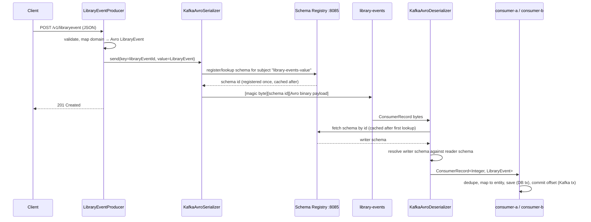
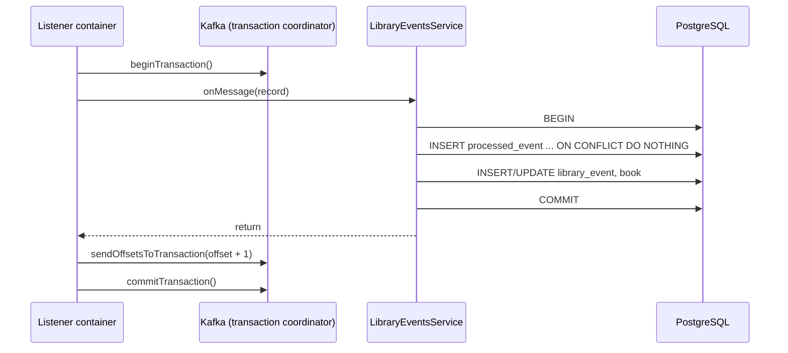
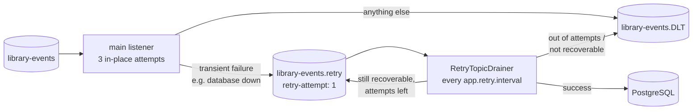
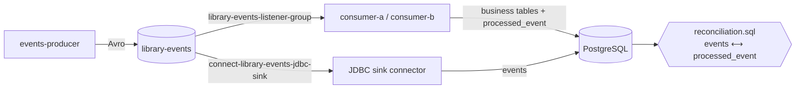

# <span style="color:hsl(304,80%,58%)">events-consumer-a / events-consumer-b — Kafka → PostgreSQL, retries, share groups</span>

## <span style="color:hsl(139,80%,58%)">Table of contents</span>

1. 🧭 [Overview](#1-overview)
2. 📥 [Consumers](#2-consumers)
3. 🧱 [Base event on the consumer side](#3-base-event-on-the-consumer-side)
4. 👥 [Two consumers, one group: consumer-a and consumer-b](#4-two-consumers-one-group-consumer-a-and-consumer-b)
5. 🔁 [Kafka transactions](#5-kafka-transactions)
6. 🪪 [Idempotent consumer](#6-idempotent-consumer)
7. ⚠️ [Error handling: retries, recovery, dead-letter topic](#7-error-handling-retries-recovery-dead-letter-topic)
8. ✋ [Manual offset commits](#8-manual-offset-commits)
9. 🎯 [Delivery semantics, concretely](#9-delivery-semantics)
10. 🗄️ [Database and Flyway migrations](#10-database-and-flyway-migrations)
11. 🔄 [Data replication with Kafka Connect, and reconciliation](#11-data-replication-with-kafka-connect-and-reconciliation)
12. 🔁 [Non-blocking retry topics (`@RetryableTopic`)](#12-non-blocking-retry-topics-retryabletopic)
13. 🧺 [Share groups: Kafka as a queue](#13-share-groups-kafka-as-a-queue)
14. 🗜️ [Compacted "latest state" topic](#14-compacted-latest-state-topic)
15. 🆕 [KIP-848 consumer rebalance protocol](#15-kip-848-consumer-rebalance-protocol)
16. ⏪ [Replaying records with seek](#16-replaying-records-with-seek)
17. 📚 [Consumer concepts, and where these apps use them](#17-consumer-concepts)
18. ⚙️ [Configuration](#18-configuration)
19. 🪤 [Gotchas (Avro 1.12 / Spring Boot 4)](#19-gotchas)
20. 🧪 [Tests](#20-tests)
21. ❓ [Q&A](#21-q-and-a)
    - ❓ [21.1 What is zombie fencing, and how does it protect consumer-a and consumer-b?](#21-1-zombie-fencing-in-the-consumers)
    - ❓ [21.2 🔥 consumer-a dies after the database commit but before the Kafka commit. Walk through it.](#21-2-consumer-a-dies-after-the-database-commit-but-before)
    - ❓ [21.3 🔥 PostgreSQL is down for 10 minutes. What happens to library events?](#21-3-postgresql-is-down-for-10-minutes-what-happens-to)
    - ❓ [21.4 🔥 A book shows an older title although a newer UPDATE was processed. How?](#21-4-a-book-shows-an-older-title-although-a-newer-update-was)
    - ❓ [21.5 What happens if consumer-a sets `concurrency: 3`?](#21-5-what-happens-if-consumer-a-sets-concurrency-3)
    - ❓ [21.6 Why does `library-events.DLT` contain two kinds of values?](#21-6-why-does-library-events-dlt-contain-two-kinds-of-values)
    - ❓ [21.7 🔥 The retry drainer sees nothing on a partition that clearly has records. Why?](#21-7-read-committed-stall)
    - ❓ [21.8 Could consumer-a and consumer-b ever process the same record?](#21-8-could-consumer-a-and-consumer-b-ever-process-the-same)

---

The consumer side of [kafka-core](../README.md): ***events-consumer-a*** (port `8081`) and ***events-consumer-b*** (port `8086`). Both modules hold ***the same code*** and join ***the same consumer groups***, so this README covers both; only the app name, port, client id, transaction id prefix and consumer-b's KIP-848 group protocol differ ([§4](#4-two-consumers-one-group-consumer-a-and-consumer-b)).

The cluster, Schema Registry and security live in the [kafka-core README](../README.md); the producer and the event schemas in [events-producer](../events-producer/README.md).


---

<a id="1-overview"></a>
## <span style="color:hsl(230,80%,58%)">1. 🧭 Overview</span>

| Reads | Group | Does | Section |
|---|---|---|---|
| `library-events` | `library-events-listener-group` | writes PostgreSQL (Kafka transaction + idempotent consumer), publishes `library-book-state` | [§2](#2-consumers), [§5](#5-kafka-transactions), [§6](#6-idempotent-consumer) |
| `library-events.retry` | `library-events-retry-group` | scheduled drain of transient failures | [§7](#retry-topic-and-the-scheduled-drain) |
| `coffee-orders` | `coffee-orders-listener-group` | logs; `@RetryableTopic` retries | [§2](#2-consumers), [§12](#12-non-blocking-retry-topics-retryabletopic) |
| `coffee-orders` | `coffee-baristas` (share group) | work queue, per-record acks | [§13](#13-share-groups-kafka-as-a-queue) |

REST: `ReplayController` on each app ([§16](#16-replaying-records-with-seek)).

```bash
# from the repo root, after `docker compose up -d` in kafka-core (kafka-core §8). Flyway migrates on startup.
mvn spring-boot:run -pl kafka-core/events-consumer-a
mvn spring-boot:run -pl kafka-core/events-consumer-b

# Optional, instead of a consumer: the manual-offset demo listener (§8)
mvn spring-boot:run -pl kafka-core/events-consumer-a -Dspring-boot.run.profiles=manual-offset
```

---

<a id="2-consumers"></a>
## <span style="color:hsl(304,80%,58%)">2. 📥 Consumers</span>

### <span style="color:hsl(54,80%,50%)">`LibraryEventsConsumer` → `LibraryEventsService` (events-consumer-a / -b)</span>

`events-consumer-a` and `events-consumer-b` contain the same code. Only the app name, port and client id differ ([§4](#4-two-consumers-one-group-consumer-a-and-consumer-b)).

```java
@KafkaListener(topics = {"library-events"}, groupId = "${spring.kafka.consumer.group-id}",
        properties = "specific.avro.value.type=com.learnkafka.avro.LibraryEventAvro")
public void onMessage(ConsumerRecord<Integer, LibraryEventAvro> consumerRecord) {
    libraryEventsService.processLibraryEvent(consumerRecord);
}
```

```yaml
spring.kafka.consumer:
  key-deserializer: org.apache.kafka.common.serialization.IntegerDeserializer
  value-deserializer: org.springframework.kafka.support.serializer.ErrorHandlingDeserializer
  properties:
    spring.deserializer.value.delegate.class: io.confluent.kafka.serializers.KafkaAvroDeserializer
    specific.avro.reader: true
```

- ***`ErrorHandlingDeserializer` wraps `KafkaAvroDeserializer`.*** Bytes that are not valid Avro become a `DeserializationException` that is dead-lettered ([§7](#7-error-handling-retries-recovery-dead-letter-topic)), instead of a poison pill that fails every `poll()`.
- ***`specific.avro.reader: true`*** makes the deserializer return the typed generated class instead of a reflection-only [`GenericRecord`][GenericRecord].
- ***`specific.avro.value.type`*** (set per listener) pins the reader class. Without it the deserializer picks the class from the ***writer's*** schema name, so records written as `LibraryEvent` (schema v1) would fail with `Could not find class com.learnkafka.avro.LibraryEvent`. It's per listener because the same apps also read `CoffeeOrder`.

`processLibraryEvent()` is the Template Method. It runs in ***one database transaction*** ([`@Transactional("transactionManager")`][Transactional], the JPA transaction manager):

1. ***Idempotency check*** — insert `(group, topic, partition, offset)` into `processed_event`. If the row already exists, the record was applied before: log and return ([§6](#6-idempotent-consumer)).
2. ***Map*** the Avro record to the JPA entity (`LibraryEventEntityMapper`), seen through the base-event view `ReceivedEvent.of(value)` for logging ([§3](#3-base-event-on-the-consumer-side)).
3. ***Dispatch by `libraryEventType`*** (a `NEW` that carries an id is rejected — the database assigns ids):
    - **`NEW`** → `save()` — persists `LibraryEvent` + cascaded `Book` via `LibraryEventsRepository` (Spring Data JPA → PostgreSQL).
    - **`UPDATE`** → `validate()` then `save()`. `validate()` is where the deliberately non-retryable failure lives:

```java
private void validate(LibraryEvent libraryEvent) {
    if (libraryEvent.getLibraryEventId() == null) {
        throw new IllegalArgumentException("Library Event Id is missing");
    }
    libraryEventsRepository.findById(libraryEvent.getLibraryEventId())
            .orElseThrow(() -> new IllegalArgumentException("Not a valid library Event: " + ...));
}
```

An `UPDATE` for an id that was never saved as `NEW` (or has a null id) is not a *transient* problem — retrying fails identically every time. That's why it's an [`IllegalArgumentException`][IllegalArgumentException], excluded from retry ([§7](#7-error-handling-retries-recovery-dead-letter-topic)). If any step throws, the database transaction rolls back — including the `processed_event` row — so the retry starts clean.

### <span style="color:hsl(9,80%,58%)">`CoffeeOrdersConsumer` (in consumer-a and consumer-b)</span>

```java
@KafkaListener(topics = "coffee-orders", groupId = "coffee-orders-listener-group",
        containerFactory = LibraryEventsConsumerConfig.COFFEE_ORDERS_CONTAINER_FACTORY,
        properties = "key.deserializer=org.apache.kafka.common.serialization.StringDeserializer")
public void onMessage(ConsumerRecord<String, CoffeeOrder> record) { ... }
```

- ***Same deserializer setup*** as library events (ErrorHandlingDeserializer → KafkaAvroDeserializer, specific reader), with the key deserializer overridden to `String` for the UUID keys.
- ***Own group, shared by both apps*** — `coffee-orders-listener-group` splits the coffee partitions between consumer-a and consumer-b, independently of the library group.
- ***Own, simpler container*** (`coffeeOrdersContainerFactory`) — the listener only logs, so there is no Kafka transaction and no DLT: `DefaultErrorHandler` retries a failing record twice, then logs and skips it.
- `onMessage()` receives a typed `CoffeeOrder` (`record.value().getId()`, `.getStatus()`, `.getStore().getId()`) and logs `Received CoffeeOrder: id=... name='Ada' status=NEW store=1 partition=...`.

### <span style="color:hsl(270,80%,58%)">Message flow with Schema Registry</span>



The coffee flow differs on the producer side: `CoffeeOrderService` serializes the `CoffeeOrder` (subject `coffee-orders-value`) into the outbox row and Debezium publishes those bytes ([events-producer §8](../events-producer/README.md#8-transactional-outbox-for-coffee-orders-debezium)); `CoffeeOrdersConsumer` then reads them like any Avro record (without the database and transaction steps).

---

<a id="3-base-event-on-the-consumer-side"></a>
## <span style="color:hsl(26,80%,58%)">3. 🧱 Base event on the consumer side</span>

Every event carries the base-event metadata (`eventId`, `eventType`, `eventVersion`, `occurredAt`, `source`, `correlationId`), defined in the shared `schemas` module and stamped by the producer: [events-producer §3](../events-producer/README.md#3-base-event-common-metadata-for-every-event).

***Consumers — handled once, for every event type.***

| Where | What the base event gives |
|---|---|
| `EventMetadataMdcInterceptor` (a `RecordInterceptor` on every classic container, incl. retry/DLT ones) | puts `eventId`, `eventType`, `correlationId` into the logging MDC for the duration of the record; the barista share listener does the same itself (share containers have no interceptor) |
| `logback-spring.xml` | every log line written while processing shows `[LibraryEvent.NEW:44b660dc-…]` — console and file |
| `ProcessedEventRepository` + Flyway `V3` | idempotency also by `eventId`: the same event re-sent at a ***new offset*** is skipped ([§6](#6-idempotent-consumer)) |
| `ReceivedEvent.of(value)` | the base-event view of any received Avro event, used for logging in the library service and coffee listener |
| Kafka Connect replica | `events` gains `event_id`, `event_type`, `event_version`, `occurred_at`, `event_source`, `correlation_id` ([§11](#11-data-replication-with-kafka-connect-and-reconciliation)) |

Real consumer log, one record, three lines — all tagged with the same event:

```
[LibraryEvent.NEW:44b660dc-ca14-4d49-a939-438d4ca0b7cc] c.l.consumer.LibraryEventsConsumer : Received ConsumerRecord : ...
[LibraryEvent.NEW:44b660dc-ca14-4d49-a939-438d4ca0b7cc] c.l.service.LibraryEventsService   : Processing LibraryEvent.NEW eventId=44b660dc-...
[LibraryEvent.NEW:44b660dc-ca14-4d49-a939-438d4ca0b7cc] c.l.service.LibraryEventsService   : Persisted libraryEvent LibraryEvent(libraryEventId=21, ...)
```

---

<a id="4-two-consumers-one-group-consumer-a-and-consumer-b"></a>
## <span style="color:hsl(195,80%,58%)">4. 👥 Two consumers, one group: consumer-a and consumer-b</span>

| | consumer-a | consumer-b |
|---|---|---|
| Module | `events-consumer-a` | `events-consumer-b` |
| HTTP port | `8081` | `8086` (`8082` is the kafka-stream app, `8085` Schema Registry) |
| `spring.application.name` / `client-id` | `events-consumer-a` | `events-consumer-b` |
| Transaction id prefix | `events-consumer-a-tx-` | `events-consumer-b-tx-` |
| `group-id` (library events) | `library-events-listener-group` | ***same*** |
| `group-id` (coffee orders) | `coffee-orders-listener-group` | ***same*** |
| Listener threads (`spring.kafka.listener.concurrency`) | 1 | 1 |
| Group protocol | `classic` (default) | `consumer` — KIP-848 ([§15](#15-kip-848-consumer-rebalance-protocol)) |

- ***Same `group-id` = one logical consumer.*** Kafka gives each partition to exactly one member of the group, so the two apps never process the same partition at the same time.
- ***Different `group-id`s*** would do the opposite: each app would get *every* record (pub/sub instead of load sharing).
- ***Concurrency is 1 per app*** on purpose. With 3 threads each there would be 6 members for 3 partitions, and the assignor could give all 3 to one app and leave the other idle.
- ***Who assigns the partitions?*** With the classic protocol the group leader's client computes the assignment; with KIP-848 the broker does. Either way the ***group coordinator***, a responsibility of one ordinary broker (the leader of the group's `__consumer_offsets` partition). It is not a separate broker type. On the client side, each app's `ConsumerCoordinator` sends heartbeats and join requests to it.
- ***Transaction ids must be unique per running instance***, which is why the prefix uses the app name.

Real run — 6 NEW events (null key, so all on P0), then 6 keyed UPDATE events (spread by key):

```
PARTITION  CURRENT-OFFSET  LAG  CONSUMER-ID
0          10              0    events-consumer-a-0
1          5               0    events-consumer-a-0
2          3               0    events-consumer-b-0
```

consumer-a processed the records on P0 + P1, consumer-b those on P2, and all 6 books in PostgreSQL were created and then updated.

***Failover*** — after stopping consumer-a, the coordinator rebalanced within seconds:

```
PARTITION  CONSUMER-ID
0          events-consumer-b-0
1          events-consumer-b-0
2          events-consumer-b-0
```

Start consumer-a again and the partitions are shared once more. Coffee orders split the same way in their own group — in a real run, 3 orders went 2 to consumer-a (P0, P1) and 1 to consumer-b (P2).

---

<a id="5-kafka-transactions"></a>
## <span style="color:hsl(320,80%,58%)">5. 🔁 Kafka transactions</span>

Turned on by one property in each library consumer app:

```yaml
spring.kafka.producer.transaction-id-prefix: ${spring.application.name}-tx-
```

Spring Boot then makes the `KafkaTemplate` transactional and creates a [`KafkaTransactionManager`][KafkaTransactionManager]. `LibraryEventsConsumerConfig` puts that manager on the listener container:

```java
factory.getContainerProperties().setKafkaAwareTransactionManager(kafkaTransactionManager);
factory.setAfterRollbackProcessor(afterRollbackProcessor());
```

***What happens for each record:***



- ***Kafka side is atomic*** — the consumed offset and anything sent to Kafka while handling the record (state topic, retry-topic forward, DLT publish) commit together or not at all.
- ***Database side is a separate transaction.*** Kafka cannot take part in a database transaction (there is no XA/2PC), so this is "best-effort one-phase commit": the database commits first, then Kafka.
- ***The gap:*** if the app dies after the database commit but before the Kafka commit, the offset is not committed and the record is delivered again. The idempotent consumer ([§6](#6-idempotent-consumer)) closes that gap.
- ***Two transaction managers, one `@Primary`.*** `transactionManager` is a [`JpaTransactionManager`][JpaTransactionManager] declared explicitly and marked `@Primary`. Without it, Boot's JPA transaction manager can back off once a `KafkaTransactionManager` exists, and `@Transactional` would silently cover Kafka instead of the database. The service names it explicitly: `@Transactional("transactionManager")`.
- ***`isolation.level=read_committed`*** — the consumers never see records from producer transactions that were aborted.
- ***Sends must happen inside a transaction.*** A transactional `KafkaTemplate` refuses a send with no transaction open. Inside the listener the container has one open; elsewhere (for example in tests) use `kafkaTemplate.executeInTransaction(t -> t.sendDefault(...))`.
- The producer app uses no Kafka transactions: library events and key routing rely on the idempotent producer, coffee orders on a database transaction plus Debezium ([events-producer §8](../events-producer/README.md#8-transactional-outbox-for-coffee-orders-debezium)); why, and when it would need them: [events-producer §6](../events-producer/README.md#6-idempotent-producer). The coffee listener's container is not transactional either.

---

<a id="6-idempotent-consumer"></a>
## <span style="color:hsl(229,80%,58%)">6. 🪪 Idempotent consumer</span>

Two different problems, two different fixes:

| | Idempotent ***producer*** | Idempotent ***consumer*** |
|---|---|---|
| Duplicate it prevents | a producer ***retry*** writing the same record twice | the same record being ***applied twice*** to the database |
| Where it lives | Kafka broker | this app's database |
| How | producer id (PID) + per-partition sequence number; the broker drops a repeated sequence | `processed_event` row per `(group, topic, partition, offset)`, inserted in the same DB transaction |
| Config | `enable.idempotence=true`, `acks=all`, `max.in.flight.requests.per.connection ≤ 5` | Flyway `V2__create_processed_event.sql` + `V3__add_event_id_to_processed_event.sql` + `ProcessedEventRepository` |
| On in | the producer app and both consumer apps (required by transactions) | both consumer apps, library events only |

***Idempotent producer*** — PID + per-partition sequence numbers: [events-producer §6](../events-producer/README.md#6-idempotent-producer). It does ***not*** stop a consumer from processing a record twice.

***Idempotent consumer***

```java
// ProcessedEventRepository — runs inside the service's DB transaction
INSERT INTO processed_event (consumer_group, topic, partition_no, offset_no)
VALUES (?, ?, ?, ?)
ON CONFLICT DO NOTHING            -- 0 rows inserted = already processed → skip
```

- ***Atomic check-and-mark*** — one `INSERT ... ON CONFLICT DO NOTHING`, no "SELECT then INSERT" race between threads or between consumer-a and consumer-b.
- ***Same transaction as the business write*** — if processing fails, the marker rolls back too, so a retry is not wrongly skipped.
- ***Keyed by delivery position AND by event*** — the primary key `(group, topic, partition, offset)` catches a ***redelivery*** of the same record; the unique index `(group, event_id)` catches the same ***event re-sent*** at a new offset (the base event's `eventId`, [§3](#3-base-event-on-the-consumer-side)). One `INSERT ... ON CONFLICT DO NOTHING` checks both. Events written before metadata existed have no `event_id` and are deduped by position only.
- ***Shared by both apps*** — after a rebalance moves a partition from consumer-a to consumer-b, a record that a already applied is skipped by b.
- The test `redeliveredRecord_isAppliedOnce` processes the same record twice: one row, no error. Without the marker the second `NEW` would hit the `book` primary key.

Inspect the markers:

```bash
# Database: rows and idempotency markers per partition
docker exec kafka-core-postgres psql -U library -d library \
  -c "select partition_no, count(*) from processed_event group by 1 order by 1"
```

---

<a id="7-error-handling-retries-recovery-dead-letter-topic"></a>
## <span style="color:hsl(31,80%,58%)">7. ⚠️ Error handling: retries, recovery, dead-letter topic</span>

With a transactional container, a failed record ***rolls the Kafka transaction back***, and Spring Kafka's [`DefaultAfterRollbackProcessor`][DefaultAfterRollbackProcessor] (not the `DefaultErrorHandler`) decides what happens next. It wraps a [`BackOff`][BackOff] policy and a [`ConsumerRecordRecoverer`][ConsumerRecordRecoverer]:

```java
var backOff   = new FixedBackOff(1_000L, 2);       // 1s delay, 2 retries = 3 attempts total
var processor = new DefaultAfterRollbackProcessor<>(retryRouter(), backOff, kafkaTemplate, true);
processor.addNotRetryableExceptions(IllegalArgumentException.class, DataIntegrityViolationException.class);
```

- ***Deterministic failures skip the retries*** — they can never succeed: an `UPDATE` for an unknown id or a `NEW` that carries an id (`IllegalArgumentException`), a `NEW` for a `book_id` that already exists (`DataIntegrityViolationException` from the primary key), and bytes that are not Avro (`DeserializationException`). Each lands on the DLT after exactly one attempt.
- ***Why a NEW must not carry an id*** — Spring Data would `merge()` it as an existing row, and Hibernate 6.6+ rejects merging an entity whose generated id isn't in the table (`ObjectOptimisticLockingFailureException`) — on every retry. The producer answers `400` for such a POST, and the consumer rejects it too (other producers may not).
- ***Recovery looks through the whole cause chain*** for a transient failure, since the listener's exception arrives wrapped (`RetryRouter.isRecoverable`). A real PostgreSQL outage never surfaces as `RecoverableDataAccessException`: the JPA transaction fails to start (`CannotCreateTransactionException`) with Hikari's `SQLTransientConnectionException` underneath. The consumers set Hikari's `connection-timeout` to 5 s, so an outage reaches the retry topic within seconds instead of stalling the listener.
- ***`commitRecovered = true`*** — once the recoverer has handled a record, its send (retry topic / DLT) and the record's offset commit in ***one new Kafka transaction***, so the record is never processed again.
- ***`DeserializationException` is never retried*** (Spring Kafka's default) — bad bytes stay bad.

Recovery strategy — `RetryRouter`, the recoverer shared with the drain job, keyed off the **cause chain**:

| Root cause | Behavior |
|---|---|
| a ***transient failure*** anywhere in the cause chain — the database unreachable or briefly overloaded: `CannotCreateTransactionException`, `DataAccessResourceFailureException` (incl. `CannotGetJdbcConnectionException`), `TransientDataAccessException`, [`RecoverableDataAccessException`][RecoverableDataAccessException], `SQLTransientException`, `SQLRecoverableException` | Treated as transient — forwarded to **`library-events.retry`** with header `retry-attempt: 1`, same partition number; the scheduled drain job retries it ([below](#retry-topic-and-the-scheduled-drain)) |
| anything else ([`IllegalArgumentException`][IllegalArgumentException], `DataIntegrityViolationException`, `DeserializationException`, or any exception that survives all retries) | Routed via [`DeadLetterPublishingRecoverer`][DeadLetterPublishingRecoverer] to **`library-events.DLT`**, same partition number as the original record |

***What lands on the DLT*** — the library consumers publish with a [`DelegatingByTypeSerializer`][DelegatingByTypeSerializer] (set by a `DefaultKafkaProducerFactoryCustomizer` bean):

| Failed record | DLT value | Serializer |
|---|---|---|
| valid Avro, failed in business logic (e.g. unknown id) | the same `LibraryEvent`, Avro again (subject `library-events.DLT-value`) | `KafkaAvroSerializer` |
| bytes that are not valid Avro | the ***original bytes, unchanged*** | `ByteArraySerializer` |

Both carry `kafka_dlt-*` headers (original topic/partition/offset, exception class and message). A DLT reader must handle both kinds of value.

The DLT topic is created by `kafka-init` (3 partitions, RF 3) and also declared in code ([`NewTopic`][NewTopic]), so it exists before the first dead letter. It has the same partition count as the source topic, so the "same partition" mapping is meaningful.

**Retry timeline for a genuinely transient failure:**

```
t=0s      record → listener throws (e.g. transient DB hiccup) → Kafka + DB transactions roll back
t=0s+1s   retry #1 (FixedBackOff delay = 1000ms)
t=1s+1s   retry #2 (2 retries configured → 3 total attempts)
t=2s      still failing → RetryRouter invoked inside a new Kafka transaction
             → transient failure (DB down, timeout)? → "library-events.retry" (retry-attempt 1)
             → anything else?                 → DeadLetterPublishingRecoverer → "library-events.DLT"
          → offset committed in that same transaction
```

The partition is *not* blocked forever by a poison message, which is the whole point of a dead-letter topic.

<a id="retry-topic-and-the-scheduled-drain"></a>
### <span style="color:hsl(211,80%,58%)">Retry topic and the scheduled drain</span>

A recoverable failure (the database is down) is worth retrying later, but not by holding the record in the app (a restart would start the wait again) and not by re-publishing it to `library-events` (that loops forever and loses the headers). It moves to ***`library-events.retry`*** at once, and a ***scheduled job*** retries it:



| Header | Meaning |
|---|---|
| `retry-attempt` | times the record was forwarded to the retry topic: `1` on the first hop, ***replaced*** (not appended) on each hop. The DLT copy keeps it, so "dead-lettered after 3 retries" is visible. A record on `library-events` that already carries it (re-driven from the DLT) starts again at 1. |
| producer headers | kept |
| `kafka_dlt-exception-*` | the ***latest*** failure |
| `kafka_dlt-original-*` | the record's position on `library-events` (first hop only: `setAppendOriginalHeaders(false)`) |

***One drain run*** (`RetryTopicDrainer`, `@Scheduled(fixedDelay = app.retry.interval)`, so runs never overlap):

1. A fresh consumer joins `library-events-retry-group` and gets its share of the partitions (both consumer apps run the job).
2. It notes where each partition ends ***now*** and processes only records below that point ***that have waited `app.retry.delay`*** on the retry topic, judged by the record's timestamp (the time it was forwarded). A record re-queued during the run — or forwarded seconds ago by the other consumer app, whose schedule runs independently — waits for a later run, so ***attempts are at least `app.retry.delay` apart***. A run also stops at `app.retry.max-run`, checked before each record (it fetches at most 50 per poll), because with the database down every attempt can take a connection timeout.
3. Each record: Kafka transaction 1 = `processLibraryEvent` + the record's offset. On failure that transaction aborts (dropping a state record it may have sent) and transaction 2 forwards the record through `RetryRouter` — back to the retry topic with `retry-attempt + 1`, or to the DLT once `app.retry.max-attempts` are used up — together with the offset.
4. A crash loses nothing: offsets are committed per record. If Kafka itself fails mid-run, the run stops and the next one reads that record again; a record whose database work had already committed is skipped by `processed_event` ([§6](#6-idempotent-consumer)).
5. ***Schema Registry unreachable*** (a network error or a 5xx while deserializing — each run starts with an empty schema cache) counts as an outage, not a bad record: the run stops without committing that record, which waits for the next run instead of being dead-lettered.

```yaml
app:
  retry:
    topic: library-events.retry
    group-id: library-events-retry-group
    interval: 30s       # fixed delay between two drain runs
    delay: 30s          # a record is retried only after waiting this long (default: interval)
    max-attempts: 3     # attempts from the retry topic before the DLT
    max-run: 1m         # a single run never drains longer than this
```

`RetryProperties` validates these at startup: `interval` and `max-run` must be positive, `max-attempts` at least 1, `delay` may be zero.

- ***Trade-off: per-key order*** — while a record waits on the retry topic, newer events with the same key are processed from `library-events`, so an older event can be applied after a newer one: an `UPDATE` that waited on the retry topic overwrites a later `UPDATE` of the same book. (An `UPDATE` that overtakes its `NEW` fails validation and goes to the DLT.) Every retry-topic design trades ordering for not blocking the partition; the coffee orders' [`@RetryableTopic`](#12-non-blocking-retry-topics-retryabletopic) makes the same trade.
- ***Why a drain job and not `@RetryableTopic`*** — the library listener already recovers in its transactional `AfterRollbackProcessor`, and one schedule (`app.retry.interval`) makes retry timing explicit. `@RetryableTopic` instead pauses each retry partition until a record's due time, stored in a header (so it survives restarts too).

---

<a id="8-manual-offset-commits"></a>
## <span style="color:hsl(84,80%,58%)">8. ✋ Manual offset commits</span>

A second, intentionally minimal listener, `LibraryEventsConsumerManualOffset` ([`@Profile("manual-offset")`][Profile]; the default `LibraryEventsConsumer` is `@Profile("!manual-offset")`, so the two never run together), demonstrates the other end of the offset-commit spectrum:

```java
@KafkaListener(topics = {"library-events"}, groupId = "${spring.kafka.consumer.group-id}",
        containerFactory = LibraryEventsConsumerConfig.MANUAL_ACK_CONTAINER_FACTORY,
        properties = LibraryEventsConsumer.AVRO_READER_TYPE)
public void onMessage(ConsumerRecord<Integer, LibraryEventAvro> consumerRecord,
                      Acknowledgment acknowledgment) {
    acknowledgment.acknowledge();
}
```

The `manualAckContainerFactory` bean in `LibraryEventsConsumerConfig` is the default factory's setup (including the Kafka transaction manager) plus `AckMode.MANUAL_IMMEDIATE`. Without it the container would run in the default `BATCH` mode, where Spring Kafka has no `Acknowledgment` to pass and every record fails.

With [`AcknowledgingMessageListener`][AcknowledgingMessageListener] + `MANUAL_IMMEDIATE`, the framework will *not* commit an offset unless the listener calls `acknowledgment.acknowledge()` itself. This is the building block for "commit only after I'm certain the side effect succeeded". The default listener gets the same effect implicitly, since its offset is committed in the Kafka transaction only after the listener returns. The manual variant makes the commit point an explicit line of code, which matters once processing spans more than one listener invocation (e.g. batching, or committing after a separate async step).

### <span style="color:hsl(221,80%,58%)">Ack modes: when does the container commit?</span>

[`ContainerProperties.AckMode`][AckMode] decides when the listener container commits the offsets of the records it has processed (Spring Kafka 4.1.2, as of 2026). It only applies while Kafka's own auto-commit is off: with `enable.auto.commit=true` the consumer commits on its own every `auto.commit.interval.ms`, and the ack mode is ignored. Spring Kafka turns auto-commit off unless you set it.

| Ack mode | The container commits… | Listener gets | Trade-off |
|---|---|---|---|
| `BATCH` (default) | once every record from one `poll()` has been processed | the record | fewest commits; a crash replays the rest of that poll |
| `RECORD` | after each record | the record | one commit per record: slower, smallest replay window |
| `TIME` | the pending offsets, once `ackTime` (default 5 s) has passed | the record | caps the commit rate by time |
| `COUNT` | the pending offsets, once `ackCount` (default 1) records are pending | the record | caps the commit rate by count |
| `COUNT_TIME` | whichever of `ackCount` / `ackTime` comes first | the record | both caps |
| `MANUAL` | only what the listener acknowledged, queued until every record from the poll has been processed | the record + [`Acknowledgment`][Acknowledgment] | the listener decides what counts as done; still one commit per poll |
| `MANUAL_IMMEDIATE` | at once, when the listener calls `acknowledge()` on the consumer thread (from another thread it is queued like `MANUAL`) | the record + `Acknowledgment` | the commit point is a line of code; one commit per ack |

- ***Commits are synchronous*** (`commitSync`) by default; `ContainerProperties.setSyncCommits(false)` switches to `commitAsync`.
- ***An offset is a position, not a per-record flag*** — committing record 8 means "resume at 9", so it also covers an unacknowledged record 7 on the same partition. Not acknowledging a record does not by itself bring it back.
- ***`nack(Duration)`*** (manual modes, record listener) is the opposite of `acknowledge()`: nothing is committed, the rest of the poll is discarded, and the container seeks back so this record is delivered again after the sleep. The whole listener pauses for that sleep (at least `pollTimeout`, 5 s), not just the record's partition.

***Inside a Kafka transaction*** (both consumer apps, [§5](#5-kafka-transactions)) the ack mode hardly matters. After the listener returns, the container sends the record's offset to ***the record's transaction*** (`sendOffsetsToTransaction`), so the offset commits or aborts together with whatever the listener published. Checked in the spring-kafka 4.1.2 source (`ackCurrent()` takes the transaction branch before it looks at the ack mode):

- `BATCH`, `RECORD`, `TIME`, `COUNT`, `COUNT_TIME` and even `MANUAL` — the offset joins the transaction when the listener returns, whether or not it called `acknowledge()`.
- `MANUAL_IMMEDIATE` — the offset joins the transaction only when the listener calls `acknowledge()`. That is why `manualAckContainerFactory` uses it: the commit point stays the explicit line in `LibraryEventsConsumerManualOffset`.

---

<a id="9-delivery-semantics"></a>
## <span style="color:hsl(158,80%,58%)">9. 🎯 Delivery semantics, concretely</span>

- ***Producer → broker*** — no duplicates from retries (`acks=all` + idempotence): [events-producer §9](../events-producer/README.md#9-delivery-semantics).
- ***Broker → consumer: at-least-once delivery.*** A record can be delivered again if the app dies between the database commit and the Kafka offset commit.
- ***Consumer → database: effectively exactly-once.*** The idempotent consumer turns that redelivery into a no-op, so each record changes the database once.
- ***Kafka → Kafka: exactly-once.*** Anything the consumers write back to Kafka (state topic, retry topic, DLT) commits atomically with the consumed offset.
- ***Forwarding to the retry topic*** creates a *new* record (new offset) on `library-events.retry`. The original record's offset is committed as handled, because it was handled, by forwarding it. In-place retries re-attempt the *existing* record; forwarding closes the current attempt and leaves the real retry to the drain job ([§7](#7-error-handling-retries-recovery-dead-letter-topic)).
- ***Coffee orders*** use a plain (non-transactional) container: at-least-once, no dedupe — the listener only logs.

---

<a id="10-database-and-flyway-migrations"></a>
## <span style="color:hsl(14,80%,58%)">10. 🗄️ Database and Flyway migrations</span>

***Flyway owns the schema*** (`events-consumer-*/src/main/resources/db/migration`), and Hibernate only checks it (`ddl-auto: validate`) — the app fails fast at startup if the entities and tables disagree.

| Migration | Creates |
|---|---|
| `V1__create_library_event_and_book.sql` | `library_event` (identity primary key, `NEW`/`UPDATE` check) and `book` (one-to-one via `library_event_id`) |
| `V2__create_processed_event.sql` | `processed_event` — the idempotent-consumer table, primary key `(consumer_group, topic, partition_no, offset_no)` |
| `V3__add_event_id_to_processed_event.sql` | `processed_event.event_id` (UUID) + unique index `(consumer_group, event_id)` — dedupe by the base event's `eventId` |

```
library_event                         book
─────────────────────────────         ──────────────────────────────────────
library_event_id   INT  PK identity   book_id           INT  PK
library_event_type VARCHAR(20)        book_name         VARCHAR(255)
                                      book_author       VARCHAR(255)
                                      library_event_id  INT  UNIQUE FK → library_event

processed_event
──────────────────────────────────────────────────────
consumer_group VARCHAR │ topic VARCHAR │ partition_no INT │ offset_no BIGINT   ← composite PK
event_id       UUID    ← unique per consumer_group (NULL for pre-metadata events)
processed_at   TIMESTAMPTZ DEFAULT now()
```

- `LibraryEvent.libraryEventId` uses `GenerationType.IDENTITY` to match the identity column.
- Both consumer apps run the same migrations against the same database. Flyway takes a database lock while migrating, so starting both at once is safe.
- Column names follow Spring Boot's default naming: `libraryEventType` → `library_event_type`.

---

<a id="11-data-replication-with-kafka-connect-and-reconciliation"></a>
## <span style="color:hsl(280,80%,58%)">11. 🔄 Data replication with Kafka Connect, and reconciliation</span>

A ***Kafka Connect JDBC sink connector*** reads `library-events` and writes every record into a PostgreSQL table called `events`. (The same Connect worker also runs a Debezium ***source*** connector, the coffee-orders outbox — [events-producer §8](../events-producer/README.md#8-transactional-outbox-for-coffee-orders-debezium).) No Spring Boot service is involved — the connector is just configuration ([`connect/library-events-jdbc-sink.json`](../connect/library-events-jdbc-sink.json)). The table is a raw copy of ***what was sent***; the consumers' `processed_event` table records ***what was processed***. Comparing the two is reconciliation. Background: the wiki note *Kafka Connect* (connectors, workers, converters, SMTs, DLQ).



***How it is wired***

| Piece | Setting | Why |
|---|---|---|
| Worker | `kafka-connect` container, JDBC connector 10.9.9 installed with `confluent-hub` on start | the connector bundles the PostgreSQL driver |
| Own consumer group | `connect-library-events-jdbc-sink` | reads the topic independently of the apps; starts from the earliest offset |
| Key | `IntegerConverter` | keys are `IntegerSerializer`-encoded |
| Value | `AvroConverter` + Schema Registry | reads the same Avro the consumers read |
| Isolation | `consumer.override.isolation.level=read_committed` | needs `CONNECT_CONNECTOR_CLIENT_CONFIG_OVERRIDE_POLICY=All` on the worker |
| SMT `Flatten$Value` | `book.bookId` → `book_bookId` | the JDBC sink can't write nested structs |
| SMT `ReplaceField$Value` | renames to `library_event_id`, `book_id`, ... | snake_case columns |
| SMT `InsertField$Value` | `kafka_timestamp` | when the record was produced |
| Primary key | `pk.mode=kafka`, `pk.fields=kafka_topic,kafka_partition,kafka_offset` | same coordinates as `processed_event` |
| Write mode | `insert.mode=upsert` | a replay after a Connect crash overwrites the same row — idempotent |
| Table | `auto.create=true`, `auto.evolve=true` | the connector owns `events`; a new optional Avro field becomes a new column |
| Errors | `errors.tolerance=all` → DLQ `library-events.connect-dlq` (with context headers) | a bad record doesn't stop replication |

`kafka-connect-init` registers the connector with `PUT /connectors/library-events-jdbc-sink/config`, which creates or updates it, so re-running compose is safe.

***The table it created***

```
events
──────────────────────────────────────────────────────────────
kafka_topic TEXT │ kafka_partition INT │ kafka_offset BIGINT     ← primary key
event_id TEXT │ event_type TEXT │ event_version INT │ occurred_at TIMESTAMP │ event_source TEXT │ correlation_id TEXT
                                                                  ← base-event metadata (§3), added by auto.evolve
kafka_timestamp TIMESTAMP
library_event_id INT (null for NEW) │ library_event_type TEXT
book_id INT │ book_name TEXT │ book_author TEXT
```

***Reconciliation*** — [`connect/reconciliation.sql`](../connect/reconciliation.sql) joins the two tables on `(topic, partition, offset)`:

```bash
docker exec -i kafka-core-postgres psql -U library -d library < connect/reconciliation.sql
```

1. ***Summary per partition*** — sent, processed, not processed.
2. ***Sent but never processed*** — dead-lettered (look them up on `library-events.DLT`), still in flight, or sent before `processed_event` existed.
3. ***Processed but missing from the replica*** — should be empty; non-empty means the connector is behind or couldn't read those records.
4. ***The same event sent more than once*** — groups the replica by `event_id`; more than one row = a producer re-send (the consumers applied it once).

Real run:

```
 partition | sent | processed | not_processed
-----------+------+-----------+---------------
         0 |   11 |         9 |             2
         1 |    6 |         6 |             0
         2 |    1 |         1 |             0
```

The 2 unprocessed records were exactly the two the consumers had dead-lettered: one written with schema v1 before the reader class was pinned ([§2](#2-consumers)), and one a second `NEW` for an existing `book_id`. The 6 "processed but missing" rows were plain-JSON records from before the Avro switch: the consumers of that time processed them, but the Avro converter can't read them, so the connector sent them to `library-events.connect-dlq`.

***Things to know***

- ***At-least-once, made safe by the key*** — Connect commits its consumer offsets after writing; a crash replays records, and `upsert` on the Kafka coordinates absorbs the duplicates.
- ***`events` is a replica, not the source of truth*** — the topic is. Retention still applies to the topic; the table keeps everything until you delete it.
- ***Licensing*** — the Confluent JDBC connector uses the Confluent Community License (free to self-host, not Apache 2.0). Aiven's JDBC sink is an Apache-licensed alternative.
- ***Managing it*** (REST on `localhost:8083`; also in the *Kafka Connect* folder of [`insomnia-collection.json`](../insomnia-collection.json)):

```bash
curl localhost:8083/connectors                                        # list
curl localhost:8083/connectors/library-events-jdbc-sink/status        # connector + task state
curl -X POST localhost:8083/connectors/library-events-jdbc-sink/restart?includeTasks=true
curl -X PUT localhost:8083/connectors/library-events-jdbc-sink/pause  # .../resume
docker exec kafka-core-kafka-1 kafka-consumer-groups --bootstrap-server kafka-1:29092 \
  --describe --group connect-library-events-jdbc-sink                 # connector lag
```

---

<a id="12-non-blocking-retry-topics-retryabletopic"></a>
## <span style="color:hsl(18,80%,58%)">12. 🔁 Non-blocking retry topics (`@RetryableTopic`)</span>

Library events retry ***in place*** (the partition waits — [§7](#7-error-handling-retries-recovery-dead-letter-topic)). Coffee orders show the other approach, ***error-handling pattern 3***: a failed record is moved to a ***retry topic*** and retried later, while the main topic keeps flowing.

```java
@RetryableTopic(
        attempts = "4",                                            // 1 main + 3 retry topics
        backOff = @BackOff(delay = 1_000, multiplier = 2.0, maxDelay = 10_000),
        include = CoffeeMachineBusyException.class,                // anything else → straight to the DLT
        topicSuffixingStrategy = TopicSuffixingStrategy.SUFFIX_WITH_INDEX_VALUE,
        autoCreateTopics = "true", numPartitions = "3", replicationFactor = "-1",
        kafkaTemplate = CoffeeKafkaConfig.COFFEE_RETRY_TEMPLATE,
        listenerContainerFactory = CoffeeKafkaConfig.COFFEE_ORDERS_CONTAINER_FACTORY)
@KafkaListener(topics = "coffee-orders", groupId = "coffee-orders-listener-group", ...)
public void onMessage(ConsumerRecord<String, CoffeeOrder> record) { ... }
```

```
coffee-orders ──fail──▶ coffee-orders-retry-0 (≥1 s) ──fail──▶ -retry-1 (≥2 s) ──fail──▶ -retry-2 (≥4 s) ──fail──▶ coffee-orders-dlt
```

- ***How the delay works*** — each retry topic's listener ***pauses its partition*** until the record's due time (header `retry_topic-backoff-timestamp`), so nothing blocks the main topic.
- ***Topics and groups*** — Spring creates `coffee-orders-retry-0/1/2` and `coffee-orders-dlt` (`SUFFIX_WITH_INDEX_VALUE`; the default suffix is the delay, e.g. `-retry-1000`), each consumed by its own group (`coffee-orders-listener-group-retry-0`, ...). Consumer-a and consumer-b share them, just like the main topic.
- ***Its own template*** — retry and DLT records keep the String key (order UUID) and are not transactional. `coffeeRetryKafkaTemplate` is a `@Bean(defaultCandidate = false)`, so Boot's auto-configured template for library events stays in place.
- ***Trade-off*** — per-key ***ordering is lost***: later orders for the same key overtake one that is waiting in a retry topic. Fine for independent orders, wrong for "UPDATE must follow NEW".
- ***Why on the method, not a `RetryTopicConfiguration` bean*** — a configuration bean matches ***by topic*** and also took over the barista share-group listener on `coffee-orders` ([§19](#19-gotchas)).
- ***Try it*** — the customer name drives the demo: `flaky ...` fails once on the main topic and succeeds on `-retry-0`; `fail ...` fails every attempt and lands on `coffee-orders-dlt`. Real run: `name='flaky Dennis' ... topic=coffee-orders-retry-0`, and one record on `coffee-orders-dlt` for `fail Edsger`.

---

<a id="13-share-groups-kafka-as-a-queue"></a>
## <span style="color:hsl(36,80%,58%)">13. 🧺 Share groups: Kafka as a queue</span>

A ***share group*** (KIP-932, "Queues for Kafka" — GA in Kafka 4.2, as of 2026) reads the same `coffee-orders` topic as a ***work queue***: the `coffee-baristas` group has 2 barista threads in each consumer app (4 in total), and every order is made by exactly one of them.

| | Consumer group (`coffee-orders-listener-group`) | Share group (`coffee-baristas`) |
|---|---|---|
| Unit of work | a ***partition***, owned by one member | a ***record***, handed to any member |
| Members vs partitions | at most one member per partition | ***more members than partitions*** is fine |
| Ordering | per partition | none |
| Progress | committed offset | per-record ***acknowledgement*** (with a lock and a delivery count) |

```java
@KafkaListener(topics = "coffee-orders", groupId = "coffee-baristas",
        containerFactory = CoffeeKafkaConfig.BARISTA_SHARE_CONTAINER_FACTORY)
public void onMessage(ConsumerRecord<String, CoffeeOrder> record, ShareAcknowledgment ack) {
    if (busy && record.deliveryCount().orElse((short) 1) == 1) { ack.release(); return; }   // back to the queue
    ack.acknowledge();                                                                      // ACCEPT
}
```

- ***Container*** — `ShareKafkaListenerContainerFactory` + `DefaultShareConsumerFactory`, `ShareAckMode.MANUAL` (the listener acknowledges each record). The consumer config is copied from the normal one ***minus*** the settings share consumers reject (`isolation.level`, `auto.offset.reset`, `enable.auto.commit`, `group.protocol`, ...).
- ***Acknowledgements*** — `acknowledge()` = ACCEPT (done), `release()` = RELEASE (redeliver, maybe to another barista; delivery count + 1), `reject()` = REJECT (poison, never again), `renew()` = extend the lock.
- ***Built-in poison handling*** — a record is locked while in flight (`group.share.record.lock.duration.ms`); after `group.share.delivery.count.limit` attempts it is archived.
- ***Where it starts*** — a new share group starts at the ***latest*** offset; change it with the group config `share.auto.offset.reset=earliest`.
- ***Try it*** — a customer name starting with `busy` is released on its first delivery. Real run:

```
Barista busy — RELEASE order id=5a8d... (delivery 1) partition=1
Barista made order id=5a8d... name='busy Barbara' (delivery 2) partition=1
```

```bash
docker exec kafka-core-kafka-1 kafka-share-groups --bootstrap-server kafka-1:29092 --describe --group coffee-baristas --members
```

The members' assignments ***overlap*** (partition 2 was given to two barista consumers at once) — something a consumer group never does.

---

<a id="14-compacted-latest-state-topic"></a>
## <span style="color:hsl(72,80%,58%)">14. 🗜️ Compacted "latest state" topic</span>

After saving an event, the consumer publishes the ***current state*** to `library-book-state`, keyed by the database id:

```java
var saved = libraryEventsRepository.save(libraryEvent);
kafkaTemplate.send(STATE_TOPIC, saved.getLibraryEventId(), LibraryEventEntityMapper.toAvro(saved));
```

- ***Exactly-once publish*** — the send joins the listener's ***Kafka transaction***, so the state record and the consumed offset commit together (consume-process-produce). Outside a listener it joins the database transaction's synchronization instead.
- ***How the broker compacts it*** (log cleaner, active segment, tombstones, a real run): [kafka-core §6](../README.md#6-compacted-topics-log-compaction).

---

<a id="15-kip-848-consumer-rebalance-protocol"></a>
## <span style="color:hsl(90,80%,58%)">15. 🆕 KIP-848 consumer rebalance protocol</span>

consumer-b sets `spring.kafka.consumer.properties.group.protocol: consumer` — the ***next-generation rebalance protocol*** (GA in Kafka 4.0, opt-in as of 2026). consumer-a stays on `classic`, so the same groups run ***both protocols at once***.

| | `classic` (consumer-a) | `consumer` / KIP-848 (consumer-b) |
|---|---|---|
| Who computes the assignment | the group leader's client | the ***broker*** (group coordinator) |
| Rebalance | join/sync rounds; eager or cooperative | ***incremental***, member by member — no stop-the-world |
| Liveness settings | `session.timeout.ms`, `heartbeat.interval.ms` on the client | `group.consumer.*` on the broker (setting the client ones throws `ConfigException`) |

Real run — one group, mixed members:

```
CLIENT-ID                    CURRENT-ASSIGNMENT    TARGET-ASSIGNMENT     UPGRADED
events-consumer-a-0          library-events:2      library-events:2      false
events-consumer-b-0          library-events:0,1    library-events:0,1    true
```

`UPGRADED=true` marks the KIP-848 member; the broker computed the target assignment for both. consumer-b runs the same 51 tests as consumer-a, on the KIP-848 protocol.

---

<a id="16-replaying-records-with-seek"></a>
## <span style="color:hsl(108,80%,58%)">16. ⏪ Replaying records with seek</span>

Kafka keeps records for the retention period, so a consumer can ***re-read*** them by moving its position. `LibraryEventsConsumer` extends `AbstractConsumerSeekAware` (Spring Kafka gives it a seek callback per assigned partition), and `ReplayController` exposes it:

```bash
curl localhost:8081/v1/library-events/replay/partitions                    # which partitions this app owns
curl -X POST 'localhost:8086/v1/library-events/replay?partition=1&offset=8'  # rewind one owned partition
curl -X POST 'localhost:8081/v1/library-events/replay?timestamp=1760000000000'  # all owned partitions, from a time
```

- ***Only the owner can seek*** — partitions are split between the two apps; the other app answers `409` with its own partitions. Real run: consumer-b (owner of P1) → `202 {"partition":1,"fromOffset":8}`; consumer-a → `409 {"error":"partition 1 is not assigned to this app","ownedPartitions":[2]}`.
- ***Replays are safe*** — redelivered records hit the idempotent consumer: `Skipping duplicate record topic=library-events partition=1 offset=8`, and the database is unchanged. To really re-apply a range, delete its `processed_event` rows first.
- ***The seek runs on the consumer thread*** before its next `poll()`; the REST call only queues it.
- ***From the CLI*** (stopped group only): `kafka-consumer-groups --reset-offsets --to-offset 8 --topic library-events:1 --group library-events-listener-group --execute`.

---

<a id="17-consumer-concepts"></a>
## <span style="color:hsl(40,80%,58%)">17. 📚 Consumer concepts, and where these apps use them</span>

The consumer-side topics of the learning notes (`learning-messaging-kafka*.md`, including the slow-consumer runbook), each tied to these apps. Versions: Kafka clients 4.2.2, Spring Kafka 4.1.2, Spring Boot 4.1.2 (as of 2026).

### <span style="color:hsl(200,80%,58%)">From `@KafkaListener` to a running consumer</span>

1. `KafkaAutoConfiguration` builds a `ConsumerFactory` from `spring.kafka.consumer.*` (a property map, no consumer yet) and the default `ConcurrentKafkaListenerContainerFactory`.
2. `KafkaListenerAnnotationBeanPostProcessor` (registered by `@EnableKafka`, which Boot applies) finds every `@KafkaListener`.
3. For each one the container factory builds a listener container; each container thread creates a `KafkaConsumer`, calls `subscribe()` and runs the `poll()` loop that calls your method.

| Container | Threads | Here |
|---|---|---|
| `KafkaMessageListenerContainer` | one consumer, one thread | the children of every concurrent container |
| `ConcurrentMessageListenerContainer` | `concurrency` children | every listener; `spring.kafka.listener.concurrency: 1` |
| batch listener | same factory with `setBatchListener(true)` / `@KafkaListener(batch = "true")`: a `List<ConsumerRecord>` per poll | not used |
| share container | `ShareKafkaListenerContainerFactory`, one `KafkaShareConsumer` per thread | the barista listener ([§13](#13-share-groups-kafka-as-a-queue)) |

Container factories in these apps: `kafkaListenerContainerFactory` (Kafka transaction + `AfterRollbackProcessor`, library events), `manualAckContainerFactory` (`MANUAL_IMMEDIATE`, [§8](#8-manual-offset-commits)), `coffeeOrdersContainerFactory` (plain, `DefaultErrorHandler`, coffee orders) and `baristaShareContainerFactory`.

- ***Every listener built from one factory shares its `ConsumerFactory` settings*** — listener-specific settings go into `@KafkaListener(properties = …)`, which is why `specific.avro.value.type` and the coffee key deserializer are set there ([§2](#2-consumers)).
- ***`subscribe()` vs `assign()`*** — `subscribe()` lets the group coordinator assign partitions and rebalance (needs `group.id`); `assign()` picks partitions by hand, no rebalancing. All listeners here subscribe; the retry drainer's fresh consumer subscribes to `library-events-retry-group` ([§7](#retry-topic-and-the-scheduled-drain)).
- ***`ConsumerCoordinator` vs `GroupCoordinator`*** — the first runs inside your app (heartbeats, `JoinGroup`/`SyncGroup`, the assignor if this member leads, auto-commit); the second is a broker role (members, liveness, committed offsets). With KIP-848 the client side becomes `AsyncKafkaConsumer` + `ConsumerMembershipManager`, and the broker computes the assignment ([§15](#15-kip-848-consumer-rebalance-protocol)).

### <span style="color:hsl(160,80%,45%)">The poll loop and the fetcher</span>

- ***Classic consumer*** — fetches run inside `poll()` on your thread, pipelined: before returning records it sends the next fetch requests. Only heartbeats run on a background thread. ***KIP-848 consumer*** (consumer-b) — network I/O, fetches and membership run on a background thread; `poll()` drains a buffer.
- You can't start or stop the fetcher, only `pause()`/`resume()` partitions. Batches stay compressed in memory and are decompressed on `poll()`.
- ***`max.poll.records` ≠ fetch size*** — `max.poll.records` (500) caps what one `poll()` hands to your code; `fetch.max.bytes` (50 MB) and `max.partition.fetch.bytes` (1 MB) cap what one fetch brings over the network; `fetch.min.bytes` (1 B) waited for up to `fetch.max.wait.ms` (500 ms) is the minimum. With `max.poll.records=30` the rest of a fetch stays buffered for the next `poll()`. The retry drainer uses `max.poll.records=50` ([§7](#retry-topic-and-the-scheduled-drain)).

| Question | Property (`spring.kafka.…`) | Default |
|---|---|---|
| No committed offset — where to start? | `consumer.auto-offset-reset` | `latest` (***`earliest` here***) |
| How long `poll()` waits when idle | `listener.poll-timeout` | 5 s |
| Pause between polls | `listener.idle-between-polls` | 0 |
| Is a consumer stuck? | `listener.no-poll-threshold` × `listener.monitor-interval` | 3.0 × 30 s |
| Dead-consumer detection | `consumer.properties.session.timeout.ms` / `heartbeat.interval.ms` / `max.poll.interval.ms` | 45 s / 3 s / 5 min |
| Records per `poll()` | `consumer.max-poll-records` | 500 |
| Bytes per fetch | `consumer.fetch-min-size` / `fetch-max-wait` / `properties.fetch.max.bytes` / `properties.max.partition.fetch.bytes` | 1 B / 500 ms / 50 MB / 1 MB |
| One record or a list per call | `listener.type` | `single` |
| When the offset is committed | `consumer.enable-auto-commit` (Boot: `false`), `listener.ack-mode`, `ack-count`, `ack-time` | `BATCH` |

### <span style="color:hsl(280,80%,58%)">Order of consumption</span>

- ***Per partition only.*** `poll()` returns records grouped by partition, each group in offset order, so one listener thread sees chunks (`P0:5, P0:6, P1:3, P2:9, P0:7 …`) — never a global order. Same key → same partition → ordered.
- ***A hot partition delays, but can't starve, the others*** — each partition's share of a fetch is capped by `max.partition.fetch.bytes`, and a partition with records still buffered is left out of the next fetch. With `concurrency: 1` all owned partitions still share one thread: 8,000 hot records at 10 ms each hold the quiet ones back ~80 s. Fixes: a thread per partition, smaller `max.poll.records`, better keys, `pausePartition()`.
- ***What breaks order*** — non-blocking retry topics ([§12](#12-non-blocking-retry-topics-retryabletopic)) and the library retry topic ([§7](#retry-topic-and-the-scheduled-drain)); share groups have none ([§13](#13-share-groups-kafka-as-a-queue)). Blocking retries (`DefaultErrorHandler`, `AfterRollbackProcessor`) keep it.

### <span style="color:hsl(10,80%,58%)">Liveness, rebalances and assignors</span>

- ***A rebalance*** reassigns partitions when a member joins, leaves cleanly, or is declared dead: no heartbeat within `session.timeout.ms` (45 s; heartbeats every `heartbeat.interval.ms`, 3 s, about a third of it — a heartbeat not below the session timeout fails with "Heartbeat must be set lower than the session timeout"), or no `poll()` within `max.poll.interval.ms` (5 min). The consumers' 5 s Hikari `connection-timeout` keeps a database outage well inside that interval.
- ***Assignors*** (classic protocol, `partition.assignment.strategy`): `RangeAssignor`, `RoundRobinAssignor`, `StickyAssignor` — ***eager***, every member gives up everything first — and `CooperativeStickyAssignor` — ***incremental***, only moved partitions are revoked, enabled on every member. The client default list is `[RangeAssignor, CooperativeStickyAssignor]`; consumer-a doesn't change it.
- ***KIP-848*** (`group.protocol=consumer`, consumer-b) — the broker assigns, incrementally; the client must not set `session.timeout.ms`, `heartbeat.interval.ms` or `partition.assignment.strategy` (`ConfigException`); `group.consumer.*` broker settings apply instead. `max.poll.interval.ms` still applies.
- ***Static membership*** — `group.instance.id` per instance (with `concurrency` > 1 Spring appends `-1`, `-2`, …): a restart within `session.timeout.ms` causes no rebalance. Not set here. Trade-off: a static member that dies holds its partitions until the session times out.
- ***Fewer rebalances*** — fast `poll()` cycles (smaller `max.poll.records`, timeouts on remote calls), cooperative or KIP-848 protocol, static membership, clean shutdown (`close()` leaves the group at once).

### <span style="color:hsl(229,80%,58%)">Offsets and `auto.offset.reset`</span>

- ***Stored*** in `__consumer_offsets`, keyed by (group, topic, partition). A committed offset is the next one to read.
- ***`auto.offset.reset`*** applies when the group has no valid offset: a new group, a changed `group-id`, offsets expired (`offsets.retention.minutes`, 7 days after the group became empty), or an offset already deleted by retention. `earliest` (these apps) re-reads what is retained — duplicates and a big first batch; `latest` skips the backlog — loss; `none` throws `NoOffsetForPartitionException` / `OffsetOutOfRangeException`. Retention can delete data even with `earliest`.
- ***Auto-commit, precisely*** — the plain client (`enable.auto.commit=true`) commits, inside `poll()`, the offsets of what the ***previous*** `poll()` returned, every `auto.commit.interval.ms` (5 s). Processing each batch before polling again is at-least-once; handing records to another thread and polling on can commit before the work is done — loss. Spring sets auto-commit to `false` and commits by ack mode ([§8](#8-manual-offset-commits)); here inside the Kafka transaction ([§5](#5-kafka-transactions)).

### <span style="color:hsl(140,80%,45%)">Changing the group at runtime</span>

- `group.id` is fixed per `KafkaConsumer`. In Spring: `registry.getListenerContainer(id).stop()`, `getContainerProperties().setGroupId("new")`, `start()` — no app restart. `groupId = "${…}"` is resolved once at startup.
- ***The new group has no offsets*** — `auto.offset.reset` decides (here `earliest`: everything retained is processed again, then skipped by `processed_event`). To continue where the old group stopped, copy its offsets first: `kafka-consumer-groups --group old --reset-offsets --to-current --export --dry-run > offsets.csv`, then `--group new --reset-offsets --from-file offsets.csv --execute`.
- ***Switch every instance*** — if consumer-a moves and consumer-b doesn't, there are two groups and each gets every partition: every record is processed twice.
- Kafka can't rename a group: new group + copied offsets + `kafka-consumer-groups --delete --group old`.

### <span style="color:hsl(320,80%,58%)">Replay</span>

- ***CLI*** (group stopped): `kafka-consumer-groups --reset-offsets --to-earliest | --to-latest | --to-offset N | --shift-by -N | --to-datetime … | --by-duration PT1H --topic t[:partitions] --execute`; without `--execute` it is a dry run.
- ***Client API*** — `seek(tp, offset)`, `seekToBeginning()`, `seekToEnd()`, `offsetsForTimes()` + `seek()`; only on partitions this consumer owns, so with `subscribe()` seek in `onPartitionsAssigned`.
- ***Spring*** — `AbstractConsumerSeekAware` (here: `LibraryEventsConsumer` + `ReplayController`, [§16](#16-replaying-records-with-seek)), or fixed start offsets with `@KafkaListener(topicPartitions = @TopicPartition(… partitionOffsets = @PartitionOffset(partition = "0", initialOffset = "0")))`.

### <span style="color:hsl(60,80%,45%)">Error handling</span>

- ***Classify first*** — ***transient*** (timeouts, database or service down) → retry; ***non-transient*** (bad bytes, validation, constraint violation) → straight to a dead-letter topic.
- ***Spring Kafka 3.0+*** has one `CommonErrorHandler`, normally `DefaultErrorHandler(recoverer, backOff)`: in-place retries (seek back, the partition waits), then a `ConsumerRecordRecoverer` such as `DeadLetterPublishingRecoverer`. The old `ErrorHandler`, `SeekToCurrentErrorHandler`, container `RetryTemplate` and `RecoveryCallback` were removed in 3.0. With a Kafka transaction on the container, `DefaultAfterRollbackProcessor` plays that role (library events, [§7](#7-error-handling-retries-recovery-dead-letter-topic)).
- ***`ErrorHandlingDeserializer`*** turns bad bytes into a `DeserializationException` the handler can dead-letter, instead of a record that fails every `poll()`.
- ***Patterns*** (Confluent's names):

| Pattern | Idea | Here |
|---|---|---|
| 1 — stop on error | halt the partition; every record must succeed in order | no |
| 2 — dead-letter topic | N in-place retries, then `-dlt` / `.DLT` and move on | library events → `library-events.DLT` |
| 3 — retry topics | delayed retries via `-retry-N` topics, main topic keeps flowing, per-key order lost | coffee orders (`@RetryableTopic`, [§12](#12-non-blocking-retry-topics-retryabletopic)); library events' own `library-events.retry` + scheduled drain |
| 4 — ordered retry | park every later record of a key that is in retry | no |

- ***Two payload shapes on one DLT*** — a deserialization failure leaves raw `byte[]`, a listener failure the typed object; one value serializer can't send both. The library consumers use `DelegatingByTypeSerializer` ([§7](#7-error-handling-retries-recovery-dead-letter-topic)).
- ***Pause as backpressure*** — when a dependency is down, pausing the container (it keeps polling, stays in the group, fetches nothing) beats dead-lettering every record. Here a database outage moves records to the retry topic instead.

| Exception | Cause | Fix |
|---|---|---|
| `CommitFailedException` | member left the group (processing exceeded `max.poll.interval.ms`) before committing | faster processing, smaller `max.poll.records`, larger interval |
| `NoOffsetForPartitionException` / `OffsetOutOfRangeException` | `auto.offset.reset=none` and no offset, or the offset was deleted by retention | pick a reset policy or `seek()` |
| `DeserializationException` / `SerializationException` | poison pill, schema mismatch | `ErrorHandlingDeserializer` + DLT |
| `InvalidGroupIdException` | `subscribe()` or commits without `group.id` | set it |
| `GroupAuthorizationException` / `TopicAuthorizationException` | ACLs missing (READ on topic and group) | add ACLs ([kafka-core §11](../README.md#11-security-sasl-scram-over-tls)) |
| `ConfigException: session.timeout.ms cannot be set when group.protocol=CONSUMER` | classic settings with KIP-848 | remove them |
| `ProducerFencedException` / `InvalidProducerEpochException` | two instances share a `transactional.id`, or a copied producer factory kept the prefix ([§19](#19-gotchas)) | unique prefix per instance |

### <span style="color:hsl(250,80%,58%)">Transactions on the consumer side</span>

- ***`isolation.level`*** — `read_uncommitted` (client default; neither Spring nor Boot changes it) sees records at once, including aborted ones; `read_committed` (these apps) sees only committed ones.
- ***Control records*** — a commit or abort writes a COMMIT/ABORT marker into every involved partition; the client always drops them, so a listener never sees them, but they occupy offsets (gaps).
- ***Last stable offset (LSO)*** — the first offset of the oldest open transaction. A `read_committed` consumer gets nothing at or beyond it, even committed records, so one stuck transaction stalls readers until it ends or `transaction.timeout.ms` (60 s) aborts it. Aborted records are filtered by the client, using the aborted ranges the broker sends (from each segment's `.txnindex`).
- ***Read-process-write exactly once*** = transactional producer + `read_committed` input + offsets sent into the transaction (`sendOffsetsToTransaction`). The container does it when `transaction-id-prefix` is set and auto-commit is off; `@Transactional("kafkaTransactionManager")` on the listener is redundant. Here: [§5](#5-kafka-transactions).
- ***Rollback rules*** — Spring rolls back on unchecked exceptions only; checked ones need `rollbackFor`. Logging `org.springframework.transaction: trace` and `org.springframework.kafka.transaction: debug` shows both transactions.

### <span style="color:hsl(116,80%,58%)">Exactly once with side effects outside Kafka</span>

Kafka transactions stop at Kafka. A consumer that writes to a database (or calls an API) and dies before its offset commit gets the record again, so "applied once" must come from idempotency:

- ***A business idempotency key*** carried in the record — here the base event's `eventId`, plus the delivery position, in `processed_event` ([§6](#6-idempotent-consumer)). An offset alone changes when a record is re-sent.
- ***Claim before the side effect*** — insert with a unique constraint in the same database transaction as the business write; a redelivery hits the constraint and is skipped.
- ***External calls*** need the same key passed on (a payment provider's idempotency key) and a state machine (`PENDING` → `CHARGED`) so a redelivery resumes instead of repeating. Not needed here: the only side effect is PostgreSQL.
- ***Events caused by the write*** — store them in an outbox in the same transaction, never `send()` after the commit (dual write). The producer's coffee orders do this ([events-producer §8](../events-producer/README.md#8-transactional-outbox-for-coffee-orders-debezium)).
- ***Commit the offset last.***

### <span style="color:hsl(84,80%,58%)">Share groups vs consumer groups</span>

| | Consumer group | Share group |
|---|---|---|
| Partition → consumer | exclusive | shared, records handed out one by one |
| Max parallelism | partition count | independent of partitions (the broker still caps in-flight records per partition) |
| Ordering | per partition | none, not even per key |
| Progress | committed offset | per-record state: acquired, acknowledged, archived |
| Retry / poison | application (seek, DLT) | delivery count + `RELEASE` / `REJECT`, archived after `group.share.delivery.count.limit` |
| Transactions | `sendOffsetsToTransaction` | at-least-once only |

- ***Lease expiry duplicates*** — processing longer than `group.share.record.lock.duration.ms` lets another consumer take the same record while the first still works; handlers must be idempotent, or `renew()` the lock.
- ***Pick a consumer group*** for per-key order, exactly-once into Kafka, stateful processing or offset replay; ***a share group*** for independent tasks with uneven processing time. Here both read `coffee-orders` ([§13](#13-share-groups-kafka-as-a-queue)).

### <span style="color:hsl(300,80%,58%)">Threads: concurrency, virtual threads, reactive</span>

- ***`concurrency`*** = consumers per app; threads beyond the partition count idle. Scaling horizontally (more instances) is preferred in the cloud. Here 1 per app, so 2 members for 3 partitions ([§4](#4-two-consumers-one-group-consumer-a-and-consumer-b)).
- ***Virtual threads*** — both apps set `spring.threads.virtual.enabled: true`, so Boot runs the auto-configured container factory's consumer loops on virtual threads. Still one thread per consumer: partition affinity and order are kept, and Kafka parallelism doesn't grow. They help when the listener blocks on I/O. A custom listener task executor must run `concurrency` long-lived loops at once (`SimpleAsyncTaskExecutor`, not a 1-thread pool). `KafkaConsumer` is not thread-safe: fanning records out to more threads loses order and needs manual acks after the work completes.
- ***Reactive*** — `ReactiveKafkaConsumerTemplate` / `ReactiveKafkaProducerTemplate` are gone from Spring Kafka 4.x and Reactor Kafka is not developed further. Alternatives: `@KafkaListener` on virtual threads, Spring Cloud Stream functions, share groups. Not used here.

### <span style="color:hsl(195,80%,58%)">Payload types: Avro, JSON, several types per topic</span>

- ***Avro here*** — `KafkaAvroDeserializer` reads the schema id, fetches the writer schema from the registry (cached), and resolves it against the reader schema. `specific.avro.reader: true` returns generated classes; `false` returns `GenericRecord` (fields by name, no generated classes). `specific.avro.value.type` pins the reader class per listener ([§2](#2-consumers)).
- ***JSON*** (not used here) — `JacksonJsonDeserializer` picks the class from the `__TypeId__` header (if `spring.json.use.type.headers`, default `true`), mapped by `spring.json.type.mapping`, else it must be in `spring.json.trusted.packages` (a header is attacker-controlled input; avoid `*`), or falls back to `spring.json.value.default.type`.
- ***One listener, several types*** — one `@KafkaListener` per topic with type mapping (preferred), a class-level `@KafkaListener` with `@KafkaHandler` methods, or `String` + manual mapping. Trap: `use.type.headers=false` with one default type on a shared `ConsumerFactory` parses every topic as that type; give each type its own consumer factory and container factory.

### <span style="color:hsl(18,80%,58%)">Slow consumer and lag</span>

- ***Lag*** = log-end offset − committed offset, per partition: `kafka-consumer-groups --describe --group library-events-listener-group` ([kafka-core §9](../README.md#9-inspecting-the-cluster-and-the-registry)). Lag past retention is data the group never reads.
- ***Triage*** — offsets not advancing anywhere: rebalance loop, stopped container, wrong group id, failing commits; stuck on one partition: a poison record or a retry loop; lag on one or two partitions: hot key; lag everywhere with a flat produce rate: the listener got slower (dependency, GC, CPU).
- ***Adding consumers helps only if*** the topic has more partitions than consumer threads, lag is spread across partitions, the group is stable, the dependency has headroom, and processing is idempotent (scaling causes a rebalance and redelivery). Here: 3 partitions, 2 apps × 1 thread — a third instance (or `concurrency: 2` on one app) helps; a fourth thread idles.
- ***Levers, in order*** — stabilise the group (smaller `max.poll.records`, timeouts on remote calls); unblock a stuck partition (DLT, or move the offset with the group stopped); scale to the partition count; cut the cost per record (batch listener with set-based writes, upserts, caching); parallelise inside a partition (key-ordered worker lanes, async acks — commit only when a record and all before it are done); more partitions via a new, wider topic (adding partitions in place moves keys and leaves the backlog where it is); do less work (skip stale ranges, collapse superseded events).
- ***Catch-up hazards*** — a fast drain overloads the database (cap concurrency), redeliveries duplicate (idempotency), replayed old events overwrite newer state (compare event time or version), and autoscaling on lag can feed itself.
- ***Operating*** — make incident knobs environment variables (`max-poll-records: ${KAFKA_MAX_POLL_RECORDS:500}`), keep liveness checks independent of Kafka and the database, and stop quickly (`spring.kafka.listener.immediate-stop=true`).

### <span style="color:hsl(120,80%,58%)">Testing consumers</span>

- ***`@EmbeddedKafka`*** — in-JVM broker, KRaft-only in spring-kafka 4.x; wire it with `bootstrapServersProperty = "spring.kafka.bootstrap-servers"` (random port). ***Testcontainers*** — a real broker (`cp-kafka`) and PostgreSQL with `@ServiceConnection`, closer to production, slower to start.
- ***Schema Registry*** — `schema.registry.url: mock://…` (Confluent's in-memory registry) or WireMock stubs.
- ***Assertions*** — Awaitility + `@MockitoSpyBean` (Boot 4; `@SpyBean` is gone) on the listener or service. What these apps test: [§20](#20-tests).

---

<a id="18-configuration"></a>
## <span style="color:hsl(250,80%,58%)">18. ⚙️ Configuration</span>

***One default configuration, no profiles.*** Each app has a single `application.yml` (no `local`/`prod` sections, no `spring.profiles.active`). Environment-specific values come from environment variables with local defaults: `SCHEMA_REGISTRY_URL` (default `http://localhost:8085`) and `POSTGRES_HOST/PORT/DB/USER/PASSWORD` (default the compose PostgreSQL). The only profile left is the opt-in `manual-offset` demo ([§8](#8-manual-offset-commits)).

***Consumer apps*** (`application.yml`):

| Property | Value | Why |
|---|---|---|
| `spring.kafka.bootstrap-servers` | `localhost:9092` | any broker; clients discover the rest |
| `spring.kafka.security.protocol`, `spring.kafka.ssl.trust-store-*`, `spring.kafka.properties.sasl.*` | `SASL_SSL`, `../certs/kafka.truststore.p12`, `SCRAM-SHA-512` + per-app user | the host listener ([kafka-core §11](../README.md#11-security-sasl-scram-over-tls)); env `KAFKA_USERNAME`, `KAFKA_PASSWORD`, `KAFKA_TRUSTSTORE` |
| `spring.kafka.properties.schema.registry.url` | `${SCHEMA_REGISTRY_URL:http://localhost:8085}` | Avro (de)serializers |
| `spring.kafka.consumer.value-deserializer` | `ErrorHandlingDeserializer` | wraps the Avro deserializer |
| `spring.kafka.consumer.properties.spring.deserializer.value.delegate.class` | `KafkaAvroDeserializer` | the real deserializer |
| `spring.kafka.consumer.properties.specific.avro.reader` | `true` | generated classes, not `GenericRecord` |
| `spring.kafka.producer.transaction-id-prefix` | `${spring.application.name}-tx-` | turns on Kafka transactions; unique per app |
| `spring.kafka.producer.acks` | `all` | required by idempotence and transactions |
| `spring.kafka.producer.properties.enable.idempotence` | `true` | idempotent producer |
| `spring.kafka.producer.properties.max.in.flight.requests.per.connection` | `5` | the most that keeps ordering with idempotence |
| producer value serializer | `DelegatingByTypeSerializer` (in code) | Avro for records, raw bytes for undeserializable ones |
| `spring.kafka.consumer.isolation-level` | `read_committed` | skip records from aborted transactions |
| `spring.kafka.consumer.enable-auto-commit` | `false` | offsets are committed inside the Kafka transaction |
| `spring.kafka.consumer.client-id` | `${spring.application.name}` | readable consumer ids in `kafka-consumer-groups` |
| `spring.kafka.consumer.group-id` | `library-events-listener-group` | ***same*** for consumer-a and consumer-b (coffee uses `coffee-orders-listener-group`, set on its listener) |
| `spring.kafka.listener.concurrency` | `1` | one listener thread per app |
| `spring.kafka.producer.compression-type` | `zstd` | DLT, state-topic and retry records compressed ([events-producer §7](../events-producer/README.md#7-custom-partitioner-and-compression)) |
| `spring.kafka.consumer.properties.group.protocol` | `consumer` — ***consumer-b only*** | KIP-848 ([§15](#15-kip-848-consumer-rebalance-protocol)) |
| `app.retry.topic` / `app.retry.group-id` | `library-events.retry` / `library-events-retry-group` | retry topic and the drain job's own group ([§7](#retry-topic-and-the-scheduled-drain)) |
| `app.retry.interval` | `30s` | fixed delay between drain runs |
| `app.retry.delay` | `30s` (default: `interval`) | how long a record waits on the retry topic before it is retried, judged by its timestamp |
| `app.retry.max-attempts` | `3` | attempts from the retry topic before the DLT |
| `app.retry.max-run` | `1m` | longest single drain run (checked before each record) |
| `spring.datasource.hikari.connection-timeout` (consumers) | `5000` | fail fast while PostgreSQL is down, so records move on to the retry topic |
| `app.coffee.share-group.enabled` | `true` (default) | turns the barista share-group listener on/off ([§13](#13-share-groups-kafka-as-a-queue)) |
| `spring.jpa.hibernate.ddl-auto` | `validate` | Flyway owns the schema |
| `spring.jpa.open-in-view` | `false` | no lazy loading outside transactions |
| `spring.datasource.url` | `jdbc:postgresql://${POSTGRES_HOST:localhost}:${POSTGRES_PORT:5435}/${POSTGRES_DB:library}` | compose PostgreSQL by default |
| `spring.datasource.username/password` | `${POSTGRES_USER:library}` / `${POSTGRES_PASSWORD:library}` | local demo credentials; set the env vars elsewhere |
| `server.port` | `8081` (a) / `8086` (b) | REST (replay) and actuator |
| `spring.threads.virtual.enabled` | `true` | listener containers run on virtual threads ([§17](#17-consumer-concepts)) |
| `spring.kafka.consumer.auto-offset-reset` | `earliest` | a new group reads everything retained |

#### <span style="color:hsl(188,80%,45%)">Clients</span>

```yaml
spring:
  kafka:
    security:
      protocol: SASL_SSL
    ssl:
      trust-store-location: file:${KAFKA_TRUSTSTORE:../certs/kafka.truststore.p12}
      trust-store-password: ${KAFKA_TRUSTSTORE_PASSWORD:kafka-dev-secret}
      trust-store-type: PKCS12
    properties:
      sasl.mechanism: SCRAM-SHA-512
      sasl.jaas.config: org.apache.kafka.common.security.scram.ScramLoginModule required username="${KAFKA_USERNAME:events-consumer}" password="${KAFKA_PASSWORD:events-consumer-secret}";
```

- Producers, consumers, admin clients and Kafka Streams all read `spring.kafka.security`, `spring.kafka.ssl` and `spring.kafka.properties`. The Streams app builds its own configuration bean, so `OrdersStreamsConfiguration` copies them in.
- ***Relative truststore path*** — relative to the module directory (the IDE's and Maven's working directory); `KAFKA_TRUSTSTORE` overrides it.
- ***Tests stay plaintext*** — each module's `src/test/resources/config/application.yml` sets `security.protocol: PLAINTEXT`, and Spring Boot loads it on top of `application.yml`.
- ***Console tools on the host*** need a properties file (`--command-config`) with the same five settings (`security.protocol`, `sasl.mechanism`, `sasl.jaas.config`, `ssl.truststore.location`, `ssl.truststore.password`). Inside docker keep using `kafka-N:29092`.

***Logging*** — Spring Boot logs through ***Logback***; each app has a `logback-spring.xml`:

- ***Console*** — Spring Boot's coloured default pattern.
- ***File*** — `logs/<app-name>.log` (directory from `LOG_DIR`, default `logs/` in the working directory, git-ignored), rolled daily or at 10 MB, gzipped, kept 7 days / 200 MB.
- ***Levels*** — `com.learnkafka` at `DEBUG`; Kafka's `AbstractConfig` and Confluent's serializer config dumps (the long "ConsumerConfig values: ..." blocks printed on every client start) at `WARN`.
- `<springProperty>` reads `spring.application.name`, so each app's file and log lines carry its own name.

---

<a id="19-gotchas"></a>
## <span style="color:hsl(201,80%,58%)">19. 🪤 Gotchas (Avro 1.12 / Spring Boot 4)</span>

- ***Trusted packages:*** Avro ≥ 1.12.1 ([`ClassSecurityValidator`][ClassSecurityValidator], the fix for the 2025 Avro deserialization CVE) only instantiates [`SpecificRecord`][SpecificRecord] classes from trusted packages. Every app sets `org.apache.avro.SERIALIZABLE_PACKAGES=com.learnkafka.avro,com.learnavro.domain.generated` in `main()`; tests get the same value from Surefire's `systemPropertyVariables` in `kafka-core/pom.xml`. Without it every send fails with `SecurityException: Forbidden com.learnkafka.avro.LibraryEventAvro`.
- ***Renaming an Avro record*** needs `aliases` in the new schema (or Schema Registry rejects it as incompatible), ***and*** consumers need `specific.avro.value.type`, because the specific reader looks up the Java class by the writer's name ([events-producer §2](../events-producer/README.md#2-the-library-event-libraryeventavsc), [§2](#2-consumers)).
- ***Boot 4 modularity:*** depend on `spring-boot-starter-kafka`, not bare `spring-kafka` — the Kafka auto-configuration ([`KafkaTemplate`][KafkaTemplate], listener container factory) lives in `spring-boot-kafka`.
- ***Avro strings are [`CharSequence`][CharSequence]*** ([`Utf8`][Utf8]) in the generated getters — call `.toString()` when mapping to Java types (`LibraryEventEntityMapper` does).
- ***`DefaultKafkaProducerFactoryCustomizer` must be a `static` `@Bean`*** in a config class that also injects the `KafkaTemplate`; otherwise the producer factory and the config class wait on each other (circular reference).
- ***Spring's consumer factory re-configures deserializer instances*** from the consumer properties, so put `schema.registry.url` in those properties rather than calling `configure()` yourself.
- ***`RetryTopicConfiguration` beans match by topic*** — every `@KafkaListener` on that topic gets retry topics, including a share-group listener (which then silently runs as a classic consumer). Put `@RetryableTopic` on the one method instead ([§12](#12-non-blocking-retry-topics-retryabletopic)).
- ***Extra `KafkaTemplate` beans*** — declare them `@Bean(defaultCandidate = false)`: reachable by name (e.g. from `@RetryableTopic(kafkaTemplate = ...)`), ignored by Boot's `@ConditionalOnMissingBean` and by type-based injection, so Boot's own template stays.
- ***Share consumers reject consumer-group settings*** (`isolation.level`, `auto.offset.reset`, `enable.auto.commit`, `group.protocol`, ...): copy the consumer config and remove them, or the client throws `ConfigException`.
- ***Single-node test brokers*** need `share.coordinator.state.topic.replication.factor=1` (and `min.isr=1`) for share groups, like `transaction.state.log.*` for transactions.
- ***Copying a transactional producer factory*** keeps its `transaction-id-prefix`. Give the copy its own prefix, or its producer fences the original (same `transactional.id`, newer epoch → `InvalidProducerEpochException` on the original's next send).

---

<a id="20-tests"></a>
## <span style="color:hsl(120,80%,58%)">20. 🧪 Tests</span>

No Schema Registry container is needed: tests point `schema.registry.url` at ***`mock://...`***, Confluent's in-memory registry shared by every serializer/deserializer in the JVM with the same scope. The library consumers and the producer (coffee outbox) also use a real ***PostgreSQL Testcontainer*** (`TestcontainersConfiguration`, [`@ServiceConnection`][ServiceConnection]), so Flyway runs the production migrations in every test run.

51 tests per app, identical in a and b (consumer-b runs them on the KIP-848 protocol):

- `RetryRouterTest` (13, unit) — the real outage exception chains (JPA transaction can't start, no pool connection) and a transient data-access failure are recoverable, a constraint violation is not; `RecoverableDataAccessException` is found anywhere in the cause chain; first hop → retry topic with `retry-attempt 1`, the header replaced not appended, out of attempts → DLT, non-recoverable → DLT at once; a malformed header counts as the first hop, a negative one as no attempt, a huge one goes to the DLT; a record on `library-events` that still carries the header (re-driven from the DLT) starts again at 1.
- `RetryTopicDrainerTest` (4, unit) — the drain consumer pins `enable.auto.commit=false` and `isolation.level=read_committed` whatever the shared config says; Schema Registry refusing connections or answering 5xx is an outage (the run stops, the record waits), a bad record is not.
- `RetryPropertiesTest` (3) — a zero `app.retry.interval` and a negative `max-run` are rejected at startup; a zero `delay` is allowed.
- `RetryTopicIntegrationTest` (8) — a real outage (the Testcontainers database refusing connections) goes to the retry topic and is drained once the database is back; a record forwarded less than `app.retry.delay` ago waits for a later run; `max-run` is checked between records; a recoverable failure is forwarded once (no loop on `library-events`); a drain run saves the book once the database is back; a record that keeps failing gets one attempt per run and lands on the DLT with `retry-attempt 3` and the exception headers; non-Avro bytes on the retry topic go to the DLT unchanged; a failed forward commits nothing and the next run reads the record again.
- `LibraryEventsConsumerIntegrationTest` (16) — `@EmbeddedKafka`-backed. Publishes NEW/UPDATE events (built from readable JSON by the `AvroEvents` test helper) and checks the consumer spy, service spy and database state, including "update with unknown id is consumed but not persisted". Two tests read `library-events.DLT` back: an unknown-id update arrives as Avro with `IllegalArgumentException` in `kafka_dlt-exception-cause-fqcn`, and bytes that are not Avro arrive unchanged with `DeserializationException` — the listener never runs for them. `redeliveredRecord_isAppliedOnce` proves the idempotent consumer, and `coffeeOrder_isConsumed` sends a String-keyed `CoffeeOrder` and checks the coffee listener receives it typed. Five feature tests: `flakyCoffeeOrder_succeedsOnRetryTopic`, `failingCoffeeOrder_endsOnDlt` (4 attempts, then `coffee-orders-dlt`), `processedEvent_publishesLatestState` (compacted topic keyed by the DB id), `shareGroup_releasedOrderIsRedelivered` (delivery count 1 → RELEASE → delivery 2 → ACCEPT) and `replay_redeliversAndIsSkipped`. Base event and deterministic failures: `resentEvent_sameEventId_isAppliedOnce` (same eventId at a new offset → applied once), `newEventWithId_isDeadLettered_withoutRetry` and `duplicateBookId_isDeadLettered_withoutRetry` (DLT after exactly one attempt).
- `LibraryEventsConsumerManualOffsetTest` (1) — runs with the `manual-offset` profile, checks that only the manual listener is active, and that its `acknowledge()` commits the offset (read back with the Kafka `Admin` client).
- `LibraryEventsConsumerContainerTest` (4) — Testcontainers variant with a real `cp-kafka:8.3.2` broker.
- `EventMetadataMdcInterceptorTest` (2) — the record's metadata goes into the MDC and is cleared afterwards; legacy records leave it empty.
- ***Test sends use `executeInTransaction`*** because the `KafkaTemplate` is transactional. The embedded broker sets `transaction.state.log.replication.factor=1` and `min.isr=1`, since it is a single node.

```bash
cd kafka-core && mvn -pl schemas,events-consumer-a,events-consumer-b clean install
```

---

<a id="21-q-and-a"></a>
## <span style="color:hsl(298,80%,58%)">21. ❓ Q&A</span>

<a id="21-1-zombie-fencing-in-the-consumers"></a>
### <span style="color:hsl(175,80%,45%)">21.1 What is zombie fencing, and how does it protect consumer-a and consumer-b?</span>

***Zombie fencing stops an instance that lost its partitions, but is still running, from committing work for them.*** Kafka fences with the ***producer epoch*** of a `transactional.id` and, since KIP-447 (Kafka 2.5), with the ***consumer group generation*** that travels with `sendOffsetsToTransaction`.

```text
consumer-a  owns library-events P0, starts a Kafka transaction for offset 41
consumer-a  long GC pause → no poll() within max.poll.interval.ms → leaves the group
coordinator rebalance, generation 7 → 8: P0 goes to consumer-b
consumer-b  reads offset 41 again, processes it, commits offsets in generation 8
consumer-a  wakes up: sendOffsetsToTransaction(..., generation 7) → rejected (fenced) → transaction aborts
```

| Problem in read → process → write | Fix in these apps |
|---|---|
| ***Duplicate writes*** from producer retries | idempotent producer (`enable.idempotence: true`) |
| ***Reprocessing after a crash*** | state record, retry/DLT forward and consumed offset in ***one Kafka transaction*** ([§5](#5-kafka-transactions)) |
| ***Zombie instances*** | group generation (the container passes `consumer.groupMetadata()`; so does the retry drainer) + epoch per `transactional.id` |

- ***Why the prefix is per app*** — `${spring.application.name}-tx-` gives consumer-a and consumer-b different ids. A shared id would make them fence each other on every start ([§4](#4-two-consumers-one-group-consumer-a-and-consumer-b)).
- ***What fencing can't undo*** — consumer-a's ***database*** transaction may already have committed before it was fenced. Kafka can't roll that back; `processed_event` makes consumer-b's second run a no-op ([§6](#6-idempotent-consumer)).
- ***What you see*** — `ProducerFencedException` / `InvalidProducerEpochException` in the zombie's log, and a rebalance in both apps' logs.

<a id="21-2-consumer-a-dies-after-the-database-commit-but-before"></a>
### <span style="color:hsl(10,80%,58%)">21.2 🔥 consumer-a dies after the database commit but before the Kafka commit. Walk through it.</span>

***The record is delivered again and skipped.***

1. consumer-a: Kafka transaction open → `processed_event` row + `library_event`/`book` rows → ***DB COMMIT*** → crash before `commitTransaction()`.
2. The transaction coordinator aborts the open Kafka transaction after `transaction.timeout.ms` (60 s), or at once when consumer-a restarts with the same `transactional.id`. Any state record it had sent is discarded for `read_committed` readers.
3. The group rebalances; the partition's committed offset is still the old one.
4. The new owner reads the record again, `INSERT … ON CONFLICT DO NOTHING` into `processed_event` inserts 0 rows → `Skipping duplicate record`, commit offset.
- ***Gap*** — the compacted state record ([§14](#14-compacted-latest-state-topic)) for that record was aborted and the skip doesn't resend it; the next event for the same book publishes the current state again.

<a id="21-3-postgresql-is-down-for-10-minutes-what-happens-to"></a>
### <span style="color:hsl(50,80%,45%)">21.3 🔥 PostgreSQL is down for 10 minutes. What happens to library events?</span>

***They move to the retry topic within seconds and, if the outage outlasts the retry budget, end on the DLT.***

```text
t=0       record fails: CannotCreateTransactionException (Hikari gives up after 5 s)
          3 in-place attempts, 1 s apart → transient → library-events.retry, retry-attempt 1
t≈30 s+   drain run: record has waited app.retry.delay (30 s) → attempt → still down → retry-attempt 2
t≈60 s+   attempt → retry-attempt 3
t≈90 s+   attempt → out of app.retry.max-attempts (3) → library-events.DLT
```

- ***The partition never blocks*** — the main listener keeps taking new records, which follow the same path.
- ***Each run is bounded*** — `app.retry.max-run` (1 m), checked before each record, because with the database down every attempt costs a connection timeout.
- ***After the outage*** — the DLT holds them with `retry-attempt 3` and `kafka_dlt-exception-*` headers. Re-drive by publishing them back to `library-events`; a record that arrives there with a `retry-attempt` header starts again at 1. `processed_event` makes the re-drive safe if some had succeeded.
- ***A longer outage budget*** — raise `app.retry.max-attempts` or `app.retry.delay` ([§18](#18-configuration)).
- ***Schema Registry down instead*** — the drainer treats an unreachable registry as an outage, not a bad record: the run stops without committing, and the record waits for the next run ([§7](#retry-topic-and-the-scheduled-drain)).

<a id="21-4-a-book-shows-an-older-title-although-a-newer-update-was"></a>
### <span style="color:hsl(230,80%,58%)">21.4 🔥 A book shows an older title although a newer UPDATE was processed. How?</span>

***The older UPDATE waited on the retry topic and was applied after the newer one.***

- UPDATE v2 fails transiently → `library-events.retry`. UPDATE v3 for the same book arrives on `library-events`, succeeds. The drain job later applies v2 over v3.
- Every retry-topic design trades per-key order for not blocking the partition ([§7](#retry-topic-and-the-scheduled-drain), [§12](#12-non-blocking-retry-topics-retryabletopic)).
- ***Fixes*** — a version per entity that the service checks before writing (skip anything not newer), or ordered retry: once a key is in retry, park its later records too.

<a id="21-5-what-happens-if-consumer-a-sets-concurrency-3"></a>
### <span style="color:hsl(290,80%,58%)">21.5 What happens if consumer-a sets `concurrency: 3`?</span>

***Four members for three partitions: one is idle, and it may be consumer-b.***

- consumer-a's three threads plus consumer-b's one join `library-events-listener-group`. The assignor can give P0, P1, P2 to consumer-a's threads and nothing to consumer-b.
- Throughput rises only up to the partition count (3 active threads either way); fault isolation gets worse — losing consumer-a now stops all processing until the rebalance.
- That is why both apps keep `concurrency: 1` ([§4](#4-two-consumers-one-group-consumer-a-and-consumer-b)). To use more threads, add partitions first.

<a id="21-6-why-does-library-events-dlt-contain-two-kinds-of-values"></a>
### <span style="color:hsl(140,80%,45%)">21.6 Why does `library-events.DLT` contain two kinds of values?</span>

***Because records fail at two different points.***

| Failure | What the recoverer has | Published as |
|---|---|---|
| business logic (unknown id, duplicate `bookId`) | the deserialized `LibraryEventAvro` | Avro again, subject `library-events.DLT-value` |
| bytes that aren't Avro | the raw `byte[]` from `ErrorHandlingDeserializer` | the original bytes |

- One value serializer can't write both, so the consumers' producer factory uses `DelegatingByTypeSerializer` ([§7](#7-error-handling-retries-recovery-dead-letter-topic)). A DLT reader must handle both.

<a id="21-7-read-committed-stall"></a>
### <span style="color:hsl(0,80%,58%)">21.7 🔥 The retry drainer sees nothing on a partition that clearly has records. Why?</span>

***A transaction on that partition is still open, and `read_committed` readers stop at the last stable offset (LSO).***

- consumer-a forwarded a record to `library-events.retry` inside a Kafka transaction and crashed before committing. Everything after that forward — even committed records from consumer-b — sits beyond the LSO.
- The drainer pins `isolation.level=read_committed` and uses `endOffsets()` as "where the partition ends now", which under `read_committed` is the LSO ([§7](#retry-topic-and-the-scheduled-drain)).
- ***It clears*** when consumer-a restarts (same `transactional.id` → `initTransactions()` aborts the old transaction) or after `transaction.timeout.ms` (60 s). A random prefix would leave it waiting for the full timeout every time — keep the prefix stable.

<a id="21-8-could-consumer-a-and-consumer-b-ever-process-the-same"></a>
### <span style="color:hsl(84,80%,58%)">21.8 Could consumer-a and consumer-b ever process the same record?</span>

***Yes — after a rebalance, the record whose offset wasn't committed yet is processed by the new owner.*** One group gives each partition to one member at a time, not each record to one member ever.

- Causes: a crash (21.2), a zombie (21.1), a rebalance during processing.
- ***Defence*** — the shared `processed_event` table; both apps use the same database, so the second app's insert finds the first app's row ([§6](#6-idempotent-consumer)).
- ***Coffee orders*** have no dedupe — the listener only logs, so a duplicate is harmless there.

<!-- Library classes mentioned above, linked to their source at the versions this project builds with. -->

[AckMode]: https://github.com/spring-projects/spring-kafka/blob/v4.1.2/spring-kafka/src/main/java/org/springframework/kafka/listener/ContainerProperties.java
[AcknowledgingMessageListener]: https://github.com/spring-projects/spring-kafka/blob/v4.1.2/spring-kafka/src/main/java/org/springframework/kafka/listener/AcknowledgingMessageListener.java
[Acknowledgment]: https://github.com/spring-projects/spring-kafka/blob/v4.1.2/spring-kafka/src/main/java/org/springframework/kafka/support/Acknowledgment.java
[BackOff]: https://github.com/spring-projects/spring-framework/blob/v7.0.10/spring-core/src/main/java/org/springframework/util/backoff/BackOff.java
[CharSequence]: https://github.com/openjdk/jdk/blob/jdk-27-ga/src/java.base/share/classes/java/lang/CharSequence.java
[ClassSecurityValidator]: https://github.com/apache/avro/blob/release-1.12.2/lang/java/avro/src/main/java/org/apache/avro/util/ClassSecurityValidator.java
[ConsumerRecordRecoverer]: https://github.com/spring-projects/spring-kafka/blob/v4.1.2/spring-kafka/src/main/java/org/springframework/kafka/listener/ConsumerRecordRecoverer.java
[DeadLetterPublishingRecoverer]: https://github.com/spring-projects/spring-kafka/blob/v4.1.2/spring-kafka/src/main/java/org/springframework/kafka/listener/DeadLetterPublishingRecoverer.java
[DefaultAfterRollbackProcessor]: https://github.com/spring-projects/spring-kafka/blob/v4.1.2/spring-kafka/src/main/java/org/springframework/kafka/listener/DefaultAfterRollbackProcessor.java
[DelegatingByTypeSerializer]: https://github.com/spring-projects/spring-kafka/blob/v4.1.2/spring-kafka/src/main/java/org/springframework/kafka/support/serializer/DelegatingByTypeSerializer.java
[GenericRecord]: https://github.com/apache/avro/blob/release-1.12.2/lang/java/avro/src/main/java/org/apache/avro/generic/GenericRecord.java
[IllegalArgumentException]: https://github.com/openjdk/jdk/blob/jdk-27-ga/src/java.base/share/classes/java/lang/IllegalArgumentException.java
[JpaTransactionManager]: https://github.com/spring-projects/spring-framework/blob/v7.0.10/spring-orm/src/main/java/org/springframework/orm/jpa/JpaTransactionManager.java
[KafkaTemplate]: https://github.com/spring-projects/spring-kafka/blob/v4.1.2/spring-kafka/src/main/java/org/springframework/kafka/core/KafkaTemplate.java
[KafkaTransactionManager]: https://github.com/spring-projects/spring-kafka/blob/v4.1.2/spring-kafka/src/main/java/org/springframework/kafka/transaction/KafkaTransactionManager.java
[NewTopic]: https://github.com/apache/kafka/blob/4.2.2/clients/src/main/java/org/apache/kafka/clients/admin/NewTopic.java
[Profile]: https://github.com/spring-projects/spring-framework/blob/v7.0.10/spring-context/src/main/java/org/springframework/context/annotation/Profile.java
[RecoverableDataAccessException]: https://github.com/spring-projects/spring-framework/blob/v7.0.10/spring-tx/src/main/java/org/springframework/dao/RecoverableDataAccessException.java
[ServiceConnection]: https://github.com/spring-projects/spring-boot/blob/v4.1.2/spring-boot-project/spring-boot-testcontainers/src/main/java/org/springframework/boot/testcontainers/service/connection/ServiceConnection.java
[SpecificRecord]: https://github.com/apache/avro/blob/release-1.12.2/lang/java/avro/src/main/java/org/apache/avro/specific/SpecificRecord.java
[Transactional]: https://github.com/spring-projects/spring-framework/blob/v7.0.10/spring-tx/src/main/java/org/springframework/transaction/annotation/Transactional.java
[Utf8]: https://github.com/apache/avro/blob/release-1.12.2/lang/java/avro/src/main/java/org/apache/avro/util/Utf8.java
