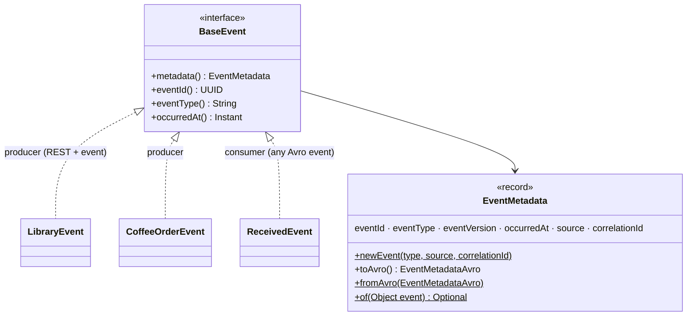
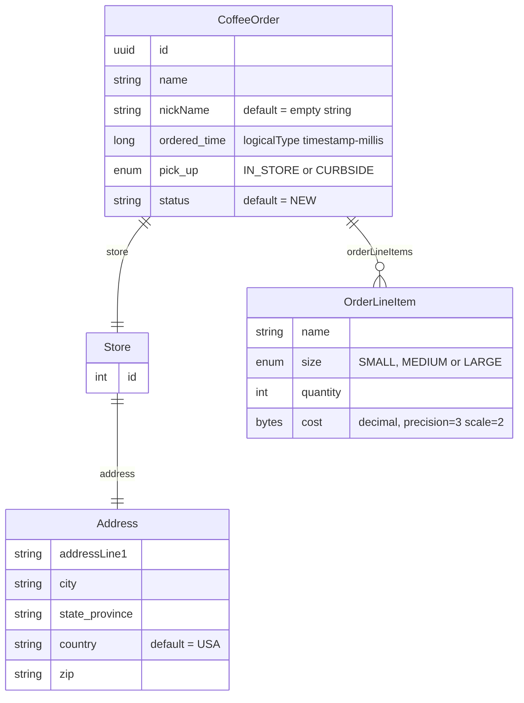
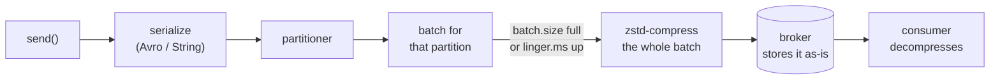
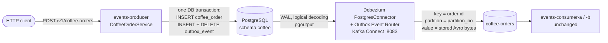
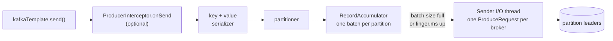
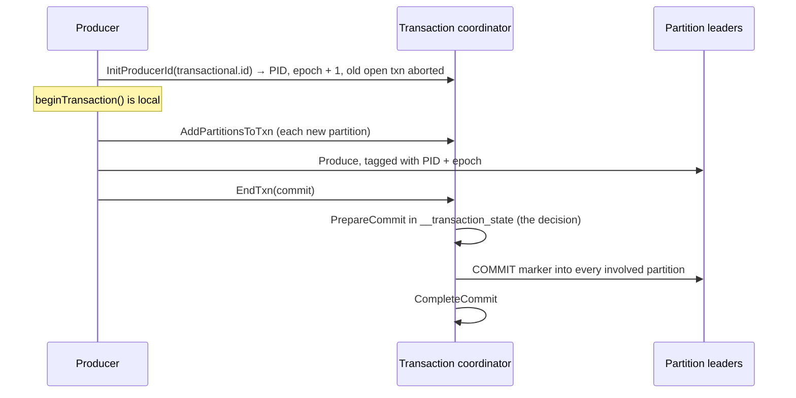

# <span style="color:hsl(112,80%,58%)">events-producer — REST → Kafka (Avro), key routing and the coffee outbox</span>

## <span style="color:hsl(139,80%,58%)">Table of contents</span>

1. 🧭 [Overview](#1-overview)
2. 📨 [The library event: `LibraryEvent.avsc`](#2-the-library-event-libraryeventavsc)
3. 🧱 [Base event: common metadata for every event](#3-base-event-common-metadata-for-every-event)
4. ☕ [The coffee orders domain](#4-the-coffee-orders-domain)
5. 📤 [Producers](#5-producers)
6. 🪪 [Idempotent producer and transactions](#6-idempotent-producer)
7. 🎯 [Custom partitioners and compression](#7-custom-partitioner-and-compression)
8. 📮 [Transactional outbox for coffee orders (Debezium)](#8-transactional-outbox-for-coffee-orders-debezium)
9. 🎯 [Delivery semantics](#9-delivery-semantics)
10. 📚 [Producer concepts, and where this app uses them](#10-producer-concepts)
11. ⚙️ [Configuration](#11-configuration)
12. 🪤 [Gotchas (Avro 1.12 / Spring Boot 4)](#12-gotchas)
13. 🧪 [Tests](#13-tests)
14. ❓ [Q&A](#14-q-and-a)
    - ❓ [14.1 What is zombie fencing, and why doesn't events-producer need it?](#14-1-zombie-fencing)
    - ❓ [14.2 🔥 `POST /v1/libraryevent` answered `201`, but the event never reached Kafka. How?](#14-2-201-but-no-event)
    - ❓ [14.3 🔥 Why not save the coffee order and then call `kafkaTemplate.send()`?](#14-3-why-not-save-the-coffee-order-and-then-call)
    - ❓ [14.4 🔥 With `acks=all` and idempotence on, can a library event still end up on the topic twice?](#14-4-with-acks-all-and-idempotence-on-can-a-library-event)
    - ❓ [14.5 A VIP key sent to `POST /v1/key-routing/partitions/2` lands on partition 2, not 0. Bug?](#14-5-a-vip-key-sent-to-post-v1-key-routing-partitions-2)
    - ❓ [14.6 Why does zstd make key-routing batches bigger, but library-event batches 4× smaller?](#14-6-why-does-zstd-make-key-routing-batches-bigger-but)
    - ❓ [14.7 🔥 Schema Registry is down. What still works in events-producer?](#14-7-schema-registry-is-down-what-still-works-in-events)

---

The producer side of [kafka-core](../README.md): ***events-producer***, a Spring Boot app on port `8080`. It publishes ***library events*** (Avro, idempotent, zstd-compressed) and ***key-routing*** records straight to Kafka, and stores ***coffee orders*** with their event in PostgreSQL for Debezium to publish (transactional outbox). It also owns the event contracts: the Avro schemas in `kafka-core/schemas` and the base-event metadata.

The cluster, Schema Registry and security live in the [kafka-core README](../README.md); the consumers in [events-consumer-a](../events-consumer-a/README.md).


---

<a id="1-overview"></a>
## <span style="color:hsl(230,80%,58%)">1. 🧭 Overview</span>

| Endpoint | Writes to | How |
|---|---|---|
| `POST` / `PUT /v1/libraryevent` | `library-events` (Avro) | `LibraryEventProducer` → `KafkaTemplate` ([§5](#5-producers)) |
| `POST /v1/coffee-orders` | PostgreSQL schema `coffee` → `coffee-orders` | transactional outbox + Debezium ([§8](#8-transactional-outbox-for-coffee-orders-debezium)) |
| `POST /v1/key-routing` | `key-routing` (String) | `KeyRoutingProducer` + `KeySubstringPartitioner` ([§7](#7-custom-partitioner-and-compression)) |
| `POST /v1/key-routing/partitions/{partition}` | `key-routing` (String) | explicit partition, partitioner skipped ([§5](#5-producers)) |

```bash
# from the repo root, after `docker compose up -d` in kafka-core (kafka-core §8)
mvn spring-boot:run -pl kafka-core/events-producer
```

***Try it***

```bash
# Library event (NEW)
curl -X POST localhost:8080/v1/libraryevent -H 'Content-Type: application/json' \
  -d '{"libraryEventType":"NEW","book":{"bookId":1,"bookName":"Kafka","bookAuthor":"Me"}}'

# Coffee order (same producer)
curl -X POST localhost:8080/v1/coffee-orders -H 'Content-Type: application/json' \
  -d '{"name": "Ada", "nickName": "Countess"}'
```

- ***Coffee orders need the outbox infrastructure*** — PostgreSQL with `wal_level=logical` and Debezium's replication slot, both from `docker compose up -d`. Without them the producer refuses to start (`OutboxCaptureCheck`, [§8](#8-transactional-outbox-for-coffee-orders-debezium)); `--app.coffee.require-outbox-slot=false` starts it anyway, and orders are then stored but not published.
- More ready-made requests (all PUT variants, DLT cases, coffee orders, Schema Registry, actuator) are in this module's [`insomnia-collection.json`](../insomnia-collection.json).
- If port `8080` is already taken on your machine, start the producer with `--server.port=8090` (or `-Dspring-boot.run.arguments=--server.port=8090`).

---

<a id="2-the-library-event-libraryeventavsc"></a>
## <span style="color:hsl(282,80%,58%)">2. 📨 The library event: `LibraryEvent.avsc`</span>

`schemas/src/main/avro/LibraryEvent.avsc` → generated `LibraryEventAvro`, `BookAvro`, `LibraryEventTypeAvro` (package `com.learnkafka.avro`):

```json
{
  "name": "LibraryEventAvro", "aliases": ["LibraryEvent"], "namespace": "com.learnkafka.avro", "type": "record",
  "fields": [
    { "name": "metadata", "type": ["null", "com.learnkafka.avro.EventMetadataAvro"], "default": null },   // base event, §3
    { "name": "libraryEventId",   "type": ["null", "int"], "default": null },
    { "name": "libraryEventType", "type": { "type": "enum", "name": "LibraryEventTypeAvro", "aliases": ["LibraryEventType"], "symbols": ["NEW", "UPDATE"] } },
    { "name": "book", "type": { "type": "record", "name": "BookAvro", "aliases": ["Book"], "fields": [
        { "name": "bookId",     "type": "int" },
        { "name": "bookName",   "type": "string" },
        { "name": "bookAuthor", "type": "string" } ] } }
  ]
}
```

- ***`libraryEventId` is optional*** (`["null","int"]`, default `null`): a NEW event has no id yet, because the consumer's database assigns it.
- ***Why the `Avro` suffix?*** The producer's REST records and the consumers' JPA entities are also called `LibraryEvent` / `Book` / `LibraryEventType`. Distinct generated names let every file import plain class names — no package-qualified names anywhere.
- ***Why the `aliases`?*** Version 1 of the schema used the names without the suffix. Avro treats a renamed record as a different type unless the new schema lists the old name as an alias. With the aliases, Schema Registry accepted the rename as a `BACKWARD`-compatible ***version 2***, and consumers still read records written with version 1 (verified with a v1 record sent through `kafka-avro-console-producer`).
- ***Registered as subject `library-events-value`*** the first time the producer sends.
- ***Three shapes, two mappings*** — each side still keeps its own Java model, and only the Avro record crosses the wire:

| Where | Type | Role |
|---|---|---|
| producer REST layer | `com.learnkafka.domain.LibraryEvent` (record + Bean Validation) | validated HTTP input |
| on the wire | `com.learnkafka.avro.LibraryEventAvro` (generated) | `LibraryEventAvroMapper.toAvro()` in the producer |
| consumer database | `com.learnkafka.entity.LibraryEvent` (JPA [`@Entity`][Entity]) | `LibraryEventEntityMapper.toEntity()` in the consumers |

- ***Key*** = `libraryEventId` (an [`Integer`][Integer], [`IntegerSerializer`][IntegerSerializer]/[`IntegerDeserializer`][IntegerDeserializer]). Events for the *same* id always land on the same partition, which preserves per-entity ordering — an `UPDATE` must never be processed before the `NEW` that created it, and per-partition ordering is Kafka's only ordering guarantee.
- ***NEW events have a `null` key***, so the producer's sticky partitioner batches them onto one partition at a time. Keyed UPDATE events spread by key hash.

---

<a id="3-base-event-common-metadata-for-every-event"></a>
## <span style="color:hsl(26,80%,58%)">3. 🧱 Base event: common metadata for every event</span>

Every event — library events and coffee orders, on the producer and on the consumer side — carries the same ***base-event metadata***:

| Field | Type | Meaning |
|---|---|---|
| `eventId` | UUID | unique per event; consumers dedupe on it |
| `eventType` | string | `<Aggregate>.<Action>`: `LibraryEvent.NEW`, `LibraryEvent.UPDATE`, `CoffeeOrder.PLACED` |
| `eventVersion` | int (default 1) | version of the event's payload contract |
| `occurredAt` | timestamp-millis | when the event happened |
| `source` | string | producing application (`spring.application.name`) |
| `correlationId` | string or null | ties the event to the request that caused it (`X-Correlation-Id` header) |

***In Avro: composition, not inheritance.*** Avro records can't extend each other, so the base event is its own named record, `EventMetadataAvro` (`schemas/src/main/avro/EventMetadata.avsc`), and every event schema embeds it as its first field:

```json
{ "name": "metadata", "type": ["null", "com.learnkafka.avro.EventMetadataAvro"], "default": null }
```

- ***Optional on purpose*** — with `null` as default, the new schemas stay ***BACKWARD-compatible*** with every event already on the topics. Schema Registry accepted them as `library-events-value` ***v3*** and `coffee-orders-value` ***v2***; old events simply read `metadata = null`.
- ***Defined once*** — `EventMetadata.avsc` is compiled first (`<imports>` in `schemas/pom.xml`) and referenced by full name from `LibraryEvent.avsc` and `CoffeeOrder.avsc`, even though `CoffeeOrder` lives in another namespace.
- ***But every generated class `extends SpecificRecordBase`?*** — that is Avro's own runtime base class, the same for every generated record (`Address`, `LibraryEventAvro`, `EventMetadataAvro` …). It has ***no fields***, only plumbing: get/put by field name, schema-based `equals`/`hashCode`/`compareTo`, JSON `toString`, Java serialization and fast custom encode/decode. It is not schema inheritance: the code generator always picks this parent, and a schema has no `extends` to name another record as its parent — so shared fields still have to be embedded. It is also why `EventMetadata.of(Object)` can read `metadata` from any event: `SpecificRecordBase` implements `GenericRecord`.

***In Java: a base interface and child events.*** The shared contract module (`schemas`) holds the Java side, so producer and consumers use the same types:



- ***Records can't extend a class*** either, so `BaseEvent` is an interface whose default methods (`eventId()`, `eventType()`, `occurredAt()`) read the composed `metadata()` — the same shape as the Avro schemas.
- ***`EventMetadata.of(event)`*** reads the `metadata` field of ***any*** generated event class (they are all `GenericRecord`s), so common handling doesn't need to know the event type.


***Producer — stamping.*** `EventMetadataFactory` creates the metadata for every event: random id, current time, the app as source, and the `X-Correlation-Id` request header if present. The child events carry it into Avro (`LibraryEventAvroMapper`, `CoffeeOrderService`), and the REST responses return it, so callers learn the eventId. Real response:

```json
"metadata": {"eventId": "44b660dc-ca14-4d49-a939-438d4ca0b7cc", "eventType": "LibraryEvent.NEW", "eventVersion": 1,
             "occurredAt": "2026-10-14T05:47:01.773Z", "source": "events-producer", "correlationId": "e2e-req-1"}
```

How the consumers use the metadata (logging MDC, dedupe by `eventId`, the Kafka Connect replica): [events-consumer §3](../events-consumer-a/README.md#3-base-event-on-the-consumer-side).

---

<a id="4-the-coffee-orders-domain"></a>
## <span style="color:hsl(197,80%,58%)">4. ☕ The coffee orders domain</span>

All coffee schemas live in `schemas/src/main/avro/` next to `LibraryEvent.avsc`. `avro-maven-plugin` (configured in `schemas/pom.xml`) compiles them to `target/generated-sources/avro` at build time — nothing generated is checked in under `src/main/java`, so `mvn clean` truly cleans them.



- ***Producer and consumer*** — `POST /v1/coffee-orders` lives in `events-producer` (stored through a transactional outbox, published by Debezium — [§8](#8-transactional-outbox-for-coffee-orders-debezium)), and the `CoffeeOrdersConsumer` listener lives in both consumer apps ([§5](#5-producers), [events-consumer §2](../events-consumer-a/README.md#2-consumers)).
- ***Logical types*** — `CoffeeOrder.id` is `{"type": "string", "logicalType": "uuid"}` and `ordered_time` is `{"type": "long", "logicalType": "timestamp-millis"}`. The generated classes expose idiomatic `UUID` and [`Instant`][Instant] getters/setters (`CoffeeOrderService.buildCoffeeOrder()` calls `.setId(...)` with a random UUID and `.setOrderedTime(...)` with the current time) while the wire format stays a plain string/long. `OrderLineItem.cost` uses a `bytes` logical `decimal` (precision 3, scale 2) so [`BigDecimal`][BigDecimal] round-trips exactly; the plugin turns this on with `<enableDecimalLogicalType>true</enableDecimalLogicalType>`.
- ***A schema not yet wired to any app*** — `CoffeeUpdateEvent.avsc` (`{id, status}`, `status` enum `PROCESSING | READY_FOR_PICK_UP`) compiles alongside the others but nothing produces or consumes it. It would be its own subject (`CoffeeUpdateEvent-value` if published), showing that the registry manages compatibility ***per subject***, not globally.

---

<a id="5-producers"></a>
## <span style="color:hsl(112,80%,58%)">5. 📤 Producers</span>

### <span style="color:hsl(27,80%,58%)">`LibraryEventProducer` (events-producer)</span>

Three send methods, each demonstrating a different Spring Kafka [`KafkaTemplate`][KafkaTemplate] usage pattern. The template's value type is the ***generated Avro class***, `KafkaTemplate<Integer, LibraryEventAvro>`:

| Method                          | Used by                                       | Behavior |
|---------------------------------|-----------------------------------------------|----------|
| `sendLibraryEventWithHeaders()` | `POST` / `PUT /v1/libraryevent`               | Async send via an explicit [`ProducerRecord`][ProducerRecord] carrying a custom header `event-source: scanner`; returns a [`CompletableFuture`][CompletableFuture] the controller does not block on |
| `sendLibraryEvent()`            | available, not wired to a controller endpoint | Async send using `kafkaTemplate.sendDefault()` (the configured default topic) — no custom headers |
| `sendLibraryEventSynchronous()` | available, not wired to a controller endpoint | Blocks up to 1 second via `.get(1, TimeUnit.SECONDS)` — for when the caller genuinely needs a confirmed offset before responding |

`LibraryEventsController` calls `sendLibraryEventWithHeaders()` for both `POST` (sets `LibraryEventType.NEW`, and 400s if a `libraryEventId` is sent — the consumers' database assigns it) and `PUT` (sets `LibraryEventType.UPDATE`, and 400s if `libraryEventId` is missing). Both stamp the base-event metadata (eventId, type, time, source, optional `X-Correlation-Id`, [§3](#3-base-event-common-metadata-for-every-event)) and return it in the response, and they return `201`/`200` ***without waiting for the Kafka send to complete***. Success or failure is only seen by the `whenComplete()` callback, which logs. The REST API's availability is decoupled from Kafka's, at the cost of the HTTP response not saying whether the message reached the topic.

```yaml
spring.kafka.producer:
  key-serializer: org.apache.kafka.common.serialization.IntegerSerializer
  value-serializer: io.confluent.kafka.serializers.KafkaAvroSerializer
  compression-type: zstd       # every batch is compressed before it is sent (§7)
  properties:
    acks: all                  # wait for all in-sync replicas to ack
    retries: 10                # retry transient send failures
    retry.backoff.ms: 1000
    enable.idempotence: "true" # producer-side dedup of retried sends
    linger.ms: 20              # wait up to 20 ms to fill a batch: bigger batches compress better
    schema.registry.url: ${SCHEMA_REGISTRY_URL:http://localhost:8085}
```

- **`acks=all`** — the leader acks only once every in-sync replica has the record. With `min.insync.replicas=2` at least one follower also has it, so a leader crash right after acking doesn't lose data.
- **`enable.idempotence=true`** — see [§6](#6-idempotent-producer).
- **Auto-topic-creation** (`AutoCreateConfig`) declares `library-events` and `key-routing` with `3` partitions via [`NewTopic`][NewTopic], so the app also works against a bare broker. With docker compose, `kafka-init` has already created them with RF 3, so this is a no-op there.

### <span style="color:hsl(165,80%,58%)">Coffee orders: `CoffeeOrdersController` → transactional outbox (also in events-producer)</span>

```java
@Transactional                                                    // CoffeeOrderService.place
public CoffeeOrderResponse place(CoffeeOrderRequest request, String correlationId) {
    ...
    orders.insert(order);                                         // coffee.coffee_order
    outbox.append(new OutboxEvent(eventId, "coffee-orders", orderId, "CoffeeOrder.PLACED",
            payloadSerializer.serialize(order),                   // KafkaAvroSerializer bytes
            vipPartitionRule.partition(name, orderId, partitions), correlationId));   // INSERT + DELETE
}
```

- ***No `KafkaTemplate` for coffee orders*** — the order and its event are stored in one PostgreSQL transaction; Debezium publishes the event ([§8](#8-transactional-outbox-for-coffee-orders-debezium)). A `201` means "committed", even if Kafka is down at that moment.
- ***Same bytes, key and partition as before*** — `KafkaAvroSerializer` produces the Confluent wire format the consumers already read, the key is the order id, and `VipPartitionRule` (the old `CoffeeVipPartitioner` arithmetic) picks the partition.
- ***REST records in `domain`*** — `CoffeeOrderRequest` and `CoffeeOrderResponse` sit next to the library-event records in `com.learnkafka.domain`.

`POST /v1/coffee-orders` (`CoffeeOrderRequest{name, nickName}`) builds a full `CoffeeOrder` — hardcoded `Store`/`Address`/one `Latte` `OrderLineItem` for demo purposes, a real `UUID.randomUUID()` id, [`Instant.now()`][Instant] ordered time (millisecond precision, as Avro's `timestamp-millis` stores it), `PickUp.IN_STORE`, `status = "NEW"` — and stores it with its outbox event. It returns a `CoffeeOrderResponse` record rather than the Avro object ([§12](#12-gotchas)).

### <span style="color:hsl(220,80%,58%)">`KeyRoutingProducer` (also in events-producer)</span>

`POST /v1/key-routing` (`KeyRoutingRequest{key, message}`) sends the message as a plain ***String*** record to `key-routing`, keyed by whatever the caller sends, through a template that uses `KeySubstringPartitioner` ([§7](#7-custom-partitioner-and-compression)). It waits for the broker's ack and returns `KeyRoutingResponse{key, matchedSubstring, partition, offset}`, so you can see where each key landed.

- ***Its own template, not a bean*** — a String/String template built from Boot's producer factory: it inherits `acks`, idempotence, zstd and `linger.ms`, and has its own `client.id` (`events-producer-key-routing-N`). A second `KafkaTemplate` ***bean*** would make Boot's auto-configured one (used by `LibraryEventProducer`) back off.
- ***Rules checked at startup*** — the controller parses `app.key-routing.substring-partitions` itself, so a malformed rule stops the app instead of failing the first send.
- ***Why a separate topic*** — the other keys can't show substring routing: library events are keyed by an Integer id (`null` for NEW) and coffee orders by a random UUID.

`POST /v1/key-routing/partitions/{partition}` sends the same request to the partition ***the caller names***, with [`KafkaTemplate.send(topic, partition, key, value)`][KafkaTemplate]:

- ***The partitioner is skipped*** — a record that carries a partition never reaches `partitioner.class`, so `KeySubstringPartitioner` doesn't run: a VIP key sent to `/partitions/2` lands on 2, not 0. The key still travels with the record, and the response's `matchedSubstring` is `null`.
- ***Checked before sending*** — a partition the topic doesn't have gets `400 Partition 7 does not exist: topic key-routing has partitions 0-2`, checked against `partitionsFor()`. `send()` itself would block for `max.block.ms` (60 s) waiting for that partition, then fail ([§7](#7-custom-partitioner-and-compression)).

---

<a id="6-idempotent-producer"></a>
## <span style="color:hsl(229,80%,58%)">6. 🪪 Idempotent producer and transactions</span>

- Each producer gets a ***PID***, and each record gets a ***sequence number per partition***. If a retry re-sends a batch the broker already wrote, the broker sees the repeated sequence and drops it.
- It is ***on by default*** in Kafka clients 3.0+, but only if `acks=all`, `retries > 0` and `max.in.flight.requests.per.connection ≤ 5`. This project sets it explicitly so a config change can't quietly turn it off.
- It does ***not*** stop a consumer from processing a record twice.

The consumer half (the `processed_event` table) and the side-by-side comparison: [events-consumer §6](../events-consumer-a/README.md#6-idempotent-consumer). Why retries reorder or duplicate without it: [§10](#10-producer-concepts).

### <span style="color:hsl(320,80%,58%)">Kafka transactions: why events-producer doesn't use them</span>

`events-producer` sets ***no*** `spring.kafka.producer.transaction-id-prefix`, so its `KafkaTemplate` is not transactional and Boot creates no `KafkaTransactionManager`. That is a choice, not a gap:

| Write | Needs | What this app uses |
|---|---|---|
| one library event per request, one partition | no duplicates from retries | ***idempotent producer*** — exactly-once per partition within a producer session, no coordinator round trips |
| one key-routing record per request | same | idempotent producer |
| coffee order row ***and*** its event | PostgreSQL and Kafka atomically | ***transactional outbox*** — a Kafka transaction can't include PostgreSQL (no XA), so the event is written in the database transaction and Debezium publishes it ([§8](#8-transactional-outbox-for-coffee-orders-debezium)) |

- ***A transaction would only add cost here*** — per request an `AddPartitionsToTxn` and an `EndTxn` round trip to the transaction coordinator, plus COMMIT markers in the partition, and every `read_committed` consumer waits at the last stable offset while a transaction is open.
- ***Where producer-side transactions do run in this repo*** — in the ***consumer apps***. Their `KafkaTemplate` is transactional (`transaction-id-prefix: ${spring.application.name}-tx-`): the state record, the retry-topic forward and the DLT publish commit atomically with the consumed offset (consume → process → produce) — [events-consumer §5](../events-consumer-a/README.md#5-kafka-transactions).
- ***When this app would need them*** — several records that must appear together or not at all (an event to two topics, a batch import). Then: set `transaction-id-prefix` unique per instance and stable across restarts (e.g. `events-producer-${HOSTNAME}-tx-`), wrap the sends in `kafkaTemplate.executeInTransaction(ops -> { ops.send(a).join(); ops.send(b).join(); return null; })`; every send must then run inside a transaction. Consumers already read with `isolation.level=read_committed`.
- ***How a transactional producer works*** — transaction coordinator, `__transaction_state`, producer epoch, zombie fencing, choosing the prefix: [§10](#10-producer-concepts) (*Transactions and zombie fencing*) and [§14.1](#14-1-zombie-fencing).

---

<a id="7-custom-partitioner-and-compression"></a>
## <span style="color:hsl(54,80%,58%)">7. 🎯 Custom partitioners and compression</span>

The producer app has one custom Kafka partitioner and one partition rule. `KeySubstringPartitioner` is plugged into ***one template only*** (`partitioner.class` is a config override when that template is built). `VipPartitionRule` is not a Kafka partitioner at all: Debezium, not the app, sends coffee orders, so the rule's result is stored in the outbox row ([§8](#8-transactional-outbox-for-coffee-orders-debezium)). Library events keep Kafka's built-in partitioner, including ***sticky partitioning*** for their null keys, which any custom partitioner would turn off.

| Partitioner | Topic | Decides by | Guarantee |
|---|---|---|---|
| `VipPartitionRule` (outbox) | `coffee-orders` | the ***customer name*** in the order | VIP orders get partition 0 ***to themselves*** |
| `KeySubstringPartitioner` | `key-routing` | a ***substring of the key*** | every key containing the substring lands on ***one*** partition |

### <span style="color:hsl(96,80%,50%)">`VipPartitionRule`: reserve a partition</span>

It gives VIP customers partition 0 to themselves and hashes everyone else (murmur2, like Kafka's default) over partitions 1..N-1:

```java
if (partitions < 2 || vipCustomers.contains(customerName)) {
    return 0;
}
return 1 + Utils.toPositive(Utils.murmur2(key.getBytes(UTF_8))) % (partitions - 1);
```

- ***Was a Kafka `Partitioner`*** (`CoffeeVipPartitioner`, plugged into the coffee template). With the outbox the app no longer sends coffee orders, so the rule runs when the outbox row is written (`partition_no`), and Debezium's Outbox Event Router sends the record to that partition. Same arithmetic, so an order id keeps its partition.
- ***Configured by*** `app.coffee.vip-customers: Ada,Grace` and `app.coffee.partitions: 3` (checked against the topic at startup).
- ***Real run*** — `Ada → P0`, `Ada → P0`, `Grace → P0`; `Linus → P2`, `Ken → P1`, `Margaret → P1`, `Barbara → P2`.
- ***Risk*** — a hot VIP partition caps VIP throughput at one consumer.

### <span style="color:hsl(220,80%,58%)">`KeySubstringPartitioner`: keys that share a substring share a partition</span>

Kafka's default hashes the ***whole*** key, so `order-VIP-1` and `order-VIP-2` can land on different partitions. `KeySubstringPartitioner` looks for configured substrings first:

```java
if (key != null) {
    var rule = matchingRule(rules, key.toString());              // first rule whose substring the key contains
    if (rule.isPresent()) {
        return rule.get().partitionFor(topic, numPartitions);    // pinned number, or murmur2(substring) % n
    }
}
if (keyBytes == null) {
    return ThreadLocalRandom.current().nextInt(numPartitions);   // no key
}
return Utils.toPositive(Utils.murmur2(keyBytes)) % numPartitions;   // no match: Kafka's default
```

- ***Rules*** — `app.key-routing.substring-partitions: VIP=0,UK,US`, passed to the partitioner as the producer property `key.substring.partitions`:
  - `VIP=0` — ***pinned***: every key containing `VIP` goes to partition 0.
  - `UK`, `US` — ***hashed***: Kafka's murmur2 hash of the ***substring*** instead of the whole key, so every key containing it gets the same partition. On 3 partitions `UK` → 1 and `US` → 2. You don't pick the number, and adding partitions moves it, as with any key hash; pinned rules stay put.
- ***First match wins***, in configured order: `US-VIP-9` goes to 0. Matching is ***case-sensitive***: `vip` is not `VIP`.
- ***Why*** — Kafka orders records only ***within a partition***. Related records with distinct keys (`order-VIP-1001`, `member-7-VIP`) land on one partition, so one consumer of a group reads all of them, in order.
- ***Pinning doesn't reserve*** — unmatched keys can still hash onto partition 0 (`VipPartitionRule` shows how to reserve one). A busy substring also caps its throughput at one consumer.
- ***Mistakes fail loudly*** — a malformed rule (`VIP=x`, `=1`, `VIP=-1`) stops the app at startup with a `ConfigException`. A pinned partition the topic doesn't have (`VIP=5` on 3 partitions) fails the send with `Rule VIP=5 needs partition 5, but topic key-routing has 3 partitions`. Kafka doesn't check this itself: the record would wait for a partition that never appears, then time out after `delivery.timeout.ms` (2 minutes).
- ***Keyless records*** get a random partition: a custom partitioner can't hand them back to Kafka's sticky logic (returning `-1` is an error).
- ***An explicit partition beats every partitioner*** — a record sent with a partition number (`POST /v1/key-routing/partitions/{partition}`, [§5](#5-producers)) never reaches `partitioner.class`. The producer checks that partition up front instead: one the topic doesn't have makes `send()` block for `max.block.ms` (60 s), then fail with `Partition 7 of topic key-routing with partition count 3 is not present in metadata after 60000 ms.` A partitioner that returns such a partition fails later and slower, after `delivery.timeout.ms` (see ***Mistakes fail loudly***).

Try it with the Insomnia folder ***Kafka Core — Key routing***: `POST /v1/key-routing` with `{"key": "...", "message": "..."}`. Real run on the 3-broker cluster:

| Key | `matchedSubstring` | Partition |
|---|---|---|
| `order-VIP-1001` | `VIP` | 0 |
| `member-7-VIP` | `VIP` | 0 |
| `US-VIP-9` | `VIP` (first rule) | 0 |
| `branch-UK-12` | `UK` | 1 |
| `UK-branch-3` | `UK` | 1 |
| `order-US-42` | `US` | 2 |
| `order-12345` | `null`: whole key hashed | 1 |
| `order-vip-1` | `null`: case-sensitive | 2 |

The topic agrees:

```bash
docker exec kafka-core-kafka-1 kafka-console-consumer --bootstrap-server kafka-1:29092 --topic key-routing \
  --from-beginning --formatter-property print.partition=true --formatter-property print.key=true --timeout-ms 5000
# Partition:0	order-VIP-1001	hi order-VIP-1001
# Partition:0	member-7-VIP	hi member-7-VIP
# Partition:0	US-VIP-9	hi US-VIP-9
# Partition:1	branch-UK-12	hi branch-UK-12
# Partition:1	UK-branch-3	hi UK-branch-3
# Partition:1	order-12345	hi order-12345
# Partition:2	order-US-42	hi order-US-42
# Partition:2	order-vip-1	hi order-vip-1
```

### <span style="color:hsl(160,80%,45%)">Compression: in the producer, before the send</span>

Every producer in the repo compresses with ***zstd***: the three kafka-core apps (`spring.kafka.producer.compression-type: zstd`) and the Kafka Streams app ([kafka-stream §10](../../kafka-stream/README.md#10-configuration)). The Kafka client does it before any byte leaves the app:



- ***The batch is the unit*** — records collect in one batch per partition, and the batch is compressed as ***one block***. What repeats from record to record (schema id, event type, source, book name) compresses away. A batch of one record has nothing to share.
- ***The broker doesn't recompress*** — topic `compression.type=producer` (the default) keeps the producer's codec, so batches go to disk and to consumers exactly as sent. A topic set to a different codec would make the broker decompress and recompress every batch.
- ***Consumers decompress transparently*** — the codec is in the batch header; consumers need no setting.
- ***Why not compress the payload in our own code?*** — the bytes must stay plain Avro (magic byte + schema id + data) for the consumers, Kafka Connect and Kafdrop, and one 125-byte record barely compresses on its own. Batch compression is where the gain is.

| Setting | Value | Why |
|---|---|---|
| `compression-type` | `zstd` | best ratio of the four codecs (`gzip`, `snappy`, `lz4`, `zstd`); `lz4` is the low-CPU alternative |
| `linger.ms` | `20` in the producer app (Kafka 4 default: `5`) | wait up to 20 ms for more records: bigger batches, better ratio, at most 20 ms more latency |
| `batch.size` | `16384` (default) | upper bound of one batch, per partition |
| `compression.zstd.level` | `3` (default) | KIP-390 (Kafka 3.8+): higher is smaller and slower |

***Measured*** on the 3-broker cluster with 200 concurrent `POST /v1/libraryevent` calls, read with `kafka-dump-log` on `library-events-0`. Each record's Avro value is 125 bytes, about 155 bytes in a batch with its header and length fields, plus 61 bytes per batch header:

| Batch | Records | Raw (computed) | zstd, on disk |
|---|---|---|---|
| sent on its own | 1 | ~216 B | 215 B: nothing saved |
| from the burst | 20 | ~3,160 B | 767 B (24%) |
| from the burst | 30 | ~4,710 B | 1,120 B (24%) |

- ***Producer metric*** `compression-rate-avg` (compressed batch ÷ raw batch) during that run: ***0.26*** for library events. Key-routing sends one record at a time, and there zstd made the batches ***bigger*** (1.25). The consumer apps' transactional producers write one record per transaction, so they sit around ***1.2***: compression pays off only once records share a batch.
- ***Watch it*** — Grafana ***Learning Kafka*** → ***Producers*** → ***Compression ratio*** and ***Bytes sent per second***, per `client_id`. Or ask the app: `/actuator/metrics/kafka.producer.compression.rate.avg?tag=client.id:events-producer-producer-1`.
- ***On disk*** — `kafka-dump-log` prints `count:` and `compresscodec:` for each batch ([kafka-core §10](../README.md#10-kafka-cli-cheat-sheet)).
- ***Tested*** — `CompressionIntegrationTest` sends 500 events in one burst and gets `compression-rate-avg` ≈ ***0.22*** (asserted below 0.5); all 500 come back intact.

---

<a id="8-transactional-outbox-for-coffee-orders-debezium"></a>
## <span style="color:hsl(300,80%,58%)">8. 📮 Transactional outbox for coffee orders (Debezium)</span>

Writing to a database ***and*** to Kafka in one request is a ***dual write***: the app can commit one and crash before the other, and no transaction spans both (Kafka has no XA). The ***transactional outbox*** removes the second write. The app stores the event in an ***outbox table, in the same database transaction*** as the business row, and something else turns committed outbox rows into Kafka records. Here that is ***Debezium*** reading the PostgreSQL write-ahead log (change data capture): no polling, and the app never talks to Kafka for coffee orders.



### <span style="color:hsl(77,80%,50%)">What the producer writes</span>

Schema `coffee` (Flyway, `V1__create_coffee_order_and_outbox_event.sql`) in the same `library` database as the consumers' tables:

| Table | Columns | Role |
|---|---|---|
| `coffee_order` | `id`, `name`, `nick_name`, `store_id`, `status`, `pick_up`, `ordered_time` | the business row |
| `outbox_event` | `id` (event id), `aggregatetype` (= topic `coffee-orders`), `aggregateid` (order id = key), `type` (`CoffeeOrder.PLACED`), `payload` (`bytea`), `partition_no`, `correlation_id`, `created_at` | the event, exactly as it should reach Kafka |

- ***One transaction*** — `CoffeeOrderService.place` (`@Transactional`) inserts the order, then `OutboxRepository.append` inserts the event ***and deletes it again*** before the commit. Order and event commit together or not at all.
- ***Why delete at once*** — Debezium reads the WAL, not the table. The INSERT is in the log; the router turns it into the Kafka record and drops the DELETE. The table stays empty, needs no clean-up job, and a connector snapshot can never re-send old events.
- ***`payload` is the Kafka value*** — `KafkaAvroSerializer` output (magic byte + schema id + Avro), the same bytes the old `KafkaTemplate` sent. So Schema Registry is still needed when an order is written (first use of the schema; cached after).
- ***`partition_no`*** — `VipPartitionRule` ([§7](#7-custom-partitioner-and-compression)) with `app.coffee.partitions: 3`. At startup `CoffeeTopicCheck` compares that with the real topic: fewer partitions → the app refuses to start (Debezium would be told to write to a partition that doesn't exist); more → a warning; Kafka unreachable → a warning, because writing an order must not depend on Kafka.

### <span style="color:hsl(214,80%,58%)">The connector</span>

[`connect/coffee-outbox.json`](../connect/coffee-outbox.json), registered by `kafka-connect-init` next to the JDBC sink ([events-consumer §11](../events-consumer-a/README.md#11-data-replication-with-kafka-connect-and-reconciliation)):

| Option | Value | Why |
|---|---|---|
| `connector.class` | `io.debezium.connector.postgresql.PostgresConnector` | Debezium ***3.7.0.Final*** (as of 2026), downloaded by the one-shot `debezium-plugin` service: Confluent Hub only has 3.2.x and the Connect image has no `curl` |
| `plugin.name` | `pgoutput` | PostgreSQL's built-in logical decoding plugin |
| `slot.name` / `publication.name` | `coffee_outbox_slot` / `coffee_outbox_publication` | the replication slot keeps WAL until Debezium has read it; both are created up front by `outbox-slot-init`, and Debezium reuses them |
| `publication.autocreate.mode` | `all_tables` | a `filtered` publication needs `coffee.outbox_event` to exist when the connector starts — but the producer's Flyway creates it only when the producer first runs |
| `table.include.list` | `coffee.outbox_event` | only outbox changes become events |
| `snapshot.mode` | `no_data` | stream from now on; the table is always empty anyway |
| `heartbeat.interval.ms` | `10000` | keeps the slot's confirmed position moving while only other tables change, so PostgreSQL can recycle WAL |
| `extended.headers.enabled` | `false` | otherwise Debezium 3.7 adds four `__debezium.context.*` headers to every record |
| `value.converter` | `io.debezium.converters.BinaryDataConverter` (+ JSON delegate) | writes the `payload` bytes unchanged; the delegate only serializes heartbeats |
| `key.converter` | `StringConverter` | the order id as a String key, as before |
| `transforms.outbox.*` | `EventRouter`, `route.by.field=aggregatetype`, `route.topic.replacement=${routedByValue}`, `table.field.event.key=aggregateid` | topic = `coffee-orders`, key = the order id |
| `transforms.outbox.table.fields.additional.placement` | `type:header:event-type,correlation_id:header:correlation-id,partition_no:partition` | two headers, and the partition the producer chose |

PostgreSQL runs with `wal_level=logical` (compose `command`). The `library` user is a superuser in the official image, so it may replicate and create the publication.

### <span style="color:hsl(351,80%,58%)">Delivery semantics</span>

- ***Atomic on the producer side*** — a `201` means order and event are both committed, even if Kafka or Kafka Connect is down at that moment. The replication slot keeps the event in the WAL until Debezium reads it, so the slot must exist ***before*** the first order: compose creates it as soon as PostgreSQL is up (`outbox-slot-init`), and `OutboxCaptureCheck` makes the producer ***refuse to start*** without it, or with `wal_level` below `logical` — an order written then would be stored but its event lost for good.
- ***At-least-once to Kafka*** — after a crash the connector resumes from its stored WAL position and can send an event again. The coffee consumers only log, so a duplicate is harmless; a consumer that changes state would dedupe on the `id` header (the event id), as the library consumers do with `processed_event` ([§6](#6-idempotent-producer)).
- ***Order*** — WAL order, one connector task.
- ***Consumers unchanged*** — same topic, key type and Avro bytes. New headers `id`, `event-type`, `correlation-id`; without `X-Correlation-Id` the `correlation-id` header is there with a null value.

### <span style="color:hsl(128,80%,45%)">Running it</span>

`docker compose up -d` in `kafka-core` does it all: `debezium-plugin` downloads the plugin once into the `kafka-core-connect-plugins` volume (a version marker is written last, so a failed or partial download is retried, and a version bump installs the new plugin), `outbox-slot-init` creates the publication and the replication slot as soon as PostgreSQL is healthy, `kafka-connect` waits for both (and is healthy only once both the JDBC sink and the Debezium plugin are loaded), and `kafka-connect-init` registers both connectors. Start the producer after that: until the slot exists it refuses to start. On a stack that is already running, the same command recreates `postgres` (new `wal_level`) and `kafka-connect`.

```bash
curl -s localhost:8083/connectors/coffee-outbox/status        # connector and task RUNNING
docker exec kafka-core-postgres psql -U library -d library \
  -c "select slot_name, plugin, active, confirmed_flush_lsn from pg_replication_slots"
```

- ***Tearing down*** — a replication slot keeps WAL until it is read. If you delete the connector but keep PostgreSQL, drop the slot: `select pg_drop_replication_slot('coffee_outbox_slot');` — but orders written after that are never published, which is why the producer refuses to start without the slot. `docker compose up outbox-slot-init` creates it again.

***Real run*** — Debezium 3.7.0.Final on `cp-kafka-connect:8.3.2` against this 3-broker cluster (producer on `:18080`, beside a running stack):

```text
POST /v1/coffee-orders  X-Correlation-Id: e2e-1  {"name":"Ada","nickName":"a"}   → 201
POST /v1/coffee-orders                           {"name":"Linus"}                → 201
coffee.coffee_order: 2 rows      coffee.outbox_event: 0 rows

kafka-console-consumer --topic coffee-orders --property print.partition=true --property print.headers=true --property print.key=true
Partition:0  id:73809e51-…,event-type:CoffeeOrder.PLACED,correlation-id:e2e-1        d8df7768-…   (Ada, VIP)
Partition:2  id:c6ed3336-…,event-type:CoffeeOrder.PLACED,correlation-id:null         19d153dc-…   (Linus)

Kafka Connect stopped → POST {"name":"Grace"} → 201 → Kafka Connect started again
Partition:0  id:99ecf677-…,event-type:CoffeeOrder.PLACED,correlation-id:e2e-outage   628bdfa1-…   (arrived after the restart)
```

`kafka-avro-console-consumer` decodes the values exactly as before, e.g. Ada's `metadata`: `{"eventId": "73809e51-…", "eventType": "CoffeeOrder.PLACED", "source": "events-producer", "correlationId": "e2e-1"}`.

---

<a id="9-delivery-semantics"></a>
## <span style="color:hsl(158,80%,58%)">9. 🎯 Delivery semantics</span>

- ***Producer → broker: no duplicates from retries.*** `acks=all` + idempotence means a producer retry cannot create a second broker-side write.
- ***Library events, HTTP → Kafka: at-most-once from the caller's view.*** The `201` is sent before the send completes; a send that fails after its retries is only logged ([§14.2](#14-2-201-but-no-event)).
- ***Coffee orders, HTTP → Kafka: at-least-once.*** The `201` means committed in PostgreSQL; Debezium may publish an event twice after a connector restart ([§8](#8-transactional-outbox-for-coffee-orders-debezium)).
- ***No idempotency key on the REST API*** — a client that retries a request sends a second event with a new `eventId`.
- What the consumers make of it (at-least-once delivery, effectively-once database writes): [events-consumer §9](../events-consumer-a/README.md#9-delivery-semantics).

---

<a id="10-producer-concepts"></a>
## <span style="color:hsl(40,80%,58%)">10. 📚 Producer concepts, and where this app uses them</span>

The producer-side topics of the learning notes (`learning-messaging-kafka*.md`), each tied to this app. Versions: Kafka clients 4.2.2, Spring Kafka 4.1.2, Spring Boot 4.1.2 (as of 2026).

### <span style="color:hsl(200,80%,58%)">What `send()` does inside the client</span>



- ***Interceptors*** see the record first. This app has none.
- ***Serializers*** run next; a serializer failure stops the record before it reaches the partitioner. Here: `IntegerSerializer` + `KafkaAvroSerializer` for library events, `StringSerializer` for key routing.
- ***Partitioner*** — part of the Kafka client, not Spring. `DefaultPartitioner` was removed in Kafka 4.0; the built-in logic (since 3.3) is:
  - ***keyed*** record → murmur2 hash of the key, so the same key always lands on the same partition (until the partition count changes);
  - ***keyless*** record → ***sticky partitioning*** (KIP-480): records stick to one partition until about `batch.size` bytes went there (KIP-794), then the partitioner picks another at random, weighted away from slow brokers. Library NEW events (null key) use this ([§2](#2-the-library-event-libraryeventavsc)).
  - a ***custom partitioner*** replaces both; an ***explicit partition*** in the record skips the partitioner entirely ([§7](#7-custom-partitioner-and-compression)).
- ***RecordAccumulator*** batches per partition (`batch.size` 16 KB, `linger.ms` — 20 here, `buffer.memory` 32 MB in total).
- ***Sender thread*** keeps one TCP connection per broker and packs every ready batch for that broker into one ProduceRequest.
- ***Where `send()` blocks*** — only while metadata is missing or `buffer.memory` is full, for up to `max.block.ms` (60 s). Everything after that is asynchronous.
- ***Adding partitions moves keys*** — the key → partition mapping depends on the partition count, so records for one key written before and after the change sit on different partitions and can be read out of order. `CoffeeTopicCheck` refuses to start when `coffee-orders` has fewer partitions than `app.coffee.partitions` ([§8](#8-transactional-outbox-for-coffee-orders-debezium)).
- ***Hot keys*** — one key always means one partition, read by one consumer of a group. No number of consumers splits a hot key; only a different key or partitioner does.

### <span style="color:hsl(160,80%,45%)">Serializers</span>

| Kind | Classes | Used here |
|---|---|---|
| Built-in | `StringSerializer`, `IntegerSerializer`, `LongSerializer`, `ByteArraySerializer`, `UUIDSerializer`, … | `IntegerSerializer` (library keys), `StringSerializer` (key routing) |
| JSON (Spring Kafka 4) | `JacksonJsonSerializer` (Jackson 3); `JsonSerializer` is deprecated for removal since 4.0 | no |
| Schema-based | `KafkaAvroSerializer`, Protobuf and JSON Schema serializers backed by Schema Registry | `KafkaAvroSerializer` for library events and the coffee outbox payload ([kafka-core §4](../README.md#4-why-avro--schema-registry-instead-of-json)) |
| Custom | implement `Serializer<T>` — `byte[] serialize(String topic, T data)` | no |

- ***Custom serializer*** — the place to drop or encrypt sensitive fields before bytes leave the app. Return `null` for `null`, or tombstones stop working; throw `SerializationException` on failure.
- ***JSON type headers*** — with `spring.json.add.type.headers=true` (default) the ***serializer*** adds a `__TypeId__` header naming the producer's class; consumers either map it (`spring.json.type.mapping`) or must trust its package. Avro needs none of this: the schema id in the payload tells the consumer what it reads.
- ***Avro without a producer*** — `CoffeeOrderPayloadSerializer` calls `KafkaAvroSerializer.serialize()` directly to fill the outbox `payload`: the same Confluent wire format, written to PostgreSQL instead of Kafka.
- ***Schema Registry at send time*** — the first send of a schema registers or looks it up (subject `<topic>-value`); afterwards the id is cached. A registry outage therefore only hurts a producer that meets a schema it hasn't cached yet. An incompatible schema fails the send with `SerializationException` (registry answer `409`, [kafka-core §5](../README.md#5-schema-evolution-and-compatibility-modes)).

### <span style="color:hsl(280,80%,58%)">Setting up `KafkaTemplate`</span>

- ***Boot auto-configuration*** (used here) builds the `ProducerFactory` and `KafkaTemplate` from `spring.kafka.producer.*`. The alternative is your own `producerConfigs()` map + `DefaultKafkaProducerFactory` + `KafkaTemplate` beans.
- ***First-class Boot keys vs `properties`*** — only `acks`, `retries`, `batch-size`, `buffer-memory`, `compression-type`, `client-id`, `transaction-id-prefix` and the serializers are first-class; anything else (`linger.ms`, `retry.backoff.ms`, `enable.idempotence`, `schema.registry.url`) goes under `spring.kafka.producer.properties`. This app's `application.yml` does exactly that ([§11](#11-configuration)).
- ***A second template*** — Boot backs off its own `KafkaTemplate` as soon as another `KafkaTemplate` bean exists. `KeyRoutingProducer` therefore builds its String/String template from Boot's factory with the `KafkaTemplate(producerFactory, autoFlush, configOverrides)` constructor — which calls `copyWithConfigurationOverride` — instead of declaring a bean ([§5](#5-producers), [§12](#12-gotchas)). Each template owns its own producer: own connections, own batches.
- ***Topics from code*** — `KafkaAdmin` (auto-configured) creates every `NewTopic` bean at startup. `AutoCreateConfig` declares `library-events` and `key-routing` with 3 partitions via `TopicBuilder`, no replica count (the broker default, 3 in compose, applies). Against the compose cluster they already exist, so nothing happens.
- ***Shutdown*** — `DefaultKafkaProducerFactory` closes its producer when the Spring context stops; `close()` still sends what is buffered. A plain `KafkaProducer` needs that `close()` (often in a shutdown hook) or the last batches are lost.

### <span style="color:hsl(10,80%,58%)">`acks`, `min.insync.replicas`, retries</span>

| Setting | Meaning | Default (Kafka 4) | Here |
|---|---|---|---|
| `acks=0` | don't wait for the broker: lowest latency, loss possible | — | — |
| `acks=1` | wait for the leader only: lost if the leader dies before followers copy it | — | — |
| `acks=all` (`-1`) | wait for every in-sync replica | ***`all`*** since Kafka 3.0 (KIP-679) | `all` |
| `min.insync.replicas` | ***broker/topic*** setting: how many replicas must be in sync for an `acks=all` write; ignored for `acks=0/1` | `1` | `2` on every topic (RF 3) |
| `retries` | resend attempts on retriable errors | `2147483647`, bounded by `delivery.timeout.ms` (120 s) | `10` |
| `retry.backoff.ms` / `retry.backoff.max.ms` | backoff between retries; exponential from the first to the second since Kafka 3.7 (KIP-580) | `100` / `1000` ms | `1000` (so a flat 1 s) |

- ***`min.insync.replicas` above the replication factor*** can never be met: every `acks=all` write fails with `NotEnoughReplicasException`.
- ***Tune `delivery.timeout.ms`, not `retries`*** — it is the total time a record may take, retries included.
- ***Can an `acks=all` write still be lost?*** Yes: `acks=all` means "in the page cache of every ISR member", not "fsynced". All ISR replicas losing power together, an ***unclean leader election*** (`unclean.leader.election.enable=true`), or losing both replicas of a 2-member ISR can drop acknowledged records; retention deletes unread ones. More often the write was never acknowledged: a send result nobody checked. `LibraryEventProducer` logs every failure in `whenComplete()`.

### <span style="color:hsl(229,80%,58%)">Duplicates and reordering on retry</span>

- ***Duplicate*** — the broker appends a batch but the ack is lost; the producer retries and the log holds it twice.
- ***Reorder*** — batches A and B are in flight on one connection, A fails, B succeeds, A is retried and lands after B. Needs `max.in.flight.requests.per.connection` > 1 ***and*** retries.
- ***The idempotent producer*** fixes both ([§6](#6-idempotent-producer)): a producer id (PID) plus a sequence number per partition. The broker accepts a batch only if it starts at the last sequence + 1, acknowledges a repeat of one of the ***last 5*** batches without appending it, and rejects a gap with `OutOfOrderSequenceException`. Hence the rules:
  - `max.in.flight.requests.per.connection` ≤ 5 — the broker only remembers 5 batches per producer and partition. Above 5, Kafka 4 fails with `ConfigException` unless idempotence is off.
  - `acks=all` — with `acks=1` an acknowledged batch can vanish with the leader and the new leader's sequence state falls behind.
  - Setting `enable.idempotence=true` ***explicitly*** with a conflicting `acks`/`retries` throws `ConfigException`; left implicit, the client just turns idempotence off. This app sets it explicitly.
- ***Limit*** — the PID lives as long as the producer instance. A restarted producer gets a new PID, so a batch it re-sends is written again. Only a `transactional.id` keeps the PID across restarts (next section).
- ***See it*** — `kafka-dump-log --deep-iteration --print-data-log --files <segment>.log` prints `producerId`, `baseSequence`, `lastSequence` per batch.
- ***Other ways to handle duplicates*** — transactions (Kafka → Kafka only), and consumer-side dedupe by a unique id, which is what the consumers do with `processed_event` ([events-consumer §6](../events-consumer-a/README.md#6-idempotent-consumer)).

### <span style="color:hsl(140,80%,45%)">Ordering between producers</span>

- ***One producer, one partition*** — records keep send order, even across retries, thanks to idempotence.
- ***Two producers, one partition (even the same key)*** — ***arrival order*** at the leader, not send time: batching (`linger.ms`), retries, network paths and GC pauses let a later `send()` win.
- ***Timestamps don't fix it*** — `CreateTime` (default) is the producer's clock and offsets aren't sorted by it; `LogAppendTime` is the broker's arrival time. Clocks of different hosts skew.
- ***If order between writers matters*** — one writer per key, a version per entity that consumers check, or an outbox relayed in commit order. Coffee orders reach Kafka in PostgreSQL WAL order through one Debezium task ([§8](#8-transactional-outbox-for-coffee-orders-debezium)).
- ***In this app*** — library UPDATEs are keyed by `libraryEventId`, so one producer instance keeps them in order per book. NEW events have a null key and no order between them. Several producer instances would only keep arrival order.

### <span style="color:hsl(320,80%,58%)">Transactions and zombie fencing (producer side)</span>

The producer app does ***not*** use Kafka transactions: library events need no atomic multi-record write, and Kafka can't share a transaction with PostgreSQL, so coffee orders use the outbox. The consumers do use them ([events-consumer §5](../events-consumer-a/README.md#5-kafka-transactions)). What a transactional producer does:



- ***Turn it on*** — `spring.kafka.producer.transaction-id-prefix`; Boot then makes the template transactional and adds a `KafkaTransactionManager`. Outside a listener use `kafkaTemplate.executeInTransaction(ops -> { ops.send(a).join(); ops.send(b).join(); return null; })` — commit on return, abort on exception; `.join()` makes a failed async send abort it.
- ***Coordinator*** — the broker leading partition `hash(transactional.id) % 50` of `__transaction_state`; it maps the id to PID, epoch, state and partitions, so the same id gets the ***same PID after a restart***.
- ***Zombie fencing*** — a new producer with the same `transactional.id` bumps the epoch; the old one's next send or commit fails with `ProducerFencedException` / `InvalidProducerEpochException` and it must close. Since KIP-447 the consumer group generation, sent with `sendOffsetsToTransaction(offsets, consumer.groupMetadata())`, fences zombie consumers too; Kafka 4.0 removed the `String groupId` overload.
- ***Choosing the prefix*** — unique per running instance (two live instances on one id fence each other forever) and stable across restarts (never `${random.uuid}`): with a fresh id the dead instance's open transaction stays open until `transaction.timeout.ms` (60 s), and every `read_committed` consumer stalls at the last stable offset meanwhile.
- ***Kafka + database*** — no XA. `ChainedKafkaTransactionManager` is deprecated (still `@Deprecated` in spring-kafka 4.1.2). Options: a database transaction with a nested Kafka one (best-effort 1PC, needs an idempotent consumer), or the transactional outbox ([§8](#8-transactional-outbox-for-coffee-orders-debezium)).
- ***Three problems, three fixes*** — duplicate writes → idempotence; reprocessing after a crash → atomic commit of output + consumed offsets; zombies → epoch fencing.

### <span style="color:hsl(60,80%,45%)">Sending: async, sync, headers</span>

- ***Async*** — `KafkaTemplate.send()` returns `CompletableFuture<SendResult<K, V>>` (Spring Kafka 3.0+; `ListenableFuture` is gone). `sendLibraryEventWithHeaders()` handles the result in `whenComplete()`: partition and offset on success, the exception once retries / `delivery.timeout.ms` are exhausted.
- ***Sync*** — `.get(1, TimeUnit.SECONDS)` in `sendLibraryEventSynchronous()` blocks the caller. The timeout only stops ***waiting***: the record can still be delivered afterwards, because the producer keeps retrying until `delivery.timeout.ms`.
- ***`ProducerRecord`*** — topic, partition (optional), timestamp (optional), key, value, headers. Headers are metadata (`RecordHeader` = name + bytes); this app adds `event-source: scanner`. Debezium adds `id`, `event-type` and `correlation-id` to coffee orders.

### <span style="color:hsl(0,80%,58%)">Send errors and what they mean</span>

| Exception | Cause | Fix |
|---|---|---|
| `TimeoutException: Topic X not present in metadata after 60000 ms` | `send()` waited `max.block.ms` for metadata: topic missing (auto-create off), broker unreachable, wrong `advertised.listeners` | create the topic, fix bootstrap / listeners. The record never reached the accumulator, so retries don't apply |
| `TimeoutException: Partition 7 of topic … is not present in metadata` | explicit partition the topic doesn't have | `KeyRoutingProducer` checks `partitionsFor()` first and answers `400` ([§5](#5-producers)) |
| `BufferExhaustedException` | `buffer.memory` full for `max.block.ms` (a `TimeoutException` subclass): producing faster than the brokers drain | backpressure upstream, more `buffer.memory`, faster brokers |
| `NotEnoughReplicasException` (retriable) | ISR below `min.insync.replicas` with `acks=all` | bring brokers back; retried until `delivery.timeout.ms` |
| `RecordTooLargeException` | record over `max.request.size` / `message.max.bytes` | raise limits together, or claim-check (below) |
| `SerializationException` | serializer failed: Schema Registry unreachable for an uncached schema, incompatible schema (`409`), bad payload | fix the schema or registry; nothing was sent |
| `SecurityException: Forbidden com.learnkafka.avro.…` | Avro trusted packages not set ([§12](#12-gotchas)) | set `org.apache.avro.SERIALIZABLE_PACKAGES` |
| `ProducerFencedException` / `InvalidProducerEpochException` | another producer took the `transactional.id` | close this producer |
| `SaslAuthenticationException` | wrong SCRAM user or password ([kafka-core §11](../README.md#11-security-sasl-scram-over-tls)) | fix `KAFKA_USERNAME` / `KAFKA_PASSWORD` |

- ***Retain and recover failed records*** — a failed send is lost unless the app stored it first. Library events only log the failure (the HTTP response has already gone out); coffee orders store the event in the outbox before anything is sent, which is the systematic version of "save failed records, retry later".

### <span style="color:hsl(250,80%,58%)">Large messages</span>

| Side | Setting | Default |
|---|---|---|
| producer | `max.request.size` | 1 MB |
| broker | `message.max.bytes` | ~1 MB |
| topic | `max.message.bytes` | broker value |
| broker replication | `replica.fetch.max.bytes` | 1 MB |
| consumer | `max.partition.fetch.bytes` / `fetch.max.bytes` | 1 MB / 50 MB |

- Raise them together, or the record is rejected at the first one that is too small. Since KIP-74 an oversized batch no longer blocks replication or a consumer, but small limits mean one record per fetch.
- ***Claim-check pattern*** — store a big payload in object storage and publish only a reference. This app's records are about 125 bytes, so it keeps every default.

### <span style="color:hsl(116,80%,58%)">Latency and throughput</span>

- ***Producer latency*** comes from network round trips, broker disk, `linger.ms`/`batch.size` (too small: many tiny requests; too large: buffering delay), `acks=all` waiting for a slow follower, and compression CPU. Here `linger.ms: 20` adds at most 20 ms per record for better batches ([§7](#7-custom-partitioner-and-compression)).
- ***Compression*** — codecs, levels and measured ratios: [§7](#7-custom-partitioner-and-compression).
- ***Delivery semantics*** — at-most-once (`acks=0` or no retries), at-least-once (retries without idempotence can duplicate), exactly-once only Kafka → Kafka (idempotence + transactions + `read_committed` readers). Where this app stands: [§9](#9-delivery-semantics).

---

<a id="11-configuration"></a>
## <span style="color:hsl(250,80%,58%)">11. ⚙️ Configuration</span>

***One default configuration, no profiles*** — a single `application.yml`; environment variables with local defaults: `SCHEMA_REGISTRY_URL` (`http://localhost:8085`), `POSTGRES_HOST/PORT/DB/USER/PASSWORD` (the compose PostgreSQL), `KAFKA_USERNAME`, `KAFKA_PASSWORD`, `KAFKA_TRUSTSTORE`.

Kafka producer settings are in [§5](#5-producers) (`acks`, retries, idempotence, `linger.ms`) and [§7](#7-custom-partitioner-and-compression) (compression). The rest:

| Property | Value | Why |
|---|---|---|
| `server.port` | `8080` | REST API |
| `spring.threads.virtual.enabled` | `true` | request threads are virtual threads |
| `spring.kafka.template.default-topic` | `library-events` | `sendDefault()` in `LibraryEventProducer` |
| `spring.datasource.*`, `spring.flyway.schemas` | `library` database, schema `coffee` | the coffee outbox ([§8](#8-transactional-outbox-for-coffee-orders-debezium)) |
| `app.coffee.partitions` | `3` | the VIP rule hashes non-VIP orders over partitions 1..N-1; checked against `coffee-orders` at startup |
| `app.coffee.outbox-slot` / `app.coffee.require-outbox-slot` | `coffee_outbox_slot` / `true` | without that slot (or `wal_level=logical`) orders would be accepted but never published, so the producer refuses to start; `false` only warns (tests) |
| `app.coffee.vip-customers` | `Ada,Grace` | customers whose orders get partition 0 to themselves ([§7](#7-custom-partitioner-and-compression)) |
| `app.key-routing.substring-partitions` | `VIP=0,UK,US` | rules for `KeySubstringPartitioner` ([§7](#7-custom-partitioner-and-compression)) |
| `management.endpoints.web.exposure.include` | `health,info,metrics,prometheus` | Prometheus scrapes `/actuator/prometheus` |

#### <span style="color:hsl(188,80%,45%)">Clients</span>

```yaml
spring:
  kafka:
    security:
      protocol: SASL_SSL
    ssl:
      trust-store-location: file:${KAFKA_TRUSTSTORE:../certs/kafka.truststore.p12}
      trust-store-password: ${KAFKA_TRUSTSTORE_PASSWORD:kafka-dev-secret}
      trust-store-type: PKCS12
    properties:
      sasl.mechanism: SCRAM-SHA-512
      sasl.jaas.config: org.apache.kafka.common.security.scram.ScramLoginModule required username="${KAFKA_USERNAME:events-producer}" password="${KAFKA_PASSWORD:events-producer-secret}";
```

- Producers, consumers, admin clients and Kafka Streams all read `spring.kafka.security`, `spring.kafka.ssl` and `spring.kafka.properties`. The Streams app builds its own configuration bean, so `OrdersStreamsConfiguration` copies them in.
- ***Relative truststore path*** — relative to the module directory (the IDE's and Maven's working directory); `KAFKA_TRUSTSTORE` overrides it.
- ***Tests stay plaintext*** — each module's `src/test/resources/config/application.yml` sets `security.protocol: PLAINTEXT`, and Spring Boot loads it on top of `application.yml`.
- ***Console tools on the host*** need a properties file (`--command-config`) with the same five settings (`security.protocol`, `sasl.mechanism`, `sasl.jaas.config`, `ssl.truststore.location`, `ssl.truststore.password`). Inside docker keep using `kafka-N:29092`.

***Logging*** — Spring Boot logs through ***Logback***; each app has a `logback-spring.xml`:

- ***Console*** — Spring Boot's coloured default pattern.
- ***File*** — `logs/<app-name>.log` (directory from `LOG_DIR`, default `logs/` in the working directory, git-ignored), rolled daily or at 10 MB, gzipped, kept 7 days / 200 MB.
- ***Levels*** — `com.learnkafka` at `DEBUG`; Kafka's `AbstractConfig` and Confluent's serializer config dumps (the long "ConsumerConfig values: ..." blocks printed on every client start) at `WARN`.
- `<springProperty>` reads `spring.application.name`, so each app's file and log lines carry its own name.

---

<a id="12-gotchas"></a>
## <span style="color:hsl(201,80%,58%)">12. 🪤 Gotchas (Avro 1.12 / Spring Boot 4)</span>

- ***Trusted packages:*** Avro ≥ 1.12.1 ([`ClassSecurityValidator`][ClassSecurityValidator], the fix for the 2025 Avro deserialization CVE) only instantiates [`SpecificRecord`][SpecificRecord] classes from trusted packages. Every app sets `org.apache.avro.SERIALIZABLE_PACKAGES=com.learnkafka.avro,com.learnavro.domain.generated` in `main()`; tests get the same value from Surefire's `systemPropertyVariables` in `kafka-core/pom.xml`. Without it every send fails with `SecurityException: Forbidden com.learnkafka.avro.LibraryEventAvro`.
- ***Renaming an Avro record*** needs `aliases` in the new schema (or Schema Registry rejects it as incompatible), ***and*** consumers need `specific.avro.value.type`, because the specific reader looks up the Java class by the writer's name ([§2](#2-the-library-event-libraryeventavsc), [events-consumer §2](../events-consumer-a/README.md#2-consumers)).
- ***Boot 4 modularity:*** depend on `spring-boot-starter-kafka`, not bare `spring-kafka` — the Kafka auto-configuration ([`KafkaTemplate`][KafkaTemplate], listener container factory) lives in `spring-boot-kafka`.
- ***Don't return Avro records from REST:*** Jackson walks `getSchema()` and fails (`Not an array: {...}`). The coffee endpoint returns a `CoffeeOrderResponse` record; the library endpoints return no body.
- ***Named-type references:*** `"items": "OrderLineItem"` — wrapping a reference as `{"type": "OrderLineItem", "name": ...}` is invalid and Avro 1.12.2 rejects it at build time.
- ***Two keys types, one Boot `KafkaTemplate`*** — build extra templates from the producer factory (`copyWithConfigurationOverride`, or the `KafkaTemplate` constructor that takes config overrides, as `KeyRoutingProducer` does) instead of declaring another `KafkaTemplate` bean, or Boot's auto-configured one backs off ([§5](#5-producers)).

---

<a id="13-tests"></a>
## <span style="color:hsl(120,80%,58%)">13. 🧪 Tests</span>

No Schema Registry container is needed: tests point `schema.registry.url` at ***`mock://...`***, Confluent's in-memory registry shared by every serializer/deserializer in the JVM with the same scope. The library consumers and the producer (coffee outbox) also use a real ***PostgreSQL Testcontainer*** (`TestcontainersConfiguration`, [`@ServiceConnection`][ServiceConnection]), so Flyway runs the production migrations in every test run.

| Module | Tests | What they cover |
|---|---|---|
| `schemas` | 5 | `EventMetadataTest` — Java ↔ Avro round trip, reading metadata from any event, legacy events without it |
| `events-producer` | 55 | `LibraryEventControllerUnitTest` (incl. metadata stamping, `X-Correlation-Id`, `400` for a NEW with an id); `VipPartitionRuleTest` (VIP → P0, others never P0, same key → same partition, same arithmetic as the old partitioner); `CoffeeOutboxIntegrationTest` (real PostgreSQL with `wal_level=logical`: a `test_decoding` replication slot shows exactly what Debezium reads — order INSERT, outbox INSERT, outbox DELETE in one transaction — plus the Avro payload, VIP → partition 0, a NULL correlation id, and the rollback when the outbox write fails); `CoffeeSchemaIntegrationTest` (Flyway creates the `coffee` schema); `CoffeeTopicCheckTest` (partition-count check, an unresolvable Kafka host only warns) and `CoffeeTopicCheckEmbeddedKafkaTest` (a too-small topic refuses to start); `OutboxCaptureCheckTest` / `OutboxCaptureCheckIntegrationTest` (`wal_level` not logical or no slot → refuse to start, slot present → start, not required → warning); `KeySubstringPartitionerTest` (12: pinned and hashed substrings, first match wins, unmatched keys hash exactly like Kafka's built-in partitioner, case-sensitive, keyless records, out-of-range pin, rule parsing and `ConfigException`s); `LibraryEventsControllerIntegrationTest` ([`@EmbeddedKafka`][EmbeddedKafka]) reads the published record back with `KafkaAvroDeserializer` and compares the Avro object; `KeyRoutingIntegrationTest` (VIP → P0, UK → P1, US → P2 through the real producer, and the consumed records sit where the responses said); `CompressionIntegrationTest` (500-event burst: `compression-rate-avg` below 0.5, all read back); controller and producer unit tests; `CoffeeOrdersControllerTest` and `KeyRoutingProducerTest` (201 with the result, 400 on a blank name or key; for an explicit partition, 201 from that partition and 400 for partitions 3 and -1); `ExplicitPartitionIntegrationTest` (a VIP key sent to partition 2 lands on 2, not on the VIP rule's 0; a missing partition is a 400 at once, not a 60 s wait) |

```bash
cd kafka-core && mvn -pl schemas,events-producer clean install
```

---

<a id="14-q-and-a"></a>
## <span style="color:hsl(298,80%,58%)">14. ❓ Q&A</span>

<a id="14-1-zombie-fencing"></a>
### <span style="color:hsl(175,80%,45%)">14.1 What is zombie fencing, and why doesn't events-producer need it?</span>

***Zombie fencing stops a producer that was replaced, but is still alive, from writing or committing.*** A zombie is an instance that looked dead (long GC pause, network split), was replaced, then wakes up and carries on. Kafka fences it with the ***epoch*** of its `transactional.id`.

```text
A  initTransactions()   transactional.id = orders-tx-0   → epoch 5
A  long GC pause … a replacement B starts
B  initTransactions()   same transactional.id            → epoch 6; A's open transaction is aborted
A  wakes up: send() / commitTransaction() with epoch 5   → ProducerFencedException → A must close
```

- ***Only transactional producers are fenced.*** An idempotent producer without a `transactional.id` gets a new producer id on every start, so there is nothing to fence and nothing to bump.
- ***events-producer has no `transaction-id-prefix`*** — library events and key routing use the idempotent producer, coffee orders the outbox ([§8](#8-transactional-outbox-for-coffee-orders-debezium)). Two producer instances side by side are simply two producers; a "zombie" request thread can still send, which is harmless because every send is an independent event.
- ***Where fencing matters here*** — in the consumers, whose read → process → write runs in Kafka transactions ([events-consumer §21.1](../events-consumer-a/README.md#21-1-zombie-fencing-in-the-consumers)).
- ***The three problems transactions solve*** — duplicate writes (idempotence), reprocessing after a crash (atomic output + offsets), zombies (epoch fencing): [§10](#10-producer-concepts).

<a id="14-2-201-but-no-event"></a>
### <span style="color:hsl(10,80%,58%)">14.2 🔥 `POST /v1/libraryevent` answered `201`, but the event never reached Kafka. How?</span>

***The controller answers before the send completes.*** `sendLibraryEventWithHeaders()` returns a `CompletableFuture` that nobody waits for; the outcome is only logged in `whenComplete()`.

- ***Ways to lose it after the `201`*** — every broker unreachable or the ISR below `min.insync.replicas` until `delivery.timeout.ms` (120 s) expires; the app stopped with the record still in the accumulator and `close()` didn't get to send it; a serializer failure (registry down for a schema not yet cached).
- ***What you see*** — an `ERROR` from the `whenComplete()` callback with the exception.
- ***Fixes, by cost*** — wait for the result (`sendLibraryEventSynchronous()`, or `.get()` with a timeout) and answer `503` on failure; or store first and publish later, like coffee orders: their `201` means "committed in PostgreSQL", and Debezium publishes even after a Kafka outage ([§8](#8-transactional-outbox-for-coffee-orders-debezium)).

<a id="14-3-why-not-save-the-coffee-order-and-then-call"></a>
### <span style="color:hsl(50,80%,45%)">14.3 🔥 Why not save the coffee order and then call `kafkaTemplate.send()`?</span>

***That is a dual write: two systems, no shared transaction.***

| Order | Crash between the two | Result |
|---|---|---|
| DB commit, then `send()` | after the commit | order stored, event lost forever |
| `send()`, then DB commit | after the send | event published for an order that doesn't exist |
| `send()` inside `@Transactional` | DB rollback after the send | same: the event is already out |

- ***The outbox removes the second write*** — order and event row commit in one PostgreSQL transaction; Debezium turns the committed row into the Kafka record ([§8](#8-transactional-outbox-for-coffee-orders-debezium)).
- ***Cost*** — at-least-once to Kafka (a connector restart can resend), so consumers that change state must dedupe on the event id header.

<a id="14-4-with-acks-all-and-idempotence-on-can-a-library-event"></a>
### <span style="color:hsl(230,80%,58%)">14.4 🔥 With `acks=all` and idempotence on, can a library event still end up on the topic twice?</span>

***Yes — idempotence only removes duplicates the producer's own retries create, within one producer session.***

- ***Client retries the HTTP call*** — each `POST` stamps a new `eventId` ([§3](#3-base-event-common-metadata-for-every-event)), so a timed-out request retried by the caller is a second, different event. The consumers dedupe by `eventId` and by position, so they can't tell. A retried NEW carries the same `bookId`, fails on the `book` primary key and is dead-lettered; a retried UPDATE is applied twice with the same values.
- ***Producer restart*** — a new producer id, so a re-send isn't recognised. This app never re-sends after a restart (nothing is stored), so it doesn't hit this.
- ***Fix for client retries*** — an `Idempotency-Key` header the producer turns into the `eventId`, so a retried request produces the same id and the consumers skip it.

<a id="14-5-a-vip-key-sent-to-post-v1-key-routing-partitions-2"></a>
### <span style="color:hsl(290,80%,58%)">14.5 A VIP key sent to `POST /v1/key-routing/partitions/2` lands on partition 2, not 0. Bug?</span>

***No — an explicit partition skips the partitioner.*** `KafkaTemplate.send(topic, partition, key, value)` builds a record that already carries its partition, so the client never calls `partitioner.class` and `KeySubstringPartitioner` doesn't run ([§7](#7-custom-partitioner-and-compression)).

- The key still travels with the record; the response's `matchedSubstring` is `null`.
- ***Consequence*** — the "every VIP key on partition 0" guarantee only holds as long as every producer uses the partitioner. A consumer relying on it would see VIP keys on other partitions.

<a id="14-6-why-does-zstd-make-key-routing-batches-bigger-but"></a>
### <span style="color:hsl(140,80%,45%)">14.6 Why does zstd make key-routing batches bigger, but library-event batches 4× smaller?</span>

***Compression works per batch; a batch of one record has nothing to share.***

- Key routing sends one record at a time and waits for each ack, so every batch holds one record: zstd's frame header outweighs the savings (`compression-rate-avg` ≈ 1.25).
- 200 concurrent library-event POSTs fill batches of 20–30 records within `linger.ms: 20`; repeated schema ids, event types and source names compress away (≈ 0.26).
- ***Takeaway*** — `linger.ms` and traffic shape decide the ratio more than the codec ([§7](#7-custom-partitioner-and-compression)).

<a id="14-7-schema-registry-is-down-what-still-works-in-events"></a>
### <span style="color:hsl(0,80%,58%)">14.7 🔥 Schema Registry is down. What still works in events-producer?</span>

***Everything whose schema id is already cached; nothing that needs a new lookup.***

| Path | Registry down |
|---|---|
| Library events, schema used since the app started | works — `KafkaAvroSerializer` caches the id |
| Library events, first send after a restart | the send fails with `SerializationException`, logged in `whenComplete()`; the HTTP response was already `201` ([§14.2](#14-2-201-but-no-event)) |
| Coffee orders, schema cached | works |
| Coffee orders, first order after a restart | `CoffeeOrderPayloadSerializer` throws inside `CoffeeOrderService.place`, the transaction rolls back, no order is stored and the caller gets an error |
| Key routing | works — plain Strings, no registry |

- ***Consumers*** have their own cache of writer schemas by id; new ids need the registry ([events-consumer §21](../events-consumer-a/README.md#21-q-and-a)).

<!-- Library classes mentioned above, linked to their source at the versions this project builds with. -->

[BigDecimal]: https://github.com/openjdk/jdk/blob/jdk-27-ga/src/java.base/share/classes/java/math/BigDecimal.java
[ClassSecurityValidator]: https://github.com/apache/avro/blob/release-1.12.2/lang/java/avro/src/main/java/org/apache/avro/util/ClassSecurityValidator.java
[CompletableFuture]: https://github.com/openjdk/jdk/blob/jdk-27-ga/src/java.base/share/classes/java/util/concurrent/CompletableFuture.java
[EmbeddedKafka]: https://github.com/spring-projects/spring-kafka/blob/v4.1.2/spring-kafka-test/src/main/java/org/springframework/kafka/test/context/EmbeddedKafka.java
[Entity]: https://github.com/jakartaee/persistence/blob/3.2-3.2.0-RELEASE/api/src/main/java/jakarta/persistence/Entity.java
[Instant]: https://github.com/openjdk/jdk/blob/jdk-27-ga/src/java.base/share/classes/java/time/Instant.java
[Integer]: https://github.com/openjdk/jdk/blob/jdk-27-ga/src/java.base/share/classes/java/lang/Integer.java
[IntegerDeserializer]: https://github.com/apache/kafka/blob/4.2.2/clients/src/main/java/org/apache/kafka/common/serialization/IntegerDeserializer.java
[IntegerSerializer]: https://github.com/apache/kafka/blob/4.2.2/clients/src/main/java/org/apache/kafka/common/serialization/IntegerSerializer.java
[KafkaTemplate]: https://github.com/spring-projects/spring-kafka/blob/v4.1.2/spring-kafka/src/main/java/org/springframework/kafka/core/KafkaTemplate.java
[NewTopic]: https://github.com/apache/kafka/blob/4.2.2/clients/src/main/java/org/apache/kafka/clients/admin/NewTopic.java
[ProducerRecord]: https://github.com/apache/kafka/blob/4.2.2/clients/src/main/java/org/apache/kafka/clients/producer/ProducerRecord.java
[ServiceConnection]: https://github.com/spring-projects/spring-boot/blob/v4.1.2/spring-boot-project/spring-boot-testcontainers/src/main/java/org/springframework/boot/testcontainers/service/connection/ServiceConnection.java
[SpecificRecord]: https://github.com/apache/avro/blob/release-1.12.2/lang/java/avro/src/main/java/org/apache/avro/specific/SpecificRecord.java
