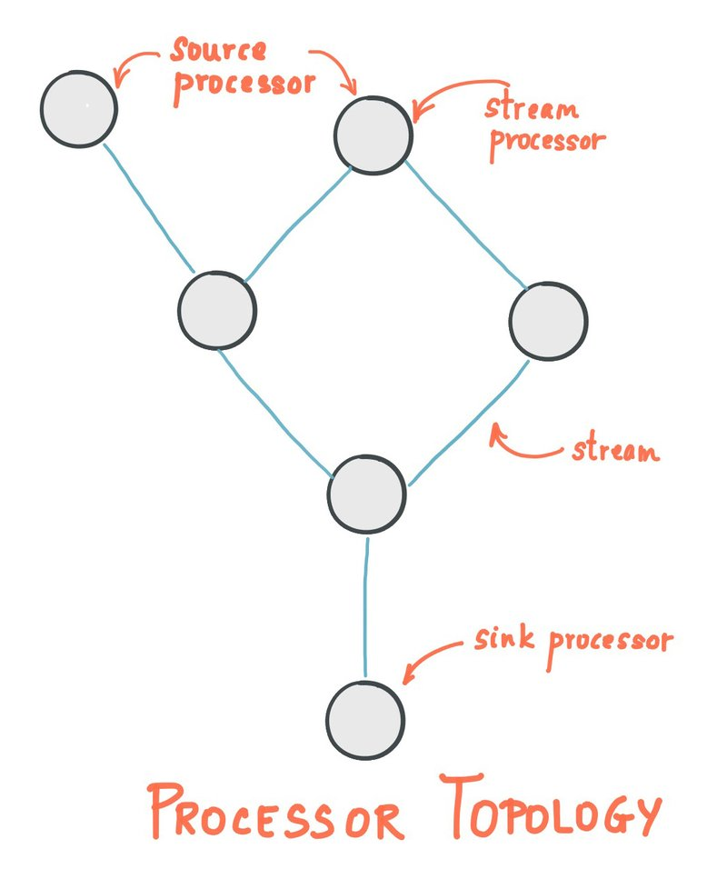
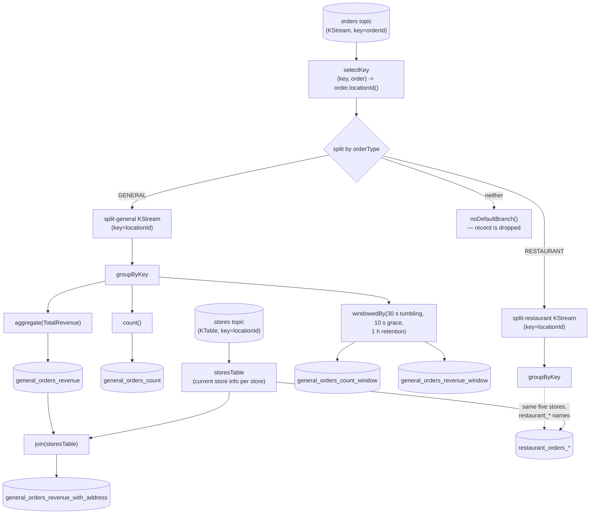

# <span style="color:hsl(69,80%,50%)">kafka-stream — Orders Count & Revenue Topology</span>

## <span style="color:hsl(139,80%,58%)">Table of contents</span>

1. 🧰 [Tech stack](#1-tech-stack)
2. 🏗️ [Modules](#2-modules)
3. 💡 [Why Kafka Streams — stream processing vs. request/reply](#3-why-kafka-streams--stream-processing-vs-requestreply)
4. 🔀 [The topology, end to end](#4-the-topology-end-to-end)
5. 🗃️ [The materialized state stores](#5-the-materialized-state-stores)
6. 🪟 [Windowed aggregations](#6-windowed-aggregations)
7. 🔗 [Joining revenue with the stores table](#7-joining-revenue-with-the-stores-table)
8. ⚠️ [Error handling: three handlers for three failure modes](#8-error-handling-three-handlers-for-three-failure-modes)
9. 🔍 [Interactive queries: `OrderStoreService` + `OrdersController`](#9-interactive-queries-orderstoreservice--orderscontroller)
10. ⚙️ [Configuration](#10-configuration)
11. 🚀 [Running](#11-running)
12. 🧪 [Tests](#12-tests)

This module is a Kafka Streams application (`orders-streams-app`, wired via Spring Kafka's [`@EnableKafkaStreams`][EnableKafkaStreams]) that continuously aggregates order counts and running revenue ***per store, per order type*** — all-time and ***per 30-second window*** — ***joins*** the revenue with each store's details, materializes everything into queryable local state stores, and exposes them over a REST API for interactive queries. It's the "derive live materialized views from an event stream" half of the repo, in contrast to the request/reply style of [`kafka-core`](../kafka-core/README.md).

For the broader repo architecture, see the [root README](../README.md).

---

<a id="1-tech-stack"></a>
## <span style="color:hsl(230,80%,58%)">1. 🧰 Tech stack</span>

| Piece | Version (as of 2026) | Used for |
|---|---|---|
| Spring Boot | 4.1.1 | app, REST API, Actuator (single default config, no profiles) |
| Spring Kafka | 4.1.1 | `@EnableKafkaStreams`, `StreamsBuilderFactoryBean`, `JacksonJsonSerde` |
| Kafka Streams | 4.2.x | topology, state stores (RocksDB), interactive queries |
| Kafka broker | the kafka-core cluster (`cp-kafka:8.3.2`, 3 brokers) | `orders`, `stores`, internal repartition/changelog topics |
| Logback | via Spring Boot | console + rolling file (`logback-spring.xml`) |
| Tests | `TopologyTestDriver`, `@EmbeddedKafka`, MockMvc | no Docker needed |

---

<a id="2-modules"></a>
## <span style="color:hsl(207,80%,58%)">2. 🏗️ Modules</span>

```
kafka-stream/
├── orders-domain/          Shared domain records (Order, Store, TotalRevenue, TotalRevenueWithAddress, DTOs) — plain JAR, no Spring Boot
└── orders-streams-app/     The topology + REST query API (port 8082)
```

`orders-domain` exists so the same `Order`/`Store`/`TotalRevenue` record shapes used by the topology's serdes are available to the test producers (`OrdersMockDataProducer`, `StoresMockDataProducer`) and the topology test without depending on the whole Spring Boot app.

---

<a id="3-why-kafka-streams--stream-processing-vs-requestreply"></a>
## <span style="color:hsl(344,80%,58%)">3. 💡 Why Kafka Streams — stream processing vs. request/reply</span>

`kafka-core`'s consumers react to one record at a time and write to a database on the side. Kafka Streams instead treats the topic itself as the source of truth and continuously folds it into ***state*** — a [`KTable`][KTable] or an aggregation result — that lives inside the application (backed by RocksDB by default, changelog-replicated to Kafka for fault tolerance) and can be queried directly, with no separate database. The core abstractions this topology uses:

- ***[`KStream<K, V>`][KStream]*** — an unbounded stream of independent records (the `orders` topic: every order is a distinct event).
- ***[`KTable<K, V>`][KTable]*** — a changelog view where a new record for the same key *replaces* the previous value (the `stores` topic: a store's contact/address info is current-state-per-store, not a stream of independent events).
- ***Aggregation*** (`count()`, `aggregate()`) — continuously folds a `KStream`, once `groupByKey`'d, into a running per-key result, materialized as a state store.
- ***Windowing*** (`windowedBy(TimeWindows...)`) — the same aggregation, but per key ***per time bucket***.
- ***Join*** — combines two tables (or a stream and a table) on their key, here revenue per store with the store's details.

---

<a id="4-the-topology-end-to-end"></a>
## <span style="color:hsl(122,80%,58%)">4. 🔀 The topology, end to end</span>

<p align="center">
  
</p>

<p align="center"><sub>A processor topology in general — sources, processors, sinks. Diagram: <a href="https://kafka.apache.org/documentation/streams/architecture">Kafka Streams architecture</a>, Apache-2.0.</sub></p>



Step by step, matching `orderTopology()` / `aggregateOrdersCountAndRevenue()`:

1. ***Consume `orders`*** as a [`KStream<String, Order>`][KStream] keyed by `orderId`, using a custom `OrderTimeStampExtractor` — instead of Kafka's default (the record's producer/broker timestamp), the stream time used for windowing is pulled from `Order.orderedDateTime()` itself (read as UTC; falling back to `partitionTime` if the field is missing). That makes "when did this happen" business time, not "when did it arrive".
2. ***`selectKey((key, order) -> order.locationId())`*** — re-keys every order by store location. This is a ***repartition***: Kafka Streams writes the re-keyed records to an internal repartition topic and re-reads them, because `groupByKey` and the join require records with the same key on the same partition.
3. ***Consume `stores`*** as a [`KTable<String, Store>`][KTable] — the current-state view of each store — with a debug `peek()` on its stream representation. It feeds the join (§7).
4. ***`split(...).branch(...).branch(...).noDefaultBranch()`*** — one `KStream` becomes two named branches, `split-general` and `split-restaurant`, by `order.orderType()`. `noDefaultBranch()` silently drops any other type.
5. ***`aggregateOrdersCountAndRevenue(...)`*** runs identically for each branch (the GoF Template Method referenced in the root README) and builds five stores per order type:
   - `groupByKey()` — required before any aggregation.
   - `.count()` → `<type>_orders_count` — running count per store.
   - `.aggregate(TotalRevenue::new, updateRunningRevenue)` → `<type>_orders_revenue` — folds `order.finalAmount()` into a running `TotalRevenue(locationId, runningOrderCount, runningRevenue)`.
   - `.windowedBy(30 s).count()` / `.aggregate(...)` → `<type>_orders_count_window` / `<type>_orders_revenue_window` (§6).
   - revenue table `.join(storesTable, TotalRevenueWithAddress::new)` → `<type>_orders_revenue_with_address` (§7).

---

<a id="5-the-materialized-state-stores"></a>
## <span style="color:hsl(259,80%,58%)">5. 🗃️ The materialized state stores</span>

Ten stores — five per order type:

| Store name (general / restaurant) | Constant | Type | Value |
|---|---|---|---|
| `general_orders_count` / `restaurant_orders_count` | `*_ORDERS_COUNT` | key-value | [`Long`][Long] — running count |
| `general_orders_revenue` / `restaurant_orders_revenue` | `*_ORDERS_REVENUE` | key-value | `TotalRevenue` — running count + running [`BigDecimal`][BigDecimal] revenue |
| `general_orders_count_window` / `restaurant_orders_count_window` | `*_ORDERS_COUNT_WINDOWS` | ***window*** | `Long` per store per 30 s window |
| `general_orders_revenue_window` / `restaurant_orders_revenue_window` | `*_ORDERS_REVENUE_WINDOWS` | ***window*** | `TotalRevenue` per store per 30 s window |
| `general_orders_revenue_with_address` / `restaurant_orders_revenue_with_address` | `*_ORDERS_REVENUE_WITH_ADDRESS` | key-value | `TotalRevenueWithAddress(totalRevenue, store)` |

Every store is backed by RocksDB on local disk (`state.dir`) and by a ***changelog topic*** in Kafka (`orders-kafka-streams-<store>-changelog`), so a restarted or moved instance rebuilds its state from Kafka.

---

<a id="6-windowed-aggregations"></a>
## <span style="color:hsl(37,80%,58%)">6. 🪟 Windowed aggregations</span>

```java
var windowed = grouped.windowedBy(TimeWindows.ofSizeAndGrace(WINDOW_SIZE, WINDOW_GRACE));   // 30 s, 10 s
windowed.count(Materialized.as(countWindowsStoreName).withRetention(WINDOW_RETENTION) ...);         // 1 h
windowed.aggregate(TotalRevenue::new, (key, order, agg) -> agg.updateRunningRevenue(key, order),
        Materialized.as(revenueWindowsStoreName).withRetention(WINDOW_RETENTION) ...);
```

- ***Tumbling windows*** — fixed 30 s buckets that don't overlap: `[11:27:00, 11:27:30)`, `[11:27:30, 11:28:00)`, … Each order counts in exactly one window.
- ***Event time*** — the bucket comes from `orderedDateTime` (the timestamp extractor), not from when the order arrived. Replaying old orders fills old windows.
- ***Grace period (10 s)*** — an order that arrives up to 10 s (in stream time) after its window ended still counts; later ones are dropped for that window. Stream time = the highest order time seen so far.
- ***Retention (1 hour)*** — a window store keeps windows only for its retention period, measured in stream time. The default is just ***window size + grace*** (40 s here — Kafka Streams' `WindowStoreMaterializer`), which would leave the endpoints showing the last window or two, so both window stores set `.withRetention(Duration.ofHours(1))`. Retention also bounds the store's changelog topic.
- ***Queried with a time range*** — `fetchAll(from, to)` returns the windows whose ***start*** lies in `[from, to]` (both inclusive); without a range, `all()` returns every retained window.

Real run — three `GENERAL` orders for `store_1234` at `:05`, `:12` and `:40` past the minute:

```
GET /v1/orders/windows/count/general
  orderCount=2  startWindow=2026-10-14T05:47:00  endWindow=2026-10-14T05:47:30
  orderCount=1  startWindow=2026-10-14T05:47:30  endWindow=2026-10-14T05:48:00

GET /v1/orders/windows/revenue/general
  2026-10-14T05:47:00  runningRevenue=20.0
  2026-10-14T05:47:30  runningRevenue=10.0
```

---

<a id="7-joining-revenue-with-the-stores-table"></a>
## <span style="color:hsl(18,80%,58%)">7. 🔗 Joining revenue with the stores table</span>

```java
revenueTable.join(storesTable, TotalRevenueWithAddress::new,
        Materialized.as(revenueWithAddressStoreName) ...);
```

- ***KTable–KTable inner join on `locationId`*** — whenever ***either*** side changes (a new order updates the revenue, or a store's details change), the joined row is recomputed. A store with revenue but no `stores` record has ***no*** joined row (inner join).
- ***Co-partitioning*** — both tables are keyed by `locationId` and their topics (the internal repartition topic of `orders`, and `stores`) have the same number of partitions and the same key hashing, so each join happens locally inside one task.
- ***Caching vs. latency*** — Kafka Streams caches KTables and only forwards updates ***downstream*** on commit — by default every ***30 s*** with at-least-once. The join sits downstream of the cached revenue table, so this app commits every ***1 s*** (`commit.interval.ms=1000` in `OrdersStreamsConfiguration`) and joined results appear within about a second. Queries on the aggregate stores themselves read through the cache and are always current.
- Real run: `GET /v1/orders/revenue/general/with-address` → `store_1234 City1 runningRevenue=30.0`.

---

<a id="8-error-handling-three-handlers-for-three-failure-modes"></a>
## <span style="color:hsl(174,80%,58%)">8. ⚠️ Error handling: three handlers for three failure modes</span>

Kafka Streams distinguishes deserialization errors, in-topology processing errors, and serialization errors — each has its own pluggable handler, configured in `OrdersStreamsConfiguration`:

| Failure mode | Handler | Configured behavior |
|---|---|---|
| A record fails to ***deserialize*** off `orders`/`stores` (bad bytes for the configured [`Serde`][Serde]) | [`RecoveringDeserializationExceptionHandler`][RecoveringDeserializationExceptionHandler] (Spring Kafka), delegating to a `logAndSkipRecoverer` lambda | Logs the record and exception, then skips it — the topology keeps running |
| Also present: `StreamsDeserializationErrorHandler` (a plain Kafka Streams [`DeserializationExceptionHandler`][DeserializationExceptionHandler]) | Counts errors via an [`AtomicInteger`][AtomicInteger]; returns `resume()` for the first 10 errors, then `fail()`; ***not registered*** — swap it in via `DESERIALIZATION_EXCEPTION_HANDLER_CLASS_CONFIG` to try it | A circuit-breaker-style variant: tolerate a bounded number of bad records, but stop tolerating a flood of them |
| A record fails during ***topology processing*** (uncaught exception in a stream operator) | `StreamsProcessorCustomErrorHandler` ([`StreamsUncaughtExceptionHandler`][StreamsUncaughtExceptionHandler], registered via [`StreamsBuilderFactoryBeanConfigurer`][StreamsBuilderFactoryBeanConfigurer] — the Decorator pattern noted in the root README) | If the exception is a [`StreamsException`][StreamsException] whose cause's message is exactly `"Transient Error"`, returns `REPLACE_THREAD` (Kafka Streams replaces the dead stream thread); any other exception returns `SHUTDOWN_APPLICATION` |
| A record fails to ***serialize*** or ***send*** to an output/changelog topic | `StreamsSerializationExceptionHandler` ([`ProductionExceptionHandler`][ProductionExceptionHandler], registered as `production.exception.handler`) | Always `RESUME` — logs and drops the record rather than killing the producer |

Note what this module does ***not*** do: unlike `events-consumer-a` / `-b` in `kafka-core` (which route unrecoverable records to `library-events.DLT`), no handler here publishes failed records to a dead-letter topic — every failure path is ***log-and-skip*** (or, for uncaught processing exceptions, possibly an application shutdown). For replay-able failed records, a [`DeadLetterPublishingRecoverer`][DeadLetterPublishingRecoverer]-equivalent for the Streams handlers would be the natural extension — see [`kafka-core/README.md`](../kafka-core/README.md) for the consumer-side version.

---

<a id="9-interactive-queries-orderstoreservice--orderscontroller"></a>
## <span style="color:hsl(312,80%,58%)">9. 🔍 Interactive queries: `OrderStoreService` + `OrdersController`</span>

Spring's [`StreamsBuilderFactoryBean`][StreamsBuilderFactoryBean] exposes the running [`KafkaStreams`][KafkaStreams] instance, and `OrderStoreService` uses `KafkaStreams.store(StoreQueryParameters...)` to read a named store ***directly*** from the local RocksDB — no round-trip through Kafka, no separate database.

| Endpoint | Backing store | Behavior |
|---|---|---|
| `GET /v1/orders/count/{orderType}` | `<type>_orders_count` | All stores' counts for that order type |
| `GET /v1/orders/count/{orderType}/location/{locationId}` | same | One store, `404` if absent |
| `GET /v1/orders/count/all` | both count stores | Every type, each row tagged with its type |
| `GET /v1/orders/revenue/{orderType}` | `<type>_orders_revenue` | All stores' running revenue |
| `GET /v1/orders/revenue/{orderType}/location/{locationId}` | same | One store, `404` if absent |
| `GET /v1/orders/revenue/{orderType}/with-address` | `<type>_orders_revenue_with_address` | Revenue joined with the store's address and contact (§7) |
| `GET /v1/orders/windows/count/{orderType}` | `<type>_orders_count_window` | Counts per store per 30 s window (§6) |
| `GET /v1/orders/windows/count` | both window count stores | Every type |
| `GET /v1/orders/windows/revenue/{orderType}` | `<type>_orders_revenue_window` | Revenue per store per window |

`{orderType}` is `general` or `restaurant` (case-insensitive). The window endpoints take optional `from_time` / `to_time` (ISO local date-time, UTC), e.g. `?from_time=2026-10-14T05:47:00&to_time=2026-10-14T05:48:00`.

***Errors*** (RFC 9457 problem details, `OrdersExceptionHandler`):

| Situation | Status |
|---|---|
| Unknown `orderType`, `from_time` after `to_time` | `400` (`IllegalArgumentException`) |
| `from_time` / `to_time` not a date-time | `400` (type mismatch) |
| Store not queryable yet — Kafka Streams starting or rebalancing (`InvalidStateStoreException`) | ***`503`*** with `retryAfterSeconds: 5` — it is a `StreamsException`, not an `IllegalStateException`, so it needs its own handler |
| `KafkaStreams` not created | `503` |

- ***Every store iterator is closed.*** `store.all()` / `fetchAll()` return a `KeyValueIterator` over native RocksDB memory; `OrderStoreService.collect()` drains it inside try-with-resources. (An earlier version wrapped it in a Java `Stream` with `onClose()` and never closed the stream, leaking one RocksDB iterator per request.)
- ***Strategy dispatch*** — `storeName(type, generalStore, restaurantStore)` picks the physical store from the `orderType`, so `OrdersController` never knows store names.
- ***Local state only.*** With more than one instance of `orders-streams-app`, each owns a subset of the partitions, and a query for a `locationId` owned by another instance finds nothing here. A full interactive-query deployment adds `application.server` plus `KafkaStreams.queryMetadataForKey()` to find the owning instance and forward the request (the `HostInfoDTO` record in `orders-domain` is a placeholder for that); it isn't implemented.

---

<a id="10-configuration"></a>
## <span style="color:hsl(89,80%,58%)">10. ⚙️ Configuration</span>

One default `application.yml`, no profiles:

| Property | Value | Notes |
|---|---|---|
| `spring.kafka.streams.bootstrap-servers` | `${KAFKA_BOOTSTRAP_SERVERS:localhost:9092}` | any broker of the kafka-core cluster |
| `spring.kafka.streams.application-id` | `orders-kafka-streams` | consumer group + prefix of internal topics |
| `spring.kafka.streams.state-dir` | unset (→ `<tmp>/kafka-streams`) | where RocksDB keeps the stores |
| `server.port` | `8082` | REST API + Actuator |

- ***`OrdersStreamsConfiguration` owns the Streams config.*** Its `KafkaStreamsConfiguration` bean replaces Boot's, so `spring.kafka.streams.properties.*` never reaches Kafka Streams — serdes (`String` defaults; records use `JacksonJsonSerde`), the exception handlers, `commit.interval.ms=1000` (§7), producer compression and `state.dir` are all set in that bean.
- ***zstd compression*** — `producer.compression.type=zstd` (`StreamsConfig.producerPrefix`) compresses everything Streams writes: repartition, changelog and output topics. Each batch is compressed in the producer, before it is sent; Streams' producer already lingers 100 ms, so batches fill. Checked with `kafka-dump-log`: new `general_orders_count` changelog and repartition batches are `compresscodec: zstd` (older ones `none`). How batch compression works: [kafka-core §25](../kafka-core/README.md#25-custom-partitioner-and-compression).
- ***Topics*** — `orders` and `stores` are declared as `NewTopic` beans with 2 partitions and the ***broker's default replication factor*** (3 on the kafka-core cluster). Internal repartition and changelog topics are created by Kafka Streams.
- ***Logging*** — `logback-spring.xml`: console + `logs/orders-kafka-streams.log` (daily/10 MB rolling, 7 days); `com.learnkafkastreams` at `DEBUG`, Kafka's config dumps at `WARN`.

---

<a id="11-running"></a>
## <span style="color:hsl(227,80%,58%)">11. 🚀 Running</span>

```bash
docker compose up -d                                              # from repo root: the kafka-core cluster (+ Prometheus, Grafana)
mvn spring-boot:run -pl kafka-stream/orders-streams-app            # port 8082
```

Feed it sample data with the test-scoped mock producers (`OrdersMockDataProducer`, `StoresMockDataProducer` under `src/test/java`, run their `main()`), or produce manually — the `stores` key and the order's `locationId` must match:

```bash
docker exec -i kafka-core-kafka-1 kafka-console-producer --bootstrap-server kafka-1:29092 --topic stores \
  --reader-property parse.key=true --reader-property key.separator=:
# store_1234:{"locationId":"store_1234","address":{"addressLine1":"1234 Street 1","addressLine2":"","city":"City1","state":"State1","zip":"12345"},"contactNum":"1234567890"}

docker exec -i kafka-core-kafka-1 kafka-console-producer --bootstrap-server kafka-1:29092 --topic orders \
  --reader-property parse.key=true --reader-property key.separator=:
# 12345:{"orderId":12345,"locationId":"store_1234","finalAmount":27.00,"orderType":"GENERAL","orderLineItems":[{"item":"Bananas","count":2,"amount":2.00}],"orderedDateTime":"2026-10-14T05:47:05"}
```

Then query:

```bash
curl localhost:8082/v1/orders/count/general
curl localhost:8082/v1/orders/revenue/general/location/store_1234
curl localhost:8082/v1/orders/revenue/general/with-address
curl localhost:8082/v1/orders/windows/count/general
curl 'localhost:8082/v1/orders/windows/count?from_time=2026-10-14T05:47:00&to_time=2026-10-14T05:48:00'
curl localhost:8082/v1/orders/count/all
```

The repo's [`insomnia-collection.json`](../insomnia-collection.json) has all of these in its *Kafka Streams* folder. Example responses for each endpoint are in `orders-streams-app/src/main/resources/data/` (`01-orders-count.json` … `06-orders-revenue-windows.json`).

---

<a id="12-tests"></a>
## <span style="color:hsl(165,80%,58%)">12. 🧪 Tests</span>

```bash
mvn test -pl kafka-stream/orders-streams-app        # 21 tests, no Docker
```

- ***`OrdersTopologyTest`*** (9) — [`TopologyTestDriver`][TopologyTestDriver], no broker, no Spring: counts and revenue per type and store; accumulation across orders for the same store (`count()`/`aggregate()`, not last-value-wins); ***windowed count*** (orders at `:01` and `:29` share a window, `:31` starts the next); ***windowed revenue***; ***window retention*** (a window is still there after 30 minutes of stream time — the 40 s default would have dropped it); ***the join*** (a store with a `stores` record gets a joined row with its city, one without gets none).
- ***`OrdersControllerTest`*** (7) — MockMvc against a mocked `OrderStoreService`: routing, `404` for an unknown store, `400` problem detail for an unknown type, ***`503`*** for `InvalidStateStoreException`, `from_time`/`to_time` binding, `400` for a bad date-time.
- ***`OrdersTopologyIntegrationTest`*** (2) — [`@EmbeddedKafka`][EmbeddedKafka] and the real Spring-managed [`StreamsBuilderFactoryBean`][StreamsBuilderFactoryBean]: counts and revenue, and ***windows and the join queried through `OrderStoreService`***. Each test context gets its own `state.dir`, because every context (`@DirtiesContext`) also gets a new embedded broker.
- ***`OrdersStreamsConfigurationTest`*** (3) — the exception handlers are registered; the Streams producer resolves `compression.type=zstd`; a serialization failure is skipped, not fatal.

<!-- Library classes mentioned above, linked to their source at the versions this project builds with. -->

[AtomicInteger]: https://github.com/openjdk/jdk/blob/jdk-27-ga/src/java.base/share/classes/java/util/concurrent/atomic/AtomicInteger.java
[BigDecimal]: https://github.com/openjdk/jdk/blob/jdk-27-ga/src/java.base/share/classes/java/math/BigDecimal.java
[DeadLetterPublishingRecoverer]: https://github.com/spring-projects/spring-kafka/blob/v4.1.1/spring-kafka/src/main/java/org/springframework/kafka/listener/DeadLetterPublishingRecoverer.java
[DeserializationExceptionHandler]: https://github.com/apache/kafka/blob/4.2.1/streams/src/main/java/org/apache/kafka/streams/errors/DeserializationExceptionHandler.java
[EmbeddedKafka]: https://github.com/spring-projects/spring-kafka/blob/v4.1.1/spring-kafka-test/src/main/java/org/springframework/kafka/test/context/EmbeddedKafka.java
[EnableKafkaStreams]: https://github.com/spring-projects/spring-kafka/blob/v4.1.1/spring-kafka/src/main/java/org/springframework/kafka/annotation/EnableKafkaStreams.java
[KafkaStreams]: https://github.com/apache/kafka/blob/4.2.1/streams/src/main/java/org/apache/kafka/streams/KafkaStreams.java
[KStream]: https://github.com/apache/kafka/blob/4.2.1/streams/src/main/java/org/apache/kafka/streams/kstream/KStream.java
[KTable]: https://github.com/apache/kafka/blob/4.2.1/streams/src/main/java/org/apache/kafka/streams/kstream/KTable.java
[Long]: https://github.com/openjdk/jdk/blob/jdk-27-ga/src/java.base/share/classes/java/lang/Long.java
[ProductionExceptionHandler]: https://github.com/apache/kafka/blob/4.2.1/streams/src/main/java/org/apache/kafka/streams/errors/ProductionExceptionHandler.java
[RecoveringDeserializationExceptionHandler]: https://github.com/spring-projects/spring-kafka/blob/v4.1.1/spring-kafka/src/main/java/org/springframework/kafka/streams/RecoveringDeserializationExceptionHandler.java
[Serde]: https://github.com/apache/kafka/blob/4.2.1/clients/src/main/java/org/apache/kafka/common/serialization/Serde.java
[StreamsBuilderFactoryBean]: https://github.com/spring-projects/spring-kafka/blob/v4.1.1/spring-kafka/src/main/java/org/springframework/kafka/config/StreamsBuilderFactoryBean.java
[StreamsBuilderFactoryBeanConfigurer]: https://github.com/spring-projects/spring-kafka/blob/v4.1.1/spring-kafka/src/main/java/org/springframework/kafka/config/StreamsBuilderFactoryBeanConfigurer.java
[StreamsException]: https://github.com/apache/kafka/blob/4.2.1/streams/src/main/java/org/apache/kafka/streams/errors/StreamsException.java
[StreamsUncaughtExceptionHandler]: https://github.com/apache/kafka/blob/4.2.1/streams/src/main/java/org/apache/kafka/streams/errors/StreamsUncaughtExceptionHandler.java
[TopologyTestDriver]: https://github.com/apache/kafka/blob/4.2.1/streams/test-utils/src/main/java/org/apache/kafka/streams/TopologyTestDriver.java
